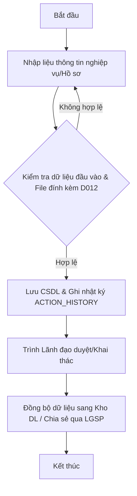

# TÀI LIỆU PHÂN TÍCH YÊU CẦU NGƯỜI SỬ DỤNG (SRS)

**Dự án**: Xây dựng Cơ sở dữ liệu Hợp tác quốc tế về pháp luật và tư pháp - Bộ Tư pháp
**Mã dự án**: CSDLHTQT
**Mẫu tài liệu**: BM_01 (Chuẩn đặc tả SRS)
**Phiên bản**: 2.0 (Bản cập nhật sau Solution Gate)
**Ngày lập**: 2026-10-03

---

## BẢNG GHI NHẬN THAY ĐỔI TÀI LIỆU

| Phiên bản | Ngày | Tác giả | Mô tả thay đổi | Trạng thái |
|---|---|---|---|---|
| 1.0 | 03/10/2026 | BA Team / Orchestrator | Bản sơ bộ sau Requirement Gate | Đã duyệt (PASS) |
| 2.0 | 03/10/2026 | BA Team / Orchestrator | Bản cập nhật bổ sung Use Cases, Flow, API, DB & Traceability sau Solution Gate | Đã duyệt (PASS) |

---

## TRANG KÝ DUYỆT

| Đại diện Bên yêu cầu (Vụ HTQT) | Đại diện Quản lý CNTT (Cục CNTT) | Đại diện Đội ngũ Phân tích & Thiết kế |
|---|---|---|
| (Ký và ghi rõ họ tên) | (Ký và ghi rõ họ tên) | (Ký và ghi rõ họ tên) |

---

### 1. GIỚI THIỆU

#### 1.1 Mục đích tài liệu
Tài liệu Đặc tả Yêu cầu Người sử dụng (SRS) này được lập nhằm mục đích thống nhất toàn bộ các yêu cầu nghiệp vụ, yêu cầu chức năng, yêu cầu phi chức năng, tiêu chuẩn nghiệm thu và ma trận truy vết cho hệ thống CSDL Hợp tác quốc tế Bộ Tư pháp. Tài liệu là căn cứ pháp lý và kỹ thuật cho đội ngũ phát triển (Dev), kiểm thử (QA/QC), quản trị CSDL (DBA) và đối tác triển khai.

#### 1.2 Phạm vi tài liệu
Tài liệu bao gồm toàn bộ 89 chức năng nghiệp vụ thuộc 2 ứng dụng lớn (Web Admin Quản trị hệ thống và Web Portal Cổng thông tin điện tử) cùng 6 phân hệ chức năng:
1. Quản trị hệ thống & Quản lý cấu hình chung.
2. Truy cập & Quản lý tài khoản.
3. Quản lý nghiệp vụ Hợp tác quốc tế (Điều ước, Thỏa thuận, Chuyên gia, Khen thưởng, Hội nghị/Hội thảo, Chương trình/Dự án, Đề án pháp luật, Hoạt động khác, Đoàn ra/Đoàn vào, Báo cáo kinh nghiệm).
4. Quản lý dữ liệu đồng bộ & Danh mục hệ thống.
5. Quản lý Báo cáo thống kê.
6. Tích hợp liên thông chia sẻ dữ liệu qua LGSP & Kho dữ liệu dùng chung.

#### 1.3 Định nghĩa thuật ngữ và từ viết tắt
- **BTP**: Bộ Tư pháp.
- **Vụ HTQT**: Vụ Hợp tác quốc tế - Bộ Tư pháp.
- **CSDL**: Cơ sở dữ liệu.
- **LGSP**: Local Government Service Platform (Nền tảng kết nối chia sẻ dữ liệu Bộ Tư pháp).
- **VNeID**: Hệ thống định danh và xác thực điện tử quốc gia.
- **SSO**: Single Sign-On (Đăng nhập một lần).
- **RBAC**: Role-Based Access Control (Phân quyền theo vai trò).
- **NFR**: Non-Functional Requirement (Yêu cầu phi chức năng).
- **AC**: Acceptance Criteria (Tiêu chí chấp nhận/nghiệm thu).

#### 1.4 Tài liệu tham khảo
1. "Dự án xây dựng CSDL Hợp tác quốc tế.xlsx" (Danh mục chức năng DSCN & TKCT_final).
2. "CSDLHTQT_Thiết kế CSDL.xlsx" (Cấu trúc 23 bảng CSDL).
3. "CSDL HTQT_Quy định dùng chung.xlsx" (Quy định UI/UX D012 - D018 và quy định dữ liệu).
4. Thiết kế Giao diện Figma CSDL Hợp tác quốc tế Bộ Tư pháp.
5. Luật Điều ước quốc tế 2016 & Pháp lệnh Thỏa thuận quốc tế 2020.

#### 1.5 Mô tả tài liệu
Tài liệu được cấu trúc làm 7 mục chính theo đúng Mẫu BM_01:
- Mục 1: Giới thiệu chung.
- Mục 2: Tổng quan về hệ thống.
- Mục 3: Thống nhất yêu cầu chức năng/nghiệp vụ (Bao gồm 89 FRs, luồng quy trình, chi tiết 89 chức năng và quy tắc nghiệp vụ).
- Mục 4: Yêu cầu phi chức năng và ràng buộc (Đủ 13 mục con 4.1 - 4.13).
- Mục 5: Tiêu chuẩn nghiệm thu hệ thống (AC).
- Mục 6: Ma trận truy vết yêu cầu (Traceability Matrix).
- Mục 7: Phụ lục.

---

### 2. TỔNG QUAN VỀ HỆ THỐNG

#### 2.1 Phát biểu bài toán
Công tác quản lý thông tin hợp tác quốc tế về pháp luật và tư pháp hiện chưa có hệ thống CSDL tập trung chuyên ngành, việc theo dõi các thỏa thuận/điều ước, tiến độ chương trình dự án và tổng hợp báo cáo thủ công qua Excel gây tốn nhiều thời gian và thiếu tính đồng bộ.

#### 2.2 Mục tiêu hệ thống
- Xây dựng CSDL tập trung 23 bảng dữ liệu quản lý toàn diện các hoạt động hợp tác quốc tế.
- Cung cấp giao diện Web Admin và Web Portal responsive chạy mượt mà trên Desktop, Tablet và Mobile browser.
- Tích hợp tự động qua LGSP và Kho dữ liệu dùng chung Bộ Tư pháp.

#### 2.3 Phạm vi hệ thống

##### 2.3.1 Danh sách nhóm người sử dụng

| STT | Nhóm người dùng | Mô tả vai trò | Số lượng dự kiến |
|---|---|---|---|
| 1 | Quản trị hệ thống | Quản trị kỹ thuật, phân quyền, cấu hình hệ thống, theo dõi log | 3 - 5 người |
| 2 | Lãnh đạo Bộ / Lãnh đạo Vụ | Chỉ đạo, xem dashboard tổng quan, duyệt báo cáo | 10 - 20 người |
| 3 | Chuyên viên nhập liệu & khai thác | Nhập dữ liệu nghiệp vụ, tra cứu, xuất báo cáo | 50 - 100 người |
| 4 | Cán bộ / Công chức Bộ Tư pháp | Tra cứu thông tin hợp tác quốc tế công khai | 500+ người |
| 5 | Hệ thống ngoài (LGSP, Kho DL, VNeID) | Tích hợp liên thông chia sẻ dữ liệu tự động | Hệ thống tự động |

##### 2.3.2 Mô hình tổng thể hệ thống
Hệ thống gồm 2 phân hệ ứng dụng lớn:
1. **Ứng dụng Web dành cho Quản trị hệ thống & Nghiệp vụ nội bộ (Web Admin)**: Xử lý quy trình quản trị, phân quyền, quản lý chi tiết 10 mảng nghiệp vụ HTQT, quản lý danh mục và báo cáo thống kê.
2. **Cổng thông tin điện tử CSDL Hợp tác quốc tế (Web Portal)**: Phục vụ tra cứu công khai thông tin điều ước, thỏa thuận, chuyên gia, hội thảo, chia sẻ dữ liệu qua LGSP.

---

### 3. THỐNG NHẤT YÊU CẦU CHỨC NĂNG/NGHIỆP VỤ

#### 3.1 Danh mục quy trình/chức năng/phân hệ

| Mã | Phân hệ | Quy trình/Chức năng | Mô tả ngắn | Actor | Ưu tiên |
|---|---|---|---|---|---|
| FR-UC-01 | I. Quản trị hệ thống -  | Quản lý vai trò | Quản trị hệ thống nhập điều kiện tìm kiếm vai trò và chọn tìm kiếm. Hệ thống hiển thị kết quả vai trò theo các tiêu chí đã nhập. ;  Quản trị hệ thống thực hiện thêm mới thông tin vai trò. ;  Quản trị hệ thống thực hiện chỉnh sửa thông tin vai trò. Hệ thống kiểm tra tính hợp lệ của dữ liệu, nếu hợp lệ thì cập nhật vào CSDL và hiển thị kết quả, nếu không hợp lệ báo lỗi cụ thể. ;  Quản trị hệ thống thực hiện thiết lập quyền cho vai trò. Hệ thống lưu thiết lập quyền và hiển thị kết quả. ;  Quản trị hệ thống thực hiện xóa vai trò. Hệ thống kiểm tra tính hợp lệ và nếu hợp lệ thực hiện xóa, nếu không hợp lệ hiển thị lỗi cụ thể. ;  Quản trị hệ thống chọn chức năng khóa/mở khóa vai trò. Hệ thống thực hiện khóa vai trò và hiển thị kết quả. ;  Quản trị hệ thống thực hiện import danh sách vai trò. Hệ thống kiểm tra tính hợp lệ của dữ liệu, nếu hợp lệ thì cập nhật vào CSDL và hiển thị kết quả, nếu không hợp lệ báo lỗi cụ thể. | Quản trị hệ thống | Cao |
| FR-UC-02 | I. Quản trị hệ thống -  | Quản lý phân quyền | Quản trị hệ thống nhập điều kiện tìm kiếm quyền và chọn tìm kiếm. Hệ thống hiển thị kết quả thông tin quyền theo các tiêu chí đã nhập. ;  Quản trị hệ thống thực hiện thêm mới thông tin quyền. Hệ thống kiểm tra tính hợp lệ của dữ liệu, nếu hợp lệ thì lưu vào CSDL và hiển thị kết quả, nếu không hợp lệ báo lỗi cụ thể. ;  Quản trị hệ thống thực hiện chỉnh sửa thông tin quyền. Hệ thống kiểm tra tính hợp lệ của dữ liệu, nếu hợp lệ thì cập nhật vào CSDL và hiển thị kết quả, nếu không hợp lệ báo lỗi cụ thể. ;  Quản trị hệ thống thực hiện xóa thông tin quyền. Hệ thống kiểm tra tính hợp lệ và nếu hợp lệ thực hiện xóa, nếu không hợp lệ hiển thị lỗi cụ thể. ;  Quản trị hệ thống chọn chức năng khóa./mở khóa quyền. Hệ thống thực hiện khóa quyền và hiển thị kết quả. ;  Quản trị hệ thống thực hiện import danh sách quyền. Hệ thống kiểm tra tính hợp lệ của dữ liệu, nếu hợp lệ thì cập nhật vào CSDL và hiển thị kết quả, nếu không hợp lệ báo lỗi cụ thể. | Quản trị hệ thống | Cao |
| FR-UC-03 | I. Quản trị hệ thống -  | Quản lý người dùng | Quản trị hệ thống nhập điều kiện tìm kiếm người dùng và chọn tìm kiếm. Hệ thống hiển thị kết quả danh sách người dùng theo các tiêu chí đã nhập. ;  Quản trị hệ thống chọn xem danh sách thông tin người dùng. Hệ thống hiển thị danh sách thông tin người dùng. ;  Quản trị hệ thống thực hiện gán/bỏ gán vai trò cho người dùng. Hệ thống lưu thông tin gán vai trò và hiển thị kết quả. | Quản trị hệ thống | Cao |
| FR-UC-04 | I. Quản trị hệ thống -  | Quản lý đơn vị | Quản trị hệ thống xem danh sách đơn vị; Hệ thống hiển thị thông tin danh sách đơn vị ;  Quản trị hệ thống tìm kiếm đơn vị; Hệ thống truy vấn dữ liệu và hiển thị kết quả thông tin đơn vị tương ứng với điều kiện tìm kiếm ;  Quản trị hệ thống xem chi tiết nội dung một đơn vị; Hệ thống hiển thị thông tin chi tiết của đơn vị | Quản trị hệ thống | Cao |
| FR-UC-05 | I. Quản trị hệ thống - II. Quản lý cấu hình chung | Quản lý cấu hình thông báo | Quản trị hệ thống tìm kiếm cấu hình thông báo. Hệ thống hiển thị kết quả theo tiêu chí đã chọn ;  Quản trị hệ thống thêm mới cấu hình thông báo. Hệ thống kiểm tra thông tin, nếu hợp lệ thì lưu vào CSDL, nếu không hợp lệ thì thông báo lỗi ;  Quản trị hệ thống chỉnh sửa cấu hình thông báo. Hệ thống kiểm tra thông tin, nếu hợp lệ thì lưu vào CSDL, nếu không hợp lệ thì thông báo lỗi ;  Quản trị hệ thống xoá cấu hình thông báo. Hệ thống kiểm tra thông tin, nếu hợp lệ thì lưu vào CSDL, nếu không hợp lệ thì thông báo lỗi ;  Quản trị hệ thống khoá/mở khóa cấu hình thông báo. Hệ thống kiểm tra thông tin, nếu hợp lệ thì lưu vào CSDL, nếu không hợp lệ thì thông báo lỗi | Quản trị hệ thống | Cao |
| FR-UC-06 | I. Quản trị hệ thống - II. Quản lý cấu hình chung | Quản lý lịch sử tác động | Quản trị hệ thống thực hiện tìm kiếm lịch sử tác động. Hệ thống hiển thị kết quả theo tiêu chí đã nhập ;  Quản trị hệ thống xem chi tiết lịch sử tác động. Hệ thống hiển thị chi tiết thông tin ;  Quản trị hệ thống xuất file danh sách lịch sử tác động. Hệ thống xuất file lịch sử tác động và cho phép người dùng lưu về máy. | Quản trị hệ thống | Cao |
| FR-UC-07 | I. Quản trị hệ thống - II. Quản lý cấu hình chung | Quản lý lịch sử lỗi phát sinh | Quản trị hệ thống thực hiện tìm kiếm lỗi phát sinh. Hệ thống hiển thị kết quả theo tiêu chí đã nhập ;  Quản trị hệ thống xem chi tiết lịch sử lỗi phát sinh. Hệ thống hiển thị chi tiết thông tin ;  Quản trị hệ thống xuất file danh sách lịch sử lỗi phát sinh. Hệ thống xuất file lịch sử lỗi phát sinh và cho phép Quản trị hệ thống lưu về máy. | Quản trị hệ thống | Cao |
| FR-UC-08 | I. Quản trị hệ thống - II. Quản lý cấu hình chung | Quản lý chính sách lưu trữ nhật ký tác động hệ thống | Quản trị hệ thống thực hiện tìm kiếm chính sách. Hệ thống trả về kết quả tìm kiếm theo các tiêu chí Quản trị hệ thống đã chọn. ;  Quản trị hệ thống thực hiện thêm mới chính sách lưu trữ nhật ký tác động hệ thống. Hệ thống kiểm tra thông tin, nếu hợp lệ thì lưu vào CSDL, nếu không hợp lệ thì thông báo lỗi cho Quản trị hệ thống. ;  Quản trị hệ thống thực hiện chỉnh sửa chính sách lưu trữ nhật ký tác động hệ thống. Hệ thống kiểm tra thông tin, nếu hợp lệ thì lưu vào CSDL, nếu không hợp lệ thì thông báo lỗi cho Quản trị hệ thống. ;  Quản trị hệ thống thực hiện xoá chính sách lưu trữ nhật ký tác động hệ thống. Hệ thống kiểm tra thông tin, nếu hợp lệ thì lưu vào CSDL, nếu không hợp lệ thì thông báo lỗi cho Quản trị hệ thống. ;  Quản trị hệ thống chọn chính sách cần khóa/mở khóa và nhấn Khóa chính sách. Hệ thống thực hiện khóa chính sách đã chọn. | Quản trị hệ thống | Cao |
| FR-UC-09 | I. Quản trị hệ thống - II. Quản lý cấu hình chung | Lưu log hệ thống | Người dùng truy cập Phần mềm. Hệ thống thực hiện kiểm tra chính sách lưu trữ nhật ký tác động hệ thống, nếu tác động của người dùng nằm trong danh sách các tác động cần lưu nhật ký hệ thống theo chính sách đã thiết lập, hệ thống thực hiện lưu nhật ký tác động. ;  Quản trị hệ thống đăng nhập khi quản trị Phần mềm. Hệ thống thực hiện kiểm tra chính sách lưu trữ nhật ký tác động hệ thống, nếu tác động của người dùng nằm trong danh sách các tác động cần lưu nhật ký hệ thống theo chính sách đã thiết lập, hệ thống thực hiện lưu nhật ký tác động. ;  Người dùng thực hiện các thao tác tác động vào hệ thống. Hệ thống thực hiện kiểm tra chính sách lưu trữ nhật ký tác động hệ thống, nếu tác động của người dùng nằm trong danh sách các tác động cần lưu nhật ký hệ thống theo chính sách đã thiết lập, hệ thống thực hiện lưu nhật ký tác động. ;  Người dùng thực hiện các chức năng quản lý tài khoản. Hệ thống thực hiện kiểm tra chính sách lưu trữ nhật ký tác động hệ thống, nếu tác động của người dùng nằm trong danh sách các tác động cần lưu nhật ký hệ thống theo chính sách đã thiết lập, hệ thống thực hiện lưu nhật ký tác động. ;  Quản trị hệ thống thực hiện thay đổi cấu hình Phần mềm. Hệ thống thực hiện kiểm tra chính sách lưu trữ nhật ký tác động hệ thống, nếu tác động của người dùng nằm trong danh sách các tác động cần lưu nhật ký hệ thống theo chính sách đã thiết lập, hệ thống thực hiện lưu nhật ký tác động. | Quản trị hệ thống | Cao |
| FR-UC-10 | I. Quản trị hệ thống - II. Quản lý cấu hình chung | Gửi thông tin log tác động/log lỗi phát sinh | Nền tảng LGSP kiểm tra kết nối gửi thông tin log tác động/log lỗi phát sinh. Hệ thống nhận kết quả kiểm tra kết nối nếu hợp lệ thì cho phép kết nối, nếu không hợp lệ thì thông báo lại cho nền tảng LGSP ;  Nền tảng LGSP thực hiện kết nối với API gửi thông tin log tác động/log lỗi phát sinh. Hệ thống nhận thông báo kết quả kết nối . | Nền tảng kết nối chia sẻ của Bộ Tư pháp (LGSP) | Cao |
| FR-UC-11 | I. Quản trị hệ thống - II. Quản lý cấu hình chung | Thiết lập chính sách sao lưu dự phòng | Quản trị hệ thống truy cập chức năng thiết lập chính sách sao lưu dự phòng. Hệ thống hiển thị màn hình tương ứng ;  Quản trị hệ thống nhập các tham số thiết lập chính sách và thực hiện lưu. Hệ thống kiểm tra, nếu hợp lệ thì lưu dữ liệu và thông báo thiết lập thành công, nếu không hợp lệ báo lỗi cụ thể ;  Quản trị hệ thống cấu hình khôi phục dữ liệu. Hệ thống kiểm tra thông tin, nếu hợp lệ thì lưu vào CSDL, nếu không hợp lệ thì thông báo cho người dùng | Quản trị hệ thống | Cao |
| FR-UC-12 | B. TRUY CẬP VÀ QUẢN LÝ TÀI KHOẢN - II. Quản lý cấu hình chung | Đăng xuất | Chuyên viên nhập liệu/chuyên viên khai thác/lãnh đạo/Quản trị hệ thống chọn đăng xuất khỏi hệ thống. Hệ thống gửi yêu cầu đăng xuất sang Nền tảng định danh và xác thực điện tử ;  Nền tảng định danh và xác thực điện tử kiểm tra yêu cầu, nếu hợp lệ thì thực hiện đăng xuất khỏi hệ thống, nếu không hợp lệ thì thông báo lỗi | Chuyên viên nhập liệu/chuyên viên khai thác/lãnh đạo/Quản trị hệ thống | Cao |
| FR-UC-13 | B. TRUY CẬP VÀ QUẢN LÝ TÀI KHOẢN - II. Quản lý cấu hình chung | Xem thông tin cá nhân | Chuyên viên nhập liệu/chuyên viên khai thác/lãnh đạo/Quản trị hệ thống vào xem thông tin cá nhân, hệ thống hiển thị màn hình thông tin cơ bản ;  Chuyên viên nhập liệu/chuyên viên khai thác/lãnh đạo/Quản trị hệ thống yêu cầu xem chi tiết thông tin cá nhân. Hệ thống hiển thị chi tiết thông tin cá nhân | Chuyên viên nhập liệu/chuyên viên khai thác/lãnh đạo/Quản trị hệ thống | Cao |
| FR-UC-14 | B. TRUY CẬP VÀ QUẢN LÝ TÀI KHOẢN - II. Quản lý cấu hình chung | Xem tài liệu hướng dẫn sử dụng | Chuyên viên nhập liệu/chuyên viên khai thác/lãnh đạo chọn xem chi tiết file hướng dẫn sử dụng. Hệ thống thực hiện mở file hướng dẫn. ;  Chuyên viên nhập liệu/chuyên viên khai thác/Lãnh đạo thực hiện tải xuống file hướng dẫn sử dụng. Hệ thống thực hiện tải xuống file hướng dẫn. | Chuyên viên nhập liệu/chuyên viên khai thác/lãnh đạo | Cao |
| FR-UC-15 | I. Quản lý dashboard - II. Quản lý cấu hình chung | Xem biểu đồ thống kê điều ước quốc tế, thỏa thuận quốc tế | Công dân, tổ chức ngoài/chuyên viên nhập liệu/chuyên viên khai thác/Lãnh đạo/Quản trị hệ thống truy cập vào dasboard. Hệ thống hiển thị biểu đồ thống kê điều ước quốc tế, thỏa thuận quốc tế ;  Công dân, tổ chức ngoài/chuyên viên nhập liệu/chuyên viên khai thác/Lãnh đạo/Quản trị hệ thống thực hiện lọc dữ liệu. Hệ thống xử lý yêu cầu lọc của người dùng và hiển thị thông tin thống kê điều ước quốc tế, thỏa thuận quốc tế với dữ liệu mới. ;  Công dân, tổ chức ngoài/chuyên viên nhập liệu/chuyên viên khai thác/Lãnh đạo/Quản trị hệ thống yêu cầu xem chi tiết các đối tượng trong một phần của biểu đồ. Hệ thống trả về thông tin chi tiết điều ước quốc tế, thỏa thuận quốc tế tương ứng. | Công dân, tổ chức ngoài/chuyên viên nhập liệu/chuyên viên khai thác/lãnh đạo/Quản trị hệ thống | Cao |
| FR-UC-16 | I. Quản lý dashboard - II. Quản lý cấu hình chung | Xem biểu đồ thống kê chương trình dự án | Công dân, tổ chức ngoài/chuyên viên nhập liệu/chuyên viên khai thác/Lãnh đạo/Quản trị hệ thống truy cập vào dasboard. Hệ thống hiển thị biểu đồ thống kê chương trình dự án ;  Công dân, tổ chức ngoài/chuyên viên nhập liệu/chuyên viên khai thác/Lãnh đạo/Quản trị hệ thống thực hiện lọc dữ liệu. Hệ thống xử lý yêu cầu lọc của người dùng và hiển thị thông tin thống kê chương trình dự án với dữ liệu mới. ;  Công dân, tổ chức ngoài/chuyên viên nhập liệu/chuyên viên khai thác/Lãnh đạo/Quản trị hệ thống yêu cầu xem chi tiết các đối tượng trong một phần của biểu đồ. Hệ thống trả về thông tin chi tiết chương trình dự án tương ứng. | Công dân, tổ chức ngoài/chuyên viên nhập liệu/chuyên viên khai thác/lãnh đạo/Quản trị hệ thống | Cao |
| FR-UC-17 | I. Quản lý dashboard - II. Quản lý cấu hình chung | Thống kê danh sách hội thảo | Công dân, tổ chức ngoài/chuyên viên nhập liệu/chuyên viên khai thác/Lãnh đạo/Quản trị hệ thống thực hiện xem danh sách hội thảo. Hệ thống hiển thị danh sách hội thảo. ;  Công dân, tổ chức ngoài/chuyên viên nhập liệu/chuyên viên khai thác/Lãnh đạo/Quản trị hệ thống nhập điều kiện tìm kiếm nhanh hội thảo và chọn tìm kiếm. Hệ thống hiển thị kết quả danh sách hội thảo theo các tiêu chí đã nhập. ;  Công dân, tổ chức ngoài/chuyên viên nhập liệu/chuyên viên khai thác/Lãnh đạo/Quản trị hệ thống chọn xem chi tiết thông tin hội thảo. Hệ thống hiển thị chi tiết thông tin hội thảo. | Công dân, tổ chức ngoài/chuyên viên nhập liệu/chuyên viên khai thác/lãnh đạo/Quản trị hệ thống | Cao |
| FR-UC-18 | I. Quản lý dashboard - II. Quản lý cấu hình chung | Xem thông báo | Chuyên viên nhập liệu/chuyên viên khai thác/lãnh đạo/quản trị hệ thống truy cập hệ thống để xem thông báo. Hệ thống hiển thị số lượng và danh sách thông báo tại màn hình trang chủ ;  Chuyên viên nhập liệu/chuyên viên khai thác/lãnh đạo/Quản trị hệ thống xem chi tiết thông báo. Hệ thống hiển thị màn hình chi tiết thông báo | Chuyên viên nhập liệu/chuyên viên khai thác/lãnh đạo/Quản trị hệ thống | Cao |
| FR-UC-19 | I. Quản lý dashboard - II. Quản lý cấu hình chung | Quản lý điều ước quốc tế | Công dân, tổ chức ngoài/chuyên viên nhập liệu/chuyên viên khai thác/Lãnh đạo nhập điều kiện tìm kiếm điều ước quốc tế và chọn tìm kiếm. Hệ thống hiển thị kết quả danh sách điều ước quốc tế theo các tiêu chí đã nhập. ;  Công dân, tổ chức ngoài/chuyên viên nhập liệu/chuyên viên khai thác/Lãnh đạo chọn xem chi tiết điều ước quốc tế. Hệ thống hiển thị đầy đủ thông tin chi tiết của điều ước quốc tế được chọn. ;  Công dân, tổ chức ngoài/chuyên viên nhập liệu/chuyên viên khai thác/Lãnh đạo chọn xem chi tiết file đính kèm về điều ước quốc tế. Hệ thống thực hiện mở/tải về file đính kèm . ;  Chuyên viên nhập liệu/lãnh đạo thực hiện thêm mới điều ước quốc tế. Hệ thống kiểm tra tính hợp lệ của dữ liệu, nếu hợp lệ thì lưu vào CSDL và hiển thị kết quả, nếu không hợp lệ báo lỗi cụ thể. ;  Chuyên viên nhập liệu/lãnh đạo thực hiện chỉnh sửa điều ước quốc tế. Hệ thống kiểm tra tính hợp lệ của dữ liệu, nếu hợp lệ thì cập nhật vào CSDL và hiển thị kết quả, nếu không hợp lệ báo lỗi cụ thể. ;  Chuyên viên nhập liệu/lãnh đạo thực hiện xóa điều ước quốc tế. Hệ thống kiểm tra tính hợp lệ của dữ liệu, nếu hợp lệ thì thực hiện xóa và hiển thị kết quả, nếu không hợp lệ báo lỗi cụ thể. ;  Công dân, tổ chức ngoài/chuyên viên nhập liệu/chuyên viên khai thác/Lãnh đạo thực hiện xuất file danh sách điều ước quốc tế. Hệ thống thực hiện xuất dữ liệu danh sách điều ước quốc tế theo định dạng được chọn. | Công dân, tổ chức ngoài/chuyên viên nhập liệu/chuyên viên khai thác/lãnh đạo | Cao |
| FR-UC-20 | I. Quản lý dashboard - II. Quản lý cấu hình chung | Quản lý thỏa thuận quốc tế | Công dân, tổ chức ngoài/chuyên viên nhập liệu/chuyên viên khai thác/Lãnh đạo nhập điều kiện tìm kiếm thỏa thuận quốc tế và chọn tìm kiếm. Hệ thống hiển thị kết quả danh sách thỏa thuận quốc tế theo các tiêu chí đã nhập. ;  Công dân, tổ chức ngoài/chuyên viên nhập liệu/chuyên viên khai thác/Lãnh đạo chọn xem chi tiết thỏa thuận quốc tế. Hệ thống hiển thị đầy đủ thông tin chi tiết của thỏa thuận quốc tế được chọn. ;  Công dân, tổ chức ngoài/chuyên viên nhập liệu/chuyên viên khai thác/Lãnh đạo chọn xem chi tiết file đính kèm về thỏa thuận quốc tế. Hệ thống thực hiện mở/tải về file đính kèm . ;  Chuyên/lãnh đạo viên thực hiện thêm mới thỏa thuận quốc tế. Hệ thống kiểm tra tính hợp lệ của dữ liệu, nếu hợp lệ thì lưu vào CSDL và hiển thị kết quả, nếu không hợp lệ báo lỗi cụ thể. ;  Chuyên viên nhập liệu/lãnh đạo thực hiện chỉnh sửa thỏa thuận quốc tế. Hệ thống kiểm tra tính hợp lệ của dữ liệu, nếu hợp lệ thì cập nhật vào CSDL và hiển thị kết quả, nếu không hợp lệ báo lỗi cụ thể. ;  Chuyên viên nhập liệu/lãnh đạo thực hiện xóa thỏa thuận quốc tế. Hệ thống kiểm tra tính hợp lệ của dữ liệu, nếu hợp lệ thì thực hiện xóa và hiển thị kết quả, nếu không hợp lệ báo lỗi cụ thể. ;  Công dân, tổ chức ngoài/chuyên viên nhập liệu/chuyên viên khai thác/Lãnh đạo thực hiện xuất file danh sách thỏa thuận quốc tế. Hệ thống thực hiện xuất dữ liệu danh sách thỏa thuận quốc tế theo định dạng được chọn. | Công dân, tổ chức ngoài/chuyên viên nhập liệu/chuyên viên khai thác/lãnh đạo | Cao |
| FR-UC-21 | I. Quản lý dashboard - II. Quản lý cấu hình chung | Quản lý thỏa thuận khác | Công dân, tổ chức ngoài/chuyên viên nhập liệu/chuyên viên khai thác/Lãnh đạo nhập điều kiện tìm kiếm thỏa thuận khác và chọn tìm kiếm. Hệ thống hiển thị kết quả danh sách thỏa thuận khác theo các tiêu chí đã nhập. ;  Công dân, tổ chức ngoài/chuyên viên nhập liệu/chuyên viên khai thác/Lãnh đạo chọn xem chi tiết thỏa thuận khác. Hệ thống hiển thị đầy đủ thông tin chi tiết của thỏa thuận khác được chọn. ;  Công dân, tổ chức ngoài/chuyên viên nhập liệu/chuyên viên khai thác/Lãnh đạo chọn xem chi tiết file đính kèm thỏa thuận khác. Hệ thống thực hiện mở/tải về file đính kèm . ;  Chuyên viên nhập liệu/lãnh đạo thực hiện thêm mới thỏa thuận khác. Hệ thống kiểm tra tính hợp lệ của dữ liệu, nếu hợp lệ thì lưu vào CSDL và hiển thị kết quả, nếu không hợp lệ báo lỗi cụ thể. ;  Chuyên viên nhập liệu/lãnh đạo thực hiện chỉnh sửa thỏa thuận khác. Hệ thống kiểm tra tính hợp lệ của dữ liệu, nếu hợp lệ thì cập nhật vào CSDL và hiển thị kết quả, nếu không hợp lệ báo lỗi cụ thể. ;  Chuyên viên nhập liệu/lãnh đạo thực hiện xóa thỏa thuận khác. Hệ thống kiểm tra tính hợp lệ của dữ liệu, nếu hợp lệ thì thực hiện xóa và hiển thị kết quả, nếu không hợp lệ báo lỗi cụ thể. ;  Công dân, tổ chức ngoài/chuyên viên nhập liệu/chuyên viên khai thác/Lãnh đạo thực hiện xuất file danh sách thỏa thuận khác. Hệ thống thực hiện xuất dữ liệu danh sách thỏa thuận khác theo định dạng được chọn. | Công dân, tổ chức ngoài/chuyên viên nhập liệu/chuyên viên khai thác/lãnh đạo | Cao |
| FR-UC-22 | I. Quản lý dashboard - II. Quản lý cấu hình chung | Triển khai điều ước quốc tế, thỏa thuận quốc tế, thỏa thuận khác | Công dân, tổ chức ngoài/chuyên viên nhập liệu/chuyên viên khai thác/Lãnh đạo nhập điều kiện tìm kiếm thông tin triển khai điều ước quốc tế, thỏa thuận quốc tế, thỏa thuận khác và chọn tìm kiếm. Hệ thống hiển thị kết quả danh sách thông tin triển khai điều ước quốc tế, thỏa thuận quốc tế, thỏa thuận khác theo các tiêu chí đã nhập. ;  Công dân, tổ chức ngoài/chuyên viên nhập liệu/chuyên viên khai thác/Lãnh đạo chọn xem chi tiết thông tin triển khai điều ước quốc tế, thỏa thuận quốc tế, thỏa thuận khác. Hệ thống hiển thị đầy đủ thông tin triển khai điều ước quốc tế, thỏa thuận quốc tế, thỏa thuận khác được chọn. ;  Công dân, tổ chức ngoài/chuyên viên nhập liệu/chuyên viên khai thác/Lãnh đạo chọn xem chi tiết file đính kèm về thông tin triển khai điều ước quốc tế, thỏa thuận quốc tế, thỏa thuận khác. Hệ thống thực hiện mở/tải về file đính kèm . ;  Chuyên viên nhập liệu/lãnh đạo thực hiện thêm mới thông tin triển khai điều ước quốc tế, thỏa thuận quốc tế, thỏa thuận khác. Hệ thống kiểm tra tính hợp lệ của dữ liệu, nếu hợp lệ thì lưu vào CSDL và hiển thị kết quả, nếu không hợp lệ báo lỗi cụ thể. ;  Chuyên viên nhập liệu/lãnh đạo thực hiện chỉnh sửa thông tin triển khai điều ước quốc tế, thỏa thuận quốc tế, thỏa thuận khác. Hệ thống kiểm tra tính hợp lệ của dữ liệu, nếu hợp lệ thì cập nhật vào CSDL và hiển thị kết quả, nếu không hợp lệ báo lỗi cụ thể. ;  Chuyên viên nhập liệu/lãnh đạo thực hiện xóa thông tin triển khai điều ước quốc tế, thỏa thuận quốc tế, thỏa thuận khác. Hệ thống kiểm tra tính hợp lệ của dữ liệu, nếu hợp lệ thì thực hiện xóa và hiển thị kết quả, nếu không hợp lệ báo lỗi cụ thể. ;  Công dân, tổ chức ngoài/chuyên viên nhập liệu/chuyên viên khai thác/Lãnh đạo thực hiện xuất file danh sách triển khai điều ước quốc tế, thỏa thuận quốc tế, thỏa thuận khác. Hệ thống thực hiện xuất dữ liệu danh sách điều ước quốc tế, thỏa thuận quốc tế, thỏa thuận khác theo định dạng được chọn. | Công dân, tổ chức ngoài/chuyên viên nhập liệu/chuyên viên khai thác/lãnh đạo | Cao |
| FR-UC-23 | I. Quản lý dashboard - II. Quản lý cấu hình chung | Quản lý chương trình dự án | Công dân, tổ chức ngoài/chuyên viên nhập liệu/chuyên viên khai thác/Lãnh đạo nhập điều kiện tìm kiếm Chương trình dự án và chọn tìm kiếm. Hệ thống hiển thị kết quả danh sách Chương trình dự án theo các tiêu chí đã nhập. ;  Công dân, tổ chức ngoài/chuyên viên nhập liệu/chuyên viên khai thác/Lãnh đạo chọn xem chi tiết Chương trình dự án. Hệ thống hiển thị đầy đủ thông tin chi tiết của Chương trình dự án được chọn. ;  Công dân, tổ chức ngoài/chuyên viên nhập liệu/chuyên viên khai thác/Lãnh đạo chọn xem chi tiết file đính kèm Chương trình dự án. Hệ thống thực hiện mở/tải về file đính kèm . ;  Chuyên viên nhập liệu/lãnh đạo viên thực hiện thêm mới Chương trình dự án. Hệ thống kiểm tra tính hợp lệ của dữ liệu, nếu hợp lệ thì lưu vào CSDL và hiển thị kết quả, nếu không hợp lệ báo lỗi cụ thể. ;  Chuyên viên nhập liệu/lãnh đạo thực hiện chỉnh sửa Chương trình dự án. Hệ thống kiểm tra tính hợp lệ của dữ liệu, nếu hợp lệ thì cập nhật vào CSDL và hiển thị kết quả, nếu không hợp lệ báo lỗi cụ thể. ;  Chuyên viên nhập liệu/lãnh đạo thực hiện xóa Chương trình dự án. Hệ thống kiểm tra tính hợp lệ của dữ liệu, nếu hợp lệ thì thực hiện xóa và hiển thị kết quả, nếu không hợp lệ báo lỗi cụ thể. ;  Công dân, tổ chức ngoài/chuyên viên nhập liệu/chuyên viên khai thác/Lãnh đạo thực hiện xuất file danh sách Chương trình dự án. Hệ thống thực hiện xuất dữ liệu danh sách Chương trình dự án theo định dạng được chọn. | Công dân, tổ chức ngoài/chuyên viên nhập liệu/chuyên viên khai thác/lãnh đạo | Cao |
| FR-UC-24 | I. Quản lý dashboard - II. Quản lý cấu hình chung | Quản lý kế hoạch hàng năm | Công dân, tổ chức ngoài/chuyên viên nhập liệu/chuyên viên khai thác/Lãnh đạo nhập điều kiện tìm kiếm Kế hoạch hàng năm và chọn tìm kiếm. Hệ thống hiển thị kết quả danh sách Kế hoạch hàng năm theo các tiêu chí đã nhập. ;  Công dân, tổ chức ngoài/chuyên viên nhập liệu/chuyên viên khai thác/Lãnh đạo chọn xem chi tiết Kế hoạch hàng năm. Hệ thống hiển thị đầy đủ thông tin chi tiết của Kế hoạch hàng năm được chọn. ;  Công dân, tổ chức ngoài/chuyên viên nhập liệu/chuyên viên khai thác/Lãnh đạo chọn xem chi tiết file đính kèm Kế hoạch hàng năm. Hệ thống thực hiện mở/tải về file đính kèm . ;  Chuyên viên nhập liệu/lãnh đạo viên thực hiện thêm mới Kế hoạch hàng năm. Hệ thống kiểm tra tính hợp lệ của dữ liệu, nếu hợp lệ thì lưu vào CSDL và hiển thị kết quả, nếu không hợp lệ báo lỗi cụ thể. ;  Chuyên viên nhập liệu/lãnh đạo thực hiện chỉnh sửa Kế hoạch hàng năm. Hệ thống kiểm tra tính hợp lệ của dữ liệu, nếu hợp lệ thì cập nhật vào CSDL và hiển thị kết quả, nếu không hợp lệ báo lỗi cụ thể. ;  Chuyên viên nhập liệu/lãnh đạo thực hiện xóa Kế hoạch hàng năm. Hệ thống kiểm tra tính hợp lệ của dữ liệu, nếu hợp lệ thì thực hiện xóa và hiển thị kết quả, nếu không hợp lệ báo lỗi cụ thể. ;  Công dân, tổ chức ngoài/chuyên viên nhập liệu/chuyên viên khai thác/Lãnh đạo thực hiện xuất file danh sách Kế hoạch hàng năm. Hệ thống thực hiện xuất dữ liệu danh sách Kế hoạch hàng năm theo định dạng được chọn. | Công dân, tổ chức ngoài/chuyên viên nhập liệu/chuyên viên khai thác/lãnh đạo | Cao |
| FR-UC-25 | I. Quản lý dashboard - II. Quản lý cấu hình chung | Cập nhật kết quả triển khai kế hoạch hàng năm | Công dân, tổ chức ngoài/chuyên viên nhập liệu/chuyên viên khai thác/Lãnh đạo chọn xem kết quả triển khai kế hoạch hàng năm. Hệ thống hiển thị thông tin kết quả triển khai kế hoạch hàng năm ;  Công dân, tổ chức ngoài/chuyên viên nhập liệu/chuyên viên khai thác/Lãnh đạo chọn xem file đính kèm về kết quả triển khai kế hoạch hàng năm. Hệ thống thực hiện mở/tải về file đính kèm ;  Chuyên viên nhập liệu/lãnh đạo thực hiện cập nhật Kết quả triển kế hoạch hàng năm. Hệ thống kiểm tra tính hợp lệ của dữ liệu, nếu hợp lệ thì lưu vào CSDL và hiển thị kết quả, nếu không hợp lệ báo lỗi cụ thể. | Công dân, tổ chức ngoài/chuyên viên nhập liệu/chuyên viên khai thác/lãnh đạo | Cao |
| FR-UC-26 | I. Quản lý dashboard - II. Quản lý cấu hình chung | Quản lý chuyên gia trong nước | Công dân, tổ chức ngoài/chuyên viên nhập liệu/chuyên viên khai thác/Lãnh đạo nhập điều kiện tìm kiếm chuyên gia trong nước và chọn tìm kiếm. Hệ thống hiển thị kết quả danh sách chuyên gia theo các tiêu chí đã nhập. ;  Công dân, tổ chức ngoài/chuyên viên nhập liệu/chuyên viên khai thác/Lãnh đạo chọn xem chi tiết file đính kèm về chuyên gia trong nước. Hệ thống thực hiện mở/tải về file đính kèm . ;  Công dân, tổ chức ngoài/chuyên viên nhập liệu/chuyên viên khai thác/Lãnh đạo chọn xem chi tiết thông tin chuyên gia trong nước. Hệ thống hiển thị đầy đủ thông tin chi tiết của chuyên gia được chọn. ;  Chuyên viên nhập liệu/lãnh đạo thực hiện thêm mới thông tin chuyên gia trong nước. Hệ thống kiểm tra tính hợp lệ của dữ liệu, nếu hợp lệ thì lưu vào CSDL và hiển thị kết quả, nếu không hợp lệ báo lỗi cụ thể. ;  Chuyên viên nhập liệu/lãnh đạo thực hiện chỉnh sửa thông tin chuyên gia trong nước. Hệ thống kiểm tra tính hợp lệ của dữ liệu, nếu hợp lệ thì cập nhật vào CSDL và hiển thị kết quả, nếu không hợp lệ báo lỗi cụ thể. ;  Chuyên viên nhập liệu/lãnh đạo thực hiện xóa thông tin chuyên gia trong nước. Hệ thống kiểm tra tính hợp lệ của dữ liệu, nếu hợp lệ thì thực hiện xóa và hiển thị kết quả, nếu không hợp lệ báo lỗi cụ thể. ;  Công dân, tổ chức ngoài/chuyên viên nhập liệu/chuyên viên khai thác/Lãnh đạo thực hiện xuất file danh sách chuyên gia trong nước. Hệ thống thực hiện xuất dữ liệu danh sách chuyên gia theo định dạng được chọn. | Công dân, tổ chức ngoài/chuyên viên nhập liệu/chuyên viên khai thác/lãnh đạo | Cao |
| FR-UC-27 | I. Quản lý dashboard - II. Quản lý cấu hình chung | Quản lý chuyên gia quốc tế | Công dân, tổ chức ngoài/chuyên viên nhập liệu/chuyên viên khai thác/Lãnh đạo nhập điều kiện tìm kiếm chuyên gia quốc tế và chọn tìm kiếm. Hệ thống hiển thị kết quả danh sách chuyên gia theo các tiêu chí đã nhập. ;  Công dân, tổ chức ngoài/chuyên viên nhập liệu/chuyên viên khai thác/Lãnh đạo chọn xem chi tiết file đính kèm về chuyên gia quốc tế. Hệ thống thực hiện mở/tải về file đính kèm . ;  Công dân, tổ chức ngoài/chuyên viên nhập liệu/chuyên viên khai thác/Lãnh đạo chọn xem chi tiết thông tin chuyên gia quốc tế. Hệ thống hiển thị đầy đủ thông tin chi tiết của chuyên gia được chọn. ;  Chuyên viên nhập liệu/lãnh đạo thực hiện thêm mới thông tin chuyên gia quốc tế. Hệ thống kiểm tra tính hợp lệ của dữ liệu, nếu hợp lệ thì lưu vào CSDL và hiển thị kết quả, nếu không hợp lệ báo lỗi cụ thể. ;  Chuyên viên nhập liệu/lãnh đạo thực hiện chỉnh sửa thông tin chuyên gia quốc tế. Hệ thống kiểm tra tính hợp lệ của dữ liệu, nếu hợp lệ thì cập nhật vào CSDL và hiển thị kết quả, nếu không hợp lệ báo lỗi cụ thể. ;  Chuyên viên nhập liệu/lãnh đạo thực hiện xóa thông tin chuyên gia quốc tế. Hệ thống kiểm tra tính hợp lệ của dữ liệu, nếu hợp lệ thì thực hiện xóa và hiển thị kết quả, nếu không hợp lệ báo lỗi cụ thể. ;  Công dân, tổ chức ngoài/chuyên viên nhập liệu/chuyên viên khai thác/Lãnh đạo thực hiện xuất file danh sách chuyên gia quốc tế. Hệ thống thực hiện xuất dữ liệu danh sách chuyên gia theo định dạng được chọn. | Công dân, tổ chức ngoài/chuyên viên nhập liệu/chuyên viên khai thác/lãnh đạo | Cao |
| FR-UC-28 | I. Quản lý dashboard - II. Quản lý cấu hình chung | Quản lý chuyên gia Việt Nam ở nước ngoài | Công dân, tổ chức ngoài/chuyên viên nhập liệu/chuyên viên khai thác/Lãnh đạo nhập điều kiện tìm kiếm Chuyên gia Việt Nam ở nước ngoài và chọn tìm kiếm. Hệ thống hiển thị kết quả danh sách chuyên gia theo các tiêu chí đã nhập. ;  Công dân, tổ chức ngoài/chuyên viên nhập liệu/chuyên viên khai thác/Lãnh đạo chọn xem chi tiết file đính kèm về chuyên gia Việt Nam ở nước ngoài. Hệ thống thực hiện mở/tải về file đính kèm . ;  Công dân, tổ chức ngoài/chuyên viên nhập liệu/chuyên viên khai thác/Lãnh đạo chọn xem chi tiết thông tin chuyên gia Việt Nam ở nước ngoài. Hệ thống hiển thị đầy đủ thông tin chi tiết của chuyên gia được chọn. ;  Chuyên viên nhập liệu/lãnh đạo thực hiện thêm mới thông tin chuyên gia Việt Nam ở nước ngoài. Hệ thống kiểm tra tính hợp lệ của dữ liệu, nếu hợp lệ thì lưu vào CSDL và hiển thị kết quả, nếu không hợp lệ báo lỗi cụ thể. ;  Chuyên viên nhập liệu/lãnh đạo thực hiện chỉnh sửa thông tin chuyên gia Việt Nam ở nước ngoài. Hệ thống kiểm tra tính hợp lệ của dữ liệu, nếu hợp lệ thì cập nhật vào CSDL và hiển thị kết quả, nếu không hợp lệ báo lỗi cụ thể. ;  Chuyên viên nhập liệu/lãnh đạo thực hiện xóa thông tin chuyên gia Việt Nam ở nước ngoài. Hệ thống kiểm tra tính hợp lệ của dữ liệu, nếu hợp lệ thì thực hiện xóa và hiển thị kết quả, nếu không hợp lệ báo lỗi cụ thể. ;  Công dân, tổ chức ngoài/chuyên viên nhập liệu/chuyên viên khai thác/Lãnh đạo thực hiện xuất file danh sách chuyên gia Việt Nam ở nước ngoài. Hệ thống thực hiện xuất dữ liệu danh sách chuyên gia theo định dạng được chọn. | Công dân, tổ chức ngoài/chuyên viên nhập liệu/chuyên viên khai thác/lãnh đạo | Cao |
| FR-UC-29 | I. Quản lý dashboard - II. Quản lý cấu hình chung | Quản lý đoàn ra do Bộ Tư Pháp chủ trì | Công dân, tổ chức ngoài/chuyên viên nhập liệu/chuyên viên khai thác/Lãnh đạo nhập điều kiện tìm kiếm đoàn ra do Bộ Tư Pháp chủ trì và chọn tìm kiếm. Hệ thống hiển thị kết quả danh sách kế hoạch đoàn ra theo các tiêu chí đã nhập. ;  Công dân, tổ chức ngoài/chuyên viên nhập liệu/chuyên viên khai thác/Lãnh đạo chọn xem chi tiết thông tin đoàn ra do Bộ Tư Pháp chủ trì. Hệ thống hiển thị đầy đủ thông tin chi tiết của kế hoạch đoàn ra được chọn. ;  Công dân, tổ chức ngoài/chuyên viên nhập liệu/chuyên viên khai thác/Lãnh đạo chọn xem chi tiết file đính kèm về đoàn ra do Bộ Tư Pháp chủ trì. Hệ thống thực hiện mở/tải về file đính kèm . ;  Chuyên viên nhập liệu/lãnh đạo thực hiện thêm mới thông tin đoàn ra do Bộ Tư Pháp chủ trì. Hệ thống kiểm tra tính hợp lệ của dữ liệu, nếu hợp lệ thì lưu vào CSDL và hiển thị kết quả, nếu không hợp lệ báo lỗi cụ thể. ;  Chuyên viên nhập liệu/lãnh đạo thực hiện chỉnh sửa thông tin đoàn ra do Bộ Tư Pháp chủ trì. Hệ thống kiểm tra tính hợp lệ của dữ liệu, nếu hợp lệ thì cập nhật vào CSDL và hiển thị kết quả, nếu không hợp lệ báo lỗi cụ thể. ;  Chuyên viên nhập liệu/lãnh đạo thực hiện xóa thông tin đoàn ra do Bộ Tư Pháp chủ trì. Hệ thống kiểm tra tính hợp lệ của dữ liệu, nếu hợp lệ thì thực hiện xóa và hiển thị kết quả, nếu không hợp lệ báo lỗi cụ thể. ;  Công dân, tổ chức ngoài/chuyên viên nhập liệu/chuyên viên khai thác/Lãnh đạo thực hiện xuất file danh sách đoàn ra do Bộ Tư Pháp chủ trì. Hệ thống thực hiện xuất dữ liệu danh sách kế hoạch đoàn ra theo định dạng được chọn. | Công dân, tổ chức ngoài/chuyên viên nhập liệu/chuyên viên khai thác/lãnh đạo | Cao |
| FR-UC-30 | I. Quản lý dashboard - II. Quản lý cấu hình chung | Quản lý đoàn ra tháp tùng | Công dân, tổ chức ngoài/chuyên viên nhập liệu/chuyên viên khai thác/Lãnh đạo nhập điều kiện tìm kiếm đoàn ra tháp tùng và chọn tìm kiếm. Hệ thống hiển thị kết quả danh sách kế hoạch đoàn ra theo các tiêu chí đã nhập. ;  Công dân, tổ chức ngoài/chuyên viên nhập liệu/chuyên viên khai thác/Lãnh đạo chọn xem chi tiết thông tin đoàn ra tháp tùng. Hệ thống hiển thị đầy đủ thông tin chi tiết của kế hoạch đoàn ra được chọn. ;  Công dân, tổ chức ngoài/chuyên viên nhập liệu/chuyên viên khai thác/Lãnh đạo chọn xem chi tiết file đính kèm về đoàn ra tháp tùng. Hệ thống thực hiện mở/tải về file đính kèm . ;  Chuyên viên nhập liệu/lãnh đạo thực hiện thêm mới thông tin đoàn ra tháp tùng. Hệ thống kiểm tra tính hợp lệ của dữ liệu, nếu hợp lệ thì lưu vào CSDL và hiển thị kết quả, nếu không hợp lệ báo lỗi cụ thể. ;  Chuyên viên nhập liệu/lãnh đạo thực hiện chỉnh sửa thông tin đoàn ra tháp tùng. Hệ thống kiểm tra tính hợp lệ của dữ liệu, nếu hợp lệ thì cập nhật vào CSDL và hiển thị kết quả, nếu không hợp lệ báo lỗi cụ thể. ;  Chuyên viên nhập liệu/lãnh đạo thực hiện xóa thông tin đoàn ra tháp tùng. Hệ thống kiểm tra tính hợp lệ của dữ liệu, nếu hợp lệ thì thực hiện xóa và hiển thị kết quả, nếu không hợp lệ báo lỗi cụ thể. ;  Công dân, tổ chức ngoài/chuyên viên nhập liệu/chuyên viên khai thác/Lãnh đạo thực hiện xuất file danh sách đoàn ra tháp tùng. Hệ thống thực hiện xuất dữ liệu danh sách kế hoạch đoàn ra theo định dạng được chọn. | Công dân, tổ chức ngoài/chuyên viên nhập liệu/chuyên viên khai thác/lãnh đạo | Cao |
| FR-UC-31 | I. Quản lý dashboard - II. Quản lý cấu hình chung | Quản lý đoàn ra khác | Công dân, tổ chức ngoài/chuyên viên nhập liệu/chuyên viên khai thác/Lãnh đạo nhập điều kiện tìm kiếm đoàn ra khác và chọn tìm kiếm. Hệ thống hiển thị kết quả danh sách kế hoạch đoàn ra theo các tiêu chí đã nhập. ;  Công dân, tổ chức ngoài/chuyên viên nhập liệu/chuyên viên khai thác/Lãnh đạo chọn xem chi tiết thông tin đoàn ra khác. Hệ thống hiển thị đầy đủ thông tin chi tiết của kế hoạch đoàn ra được chọn. ;  Công dân, tổ chức ngoài/chuyên viên nhập liệu/chuyên viên khai thác/Lãnh đạo chọn xem chi tiết file đính kèm về đoàn ra khác. Hệ thống thực hiện mở/tải về file đính kèm . ;  Chuyên viên nhập liệu/lãnh đạo thực hiện thêm mới thông tin đoàn ra khác. Hệ thống kiểm tra tính hợp lệ của dữ liệu, nếu hợp lệ thì lưu vào CSDL và hiển thị kết quả, nếu không hợp lệ báo lỗi cụ thể. ;  Chuyên viên nhập liệu/lãnh đạo thực hiện chỉnh sửa thông tin đoàn ra khác. Hệ thống kiểm tra tính hợp lệ của dữ liệu, nếu hợp lệ thì cập nhật vào CSDL và hiển thị kết quả, nếu không hợp lệ báo lỗi cụ thể. ;  Chuyên viên nhập liệu/lãnh đạo thực hiện xóa thông tin đoàn ra khác. Hệ thống kiểm tra tính hợp lệ của dữ liệu, nếu hợp lệ thì thực hiện xóa và hiển thị kết quả, nếu không hợp lệ báo lỗi cụ thể. ;  Công dân, tổ chức ngoài/chuyên viên nhập liệu/chuyên viên khai thác/Lãnh đạo thực hiện xuất file danh sách đoàn ra khác. Hệ thống thực hiện xuất dữ liệu danh sách kế hoạch đoàn ra theo định dạng được chọn. | Công dân, tổ chức ngoài/chuyên viên nhập liệu/chuyên viên khai thác/lãnh đạo | Cao |
| FR-UC-32 | I. Quản lý dashboard - II. Quản lý cấu hình chung | Cập nhật kết quả đoàn ra | Công dân, tổ chức ngoài/chuyên viên nhập liệu/chuyên viên khai thác/Lãnh đạo chọn xem chi tiết đoàn ra. Hệ thống hiển thị đầy đủ thông tin chi tiết của kết quả đoàn ra được chọn. ;  Công dân, tổ chức ngoài/chuyên viên nhập liệu/chuyên viên khai thác/Lãnh đạo chọn xem chi tiết file đính kèm kết quả đoàn ra. Hệ thống thực hiện mở/tải về file đính kèm . ;  Chuyên viên nhập liệu/lãnh đạo thực hiện cập nhật kết quả đoàn ra. Hệ thống kiểm tra tính hợp lệ của dữ liệu, nếu hợp lệ thì lưu vào CSDL và hiển thị kết quả, nếu không hợp lệ báo lỗi cụ thể. | Công dân, tổ chức ngoài/chuyên viên nhập liệu/chuyên viên khai thác/lãnh đạo | Cao |
| FR-UC-33 | I. Quản lý dashboard - II. Quản lý cấu hình chung | Quản lý đoàn vào | Công dân, tổ chức ngoài/chuyên viên nhập liệu/chuyên viên khai thác/Lãnh đạo nhập điều kiện tìm kiếm đoàn vào và chọn tìm kiếm. Hệ thống hiển thị kết quả danh sách kế hoạch đoàn vào theo các tiêu chí đã nhập. ;  Công dân, tổ chức ngoài/chuyên viên nhập liệu/chuyên viên khai thác/Lãnh đạo chọn xem chi tiết thông tin đoàn vào. Hệ thống hiển thị đầy đủ thông tin chi tiết của kế hoạch đoàn vào được chọn. ;  Công dân, tổ chức ngoài/chuyên viên nhập liệu/chuyên viên khai thác/Lãnh đạo chọn xem chi tiết về đoàn vào. Hệ thống thực hiện mở/tải về file đính kèm . ;  Chuyên viên nhập liệu/lãnh đạo thực hiện thêm mới thông tin đoàn vào. Hệ thống kiểm tra tính hợp lệ của dữ liệu, nếu hợp lệ thì lưu vào CSDL và hiển thị kết quả, nếu không hợp lệ báo lỗi cụ thể. ;  Chuyên viên nhập liệu/lãnh đạo thực hiện chỉnh sửa thông tin đoàn vào. Hệ thống kiểm tra tính hợp lệ của dữ liệu, nếu hợp lệ thì cập nhật vào CSDL và hiển thị kết quả, nếu không hợp lệ báo lỗi cụ thể. ;  Chuyên viên nhập liệu/lãnh đạo thực hiện xóa thông tin đoàn vào. Hệ thống kiểm tra tính hợp lệ của dữ liệu, nếu hợp lệ thì thực hiện xóa và hiển thị kết quả, nếu không hợp lệ báo lỗi cụ thể. ;  Công dân, tổ chức ngoài/chuyên viên nhập liệu/chuyên viên khai thác/Lãnh đạo thực hiện xuất file danh sách đoàn vào. Hệ thống thực hiện xuất dữ liệu danh sách kế hoạch đoàn vào theo định dạng được chọn. | Công dân, tổ chức ngoài/chuyên viên nhập liệu/chuyên viên khai thác/lãnh đạo | Cao |
| FR-UC-34 | I. Quản lý dashboard - II. Quản lý cấu hình chung | Cập nhật kết quả đoàn vào | Công dân, tổ chức ngoài/chuyên viên nhập liệu/chuyên viên khai thác/Lãnh đạo chọn xem chi tiết đoàn vào. Hệ thống hiển thị đầy đủ thông tin chi tiết của kết quả đoàn ra được chọn. ;  Công dân, tổ chức ngoài/chuyên viên nhập liệu/chuyên viên khai thác/Lãnh đạo chọn xem chi tiết file đính kèm kết quả đoàn vào. Hệ thống thực hiện mở/tải về file đính kèm . ;  Chuyên viên nhập liệu/lãnh đạo thực hiện cập nhật kết quả đoàn vào. Hệ thống kiểm tra tính hợp lệ của dữ liệu, nếu hợp lệ thì lưu vào CSDL và hiển thị kết quả, nếu không hợp lệ báo lỗi cụ thể. | Công dân, tổ chức ngoài/chuyên viên nhập liệu/chuyên viên khai thác/lãnh đạo | Cao |
| FR-UC-35 | I. Quản lý dashboard - II. Quản lý cấu hình chung | Quản lý hội nghị, hội thảo | Công dân, tổ chức ngoài/chuyên viên nhập liệu/chuyên viên khai thác/Lãnh đạo nhập điều kiện tìm kiếm thông tin hội nghị hội thảo và chọn tìm kiếm. Hệ thống hiển thị kết quả danh sách hội thảo theo các tiêu chí đã nhập. ;  Công dân, tổ chức ngoài/chuyên viên nhập liệu/chuyên viên khai thác/Lãnh đạo chọn xem chi tiết hội nghị hội thảo. Hệ thống hiển thị đầy đủ thông tin chi tiết . ;  Công dân, tổ chức ngoài/chuyên viên nhập liệu/chuyên viên khai thác/Lãnh đạo chọn xem chi tiết file đính kèm hội nghị hội thảo. Hệ thống thực hiện mở/tải về file đính kèm . ;  Chuyên viên nhập liệu/lãnh đạo thực hiện thêm mới hội nghị hội thảo. Hệ thống kiểm tra tính hợp lệ của dữ liệu, nếu hợp lệ thì lưu vào CSDL và hiển thị kết quả, nếu không hợp lệ báo lỗi cụ thể. ;  Chuyên viên nhập liệu/lãnh đạo thực hiện chỉnh sửa thông tin hội nghị hội thảo. Hệ thống kiểm tra tính hợp lệ của dữ liệu, nếu hợp lệ thì cập nhật vào CSDL và hiển thị kết quả, nếu không hợp lệ báo lỗi cụ thể. ;  Chuyên viên nhập liệu/lãnh đạo thực hiện xóa thông tin hội nghị hội thảo. Hệ thống kiểm tra tính hợp lệ của dữ liệu, nếu hợp lệ thì thực hiện xóa và hiển thị kết quả, nếu không hợp lệ báo lỗi cụ thể. ;  Công dân, tổ chức ngoài/chuyên viên nhập liệu/chuyên viên khai thác/Lãnh đạo thực hiện xuất file danh sách hội nghị hội thảo. Hệ thống thực hiện xuất dữ liệu danh sách hội nghị hội thảo theo định dạng được chọn. | Công dân, tổ chức ngoài/chuyên viên nhập liệu/chuyên viên khai thác/lãnh đạo | Cao |
| FR-UC-36 | I. Quản lý dashboard - II. Quản lý cấu hình chung | Quản lý đề án hợp tác quốc tế về pháp luật | Công dân, tổ chức ngoài/chuyên viên nhập liệu/chuyên viên khai thác/Lãnh đạo nhập điều kiện tìm kiếm đề án và chọn tìm kiếm. Hệ thống hiển thị kết quả danh sách đề án theo các tiêu chí đã nhập. ;  Công dân, tổ chức ngoài/chuyên viên nhập liệu/chuyên viên khai thác/Lãnh đạo chọn xem chi tiết thông tin đề án. Hệ thống hiển thị đầy đủ thông tin chi tiết của đề án được chọn. ;  Công dân, tổ chức ngoài/chuyên viên nhập liệu/chuyên viên khai thác/Lãnh đạo chọn xem chi tiết file đính kèm về đề án. Hệ thống thực hiện mở/tải về file đính kèm . ;  Chuyên viên nhập liệu/lãnh đạo thực hiện thêm mới đề án. Hệ thống kiểm tra tính hợp lệ của dữ liệu, nếu hợp lệ thì lưu vào CSDL và hiển thị kết quả, nếu không hợp lệ báo lỗi cụ thể. ;  Chuyên viên nhập liệu/lãnh đạo thực hiện chỉnh sửa đề án. Hệ thống kiểm tra tính hợp lệ của dữ liệu, nếu hợp lệ thì cập nhật vào CSDL và hiển thị kết quả, nếu không hợp lệ báo lỗi cụ thể. ;  Chuyên viên nhập liệu/lãnh đạo thực hiện xóa đề án. Hệ thống kiểm tra tính hợp lệ của dữ liệu, nếu hợp lệ thì thực hiện xóa và hiển thị kết quả, nếu không hợp lệ báo lỗi cụ thể. ;  Công dân, tổ chức ngoài/chuyên viên nhập liệu/chuyên viên khai thác/Lãnh đạo thực hiện xuất file danh sách đề án. Hệ thống thực hiện xuất dữ liệu danh sách đề án theo định dạng được chọn. | Công dân, tổ chức ngoài/chuyên viên nhập liệu/chuyên viên khai thác/lãnh đạo | Cao |
| FR-UC-37 | I. Quản lý dashboard - II. Quản lý cấu hình chung | Quản lý hoạt động khác | Công dân, tổ chức ngoài/chuyên viên nhập liệu/chuyên viên khai thác/Lãnh đạo nhập điều kiện tìm kiếm hoạt động khác và chọn tìm kiếm. Hệ thống hiển thị kết quả danh sách hoạt động khác theo các tiêu chí đã nhập. ;  Công dân, tổ chức ngoài/chuyên viên nhập liệu/chuyên viên khai thác/Lãnh đạo chọn xem chi tiết thông tin hoạt động khác. Hệ thống hiển thị đầy đủ thông tin chi tiết của hoạt động khác được chọn. ;  Công dân, tổ chức ngoài/chuyên viên nhập liệu/chuyên viên khai thác/Lãnh đạo chọn xem chi tiết file đính kèm về hoạt động khác. Hệ thống thực hiện mở/tải về file đính kèm . ;  Chuyên viên nhập liệu/lãnh đạo thực hiện thêm mới hoạt động khác. Hệ thống kiểm tra tính hợp lệ của dữ liệu, nếu hợp lệ thì lưu vào CSDL và hiển thị kết quả, nếu không hợp lệ báo lỗi cụ thể. ;  Chuyên viên nhập liệu/lãnh đạo thực hiện chỉnh sửa hoạt động khác. Hệ thống kiểm tra tính hợp lệ của dữ liệu, nếu hợp lệ thì cập nhật vào CSDL và hiển thị kết quả, nếu không hợp lệ báo lỗi cụ thể. ;  Chuyên viên nhập liệu/lãnh đạo thực hiện xóa hoạt động khác. Hệ thống kiểm tra tính hợp lệ của dữ liệu, nếu hợp lệ thì thực hiện xóa và hiển thị kết quả, nếu không hợp lệ báo lỗi cụ thể. ;  Công dân, tổ chức ngoài/chuyên viên nhập liệu/chuyên viên khai thác/Lãnh đạo thực hiện xuất file danh sách hoạt động khác. Hệ thống thực hiện xuất dữ liệu danh sách hoạt động khác theo định dạng được chọn. | Công dân, tổ chức ngoài/chuyên viên nhập liệu/chuyên viên khai thác/lãnh đạo | Cao |
| FR-UC-38 | I. Quản lý dashboard - II. Quản lý cấu hình chung | Quản lý Báo cáo kinh nghiệm quốc tế (ngoài chương trình dự án) | Công dân, tổ chức ngoài/chuyên viên nhập liệu/chuyên viên khai thác/Lãnh đạo nhập điều kiện tìm kiếm Báo cáo kinh nghiệm quốc tế ( ngoài chương trình dự án) và chọn tìm kiếm. Hệ thống hiển thị kết quả danh sách Báo cáo kinh nghiệm quốc tế ( ngoài chương trình dự án) theo các tiêu chí đã nhập. ;  Công dân, tổ chức ngoài/chuyên viên nhập liệu/chuyên viên khai thác/Lãnh đạo chọn xem chi tiết thông tin Báo cáo kinh nghiệm quốc tế ( ngoài chương trình dự án). Hệ thống hiển thị đầy đủ thông tin chi tiết của Báo cáo kinh nghiệm quốc tế ( ngoài chương trình dự án) được chọn. ;  Công dân, tổ chức ngoài/chuyên viên nhập liệu/chuyên viên khai thác/Lãnh đạo chọn xem chi tiết file đính kèm Báo cáo kinh nghiệm quốc tế ( ngoài chương trình dự án). Hệ thống thực hiện mở/tải về file đính kèm . ;  Chuyên viên nhập liệu/lãnh đạo thực hiện thêm mới Báo cáo kinh nghiệm quốc tế ( ngoài chương trình dự án). Hệ thống kiểm tra tính hợp lệ của dữ liệu, nếu hợp lệ thì lưu vào CSDL và hiển thị kết quả, nếu không hợp lệ báo lỗi cụ thể. ;  Chuyên viên nhập liệu/lãnh đạo thực hiện chỉnh sửa Báo cáo kinh nghiệm quốc tế ( ngoài chương trình dự án). Hệ thống kiểm tra tính hợp lệ của dữ liệu, nếu hợp lệ thì cập nhật vào CSDL và hiển thị kết quả, nếu không hợp lệ báo lỗi cụ thể. ;  Chuyên viên nhập liệu/lãnh đạo thực hiện xóa Báo cáo kinh nghiệm quốc tế ( ngoài chương trình dự án). Hệ thống kiểm tra tính hợp lệ của dữ liệu, nếu hợp lệ thì thực hiện xóa và hiển thị kết quả, nếu không hợp lệ báo lỗi cụ thể. ;  Công dân, tổ chức ngoài/chuyên viên nhập liệu/chuyên viên khai thác/Lãnh đạo thực hiện xuất file danh sách Báo cáo kinh nghiệm quốc tế ( ngoài chương trình dự án). Hệ thống thực hiện xuất dữ liệu danh sách Báo cáo kinh nghiệm quốc tế ( ngoài chương trình dự án) theo định dạng được chọn. | Công dân, tổ chức ngoài/chuyên viên nhập liệu/chuyên viên khai thác/lãnh đạo | Cao |
| FR-UC-39 | I. Quản lý dashboard - II. Quản lý cấu hình chung | Quản lý khen thưởng phía Việt Nam trao | Công dân, tổ chức ngoài/chuyên viên nhập liệu/chuyên viên khai thác/Lãnh đạo nhập điều kiện tìm kiếm khen thưởng phía Việt Nam trao và chọn tìm kiếm. Hệ thống hiển thị kết quả danh sách khen thưởng phía Việt Nam trao theo các tiêu chí đã nhập. ;  Công dân, tổ chức ngoài/chuyên viên nhập liệu/chuyên viên khai thác/Lãnh đạo chọn xem chi tiết thông tin khen thưởng phía Việt Nam trao. Hệ thống hiển thị đầy đủ thông tin chi tiết của khen thưởng phía Việt Nam trao được chọn. ;  Công dân, tổ chức ngoài/chuyên viên nhập liệu/chuyên viên khai thác/Lãnh đạo chọn xem chi tiết file đính kèm về khen thưởng Việt Nam trao. Hệ thống thực hiện mở/tải về file đính kèm . ;  Chuyên viên nhập liệu/lãnh đạo thực hiện thêm mới khen thưởng phía Việt Nam trao. Hệ thống kiểm tra tính hợp lệ của dữ liệu, nếu hợp lệ thì lưu vào CSDL và hiển thị kết quả, nếu không hợp lệ báo lỗi cụ thể. ;  Chuyên viên nhập liệu/lãnh đạo thực hiện chỉnh sửa khen thưởng phía Việt Nam trao. Hệ thống kiểm tra tính hợp lệ của dữ liệu, nếu hợp lệ thì cập nhật vào CSDL và hiển thị kết quả, nếu không hợp lệ báo lỗi cụ thể. ;  Chuyên viên nhập liệu/lãnh đạo thực hiện xóa khen thưởng phía Việt Nam trao. Hệ thống kiểm tra tính hợp lệ của dữ liệu, nếu hợp lệ thì thực hiện xóa và hiển thị kết quả, nếu không hợp lệ báo lỗi cụ thể. ;  Công dân, tổ chức ngoài/chuyên viên nhập liệu/chuyên viên khai thác/Lãnh đạo thực hiện xuất file danh sách khen thưởng phía Việt Nam trao. Hệ thống thực hiện xuất dữ liệu danh sách khen thưởng phía Việt Nam trao theo định dạng được chọn. | Công dân, tổ chức ngoài/chuyên viên nhập liệu/chuyên viên khai thác/lãnh đạo | Cao |
| FR-UC-40 | I. Quản lý dashboard - II. Quản lý cấu hình chung | Quản lý khen thưởng phía Việt Nam nhận | Công dân, tổ chức ngoài/chuyên viên nhập liệu/chuyên viên khai thác/Lãnh đạo nhập điều kiện tìm kiếm khen thưởng phía Việt Nam nhận và chọn tìm kiếm. Hệ thống hiển thị kết quả danh sách khen thưởng phía Việt Nam nhận theo các tiêu chí đã nhập. ;  Công dân, tổ chức ngoài/chuyên viên nhập liệu/chuyên viên khai thác/Lãnh đạo chọn xem chi tiết thông tin khen thưởng phía Việt Nam nhận. Hệ thống hiển thị đầy đủ thông tin chi tiết của khen thưởng phía Việt Nam nhận được chọn. ;  Công dân, tổ chức ngoài/chuyên viên nhập liệu/chuyên viên khai thác/Lãnh đạo chọn xem chi tiết file đính kèm về khen thưởng Việt Nam nhận. Hệ thống thực hiện mở/tải về file đính kèm . ;  Chuyên viên nhập liệu/lãnh đạo thực hiện thêm mới khen thưởng phía Việt Nam nhận. Hệ thống kiểm tra tính hợp lệ của dữ liệu, nếu hợp lệ thì lưu vào CSDL và hiển thị kết quả, nếu không hợp lệ báo lỗi cụ thể. ;  Chuyên viên nhập liệu/lãnh đạo thực hiện chỉnh sửa khen thưởng phía Việt Nam nhận. Hệ thống kiểm tra tính hợp lệ của dữ liệu, nếu hợp lệ thì cập nhật vào CSDL và hiển thị kết quả, nếu không hợp lệ báo lỗi cụ thể. ;  Chuyên viên nhập liệu/lãnh đạo thực hiện xóa khen thưởng phía Việt Nam nhận. Hệ thống kiểm tra tính hợp lệ của dữ liệu, nếu hợp lệ thì thực hiện xóa và hiển thị kết quả, nếu không hợp lệ báo lỗi cụ thể. ;  Công dân, tổ chức ngoài/chuyên viên nhập liệu/chuyên viên khai thác/Lãnh đạo thực hiện xuất file danh sách khen thưởng phía Việt Nam nhận. Hệ thống thực hiện xuất dữ liệu danh sách khen thưởng phía Việt Nam nhận theo định dạng được chọn. | Công dân, tổ chức ngoài/chuyên viên nhập liệu/chuyên viên khai thác/lãnh đạo | Cao |
| FR-UC-41 | I. Quản lý dashboard - II. Quản lý cấu hình chung | Quản lý báo cáo thường niên, giai đoạn | Công dân, tổ chức ngoài/chuyên viên nhập liệu/chuyên viên khai thác/Lãnh đạo nhập điều kiện tìm kiếm báo cáo thường niên, giai đoạn và chọn tìm kiếm. Hệ thống hiển thị kết quả danh sách báo cáo hợp tác pháp luật theo các tiêu chí đã nhập. ;  Công dân, tổ chức ngoài/chuyên viên nhập liệu/chuyên viên khai thác/Lãnh đạo chọn xem chi tiết báo cáo thường niên, giai đoạn. Hệ thống hiển thị đầy đủ thông tin chi tiết của báo cáo hợp tác pháp luật được chọn. ;  Công dân, tổ chức ngoài/chuyên viên nhập liệu/chuyên viên khai thác/Lãnh đạo chọn xem chi tiết file đính kèm về báo cáo thường niên, giai đoạn. Hệ thống thực hiện mở/tải về file đính kèm . ;  Chuyên viên nhập liệu/lãnh đạo thực hiện thêm mới báo cáo thường niên, giai đoạn. Hệ thống kiểm tra tính hợp lệ của dữ liệu, nếu hợp lệ thì lưu vào CSDL và hiển thị kết quả, nếu không hợp lệ báo lỗi cụ thể. ;  Chuyên viên nhập liệu/lãnh đạo thực hiện chỉnh sửa báo cáo thường niên, giai đoạn. Hệ thống kiểm tra tính hợp lệ của dữ liệu, nếu hợp lệ thì cập nhật vào CSDL và hiển thị kết quả, nếu không hợp lệ báo lỗi cụ thể. ;  Chuyên viên nhập liệu/lãnh đạo thực hiện xóa báo cáo thường niên, giai đoạn. Hệ thống kiểm tra tính hợp lệ của dữ liệu, nếu hợp lệ thì thực hiện xóa và hiển thị kết quả, nếu không hợp lệ báo lỗi cụ thể. ;  Công dân, tổ chức ngoài/chuyên viên nhập liệu/chuyên viên khai thác/Lãnh đạo thực hiện xuất file danh sách báo cáo thường niên, giai đoạn. Hệ thống thực hiện xuất dữ liệu danh sách báo cáo hợp tác pháp luật theo định dạng được chọn. | Công dân, tổ chức ngoài/chuyên viên nhập liệu/chuyên viên khai thác/lãnh đạo | Cao |
| FR-UC-42 | I. Quản lý dashboard - II. Quản lý cấu hình chung | Quản lý báo cáo chuyên đề, đặc thù | Công dân, tổ chức ngoài/chuyên viên nhập liệu/chuyên viên khai thác/Lãnh đạo nhập điều kiện tìm kiếm báo cáo chuyên đề, đặc thù và chọn tìm kiếm. Hệ thống hiển thị kết quả danh sách báo cáo theo các tiêu chí đã nhập. ;  Công dân, tổ chức ngoài/chuyên viên nhập liệu/chuyên viên khai thác/Lãnh đạo chọn xem chi tiết báo cáo chuyên đề, đặc thù. Hệ thống hiển thị đầy đủ thông tin chi tiết của báo cáo được chọn. ;  Công dân, tổ chức ngoài/chuyên viên nhập liệu/chuyên viên khai thác/Lãnh đạo chọn xem chi tiết file đính kèm về báo cáo chuyên đề, đặc thù. Hệ thống thực hiện mở/tải về file đính kèm . ;  Chuyên viên nhập liệu/lãnh đạo thực hiện thêm mới báo cáo chuyên đề, đặc thù. Hệ thống kiểm tra tính hợp lệ của dữ liệu, nếu hợp lệ thì lưu vào CSDL và hiển thị kết quả, nếu không hợp lệ báo lỗi cụ thể. ;  Chuyên viên nhập liệu/lãnh đạo thực hiện chỉnh sửa báo cáo chuyên đề, đặc thù. Hệ thống kiểm tra tính hợp lệ của dữ liệu, nếu hợp lệ thì cập nhật vào CSDL và hiển thị kết quả, nếu không hợp lệ báo lỗi cụ thể. ;  Chuyên viên nhập liệu/lãnh đạo thực hiện xóa báo cáo chuyên đề, đặc thù. Hệ thống kiểm tra tính hợp lệ của dữ liệu, nếu hợp lệ thì thực hiện xóa và hiển thị kết quả, nếu không hợp lệ báo lỗi cụ thể. ;  Công dân, tổ chức ngoài/chuyên viên nhập liệu/chuyên viên khai thác/Lãnh đạo thực hiện xuất file danh sách báo cáo chuyên đề, đặc thù. Hệ thống thực hiện xuất dữ liệu danh sách báo cáo theo định dạng được chọn. | Công dân, tổ chức ngoài/chuyên viên nhập liệu/chuyên viên khai thác/lãnh đạo | Cao |
| FR-UC-43 | I. Quản lý dashboard - II. Quản lý cấu hình chung | Quản lý văn bản quy phạm pháp luật | Công dân, tổ chức ngoài/chuyên viên nhập liệu/chuyên viên khai thác/Lãnh đạo nhập điều kiện tìm kiếm văn bản quy phạm pháp luật và chọn tìm kiếm. Hệ thống hiển thị kết quả danh sách văn bản quy phạm pháp luật theo các tiêu chí đã nhập. ;  Công dân, tổ chức ngoài/chuyên viên nhập liệu/chuyên viên khai thác/Lãnh đạo chọn xem chi tiết văn bản quy phạm pháp luật. Hệ thống hiển thị đầy đủ thông tin chi tiết của văn bản quy phạm pháp luật được chọn. ;  chuyên viên nhập liệu/lãnh đạo thực hiện thêm mới văn bản quy phạm pháp luật. Hệ thống kiểm tra tính hợp lệ của dữ liệu, nếu hợp lệ thì lưu vào CSDL và hiển thị kết quả, nếu không hợp lệ báo lỗi cụ thể. ;  chuyên viên nhập liệu/lãnh đạo thực hiện chỉnh sửa văn bản quy phạm pháp luật. Hệ thống kiểm tra tính hợp lệ của dữ liệu, nếu hợp lệ thì cập nhật vào CSDL và hiển thị kết quả, nếu không hợp lệ báo lỗi cụ thể. ;  chuyên viên nhập liệu/lãnh đạo thực hiện xóa văn bản quy phạm pháp luật. Hệ thống kiểm tra tính hợp lệ của dữ liệu, nếu hợp lệ thì thực hiện xóa và hiển thị kết quả, nếu không hợp lệ báo lỗi cụ thể. ;  Công dân, tổ chức ngoài/chuyên viên nhập liệu/chuyên viên khai thác/Lãnh đạo thực hiện xuất file danh sách văn bản quy phạm pháp luật. Hệ thống thực hiện xuất dữ liệu danh sách văn bản quy phạm pháp luật theo định dạng được chọn. | Công dân, tổ chức ngoài/chuyên viên nhập liệu/chuyên viên khai thác/lãnh đạo | Cao |
| FR-UC-44 | I. Quản lý dashboard - II. Quản lý cấu hình chung | Quản lý văn bản khác | Công dân, tổ chức ngoài/chuyên viên nhập liệu/chuyên viên khai thác/Lãnh đạo nhập điều kiện tìm kiếm văn bản khác và chọn tìm kiếm. Hệ thống hiển thị kết quả danh sách văn bản khác theo các tiêu chí đã nhập. ;  Công dân, tổ chức ngoài/chuyên viên nhập liệu/chuyên viên khai thác/Lãnh đạo chọn xem chi tiết thông tin văn bản khác. Hệ thống hiển thị đầy đủ thông tin chi tiết của văn bản khác được chọn. ;  chuyên viên nhập liệu/lãnh đạo thực hiện thêm mới văn bản khác. Hệ thống kiểm tra tính hợp lệ của dữ liệu, nếu hợp lệ thì lưu vào CSDL và hiển thị kết quả, nếu không hợp lệ báo lỗi cụ thể. ;  chuyên viên nhập liệu/lãnh đạo thực hiện chỉnh sửa văn bản khác. Hệ thống kiểm tra tính hợp lệ của dữ liệu, nếu hợp lệ thì cập nhật vào CSDL và hiển thị kết quả, nếu không hợp lệ báo lỗi cụ thể. ;  chuyên viên nhập liệu/lãnh đạo thực hiện xóa văn bản khác. Hệ thống kiểm tra tính hợp lệ của dữ liệu, nếu hợp lệ thì thực hiện xóa và hiển thị kết quả, nếu không hợp lệ báo lỗi cụ thể. ;  Công dân, tổ chức ngoài/chuyên viên nhập liệu/chuyên viên khai thác/Lãnh đạo thực hiện xuất file danh sách văn bản khác. Hệ thống thực hiện xuất dữ liệu danh sách văn bản khác theo định dạng được chọn. | Công dân, tổ chức ngoài/chuyên viên nhập liệu/chuyên viên khai thác/lãnh đạo | Cao |
| FR-UC-45 | I. Quản lý dashboard - II. Quản lý cấu hình chung | Quản lý chia sẻ dữ liệu | Chuyên viên nhập liệu/Lãnh đạo nhập điều kiện tìm kiếm dữ liệu chia sẻ. Hệ thống hiển thị kết quả tìm kiếm theo tiêu chí đã nhập ;  Chuyên viên nhập liệu/Lãnh đạo chọn thêm dữ liệu để chia sẻ. Hệ thống kiểm tra tính hợp lệ của dữ liệu, nếu hợp lệ thì thực hiện chia sẻ và hiển thị kết quả, nếu không thì báo lỗi. ;  Chuyên viên nhập liệu/Lãnh đạo cập nhật chia sẻ dữ liệu. Hệ thống kiểm tra tính hợp lệ, nếu hợp lệ thì lưu vào CSDL và hiển thị kết quả, nếu không hợp lệ báo lỗi cụ thể. | Chuyên viên nhập liệu/lãnh đạo | Cao |
| FR-UC-46 | I. Quản lý dashboard - III. Quản lý dữ liệu đồng bộ từ các nguồn khác | Quản lý dữ liệu đồng bộ | chuyên viên nhập liệu/lãnh đạo nhập điều kiện tìm kiếm dữ liệu đồng bộ và chọn tìm kiếm. Hệ thống hiển thị kết quả danh sách dữ liệu được đồng bộ theo các tiêu chí đã nhập. ;  chuyên viên nhập liệu/lãnh đạo chọn xem chi tiết dữ liệu đồng bộ. Hệ thống hiển thị chi tiết thông tin của dữ liệu được đồng bộ. ;  chuyên viên nhập liệu/lãnh đạo thực hiện xóa dữ liệu đồng bộ. Hệ thống kiểm tra tính hợp lệ của dữ liệu, nếu hợp lệ thì thực hiện xóa và hiển thị kết quả, nếu không hợp lệ báo lỗi cụ thể. | Chuyên viên nhập liệu/lãnh đạo | Cao |
| FR-UC-47 | I. Quản lý dashboard - III. Quản lý dữ liệu đồng bộ từ các nguồn khác | Phân loại dữ liệu | chuyên viên nhập liệu/lãnh đạo chọn chức năng phân loại dữ liệu trên hệ thống. Hệ thống hiển thị danh mục dữ liệu hợp tác quốc tế. ;  chuyên viên nhập liệu/lãnh đạo chọn danh mục cần phân loại. Hệ thống hiển thị giao diện thêm mới ;  chuyên viên nhập liệu/lãnh đạo thực hiện nhập dữ liệu bổ sung vào danh mục. Hệ thống kiểm tra tính hợp lệ của dữ liệu, nếu hợp lệ thì lưu và thông báo thành công, nếu không hợp lệ báo lỗi cụ thể. | Chuyên viên nhập liệu/lãnh đạo | Cao |
| FR-UC-48 | I. Quản lý dashboard - IV. Quản lý danh mục hệ thống | Quản lý danh mục đối tác nước ngoài | Chuyên viên nhập liệu/lãnh đạo nhập điều kiện tìm kiếm đối tác nước ngoài và chọn tìm kiếm. Hệ thống hiển thị kết quả danh sách đối tác nước ngoài theo các tiêu chí đã nhập. ;  Chuyên viên nhập liệu/lãnh đạo thực hiện xuất file danh sách đối tác nước ngoài. Hệ thống thực hiện xuất dữ liệu danh sách đối tác nước ngoài theo định dạng được chọn. | Chuyên viên nhập liệu/lãnh đạo | Cao |
| FR-UC-49 | I. Quản lý dashboard - IV. Quản lý danh mục hệ thống | Quản lý danh mục quốc gia | Chuyên viên nhập liệu/lãnh đạo nhập điều kiện tìm kiếm quốc gia và chọn tìm kiếm. Hệ thống hiển thị kết quả danh sách quốc gia theo các tiêu chí đã nhập. ;  Chuyên viên nhập liệu/lãnh đạo thực hiện xuất file danh sách quốc gia. Hệ thống thực hiện xuất dữ liệu danh sách quốc gia theo định dạng được chọn. | Chuyên viên nhập liệu/lãnh đạo | Cao |
| FR-UC-50 | I. Quản lý dashboard - IV. Quản lý danh mục hệ thống | Quản lý danh mục cơ quan tổ chức trong nước | Chuyên viên nhập liệu/lãnh đạo nhập điều kiện tìm kiếm cơ quan tổ chức trong nước và chọn tìm kiếm. Hệ thống hiển thị kết quả danh sách cơ quan tổ chức trong nước theo các tiêu chí đã nhập. ;  Chuyên viên nhập liệu/lãnh đạo thực hiện xuất file danh sách cơ quan tổ chức trong nước. Hệ thống thực hiện xuất dữ liệu danh sách cơ quan tổ chức trong nước theo định dạng được chọn. | Chuyên viên nhập liệu/lãnh đạo | Cao |
| FR-UC-51 | I. Quản lý dashboard - IV. Quản lý danh mục hệ thống | Quản lý danh mục lĩnh vực hợp tác | Chuyên viên nhập liệu/lãnh đạo nhập điều kiện tìm kiếm lĩnh vực hợp tác và chọn tìm kiếm. Hệ thống hiển thị kết quả danh sách lĩnh vực hợp tác theo các tiêu chí đã nhập. ;  Chuyên viên nhập liệu/lãnh đạo thực hiện xuất file danh sách lĩnh vực hợp tác. Hệ thống thực hiện xuất dữ liệu danh sách lĩnh vực hợp tác theo định dạng được chọn. | Chuyên viên nhập liệu/lãnh đạo | Cao |
| FR-UC-52 | I. Quản lý dashboard - IV. Quản lý danh mục hệ thống | Quản lý danh mục hình thức hợp tác | Chuyên viên nhập liệu/lãnh đạo nhập điều kiện tìm kiếm hình thức hợp tác và chọn tìm kiếm. Hệ thống hiển thị kết quả danh sách hình thức hợp tác theo các tiêu chí đã nhập. ;  Chuyên viên nhập liệu/lãnh đạo thực hiện xuất file danh sách hình thức hợp tác. Hệ thống thực hiện xuất dữ liệu danh sách hình thức hợp tác theo định dạng được chọn. | Chuyên viên nhập liệu/lãnh đạo | Cao |
| FR-UC-53 | I. Quản lý dashboard - IV. Quản lý danh mục hệ thống | Quản lý danh mục loại nguồn vốn | Chuyên viên nhập liệu/lãnh đạo nhập điều kiện tìm kiếm loại nguồn vốn và chọn tìm kiếm. Hệ thống hiển thị kết quả danh sách loại nguồn vốn theo các tiêu chí đã nhập. ;  Chuyên viên nhập liệu/lãnh đạo thực hiện xuất file danh sách loại nguồn vốn. Hệ thống thực hiện xuất dữ liệu danh sách loại nguồn vốn theo định dạng được chọn. | Chuyên viên nhập liệu/lãnh đạo | Cao |
| FR-UC-54 | I. Quản lý dashboard - IV. Quản lý danh mục hệ thống | Quản lý danh mục hình thức khen thưởng | Chuyên viên nhập liệu/lãnh đạo nhập điều kiện tìm kiếm hình thức khen thưởng và chọn tìm kiếm. Hệ thống hiển thị kết quả danh sách hình thức khen thưởng theo các tiêu chí đã nhập. ;  Chuyên viên nhập liệu/lãnh đạo thực hiện xuất file danh sách hình thức khen thưởng. Hệ thống thực hiện xuất dữ liệu danh sách hình thức khen thưởng theo định dạng được chọn. | Chuyên viên nhập liệu/lãnh đạo | Cao |
| FR-UC-55 | V. Quản lý báo cáo - IV. Quản lý danh mục hệ thống | Báo cáo về danh mục điều ước quốc tế, thỏa thuận quốc tế | Chuyên viên nhập liệu/chuyên viên khai thác/Lãnh đạo chọn chức năng báo cáo về danh mục điều ước quốc tế, thỏa thuận quốc tế trên hệ thống. Hệ thống hiển thị màn hình chức năng báo cáo. ;  Chuyên viên nhập liệu/chuyên viên khai thác/Lãnh đạo nhập điều kiện thống kê báo cáo danh mục điều ước quốc tế, thỏa thuận quốc tế và chọn thống kê. Hệ thống hiển thị kết quả báo cáo theo các tiêu chí đã nhập ;  Chuyên viên nhập liệu/chuyên viên khai thác/Lãnh đạo chọn xem trước báo cáo danh mục điều ước quốc tế, thỏa thuận quốc tế. Hệ thống hiển thị chi tiết báo cáo trước khi xuất. ;  Chuyên viên nhập liệu/chuyên viên khai thác/Lãnh đạo thực hiện xuất file báo cáo danh mục điều ước quốc tế, thỏa thuận quốc tế. Hệ thống thực hiện xuất dữ liệu báo cáo theo định dạng được chọn. | Chuyên viên nhập liệu/chuyên viên khai thác/lãnh đạo | Cao |
| FR-UC-56 | V. Quản lý báo cáo - IV. Quản lý danh mục hệ thống | Báo cáo chương trình dự án | Chuyên viên nhập liệu/chuyên viên khai thác/Lãnh đạo chọn chức năng báo cáo chương trình dự án trên hệ thống. Hệ thống hiển thị màn hình chức năng báo cáo. ;  Chuyên viên nhập liệu/chuyên viên khai thác/Lãnh đạo nhập điều kiện thống kê báo cáo chương trình dự án và chọn thống kê. Hệ thống hiển thị kết quả báo cáo chương trình dự án theo các tiêu chí đã nhập. ;  Chuyên viên nhập liệu/chuyên viên khai thác/Lãnh đạo chọn xem báo cáo chương trình dự án. Hệ thống hiển thị chi tiết báo cáo chương trình dự án. ;  Chuyên viên nhập liệu/chuyên viên khai thác/Lãnh đạo thực hiện xuất file báo cáo chương trình dự án. Hệ thống thực hiện xuất dữ liệu báo cáo tiến độ thực hiện dự án theo định dạng được chọn. | Chuyên viên nhập liệu/chuyên viên khai thác/lãnh đạo | Cao |
| FR-UC-57 | V. Quản lý báo cáo - IV. Quản lý danh mục hệ thống | Báo cáo tiến độ chương trình dự án | Chuyên viên nhập liệu/chuyên viên khai thác/Lãnh đạo chọn chức năng báo cáo tiến độ chương trình dự án trên hệ thống. Hệ thống hiển thị màn hình chức năng báo cáo. ;  Chuyên viên nhập liệu/chuyên viên khai thác/Lãnh đạo nhập điều kiện thống kê tiến độ chương trình dự án và chọn thống kê. Hệ thống hiển thị kết quả báo cáo theo các tiêu chí đã nhập. ;  Chuyên viên nhập liệu/chuyên viên khai thác/Lãnh đạo chọn xem trước báo cáo tiến độ chương trình dự án. Hệ thống hiển thị chi tiết báo cáo trước khi xuất. ;  Chuyên viên nhập liệu/chuyên viên khai thác/Lãnh đạo thực hiện xuất file báo cáo tiến độ chương trình dự án. Hệ thống thực hiện xuất dữ liệu báo cáo theo định dạng được chọn. | Chuyên viên nhập liệu/chuyên viên khai thác/lãnh đạo | Cao |
| FR-UC-58 | V. Quản lý báo cáo - IV. Quản lý danh mục hệ thống | Báo cáo thông tin đoàn ra | Chuyên viên nhập liệu/chuyên viên khai thác/Lãnh đạo chọn chức năng báo cáo thông tin đoàn ra trên hệ thống. Hệ thống hiển thị màn hình chức năng báo cáo. ;  Chuyên viên nhập liệu/chuyên viên khai thác/Lãnh đạo nhập điều kiện thống kê báo cáo thông tin đoàn ra và chọn thống kê. Hệ thống hiển thị kết quả báo cáo thông tin đoàn ra theo các tiêu chí đã nhập. ;  Chuyên viên nhập liệu/chuyên viên khai thác/Lãnh đạo chọn xem báo cáo thông tin đoàn ra. Hệ thống hiển thị chi tiết báo cáo thông tin đoàn ra. ;  Chuyên viên nhập liệu/chuyên viên khai thác/Lãnh đạo thực hiện xuất file báo cáo thông tin đoàn ra. Hệ thống thực hiện xuất dữ liệu báo cáo thông tin đoàn ra theo định dạng được chọn. | Chuyên viên nhập liệu/chuyên viên khai thác/lãnh đạo | Cao |
| FR-UC-59 | V. Quản lý báo cáo - IV. Quản lý danh mục hệ thống | Báo cáo thông tin đoàn vào | Chuyên viên nhập liệu/chuyên viên khai thác/Lãnh đạo chọn chức năng báo cáo thông tin đoàn vào trên hệ thống. Hệ thống hiển thị màn hình chức năng báo cáo. ;  Chuyên viên nhập liệu/chuyên viên khai thác/Lãnh đạo nhập điều kiện thống kê báo cáo thông tin đoàn vào và chọn thống kê. Hệ thống hiển thị kết quả báo cáo thông tin đoàn vào theo các tiêu chí đã nhập. ;  Chuyên viên nhập liệu/chuyên viên khai thác/Lãnh đạo chọn xem trước báo cáo thông tin đoàn vào. Hệ thống hiển thị chi tiết báo cáo thông tin đoàn vào. ;  Chuyên viên nhập liệu/chuyên viên khai thác/Lãnh đạo thực hiện xuất file báo cáo thông tin đoàn vào. Hệ thống thực hiện xuất dữ liệu báo cáo thông tin đoàn vào theo định dạng được chọn. | Chuyên viên nhập liệu/chuyên viên khai thác/lãnh đạo | Cao |
| FR-UC-60 | V. Quản lý báo cáo - IV. Quản lý danh mục hệ thống | Báo cáo nhân sự đi nước ngoài và chủ trì/tham gia các hoạt động đối ngoại trực tuyến | Chuyên viên nhập liệu/chuyên viên khai thác/Lãnh đạo chọn chức năng báo cáo nhân sự đi nước ngoài trên hệ thống. Hệ thống hiển thị màn hình chức năng báo cáo. ;  Chuyên viên nhập liệu/chuyên viên khai thác/Lãnh đạo nhập điều kiện thống kê báo cáo nhân sự đi nước ngoài và chọn thống kê. Hệ thống hiển thị kết quả báo cáo nhân sự đi nước ngoài theo các tiêu chí đã nhập. ;  Chuyên viên nhập liệu/chuyên viên khai thác/Lãnh đạo chọn xem trước báo cáo nhân sự đi nước ngoài. Hệ thống hiển thị chi tiết báo cáo nhân sự đi nước ngoài. ;  Chuyên viên nhập liệu/chuyên viên khai thác/Lãnh đạo thực hiện xuất file báo cáo nhân sự đi nước ngoài. Hệ thống thực hiện xuất dữ liệu báo cáo nhân sự đi nước ngoài theo định dạng được chọn. | Chuyên viên nhập liệu/chuyên viên khai thác/lãnh đạo | Cao |
| FR-UC-61 | V. Quản lý báo cáo - IV. Quản lý danh mục hệ thống | Báo cáo thống kê hội thảo | Chuyên viên nhập liệu/chuyên viên khai thác/Lãnh đạo chọn chức năng báo cáo thống kê hội thảo trên hệ thống. Hệ thống hiển thị màn hình chức năng báo cáo. ;  Chuyên viên nhập liệu/chuyên viên khai thác/Lãnh đạo nhập điều kiện thống kê báo cáo thống kê hội thảo và chọn thống kê. Hệ thống hiển thị kết quả thống kê hội thảo theo các tiêu chí đã nhập. ;  Chuyên viên nhập liệu/chuyên viên khai thác/Lãnh đạo chọn xem trước báo cáo thống kê hội thảo. Hệ thống hiển thị chi tiết báo cáo trước khi xuất. ;  Chuyên viên nhập liệu/chuyên viên khai thác/Lãnh đạo thực hiện xuất file báo cáo thống kê hội thảo. Hệ thống thực hiện xuất dữ liệu báo cáo thống kê hội thảo theo định dạng được chọn. | Chuyên viên nhập liệu/chuyên viên khai thác/lãnh đạo | Cao |
| FR-UC-62 | V. Quản lý báo cáo - IV. Quản lý danh mục hệ thống | Báo cáo thống kê khen thưởng | Chuyên viên nhập liệu/chuyên viên khai thác/Lãnh đạo chọn chức năng báo cáo thống kê khen thưởng trên hệ thống. Hệ thống hiển thị màn hình chức năng báo cáo. ;  Công dân, tổ chức ngoài/chuyên viên nhập liệu/chuyên viên khai thác/Lãnh đạo nhập điều kiện thống kê báo cáo thống kê khen thưởng và chọn thống kê. Hệ thống hiển thị kết quả thống kê khen thưởng theo các tiêu chí đã nhập. ;  Chuyên viên nhập liệu/chuyên viên khai thác/Lãnh đạo chọn xem trước báo cáo thống kê khen thưởng. Hệ thống hiển thị chi tiết báo cáo trước khi xuất. ;  Chuyên viên nhập liệu/chuyên viên khai thác/Lãnh đạo thực hiện xuất file báo cáo thống kê khen thưởng. Hệ thống thực hiện xuất dữ liệu báo cáo thống kê khen thưởng theo định dạng được chọn. | Chuyên viên nhập liệu/chuyên viên khai thác/lãnh đạo | Cao |
| FR-UC-63 | V. Quản lý báo cáo - IV. Quản lý danh mục hệ thống | Báo cáo thống kê chuyên gia | Chuyên viên nhập liệu/chuyên viên khai thác/Lãnh đạo chọn chức năng báo cáo thống kê chuyên gia trên hệ thống. Hệ thống hiển thị màn hình chức năng báo cáo. ;  Chuyên viên nhập liệu/chuyên viên khai thác/Lãnh đạo nhập điều kiện thống kê báo cáo chuyên gia và chọn thống kê. Hệ thống hiển thị kết quả báo cáo theo các tiêu chí đã nhập. ;  Chuyên viên nhập liệu/chuyên viên khai thác/Lãnh đạo chọn xem trước báo cáo chuyên gia. Hệ thống hiển thị chi tiết báo cáo trước khi xuất. ;  Chuyên viên nhập liệu/chuyên viên khai thác/Lãnh đạo thực hiện xuất file báo cáo chuyên gia. Hệ thống thực hiện xuất dữ liệu báo cáo theo định dạng được chọn. | Chuyên viên nhập liệu/chuyên viên khai thác/lãnh đạo | Cao |
| FR-UC-64 | V. Quản lý báo cáo - VI. Tích hợp liên thông chia sẻ dữ liệu | Nhận dữ liệu tài liệu theo đơn vị | Hệ thống QLVBĐH của Bộ gửi kết quả kiểm tra yêu cầu kết nối để đồng bộ thông tin tài liệu theo đơn vị thông qua nền tảng LGSP. Hệ thống nhận kết quả kiểm tra yêu cầu kết nối đồng bộ thông tin tài liệu theo đơn vị thông qua nền tảng LGSP. ;  Hệ thống QLVBĐH của Bộ gửi dữ liệu tài liệu theo đơn vị tới hệ thống thông qua nền tảng LGSP; Hệ thống nhận thông tin dữ liệu đồng bộ thông quan nền tảng LGSP và lưu vào CSDL ;  Hệ thống QLVBĐH của Bộ thực hiện ngắt kết nối tới hệ thống CSDLHTQT thông qua nền tảng LGSP. Hệ thống ngắt kết nối và thực hiện lưu nhật ký đồng bộ dữ liệu tài liệu theo đơn vị | Hệ thống quản lý văn bản và điều hành | Cao |
| FR-UC-65 | V. Quản lý báo cáo - VI. Tích hợp liên thông chia sẻ dữ liệu | Nhận dữ liệu tài liệu theo nhiệm vụ | Hệ thống QLVBĐH của Bộ gửi kết quả kiểm tra yêu cầu kết nối để đồng bộ thông tin tài liệu theo nhiệm vụ thông qua nền tảng LGSP. Hệ thống nhận kết quả kiểm tra yêu cầu kết nối đồng bộ thông tin tài liệu theo nhiệm vụ thông qua nền tảng LGSP. ;  Hệ thống QLVBĐH của Bộ gửi dữ liệu tài liệu theo nhiệm vụ tới hệ thống thông qua nền tảng LGSP; Hệ thống nhận thông tin dữ liệu đồng bộ thông quan nền tảng LGSP và lưu vào CSDL. ;  Hệ thống QLVBĐH của Bộ thực hiện ngắt kết nối tới hệ thống CSDLHTQT thông qua nền tảng LGSP. Hệ thống ngắt kết nối và thực hiện lưu nhật ký đồng bộ dữ liệu tài liệu theo nhiệm vụ | Hệ thống quản lý văn bản và điều hành | Cao |
| FR-UC-66 | V. Quản lý báo cáo - VI. Tích hợp liên thông chia sẻ dữ liệu | Tra cứu dữ liệu văn bản hợp tác quốc tế về pháp luật | Hệ thống CSDL pháp luật quốc gia của nhận yêu cầu tra cứu dữ liệu văn bản hợp tác quốc tế về pháp luật thông qua nền tảng LGSP và trả về kết quả yêu cầu kết nối. Hệ thống nhận kết quả kiểm tra yêu cầu kết nối tra cứu thông tin văn bản hợp tác quốc tế về pháp luật thông qua nền tảng LGSP. ;  Hệ thống CSDL pháp luật quốc gia của Bộ gửi kết quả tra cứu văn bản hợp tác quốc tế về pháp luật tới hệ thống thông qua nền tảng LGSP; Hệ thống nhận thông tin dữ liệu thông quan nền tảng LGSP và lưu vào CSDL ;  Hệ thống CSDL pháp luật quốc gia của Bộ thực hiện ngắt kết nối tới hệ thống CSDLHTQT thông qua nền tảng LGSP. Hệ thống ngắt kết nối và thực hiện lưu nhật ký đồng bộ dữ liệu văn bản hợp tác quốc tế về pháp luật | Hệ thống CSDL pháp luật quốc gia | Cao |
| FR-UC-67 | V. Quản lý báo cáo - VI. Tích hợp liên thông chia sẻ dữ liệu | Tích hợp đăng nhập nền tảng định danh và xác thực điện tử | Chuyên viên nhập liệu/chuyên viên khai thác/Lãnh đạo truy cập vào hệ thống. Hệ thống gửi yêu cầu xác thực đăng nhập đến Nền tảng định danh và xác thực điện tử. ;  Nền tảng định danh và xác thực điện tử phản hồi kết quả xác thực, nếu người dùng đã có phiên đăng nhập hợp lệ, hệ thống cho phép người dùng truy cập hệ thống;nếu người dùng chưa đăng nhập hoặc phiên đăng nhập đã hết hiệu lực, hệ thống chuyển hướng người dùng đến màn hình đăng nhập của Nền tảng định danh và xác thực điện tử để thực hiện đăng nhập và xác thực tài khoản. | Nền tảng định danh và xác thực điện tử | Cao |
| FR-UC-68 | V. Quản lý báo cáo - VI. Tích hợp liên thông chia sẻ dữ liệu | Đồng bộ thông tin người dùng | Nền tảng định danh và xác thực điện tử gửi kết quả kiểm tra yêu cầu kết nối đồng bộ thông tin người dùng thông qua Nền tảng LGSP. Hệ thống nhận kết quả kiểm tra yêu cầu kết nối đồng bộ thông tin người dùng thông qua nền tảng LGSP. ;  Nền tảng định danh và xác thực điện tử gửi thông tin người dùng cần đồng bộ đến Hệ thống thông qua Nền tảng LGSP. Hệ thống nhận thông tin người dùng thông qua nền tảng LGSP và lưu vào CSDL. ;  Nền tảng định danh và xác thực điện tử thực hiện ngắt kết nối tới hệ thống CSDLHTQT thông qua nền tảng LGSP. Hệ thống ngắt kết nối và thực hiện lưu nhật ký đồng bộ thông tin người dùng | Nền tảng định danh và xác thực điện tử | Cao |
| FR-UC-69 | V. Quản lý báo cáo - VI. Tích hợp liên thông chia sẻ dữ liệu | Chia sẻ thông tin dashboard sang hệ thống khác | Hệ thống khác gửi yêu cầu kết nối tới hệ thống CSDLHTQT để chia sẻ thông tin dữ liệu dashboard thông qua nền tảng LGSP. Hệ thống xác thực yêu cầu, nếu hợp lệ thì cho phép kết nối, nếu không hợp lệ thì thông báo lại cho Hệ thống khác thông qua Nền tảng LGSP ;  Hệ thống khác nhận thông tin dashboard chia sẻ từ hệ thống thông qua Nền tảng LGSP; Hệ thống ghi nhận trạng thái chia sẻ và cập nhật vào nhật ký. | Hệ thống khác | Cao |
| FR-UC-70 | V. Quản lý báo cáo - VI. Tích hợp liên thông chia sẻ dữ liệu | Nhận dữ liệu danh mục đối tác nước ngoài | Hệ thống kho dữ liệu dùng chung của Bộ gửi kết quả kiểm tra yêu cầu kết nối đồng bộ thông tin danh mục đối tác nước ngoài thông qua Nền tảng LGSP. Hệ thống nhận kết quả kiểm tra yêu cầu kết nối đồng bộ thông tin danh mục đối tác nước ngoài thông qua nền tảng LGSP. ;  Hệ thống kho dữ liệu dùng chung gửi thông tin danh mục đối tác nước ngoài cần đồng bộ đến Hệ thống CSDL HTQT thông qua Nền tảng LGSP. Hệ thống CSDL HTQT nhận thông tin danh mục đối tác nước ngoài thông qua nền tảng LGSP và lưu vào CSDL. ;  Hệ thống kho dữ liệu dùng chung của Bộ thực hiện ngắt kết nối tới hệ thống CSDLHTQT thông qua nền tảng LGSP. Hệ thống ngắt kết nối và thực hiện lưu nhật ký đồng bộ danh mục đối tác nước ngoài. | Hệ thống kho dữ liệu dùng chung | Cao |
| FR-UC-71 | V. Quản lý báo cáo - VI. Tích hợp liên thông chia sẻ dữ liệu | Nhận dữ liệu danh mục quốc gia | Hệ thống kho dữ liệu dùng chung của Bộ gửi kết quả kiểm tra yêu cầu kết nối đồng bộ thông tin danh mục quốc gia thông qua Nền tảng LGSP. Hệ thống nhận kết quả kiểm tra yêu cầu kết nối đồng bộ danh mục quốc gia thông qua nền tảng LGSP. ;  Hệ thống kho dữ liệu dùng chung gửi thông tin danh mục quốc gia cần đồng bộ đến Hệ thống CSDL HTQT thông qua Nền tảng LGSP. Hệ thống CSDL HTQT nhận thông tin danh mục quốc gia thông qua nền tảng LGSP và lưu vào CSDL. ;  Hệ thống kho dữ liệu dùng chung của Bộ thực hiện ngắt kết nối tới hệ thống CSDLHTQT thông qua nền tảng LGSP. Hệ thống ngắt kết nối và thực hiện lưu nhật ký đồng bộ danh mục quốc gia. | Hệ thống kho dữ liệu dùng chung | Cao |
| FR-UC-72 | V. Quản lý báo cáo - VI. Tích hợp liên thông chia sẻ dữ liệu | Nhận dữ liệu danh mục cơ quan tổ chức trong nước | Hệ thống kho dữ liệu dùng chung của Bộ gửi kết quả kiểm tra yêu cầu kết nối đồng bộ thông tin danh mục cơ quan tổ chức trong nước thông qua Nền tảng LGSP. Hệ thống nhận kết quả kiểm tra yêu cầu kết nối đồng bộ danh mục cơ quan tổ chức trong nước thông qua nền tảng LGSP. ;  Hệ thống kho dữ liệu dùng chung gửi thông tin danh mục cơ quan tổ chức trong nước cần đồng bộ đến Hệ thống CSDL HTQT thông qua Nền tảng LGSP. Hệ thống CSDL HTQT nhận thông tin danh mục cơ quan tổ chức trong nước thông qua nền tảng LGSP và lưu vào CSDL. ;  Hệ thống kho dữ liệu dùng chung của Bộ thực hiện ngắt kết nối tới hệ thống CSDLHTQT thông qua nền tảng LGSP. Hệ thống ngắt kết nối và thực hiện lưu nhật ký đồng bộ danh mục cơ quan tổ chức trong nước. | Hệ thống kho dữ liệu dùng chung | Cao |
| FR-UC-73 | V. Quản lý báo cáo - VI. Tích hợp liên thông chia sẻ dữ liệu | Nhận dữ liệu danh mục ngôn ngữ | Hệ thống kho dữ liệu dùng chung của Bộ gửi kết quả kiểm tra yêu cầu kết nối đồng bộ thông tin danh mục ngôn ngữ thông qua Nền tảng LGSP. Hệ thống nhận kết quả kiểm tra yêu cầu kết nối đồng bộ danh mục ngôn ngữ thông qua nền tảng LGSP. ;  Hệ thống kho dữ liệu dùng chung gửi thông tin danh mục ngôn ngữ cần đồng bộ đến Hệ thống CSDL HTQT thông qua Nền tảng LGSP. Hệ thống CSDL HTQT nhận thông tin danh mục ngôn ngữ thông qua nền tảng LGSP và lưu vào CSDL. ;  Hệ thống kho dữ liệu dùng chung của Bộ thực hiện ngắt kết nối tới hệ thống CSDLHTQT thông qua nền tảng LGSP. Hệ thống ngắt kết nối và thực hiện lưu nhật ký đồng bộ danh mục ngôn ngữ. | Hệ thống kho dữ liệu dùng chung | Cao |
| FR-UC-74 | V. Quản lý báo cáo - VI. Tích hợp liên thông chia sẻ dữ liệu | Nhận dữ liệu danh mục loại văn bản | Hệ thống kho dữ liệu dùng chung của Bộ gửi kết quả kiểm tra yêu cầu kết nối đồng bộ thông tin danh mụcloại văn bản thông qua Nền tảng LGSP. Hệ thống nhận kết quả kiểm tra yêu cầu kết nối đồng bộ danh mục loại văn bản thông qua nền tảng LGSP. ;  Hệ thống kho dữ liệu dùng chung gửi thông tin danh mục loại văn bản cần đồng bộ đến Hệ thống CSDL HTQT thông qua Nền tảng LGSP. Hệ thống CSDL HTQT nhận thông tin danh mục loại văn bản thông qua nền tảng LGSP và lưu vào CSDL. ;  Hệ thống kho dữ liệu dùng chung của Bộ thực hiện ngắt kết nối tới hệ thống CSDLHTQT thông qua nền tảng LGSP. Hệ thống ngắt kết nối và thực hiện lưu nhật ký đồng bộ danh mục loại văn bản. | Hệ thống kho dữ liệu dùng chung | Cao |
| FR-UC-75 | V. Quản lý báo cáo - VI. Tích hợp liên thông chia sẻ dữ liệu | Nhận dữ liệu danh mục lĩnh vực hợp tác | Hệ thống kho dữ liệu dùng chung của Bộ gửi kết quả kiểm tra yêu cầu kết nối đồng bộ thông tin danh mục lĩnh vực hợp tác thông qua Nền tảng LGSP. Hệ thống nhận kết quả kiểm tra yêu cầu kết nối đồng bộ danh mục lĩnh vực hợp tác thông qua nền tảng LGSP. ;  Hệ thống kho dữ liệu dùng chung gửi thông tin danh mục lĩnh vực hợp tác cần đồng bộ đến Hệ thống CSDL HTQT thông qua Nền tảng LGSP. Hệ thống CSDL HTQT nhận thông tin danh mục lĩnh vực hợp tác thông qua nền tảng LGSP và lưu vào CSDL. ;  Hệ thống kho dữ liệu dùng chung của Bộ thực hiện ngắt kết nối tới hệ thống CSDLHTQT thông qua nền tảng LGSP. Hệ thống ngắt kết nối và thực hiện lưu nhật ký đồng bộ danh mục lĩnh vực hợp tác. | Hệ thống kho dữ liệu dùng chung | Cao |
| FR-UC-76 | V. Quản lý báo cáo - VI. Tích hợp liên thông chia sẻ dữ liệu | Nhận dữ liệu danh mục hình thức hợp tác | Hệ thống kho dữ liệu dùng chung của Bộ gửi kết quả kiểm tra yêu cầu kết nối đồng bộ thông tin danh mục hình thức hợp tác thông qua Nền tảng LGSP. Hệ thống nhận kết quả kiểm tra yêu cầu kết nối đồng bộ danh mục hình thức hợp tác thông qua nền tảng LGSP. ;  Hệ thống kho dữ liệu dùng chung gửi thông tin danh mục hình thức hợp tác cần đồng bộ đến Hệ thống CSDL HTQT thông qua Nền tảng LGSP. Hệ thống CSDL HTQT nhận thông tin danh mục hình thức hợp tác thông qua nền tảng LGSP và lưu vào CSDL. ;  Hệ thống kho dữ liệu dùng chung của Bộ thực hiện ngắt kết nối tới hệ thống CSDLHTQT thông qua nền tảng LGSP. Hệ thống ngắt kết nối và thực hiện lưu nhật ký đồng bộ danh mục hình thức hợp tác. | Hệ thống kho dữ liệu dùng chung | Cao |
| FR-UC-77 | V. Quản lý báo cáo - VI. Tích hợp liên thông chia sẻ dữ liệu | Nhận dữ liệu danh mục loại nguồn vốn | Hệ thống kho dữ liệu dùng chung của Bộ gửi kết quả kiểm tra yêu cầu kết nối đồng bộ thông tin danh mục loại nguồn vốn thông qua Nền tảng LGSP. Hệ thống nhận kết quả kiểm tra yêu cầu kết nối đồng bộ danh mục loại nguồn vốn thông qua nền tảng LGSP. ;  Hệ thống kho dữ liệu dùng chung gửi thông tin danh mục loại nguồn vốn cần đồng bộ đến Hệ thống CSDL HTQT thông qua Nền tảng LGSP. Hệ thống CSDL HTQT nhận thông tin danh mục loại nguồn vốn thông qua nền tảng LGSP và lưu vào CSDL. ;  Hệ thống kho dữ liệu dùng chung của Bộ thực hiện ngắt kết nối tới hệ thống CSDLHTQT thông qua nền tảng LGSP. Hệ thống ngắt kết nối và thực hiện lưu nhật ký đồng bộ danh mục loại nguồn vốn. | Hệ thống kho dữ liệu dùng chung | Cao |
| FR-UC-78 | V. Quản lý báo cáo - VI. Tích hợp liên thông chia sẻ dữ liệu | Nhận dữ liệu danh mục lĩnh vực chuyên môn | Hệ thống kho dữ liệu dùng chung của Bộ gửi kết quả kiểm tra yêu cầu kết nối đồng bộ thông tin danh mục lĩnh vực chuyên môn thông qua Nền tảng LGSP. Hệ thống nhận kết quả kiểm tra yêu cầu kết nối đồng bộ danh mục lĩnh vực chuyên môn thông qua nền tảng LGSP. ;  Hệ thống kho dữ liệu dùng chung gửi thông tin danh mục lĩnh vực chuyên môn cần đồng bộ đến Hệ thống CSDL HTQT thông qua Nền tảng LGSP. Hệ thống CSDL HTQT nhận thông tin danh mục lĩnh vực chuyên môn thông qua nền tảng LGSP và lưu vào CSDL. ;  Hệ thống kho dữ liệu dùng chung của Bộ thực hiện ngắt kết nối tới hệ thống CSDLHTQT thông qua nền tảng LGSP. Hệ thống ngắt kết nối và thực hiện lưu nhật ký đồng bộ danh mục lĩnh vực chuyên môn. | Hệ thống kho dữ liệu dùng chung | Cao |
| FR-UC-79 | V. Quản lý báo cáo - VI. Tích hợp liên thông chia sẻ dữ liệu | Nhận dữ liệu danh mục hình thức khen thưởng | Hệ thống kho dữ liệu dùng chung của Bộ gửi kết quả kiểm tra yêu cầu kết nối đồng bộ thông tin danh mục hình thức khen thưởng thông qua Nền tảng LGSP. Hệ thống nhận kết quả kiểm tra yêu cầu kết nối đồng bộ danh mục hình thức khen thưởng thông qua nền tảng LGSP. ;  Hệ thống kho dữ liệu dùng chung gửi thông tin danh mục hình thức khen thưởng cần đồng bộ đến Hệ thống CSDL HTQT thông qua Nền tảng LGSP. Hệ thống CSDL HTQT nhận thông tin danh mục hình thức khen thưởng thông qua nền tảng LGSP và lưu vào CSDL. ;  Hệ thống kho dữ liệu dùng chung của Bộ thực hiện ngắt kết nối tới hệ thống CSDLHTQT thông qua nền tảng LGSP. Hệ thống ngắt kết nối và thực hiện lưu nhật ký đồng bộ danh mục hình thức khen thưởng. | Hệ thống kho dữ liệu dùng chung | Cao |
| FR-UC-80 | V. Quản lý báo cáo - VI. Tích hợp liên thông chia sẻ dữ liệu | Nhận dữ liệu danh mục phân loại đoàn | Hệ thống kho dữ liệu dùng chung của Bộ gửi kết quả kiểm tra yêu cầu kết nối đồng bộ thông tin danh mục phân loại đoàn thông qua Nền tảng LGSP. Hệ thống nhận kết quả kiểm tra yêu cầu kết nối đồng bộ danh mục phân loại đoàn thông qua nền tảng LGSP. ;  Hệ thống kho dữ liệu dùng chung gửi thông tin danh mục phân loại đoàn cần đồng bộ đến Hệ thống CSDL HTQT thông qua Nền tảng LGSP. Hệ thống CSDL HTQT nhận thông tin danh mục phân loại đoàn thông qua nền tảng LGSP và lưu vào CSDL. ;  Hệ thống kho dữ liệu dùng chung của Bộ thực hiện ngắt kết nối tới hệ thống CSDLHTQT thông qua nền tảng LGSP. Hệ thống ngắt kết nối và thực hiện lưu nhật ký đồng bộ danh mục phân loại đoàn. | Hệ thống kho dữ liệu dùng chung | Cao |
| FR-UC-81 | V. Quản lý báo cáo - VI. Tích hợp liên thông chia sẻ dữ liệu | Nhận dữ liệu danh mục nguồn kinh phí | Hệ thống kho dữ liệu dùng chung của Bộ gửi kết quả kiểm tra yêu cầu kết nối đồng bộ thông tin danh mục nguồn kinh phí thông qua Nền tảng LGSP. Hệ thống nhận kết quả kiểm tra yêu cầu kết nối đồng bộ danh mục nguồn kinh phí thông qua nền tảng LGSP. ;  Hệ thống kho dữ liệu dùng chung gửi thông tin danh mục nguồn kinh phí cần đồng bộ đến Hệ thống CSDL HTQT thông qua Nền tảng LGSP. Hệ thống CSDL HTQT nhận thông tin danh mục nguồn kinh phí thông qua nền tảng LGSP và lưu vào CSDL. ;  Hệ thống kho dữ liệu dùng chung của Bộ thực hiện ngắt kết nối tới hệ thống CSDLHTQT thông qua nền tảng LGSP. Hệ thống ngắt kết nối và thực hiện lưu nhật ký đồng bộ danh mục nguồn kinh phí. | Hệ thống kho dữ liệu dùng chung | Cao |
| FR-UC-82 | V. Quản lý báo cáo - VI. Tích hợp liên thông chia sẻ dữ liệu | Nhận dữ liệu danh mục danh nghĩa ký | Hệ thống kho dữ liệu dùng chung của Bộ gửi kết quả kiểm tra yêu cầu kết nối đồng bộ thông tin danh mục danh nghĩa ký thông qua Nền tảng LGSP. Hệ thống nhận kết quả kiểm tra yêu cầu kết nối đồng bộ danh mục danh nghĩa ký thông qua nền tảng LGSP. ;  Hệ thống kho dữ liệu dùng chung gửi thông tin danh mục danh nghĩa ký cần đồng bộ đến Hệ thống CSDL HTQT thông qua Nền tảng LGSP. Hệ thống CSDL HTQT nhận thông tin danh mục danh nghĩa ký thông qua nền tảng LGSP và lưu vào CSDL. ;  Hệ thống kho dữ liệu dùng chung của Bộ thực hiện ngắt kết nối tới hệ thống CSDLHTQT thông qua nền tảng LGSP. Hệ thống ngắt kết nối và thực hiện lưu nhật ký đồng bộ danh mục danh nghĩa ký. | Hệ thống kho dữ liệu dùng chung | Cao |
| FR-UC-83 | V. Quản lý báo cáo - VI. Tích hợp liên thông chia sẻ dữ liệu | Đồng bộ thông tin đơn vị | Hệ thống kho dữ liệu dùng chung của Bộ gửi kết quả kiểm tra yêu cầu kết nối đồng bộ thông tin đơn vị thông qua Nền tảng LGSP. Hệ thống nhận kết quả kiểm tra yêu cầu kết nối đồng bộ đơn vị thông qua nền tảng LGSP. ;  Hệ thống kho dữ liệu dùng chung gửi thông tin đơn vị cần đồng bộ đến Hệ thống CSDL HTQT thông qua Nền tảng LGSP. Hệ thống CSDL HTQT nhận thông tin đơn vị thông qua nền tảng LGSP và lưu vào CSDL. ;  Hệ thống kho dữ liệu dùng chung của Bộ thực hiện ngắt kết nối tới hệ thống CSDLHTQT thông qua nền tảng LGSP. Hệ thống ngắt kết nối và thực hiện lưu nhật ký đồng bộ thông tin đơn vị. | Hệ thống kho dữ liệu dùng chung | Cao |
| FR-UC-84 | V. Quản lý báo cáo - VI. Tích hợp liên thông chia sẻ dữ liệu | Chia sẻ thông tin điều ước quốc tế, thỏa thuận quốc tế | Nền tảng LGSP gửi yêu cầu kết nối tới hệ thống CSDLHTQT để lấy thông tin điều ước quốc tế, thỏa thuận quốc tế. Hệ thống xác thực yêu cầu, nếu hợp lệ thì cho phép kết nối, nếu không hợp lệ thì thông báo lại cho Nền tảng LGSP ;  Nền tảng LGSP nhận thông tin chia sẻ điều ước quốc tế, thỏa thuận quốc tế từ hệ thống; Hệ thống ghi nhận trạng thái chia sẻ và cập nhật vào nhật ký. | Nền tảng kết nối chia sẻ của Bộ Tư pháp (LGSP) | Cao |
| FR-UC-85 | V. Quản lý báo cáo - VI. Tích hợp liên thông chia sẻ dữ liệu | Chia sẻ thông tin chương trình dự án | Nền tảng LGSP gửi yêu cầu kết nối tới hệ thống để lấy thông tin chương trình dự án. Hệ thống xác thực yêu cầu, nếu hợp lệ thì cho phép kết nối, nếu không hợp lệ thì thông báo lại cho Nền tảng LGSP ;  Nền tảng LGSP thực hiện tiếp nhận dữ liệu chia sẻ chương trình dự án từ hệ thống và phản hồi kết quả tiếp nhận cho hệ thống. Hệ thống ghi nhận trạng thái chia sẻ và cập nhật vào nhật ký | Nền tảng kết nối chia sẻ của Bộ Tư pháp (LGSP) | Cao |
| FR-UC-86 | V. Quản lý báo cáo - VI. Tích hợp liên thông chia sẻ dữ liệu | Chia sẻ danh sách chuyên gia | Nền tảng LGSP gửi yêu cầu kết nối tới hệ thống để lấy thông tin danh sách chuyên gia. Hệ thống xác thực yêu cầu, nếu hợp lệ thì cho phép kết nối, nếu không hợp lệ thì thông báo lại cho Nền tảng LGSP ;  Nền tảng LGSP thực hiện tiếp nhận dữ liệu chia sẻ danh sách chuyên gia từ hệ thống và phản hồi kết quả tiếp nhận cho hệ thống. Hệ thống ghi nhận trạng thái chia sẻ và cập nhật vào nhật ký | Nền tảng kết nối chia sẻ của Bộ Tư pháp (LGSP) | Cao |
| FR-UC-87 | V. Quản lý báo cáo - VI. Tích hợp liên thông chia sẻ dữ liệu | Chia sẻ thông tin hội nghị hội thảo | Nền tảng LGSP gửi yêu cầu kết nối tới hệ thống để lấy thông tin hội nghị hội thảo. Hệ thống xác thực yêu cầu, nếu hợp lệ thì cho phép kết nối, nếu không hợp lệ thì thông báo lại cho Nền tảng LGSP ;  Nền tảng LGSP thực hiện tiếp nhận dữ liệu chia sẻ danh sách hội nghị hội thảo từ hệ thống và phản hồi kết quả tiếp nhận cho hệ thống. Hệ thống ghi nhận trạng thái chia sẻ và cập nhật vào nhật ký | Nền tảng kết nối chia sẻ của Bộ Tư pháp (LGSP) | Cao |
| FR-UC-88 | V. Quản lý báo cáo - VI. Tích hợp liên thông chia sẻ dữ liệu | Chia sẻ Báo cáo kinh nghiệm quốc tế (ngoài chương trình dự án) | Nền tảng LGSP gửi yêu cầu kết nối tới hệ thống để lấy thông tin Báo cáo kinh nghiệm quốc tế (ngoài chương trình dự án). Hệ thống xác thực yêu cầu, nếu hợp lệ thì cho phép kết nối, nếu không hợp lệ thì thông báo lại cho Nền tảng LGSP ;  Nền tảng LGSP thực hiện tiếp nhận dữ liệu chia sẻ Báo cáo kinh nghiệm quốc tế (ngoài chương trình dự án), truyền thông từ hệ thống và phản hồi kết quả tiếp nhận cho hệ thống. Hệ thống ghi nhận trạng thái chia sẻ và cập nhật vào nhật ký | Nền tảng kết nối chia sẻ của Bộ Tư pháp (LGSP) | Cao |
| FR-UC-89 | V. Quản lý báo cáo - VI. Tích hợp liên thông chia sẻ dữ liệu | Chia sẻ thông tin đoàn | Nền tảng LGSP gửi yêu cầu kết nối tới hệ thống để lấy thông tin đoàn. Hệ thống xác thực yêu cầu, nếu hợp lệ thì cho phép kết nối, nếu không hợp lệ thì thông báo lại cho Nền tảng LGSP ;  Nền tảng LGSP thực hiện tiếp nhận dữ liệu chia sẻ thông tin đoàn từ hệ thống và phản hồi kết quả tiếp nhận cho hệ thống. Hệ thống ghi nhận trạng thái chia sẻ và cập nhật vào nhật ký | Nền tảng kết nối chia sẻ của Bộ Tư pháp (LGSP) | Cao |

#### 3.1.1 Quy trình nghiệp vụ

##### 3.1.1.1 Thông tin chung

| Thuộc tính | Nội dung |
|---|---|
| Tên quy trình | Quy trình Quản lý Hoạt động Hợp tác Quốc tế Tổng thể |
| Mục đích | Quản lý vòng đời thông tin Điều ước, Thỏa thuận, Dự án, Đoàn ra/vào, Chuyên gia và Khen thưởng |
| Phạm vi | Toàn bộ Vụ Hợp tác quốc tế và các đơn vị liên quan thuộc Bộ Tư pháp |
| Tần suất thực hiện | Thường xuyên hàng ngày |
| Actor chính | Chuyên viên nhập liệu, Lãnh đạo Vụ, Quản trị hệ thống |
| Mức độ ưu tiên | Bắt buộc (Cao) |

##### 3.1.1.2 Luồng quy trình

##### 3.1.1.3 Mô tả các bước trong quy trình

| Bước | Tên bước | Mô tả | Actor | Dữ liệu vào | Dữ liệu ra | Nhánh/Điều kiện |
|---|---|---|---|---|---|---|
| 1 | Truy cập chức năng | Chọn chức năng nghiệp vụ tương ứng từ menu hệ thống | Người dùng | Thông tin tài khoản | Giao diện danh sách/form | Kiểm tra phân quyền RBAC |
| 2 | Nhập liệu / Tra cứu | Nhập thông tin chi tiết, đính kèm file (tối đa 10MB/file theo D012) | Chuyên viên | Dữ liệu biểu mẫu, tệp tin đính kèm | Dữ liệu trên form | Cảnh báo nếu chọn sai định dạng file |
| 3 | Lưu và Xử lý | Hệ thống kiểm tra ràng buộc, lưu bản ghi vào CSDL | Hệ thống | Dữ liệu form | Bản ghi CSDL, File đính kèm bảng ATTACHMENT | Báo lỗi nếu trùng mã/thiếu trường bắt buộc |
| 4 | Duyệt & Chia sẻ | Lãnh đạo xem/duyệt, hệ thống tự động đẩy dữ liệu sang LGSP | Lãnh đạo / Hệ thống | Bản ghi CSDL | Trạng thái chia sẻ, Log liên thông | Tùy thuộc vào thiết lập cấu hình tích hợp |

#### 3.1.2 Yêu cầu chi tiết chức năng

##### 3.1.2.1 Mô hình phân rã chức năng
- **A. Ứng dụng Web Quản trị hệ thống**:
  - I. Quản trị hệ thống (FR-UC-01 đến FR-UC-04)
  - II. Quản lý cấu hình chung (FR-UC-05 đến FR-UC-11)
- **B. Cổng thông tin điện tử CSDL HTQT**:
  - I. Truy cập & Quản lý tài khoản (FR-UC-12 đến FR-UC-14)
  - II. Quản lý nghiệp vụ HTQT (FR-UC-15 đến FR-UC-45)
  - III. Quản lý dữ liệu đồng bộ (FR-UC-46 đến FR-UC-47)
  - IV. Quản lý danh mục hệ thống (FR-UC-48 đến FR-UC-54)
  - V. Quản lý báo cáo (FR-UC-55 đến FR-UC-63)
  - VI. Tích hợp liên thông chia sẻ dữ liệu (FR-UC-64 đến FR-UC-89)

##### FR-UC-01 — Quản lý vai trò

###### 3.1.2.2 Thông tin chung chức năng
| Thuộc tính | Nội dung |
|---|---|
| Mã yêu cầu | FR-UC-01 |
| Tên chức năng | Quản lý vai trò |
| Mô tả | Quản trị hệ thống nhập điều kiện tìm kiếm vai trò và chọn tìm kiếm. Hệ thống hiển thị kết quả vai trò theo các tiêu chí đã nhập. ;  Quản trị hệ thống thực hiện thêm mới thông tin vai trò. ;  Quản trị hệ thống thực hiện chỉnh sửa thông tin vai trò. Hệ thống kiểm tra tính hợp lệ của dữ liệu, nếu hợp lệ thì cập nhật vào CSDL và hiển thị kết quả, nếu không hợp lệ báo lỗi cụ thể. ;  Quản trị hệ thống thực hiện thiết lập quyền cho vai trò. Hệ thống lưu thiết lập quyền và hiển thị kết quả. ;  Quản trị hệ thống thực hiện xóa vai trò. Hệ thống kiểm tra tính hợp lệ và nếu hợp lệ thực hiện xóa, nếu không hợp lệ hiển thị lỗi cụ thể. ;  Quản trị hệ thống chọn chức năng khóa/mở khóa vai trò. Hệ thống thực hiện khóa vai trò và hiển thị kết quả. ;  Quản trị hệ thống thực hiện import danh sách vai trò. Hệ thống kiểm tra tính hợp lệ của dữ liệu, nếu hợp lệ thì cập nhật vào CSDL và hiển thị kết quả, nếu không hợp lệ báo lỗi cụ thể. |
| Actor | Quản trị hệ thống |
| Điều kiện trước | Actor đăng nhập thành công và có quyền truy cập chức năng. |
| Điều kiện sau | Dữ liệu được lưu/cập nhật vào CSDL, ghi log thao tác hệ thống. |
| Ngoại lệ | Dữ liệu không hợp lệ hoặc lỗi kết nối CSDL/API -> Hệ thống báo lỗi và giữ nguyên trạng thái. |
| Yêu cầu đặc biệt | Tuân thủ quy định dùng chung D012-D018 nếu có đính kèm file hoặc xuất báo cáo. |

###### 3.1.2.3 Biểu đồ luồng xử lý chức năng
Xem sơ đồ luồng quy trình chung tại Mục 3.1.1.2.

###### 3.1.2.4 Basic Flow
| Bước | Hành động của Actor | Phản ứng của hệ thống | Dữ liệu C/R/U/D | Mã yêu cầu liên quan |
|---|---|---|---|---|
| 1 | Chọn chức năng Quản lý vai trò từ giao diện | Hiển thị màn hình làm việc / danh sách dữ liệu | R | FR-UC-01 |
| 2 | Nhập thông tin và nhấn Thực hiện | Kiểm tra hợp lệ (validation), lưu vào CSDL và phản hồi kết quả | C/U/D | FR-UC-01 |
| 3 | Xem kết quả phản hồi | Hiển thị thông báo thành công và cập nhật lại danh sách | R | FR-UC-01 |

###### 3.1.2.5 Alternate/Exception Flow
| Mã nhánh | Điều kiện | Hành động Actor | Xử lý hệ thống | Kết quả |
|---|---|---|---|---|
| E1 | Nhập sai định dạng dữ liệu | Sửa lại thông tin trên form | Kiểm tra lại và hiển thị thông báo lỗi tại trường tương ứng | Giữ nguyên form |
| E2 | Lỗi kết nối CSDL/API | Nhấn thử lại | Hiển thị toast thông báo lỗi hệ thống | Ghi log hệ thống SYSTEM_ERROR_LOG |

##### FR-UC-02 — Quản lý phân quyền

###### 3.1.2.2 Thông tin chung chức năng
| Thuộc tính | Nội dung |
|---|---|
| Mã yêu cầu | FR-UC-02 |
| Tên chức năng | Quản lý phân quyền |
| Mô tả | Quản trị hệ thống nhập điều kiện tìm kiếm quyền và chọn tìm kiếm. Hệ thống hiển thị kết quả thông tin quyền theo các tiêu chí đã nhập. ;  Quản trị hệ thống thực hiện thêm mới thông tin quyền. Hệ thống kiểm tra tính hợp lệ của dữ liệu, nếu hợp lệ thì lưu vào CSDL và hiển thị kết quả, nếu không hợp lệ báo lỗi cụ thể. ;  Quản trị hệ thống thực hiện chỉnh sửa thông tin quyền. Hệ thống kiểm tra tính hợp lệ của dữ liệu, nếu hợp lệ thì cập nhật vào CSDL và hiển thị kết quả, nếu không hợp lệ báo lỗi cụ thể. ;  Quản trị hệ thống thực hiện xóa thông tin quyền. Hệ thống kiểm tra tính hợp lệ và nếu hợp lệ thực hiện xóa, nếu không hợp lệ hiển thị lỗi cụ thể. ;  Quản trị hệ thống chọn chức năng khóa./mở khóa quyền. Hệ thống thực hiện khóa quyền và hiển thị kết quả. ;  Quản trị hệ thống thực hiện import danh sách quyền. Hệ thống kiểm tra tính hợp lệ của dữ liệu, nếu hợp lệ thì cập nhật vào CSDL và hiển thị kết quả, nếu không hợp lệ báo lỗi cụ thể. |
| Actor | Quản trị hệ thống |
| Điều kiện trước | Actor đăng nhập thành công và có quyền truy cập chức năng. |
| Điều kiện sau | Dữ liệu được lưu/cập nhật vào CSDL, ghi log thao tác hệ thống. |
| Ngoại lệ | Dữ liệu không hợp lệ hoặc lỗi kết nối CSDL/API -> Hệ thống báo lỗi và giữ nguyên trạng thái. |
| Yêu cầu đặc biệt | Tuân thủ quy định dùng chung D012-D018 nếu có đính kèm file hoặc xuất báo cáo. |

###### 3.1.2.3 Biểu đồ luồng xử lý chức năng
Xem sơ đồ luồng quy trình chung tại Mục 3.1.1.2.

###### 3.1.2.4 Basic Flow
| Bước | Hành động của Actor | Phản ứng của hệ thống | Dữ liệu C/R/U/D | Mã yêu cầu liên quan |
|---|---|---|---|---|
| 1 | Chọn chức năng Quản lý phân quyền từ giao diện | Hiển thị màn hình làm việc / danh sách dữ liệu | R | FR-UC-02 |
| 2 | Nhập thông tin và nhấn Thực hiện | Kiểm tra hợp lệ (validation), lưu vào CSDL và phản hồi kết quả | C/U/D | FR-UC-02 |
| 3 | Xem kết quả phản hồi | Hiển thị thông báo thành công và cập nhật lại danh sách | R | FR-UC-02 |

###### 3.1.2.5 Alternate/Exception Flow
| Mã nhánh | Điều kiện | Hành động Actor | Xử lý hệ thống | Kết quả |
|---|---|---|---|---|
| E1 | Nhập sai định dạng dữ liệu | Sửa lại thông tin trên form | Kiểm tra lại và hiển thị thông báo lỗi tại trường tương ứng | Giữ nguyên form |
| E2 | Lỗi kết nối CSDL/API | Nhấn thử lại | Hiển thị toast thông báo lỗi hệ thống | Ghi log hệ thống SYSTEM_ERROR_LOG |

##### FR-UC-03 — Quản lý người dùng

###### 3.1.2.2 Thông tin chung chức năng
| Thuộc tính | Nội dung |
|---|---|
| Mã yêu cầu | FR-UC-03 |
| Tên chức năng | Quản lý người dùng |
| Mô tả | Quản trị hệ thống nhập điều kiện tìm kiếm người dùng và chọn tìm kiếm. Hệ thống hiển thị kết quả danh sách người dùng theo các tiêu chí đã nhập. ;  Quản trị hệ thống chọn xem danh sách thông tin người dùng. Hệ thống hiển thị danh sách thông tin người dùng. ;  Quản trị hệ thống thực hiện gán/bỏ gán vai trò cho người dùng. Hệ thống lưu thông tin gán vai trò và hiển thị kết quả. |
| Actor | Quản trị hệ thống |
| Điều kiện trước | Actor đăng nhập thành công và có quyền truy cập chức năng. |
| Điều kiện sau | Dữ liệu được lưu/cập nhật vào CSDL, ghi log thao tác hệ thống. |
| Ngoại lệ | Dữ liệu không hợp lệ hoặc lỗi kết nối CSDL/API -> Hệ thống báo lỗi và giữ nguyên trạng thái. |
| Yêu cầu đặc biệt | Tuân thủ quy định dùng chung D012-D018 nếu có đính kèm file hoặc xuất báo cáo. |

###### 3.1.2.3 Biểu đồ luồng xử lý chức năng
Xem sơ đồ luồng quy trình chung tại Mục 3.1.1.2.

###### 3.1.2.4 Basic Flow
| Bước | Hành động của Actor | Phản ứng của hệ thống | Dữ liệu C/R/U/D | Mã yêu cầu liên quan |
|---|---|---|---|---|
| 1 | Chọn chức năng Quản lý người dùng từ giao diện | Hiển thị màn hình làm việc / danh sách dữ liệu | R | FR-UC-03 |
| 2 | Nhập thông tin và nhấn Thực hiện | Kiểm tra hợp lệ (validation), lưu vào CSDL và phản hồi kết quả | C/U/D | FR-UC-03 |
| 3 | Xem kết quả phản hồi | Hiển thị thông báo thành công và cập nhật lại danh sách | R | FR-UC-03 |

###### 3.1.2.5 Alternate/Exception Flow
| Mã nhánh | Điều kiện | Hành động Actor | Xử lý hệ thống | Kết quả |
|---|---|---|---|---|
| E1 | Nhập sai định dạng dữ liệu | Sửa lại thông tin trên form | Kiểm tra lại và hiển thị thông báo lỗi tại trường tương ứng | Giữ nguyên form |
| E2 | Lỗi kết nối CSDL/API | Nhấn thử lại | Hiển thị toast thông báo lỗi hệ thống | Ghi log hệ thống SYSTEM_ERROR_LOG |

##### FR-UC-04 — Quản lý đơn vị

###### 3.1.2.2 Thông tin chung chức năng
| Thuộc tính | Nội dung |
|---|---|
| Mã yêu cầu | FR-UC-04 |
| Tên chức năng | Quản lý đơn vị |
| Mô tả | Quản trị hệ thống xem danh sách đơn vị; Hệ thống hiển thị thông tin danh sách đơn vị ;  Quản trị hệ thống tìm kiếm đơn vị; Hệ thống truy vấn dữ liệu và hiển thị kết quả thông tin đơn vị tương ứng với điều kiện tìm kiếm ;  Quản trị hệ thống xem chi tiết nội dung một đơn vị; Hệ thống hiển thị thông tin chi tiết của đơn vị |
| Actor | Quản trị hệ thống |
| Điều kiện trước | Actor đăng nhập thành công và có quyền truy cập chức năng. |
| Điều kiện sau | Dữ liệu được lưu/cập nhật vào CSDL, ghi log thao tác hệ thống. |
| Ngoại lệ | Dữ liệu không hợp lệ hoặc lỗi kết nối CSDL/API -> Hệ thống báo lỗi và giữ nguyên trạng thái. |
| Yêu cầu đặc biệt | Tuân thủ quy định dùng chung D012-D018 nếu có đính kèm file hoặc xuất báo cáo. |

###### 3.1.2.3 Biểu đồ luồng xử lý chức năng
Xem sơ đồ luồng quy trình chung tại Mục 3.1.1.2.

###### 3.1.2.4 Basic Flow
| Bước | Hành động của Actor | Phản ứng của hệ thống | Dữ liệu C/R/U/D | Mã yêu cầu liên quan |
|---|---|---|---|---|
| 1 | Chọn chức năng Quản lý đơn vị từ giao diện | Hiển thị màn hình làm việc / danh sách dữ liệu | R | FR-UC-04 |
| 2 | Nhập thông tin và nhấn Thực hiện | Kiểm tra hợp lệ (validation), lưu vào CSDL và phản hồi kết quả | C/U/D | FR-UC-04 |
| 3 | Xem kết quả phản hồi | Hiển thị thông báo thành công và cập nhật lại danh sách | R | FR-UC-04 |

###### 3.1.2.5 Alternate/Exception Flow
| Mã nhánh | Điều kiện | Hành động Actor | Xử lý hệ thống | Kết quả |
|---|---|---|---|---|
| E1 | Nhập sai định dạng dữ liệu | Sửa lại thông tin trên form | Kiểm tra lại và hiển thị thông báo lỗi tại trường tương ứng | Giữ nguyên form |
| E2 | Lỗi kết nối CSDL/API | Nhấn thử lại | Hiển thị toast thông báo lỗi hệ thống | Ghi log hệ thống SYSTEM_ERROR_LOG |

##### FR-UC-05 — Quản lý cấu hình thông báo

###### 3.1.2.2 Thông tin chung chức năng
| Thuộc tính | Nội dung |
|---|---|
| Mã yêu cầu | FR-UC-05 |
| Tên chức năng | Quản lý cấu hình thông báo |
| Mô tả | Quản trị hệ thống tìm kiếm cấu hình thông báo. Hệ thống hiển thị kết quả theo tiêu chí đã chọn ;  Quản trị hệ thống thêm mới cấu hình thông báo. Hệ thống kiểm tra thông tin, nếu hợp lệ thì lưu vào CSDL, nếu không hợp lệ thì thông báo lỗi ;  Quản trị hệ thống chỉnh sửa cấu hình thông báo. Hệ thống kiểm tra thông tin, nếu hợp lệ thì lưu vào CSDL, nếu không hợp lệ thì thông báo lỗi ;  Quản trị hệ thống xoá cấu hình thông báo. Hệ thống kiểm tra thông tin, nếu hợp lệ thì lưu vào CSDL, nếu không hợp lệ thì thông báo lỗi ;  Quản trị hệ thống khoá/mở khóa cấu hình thông báo. Hệ thống kiểm tra thông tin, nếu hợp lệ thì lưu vào CSDL, nếu không hợp lệ thì thông báo lỗi |
| Actor | Quản trị hệ thống |
| Điều kiện trước | Actor đăng nhập thành công và có quyền truy cập chức năng. |
| Điều kiện sau | Dữ liệu được lưu/cập nhật vào CSDL, ghi log thao tác hệ thống. |
| Ngoại lệ | Dữ liệu không hợp lệ hoặc lỗi kết nối CSDL/API -> Hệ thống báo lỗi và giữ nguyên trạng thái. |
| Yêu cầu đặc biệt | Tuân thủ quy định dùng chung D012-D018 nếu có đính kèm file hoặc xuất báo cáo. |

###### 3.1.2.3 Biểu đồ luồng xử lý chức năng
Xem sơ đồ luồng quy trình chung tại Mục 3.1.1.2.

###### 3.1.2.4 Basic Flow
| Bước | Hành động của Actor | Phản ứng của hệ thống | Dữ liệu C/R/U/D | Mã yêu cầu liên quan |
|---|---|---|---|---|
| 1 | Chọn chức năng Quản lý cấu hình thông báo từ giao diện | Hiển thị màn hình làm việc / danh sách dữ liệu | R | FR-UC-05 |
| 2 | Nhập thông tin và nhấn Thực hiện | Kiểm tra hợp lệ (validation), lưu vào CSDL và phản hồi kết quả | C/U/D | FR-UC-05 |
| 3 | Xem kết quả phản hồi | Hiển thị thông báo thành công và cập nhật lại danh sách | R | FR-UC-05 |

###### 3.1.2.5 Alternate/Exception Flow
| Mã nhánh | Điều kiện | Hành động Actor | Xử lý hệ thống | Kết quả |
|---|---|---|---|---|
| E1 | Nhập sai định dạng dữ liệu | Sửa lại thông tin trên form | Kiểm tra lại và hiển thị thông báo lỗi tại trường tương ứng | Giữ nguyên form |
| E2 | Lỗi kết nối CSDL/API | Nhấn thử lại | Hiển thị toast thông báo lỗi hệ thống | Ghi log hệ thống SYSTEM_ERROR_LOG |

##### FR-UC-06 — Quản lý lịch sử tác động

###### 3.1.2.2 Thông tin chung chức năng
| Thuộc tính | Nội dung |
|---|---|
| Mã yêu cầu | FR-UC-06 |
| Tên chức năng | Quản lý lịch sử tác động |
| Mô tả | Quản trị hệ thống thực hiện tìm kiếm lịch sử tác động. Hệ thống hiển thị kết quả theo tiêu chí đã nhập ;  Quản trị hệ thống xem chi tiết lịch sử tác động. Hệ thống hiển thị chi tiết thông tin ;  Quản trị hệ thống xuất file danh sách lịch sử tác động. Hệ thống xuất file lịch sử tác động và cho phép người dùng lưu về máy. |
| Actor | Quản trị hệ thống |
| Điều kiện trước | Actor đăng nhập thành công và có quyền truy cập chức năng. |
| Điều kiện sau | Dữ liệu được lưu/cập nhật vào CSDL, ghi log thao tác hệ thống. |
| Ngoại lệ | Dữ liệu không hợp lệ hoặc lỗi kết nối CSDL/API -> Hệ thống báo lỗi và giữ nguyên trạng thái. |
| Yêu cầu đặc biệt | Tuân thủ quy định dùng chung D012-D018 nếu có đính kèm file hoặc xuất báo cáo. |

###### 3.1.2.3 Biểu đồ luồng xử lý chức năng
Xem sơ đồ luồng quy trình chung tại Mục 3.1.1.2.

###### 3.1.2.4 Basic Flow
| Bước | Hành động của Actor | Phản ứng của hệ thống | Dữ liệu C/R/U/D | Mã yêu cầu liên quan |
|---|---|---|---|---|
| 1 | Chọn chức năng Quản lý lịch sử tác động từ giao diện | Hiển thị màn hình làm việc / danh sách dữ liệu | R | FR-UC-06 |
| 2 | Nhập thông tin và nhấn Thực hiện | Kiểm tra hợp lệ (validation), lưu vào CSDL và phản hồi kết quả | C/U/D | FR-UC-06 |
| 3 | Xem kết quả phản hồi | Hiển thị thông báo thành công và cập nhật lại danh sách | R | FR-UC-06 |

###### 3.1.2.5 Alternate/Exception Flow
| Mã nhánh | Điều kiện | Hành động Actor | Xử lý hệ thống | Kết quả |
|---|---|---|---|---|
| E1 | Nhập sai định dạng dữ liệu | Sửa lại thông tin trên form | Kiểm tra lại và hiển thị thông báo lỗi tại trường tương ứng | Giữ nguyên form |
| E2 | Lỗi kết nối CSDL/API | Nhấn thử lại | Hiển thị toast thông báo lỗi hệ thống | Ghi log hệ thống SYSTEM_ERROR_LOG |

##### FR-UC-07 — Quản lý lịch sử lỗi phát sinh

###### 3.1.2.2 Thông tin chung chức năng
| Thuộc tính | Nội dung |
|---|---|
| Mã yêu cầu | FR-UC-07 |
| Tên chức năng | Quản lý lịch sử lỗi phát sinh |
| Mô tả | Quản trị hệ thống thực hiện tìm kiếm lỗi phát sinh. Hệ thống hiển thị kết quả theo tiêu chí đã nhập ;  Quản trị hệ thống xem chi tiết lịch sử lỗi phát sinh. Hệ thống hiển thị chi tiết thông tin ;  Quản trị hệ thống xuất file danh sách lịch sử lỗi phát sinh. Hệ thống xuất file lịch sử lỗi phát sinh và cho phép Quản trị hệ thống lưu về máy. |
| Actor | Quản trị hệ thống |
| Điều kiện trước | Actor đăng nhập thành công và có quyền truy cập chức năng. |
| Điều kiện sau | Dữ liệu được lưu/cập nhật vào CSDL, ghi log thao tác hệ thống. |
| Ngoại lệ | Dữ liệu không hợp lệ hoặc lỗi kết nối CSDL/API -> Hệ thống báo lỗi và giữ nguyên trạng thái. |
| Yêu cầu đặc biệt | Tuân thủ quy định dùng chung D012-D018 nếu có đính kèm file hoặc xuất báo cáo. |

###### 3.1.2.3 Biểu đồ luồng xử lý chức năng
Xem sơ đồ luồng quy trình chung tại Mục 3.1.1.2.

###### 3.1.2.4 Basic Flow
| Bước | Hành động của Actor | Phản ứng của hệ thống | Dữ liệu C/R/U/D | Mã yêu cầu liên quan |
|---|---|---|---|---|
| 1 | Chọn chức năng Quản lý lịch sử lỗi phát sinh từ giao diện | Hiển thị màn hình làm việc / danh sách dữ liệu | R | FR-UC-07 |
| 2 | Nhập thông tin và nhấn Thực hiện | Kiểm tra hợp lệ (validation), lưu vào CSDL và phản hồi kết quả | C/U/D | FR-UC-07 |
| 3 | Xem kết quả phản hồi | Hiển thị thông báo thành công và cập nhật lại danh sách | R | FR-UC-07 |

###### 3.1.2.5 Alternate/Exception Flow
| Mã nhánh | Điều kiện | Hành động Actor | Xử lý hệ thống | Kết quả |
|---|---|---|---|---|
| E1 | Nhập sai định dạng dữ liệu | Sửa lại thông tin trên form | Kiểm tra lại và hiển thị thông báo lỗi tại trường tương ứng | Giữ nguyên form |
| E2 | Lỗi kết nối CSDL/API | Nhấn thử lại | Hiển thị toast thông báo lỗi hệ thống | Ghi log hệ thống SYSTEM_ERROR_LOG |

##### FR-UC-08 — Quản lý chính sách lưu trữ nhật ký tác động hệ thống

###### 3.1.2.2 Thông tin chung chức năng
| Thuộc tính | Nội dung |
|---|---|
| Mã yêu cầu | FR-UC-08 |
| Tên chức năng | Quản lý chính sách lưu trữ nhật ký tác động hệ thống |
| Mô tả | Quản trị hệ thống thực hiện tìm kiếm chính sách. Hệ thống trả về kết quả tìm kiếm theo các tiêu chí Quản trị hệ thống đã chọn. ;  Quản trị hệ thống thực hiện thêm mới chính sách lưu trữ nhật ký tác động hệ thống. Hệ thống kiểm tra thông tin, nếu hợp lệ thì lưu vào CSDL, nếu không hợp lệ thì thông báo lỗi cho Quản trị hệ thống. ;  Quản trị hệ thống thực hiện chỉnh sửa chính sách lưu trữ nhật ký tác động hệ thống. Hệ thống kiểm tra thông tin, nếu hợp lệ thì lưu vào CSDL, nếu không hợp lệ thì thông báo lỗi cho Quản trị hệ thống. ;  Quản trị hệ thống thực hiện xoá chính sách lưu trữ nhật ký tác động hệ thống. Hệ thống kiểm tra thông tin, nếu hợp lệ thì lưu vào CSDL, nếu không hợp lệ thì thông báo lỗi cho Quản trị hệ thống. ;  Quản trị hệ thống chọn chính sách cần khóa/mở khóa và nhấn Khóa chính sách. Hệ thống thực hiện khóa chính sách đã chọn. |
| Actor | Quản trị hệ thống |
| Điều kiện trước | Actor đăng nhập thành công và có quyền truy cập chức năng. |
| Điều kiện sau | Dữ liệu được lưu/cập nhật vào CSDL, ghi log thao tác hệ thống. |
| Ngoại lệ | Dữ liệu không hợp lệ hoặc lỗi kết nối CSDL/API -> Hệ thống báo lỗi và giữ nguyên trạng thái. |
| Yêu cầu đặc biệt | Tuân thủ quy định dùng chung D012-D018 nếu có đính kèm file hoặc xuất báo cáo. |

###### 3.1.2.3 Biểu đồ luồng xử lý chức năng
Xem sơ đồ luồng quy trình chung tại Mục 3.1.1.2.

###### 3.1.2.4 Basic Flow
| Bước | Hành động của Actor | Phản ứng của hệ thống | Dữ liệu C/R/U/D | Mã yêu cầu liên quan |
|---|---|---|---|---|
| 1 | Chọn chức năng Quản lý chính sách lưu trữ nhật ký tác động hệ thống từ giao diện | Hiển thị màn hình làm việc / danh sách dữ liệu | R | FR-UC-08 |
| 2 | Nhập thông tin và nhấn Thực hiện | Kiểm tra hợp lệ (validation), lưu vào CSDL và phản hồi kết quả | C/U/D | FR-UC-08 |
| 3 | Xem kết quả phản hồi | Hiển thị thông báo thành công và cập nhật lại danh sách | R | FR-UC-08 |

###### 3.1.2.5 Alternate/Exception Flow
| Mã nhánh | Điều kiện | Hành động Actor | Xử lý hệ thống | Kết quả |
|---|---|---|---|---|
| E1 | Nhập sai định dạng dữ liệu | Sửa lại thông tin trên form | Kiểm tra lại và hiển thị thông báo lỗi tại trường tương ứng | Giữ nguyên form |
| E2 | Lỗi kết nối CSDL/API | Nhấn thử lại | Hiển thị toast thông báo lỗi hệ thống | Ghi log hệ thống SYSTEM_ERROR_LOG |

##### FR-UC-09 — Lưu log hệ thống

###### 3.1.2.2 Thông tin chung chức năng
| Thuộc tính | Nội dung |
|---|---|
| Mã yêu cầu | FR-UC-09 |
| Tên chức năng | Lưu log hệ thống |
| Mô tả | Người dùng truy cập Phần mềm. Hệ thống thực hiện kiểm tra chính sách lưu trữ nhật ký tác động hệ thống, nếu tác động của người dùng nằm trong danh sách các tác động cần lưu nhật ký hệ thống theo chính sách đã thiết lập, hệ thống thực hiện lưu nhật ký tác động. ;  Quản trị hệ thống đăng nhập khi quản trị Phần mềm. Hệ thống thực hiện kiểm tra chính sách lưu trữ nhật ký tác động hệ thống, nếu tác động của người dùng nằm trong danh sách các tác động cần lưu nhật ký hệ thống theo chính sách đã thiết lập, hệ thống thực hiện lưu nhật ký tác động. ;  Người dùng thực hiện các thao tác tác động vào hệ thống. Hệ thống thực hiện kiểm tra chính sách lưu trữ nhật ký tác động hệ thống, nếu tác động của người dùng nằm trong danh sách các tác động cần lưu nhật ký hệ thống theo chính sách đã thiết lập, hệ thống thực hiện lưu nhật ký tác động. ;  Người dùng thực hiện các chức năng quản lý tài khoản. Hệ thống thực hiện kiểm tra chính sách lưu trữ nhật ký tác động hệ thống, nếu tác động của người dùng nằm trong danh sách các tác động cần lưu nhật ký hệ thống theo chính sách đã thiết lập, hệ thống thực hiện lưu nhật ký tác động. ;  Quản trị hệ thống thực hiện thay đổi cấu hình Phần mềm. Hệ thống thực hiện kiểm tra chính sách lưu trữ nhật ký tác động hệ thống, nếu tác động của người dùng nằm trong danh sách các tác động cần lưu nhật ký hệ thống theo chính sách đã thiết lập, hệ thống thực hiện lưu nhật ký tác động. |
| Actor | Quản trị hệ thống |
| Điều kiện trước | Actor đăng nhập thành công và có quyền truy cập chức năng. |
| Điều kiện sau | Dữ liệu được lưu/cập nhật vào CSDL, ghi log thao tác hệ thống. |
| Ngoại lệ | Dữ liệu không hợp lệ hoặc lỗi kết nối CSDL/API -> Hệ thống báo lỗi và giữ nguyên trạng thái. |
| Yêu cầu đặc biệt | Tuân thủ quy định dùng chung D012-D018 nếu có đính kèm file hoặc xuất báo cáo. |

###### 3.1.2.3 Biểu đồ luồng xử lý chức năng
Xem sơ đồ luồng quy trình chung tại Mục 3.1.1.2.

###### 3.1.2.4 Basic Flow
| Bước | Hành động của Actor | Phản ứng của hệ thống | Dữ liệu C/R/U/D | Mã yêu cầu liên quan |
|---|---|---|---|---|
| 1 | Chọn chức năng Lưu log hệ thống từ giao diện | Hiển thị màn hình làm việc / danh sách dữ liệu | R | FR-UC-09 |
| 2 | Nhập thông tin và nhấn Thực hiện | Kiểm tra hợp lệ (validation), lưu vào CSDL và phản hồi kết quả | C/U/D | FR-UC-09 |
| 3 | Xem kết quả phản hồi | Hiển thị thông báo thành công và cập nhật lại danh sách | R | FR-UC-09 |

###### 3.1.2.5 Alternate/Exception Flow
| Mã nhánh | Điều kiện | Hành động Actor | Xử lý hệ thống | Kết quả |
|---|---|---|---|---|
| E1 | Nhập sai định dạng dữ liệu | Sửa lại thông tin trên form | Kiểm tra lại và hiển thị thông báo lỗi tại trường tương ứng | Giữ nguyên form |
| E2 | Lỗi kết nối CSDL/API | Nhấn thử lại | Hiển thị toast thông báo lỗi hệ thống | Ghi log hệ thống SYSTEM_ERROR_LOG |

##### FR-UC-10 — Gửi thông tin log tác động/log lỗi phát sinh

###### 3.1.2.2 Thông tin chung chức năng
| Thuộc tính | Nội dung |
|---|---|
| Mã yêu cầu | FR-UC-10 |
| Tên chức năng | Gửi thông tin log tác động/log lỗi phát sinh |
| Mô tả | Nền tảng LGSP kiểm tra kết nối gửi thông tin log tác động/log lỗi phát sinh. Hệ thống nhận kết quả kiểm tra kết nối nếu hợp lệ thì cho phép kết nối, nếu không hợp lệ thì thông báo lại cho nền tảng LGSP ;  Nền tảng LGSP thực hiện kết nối với API gửi thông tin log tác động/log lỗi phát sinh. Hệ thống nhận thông báo kết quả kết nối . |
| Actor | Nền tảng kết nối chia sẻ của Bộ Tư pháp (LGSP) |
| Điều kiện trước | Actor đăng nhập thành công và có quyền truy cập chức năng. |
| Điều kiện sau | Dữ liệu được lưu/cập nhật vào CSDL, ghi log thao tác hệ thống. |
| Ngoại lệ | Dữ liệu không hợp lệ hoặc lỗi kết nối CSDL/API -> Hệ thống báo lỗi và giữ nguyên trạng thái. |
| Yêu cầu đặc biệt | Tuân thủ quy định dùng chung D012-D018 nếu có đính kèm file hoặc xuất báo cáo. |

###### 3.1.2.3 Biểu đồ luồng xử lý chức năng
Xem sơ đồ luồng quy trình chung tại Mục 3.1.1.2.

###### 3.1.2.4 Basic Flow
| Bước | Hành động của Actor | Phản ứng của hệ thống | Dữ liệu C/R/U/D | Mã yêu cầu liên quan |
|---|---|---|---|---|
| 1 | Chọn chức năng Gửi thông tin log tác động/log lỗi phát sinh từ giao diện | Hiển thị màn hình làm việc / danh sách dữ liệu | R | FR-UC-10 |
| 2 | Nhập thông tin và nhấn Thực hiện | Kiểm tra hợp lệ (validation), lưu vào CSDL và phản hồi kết quả | C/U/D | FR-UC-10 |
| 3 | Xem kết quả phản hồi | Hiển thị thông báo thành công và cập nhật lại danh sách | R | FR-UC-10 |

###### 3.1.2.5 Alternate/Exception Flow
| Mã nhánh | Điều kiện | Hành động Actor | Xử lý hệ thống | Kết quả |
|---|---|---|---|---|
| E1 | Nhập sai định dạng dữ liệu | Sửa lại thông tin trên form | Kiểm tra lại và hiển thị thông báo lỗi tại trường tương ứng | Giữ nguyên form |
| E2 | Lỗi kết nối CSDL/API | Nhấn thử lại | Hiển thị toast thông báo lỗi hệ thống | Ghi log hệ thống SYSTEM_ERROR_LOG |

##### FR-UC-11 — Thiết lập chính sách sao lưu dự phòng

###### 3.1.2.2 Thông tin chung chức năng
| Thuộc tính | Nội dung |
|---|---|
| Mã yêu cầu | FR-UC-11 |
| Tên chức năng | Thiết lập chính sách sao lưu dự phòng |
| Mô tả | Quản trị hệ thống truy cập chức năng thiết lập chính sách sao lưu dự phòng. Hệ thống hiển thị màn hình tương ứng ;  Quản trị hệ thống nhập các tham số thiết lập chính sách và thực hiện lưu. Hệ thống kiểm tra, nếu hợp lệ thì lưu dữ liệu và thông báo thiết lập thành công, nếu không hợp lệ báo lỗi cụ thể ;  Quản trị hệ thống cấu hình khôi phục dữ liệu. Hệ thống kiểm tra thông tin, nếu hợp lệ thì lưu vào CSDL, nếu không hợp lệ thì thông báo cho người dùng |
| Actor | Quản trị hệ thống |
| Điều kiện trước | Actor đăng nhập thành công và có quyền truy cập chức năng. |
| Điều kiện sau | Dữ liệu được lưu/cập nhật vào CSDL, ghi log thao tác hệ thống. |
| Ngoại lệ | Dữ liệu không hợp lệ hoặc lỗi kết nối CSDL/API -> Hệ thống báo lỗi và giữ nguyên trạng thái. |
| Yêu cầu đặc biệt | Tuân thủ quy định dùng chung D012-D018 nếu có đính kèm file hoặc xuất báo cáo. |

###### 3.1.2.3 Biểu đồ luồng xử lý chức năng
Xem sơ đồ luồng quy trình chung tại Mục 3.1.1.2.

###### 3.1.2.4 Basic Flow
| Bước | Hành động của Actor | Phản ứng của hệ thống | Dữ liệu C/R/U/D | Mã yêu cầu liên quan |
|---|---|---|---|---|
| 1 | Chọn chức năng Thiết lập chính sách sao lưu dự phòng từ giao diện | Hiển thị màn hình làm việc / danh sách dữ liệu | R | FR-UC-11 |
| 2 | Nhập thông tin và nhấn Thực hiện | Kiểm tra hợp lệ (validation), lưu vào CSDL và phản hồi kết quả | C/U/D | FR-UC-11 |
| 3 | Xem kết quả phản hồi | Hiển thị thông báo thành công và cập nhật lại danh sách | R | FR-UC-11 |

###### 3.1.2.5 Alternate/Exception Flow
| Mã nhánh | Điều kiện | Hành động Actor | Xử lý hệ thống | Kết quả |
|---|---|---|---|---|
| E1 | Nhập sai định dạng dữ liệu | Sửa lại thông tin trên form | Kiểm tra lại và hiển thị thông báo lỗi tại trường tương ứng | Giữ nguyên form |
| E2 | Lỗi kết nối CSDL/API | Nhấn thử lại | Hiển thị toast thông báo lỗi hệ thống | Ghi log hệ thống SYSTEM_ERROR_LOG |

##### FR-UC-12 — Đăng xuất

###### 3.1.2.2 Thông tin chung chức năng
| Thuộc tính | Nội dung |
|---|---|
| Mã yêu cầu | FR-UC-12 |
| Tên chức năng | Đăng xuất |
| Mô tả | Chuyên viên nhập liệu/chuyên viên khai thác/lãnh đạo/Quản trị hệ thống chọn đăng xuất khỏi hệ thống. Hệ thống gửi yêu cầu đăng xuất sang Nền tảng định danh và xác thực điện tử ;  Nền tảng định danh và xác thực điện tử kiểm tra yêu cầu, nếu hợp lệ thì thực hiện đăng xuất khỏi hệ thống, nếu không hợp lệ thì thông báo lỗi |
| Actor | Chuyên viên nhập liệu/chuyên viên khai thác/lãnh đạo/Quản trị hệ thống |
| Điều kiện trước | Actor đăng nhập thành công và có quyền truy cập chức năng. |
| Điều kiện sau | Dữ liệu được lưu/cập nhật vào CSDL, ghi log thao tác hệ thống. |
| Ngoại lệ | Dữ liệu không hợp lệ hoặc lỗi kết nối CSDL/API -> Hệ thống báo lỗi và giữ nguyên trạng thái. |
| Yêu cầu đặc biệt | Tuân thủ quy định dùng chung D012-D018 nếu có đính kèm file hoặc xuất báo cáo. |

###### 3.1.2.3 Biểu đồ luồng xử lý chức năng
Xem sơ đồ luồng quy trình chung tại Mục 3.1.1.2.

###### 3.1.2.4 Basic Flow
| Bước | Hành động của Actor | Phản ứng của hệ thống | Dữ liệu C/R/U/D | Mã yêu cầu liên quan |
|---|---|---|---|---|
| 1 | Chọn chức năng Đăng xuất từ giao diện | Hiển thị màn hình làm việc / danh sách dữ liệu | R | FR-UC-12 |
| 2 | Nhập thông tin và nhấn Thực hiện | Kiểm tra hợp lệ (validation), lưu vào CSDL và phản hồi kết quả | C/U/D | FR-UC-12 |
| 3 | Xem kết quả phản hồi | Hiển thị thông báo thành công và cập nhật lại danh sách | R | FR-UC-12 |

###### 3.1.2.5 Alternate/Exception Flow
| Mã nhánh | Điều kiện | Hành động Actor | Xử lý hệ thống | Kết quả |
|---|---|---|---|---|
| E1 | Nhập sai định dạng dữ liệu | Sửa lại thông tin trên form | Kiểm tra lại và hiển thị thông báo lỗi tại trường tương ứng | Giữ nguyên form |
| E2 | Lỗi kết nối CSDL/API | Nhấn thử lại | Hiển thị toast thông báo lỗi hệ thống | Ghi log hệ thống SYSTEM_ERROR_LOG |

##### FR-UC-13 — Xem thông tin cá nhân

###### 3.1.2.2 Thông tin chung chức năng
| Thuộc tính | Nội dung |
|---|---|
| Mã yêu cầu | FR-UC-13 |
| Tên chức năng | Xem thông tin cá nhân |
| Mô tả | Chuyên viên nhập liệu/chuyên viên khai thác/lãnh đạo/Quản trị hệ thống vào xem thông tin cá nhân, hệ thống hiển thị màn hình thông tin cơ bản ;  Chuyên viên nhập liệu/chuyên viên khai thác/lãnh đạo/Quản trị hệ thống yêu cầu xem chi tiết thông tin cá nhân. Hệ thống hiển thị chi tiết thông tin cá nhân |
| Actor | Chuyên viên nhập liệu/chuyên viên khai thác/lãnh đạo/Quản trị hệ thống |
| Điều kiện trước | Actor đăng nhập thành công và có quyền truy cập chức năng. |
| Điều kiện sau | Dữ liệu được lưu/cập nhật vào CSDL, ghi log thao tác hệ thống. |
| Ngoại lệ | Dữ liệu không hợp lệ hoặc lỗi kết nối CSDL/API -> Hệ thống báo lỗi và giữ nguyên trạng thái. |
| Yêu cầu đặc biệt | Tuân thủ quy định dùng chung D012-D018 nếu có đính kèm file hoặc xuất báo cáo. |

###### 3.1.2.3 Biểu đồ luồng xử lý chức năng
Xem sơ đồ luồng quy trình chung tại Mục 3.1.1.2.

###### 3.1.2.4 Basic Flow
| Bước | Hành động của Actor | Phản ứng của hệ thống | Dữ liệu C/R/U/D | Mã yêu cầu liên quan |
|---|---|---|---|---|
| 1 | Chọn chức năng Xem thông tin cá nhân từ giao diện | Hiển thị màn hình làm việc / danh sách dữ liệu | R | FR-UC-13 |
| 2 | Nhập thông tin và nhấn Thực hiện | Kiểm tra hợp lệ (validation), lưu vào CSDL và phản hồi kết quả | C/U/D | FR-UC-13 |
| 3 | Xem kết quả phản hồi | Hiển thị thông báo thành công và cập nhật lại danh sách | R | FR-UC-13 |

###### 3.1.2.5 Alternate/Exception Flow
| Mã nhánh | Điều kiện | Hành động Actor | Xử lý hệ thống | Kết quả |
|---|---|---|---|---|
| E1 | Nhập sai định dạng dữ liệu | Sửa lại thông tin trên form | Kiểm tra lại và hiển thị thông báo lỗi tại trường tương ứng | Giữ nguyên form |
| E2 | Lỗi kết nối CSDL/API | Nhấn thử lại | Hiển thị toast thông báo lỗi hệ thống | Ghi log hệ thống SYSTEM_ERROR_LOG |

##### FR-UC-14 — Xem tài liệu hướng dẫn sử dụng

###### 3.1.2.2 Thông tin chung chức năng
| Thuộc tính | Nội dung |
|---|---|
| Mã yêu cầu | FR-UC-14 |
| Tên chức năng | Xem tài liệu hướng dẫn sử dụng |
| Mô tả | Chuyên viên nhập liệu/chuyên viên khai thác/lãnh đạo chọn xem chi tiết file hướng dẫn sử dụng. Hệ thống thực hiện mở file hướng dẫn. ;  Chuyên viên nhập liệu/chuyên viên khai thác/Lãnh đạo thực hiện tải xuống file hướng dẫn sử dụng. Hệ thống thực hiện tải xuống file hướng dẫn. |
| Actor | Chuyên viên nhập liệu/chuyên viên khai thác/lãnh đạo |
| Điều kiện trước | Actor đăng nhập thành công và có quyền truy cập chức năng. |
| Điều kiện sau | Dữ liệu được lưu/cập nhật vào CSDL, ghi log thao tác hệ thống. |
| Ngoại lệ | Dữ liệu không hợp lệ hoặc lỗi kết nối CSDL/API -> Hệ thống báo lỗi và giữ nguyên trạng thái. |
| Yêu cầu đặc biệt | Tuân thủ quy định dùng chung D012-D018 nếu có đính kèm file hoặc xuất báo cáo. |

###### 3.1.2.3 Biểu đồ luồng xử lý chức năng
Xem sơ đồ luồng quy trình chung tại Mục 3.1.1.2.

###### 3.1.2.4 Basic Flow
| Bước | Hành động của Actor | Phản ứng của hệ thống | Dữ liệu C/R/U/D | Mã yêu cầu liên quan |
|---|---|---|---|---|
| 1 | Chọn chức năng Xem tài liệu hướng dẫn sử dụng từ giao diện | Hiển thị màn hình làm việc / danh sách dữ liệu | R | FR-UC-14 |
| 2 | Nhập thông tin và nhấn Thực hiện | Kiểm tra hợp lệ (validation), lưu vào CSDL và phản hồi kết quả | C/U/D | FR-UC-14 |
| 3 | Xem kết quả phản hồi | Hiển thị thông báo thành công và cập nhật lại danh sách | R | FR-UC-14 |

###### 3.1.2.5 Alternate/Exception Flow
| Mã nhánh | Điều kiện | Hành động Actor | Xử lý hệ thống | Kết quả |
|---|---|---|---|---|
| E1 | Nhập sai định dạng dữ liệu | Sửa lại thông tin trên form | Kiểm tra lại và hiển thị thông báo lỗi tại trường tương ứng | Giữ nguyên form |
| E2 | Lỗi kết nối CSDL/API | Nhấn thử lại | Hiển thị toast thông báo lỗi hệ thống | Ghi log hệ thống SYSTEM_ERROR_LOG |

##### FR-UC-15 — Xem biểu đồ thống kê điều ước quốc tế, thỏa thuận quốc tế

###### 3.1.2.2 Thông tin chung chức năng
| Thuộc tính | Nội dung |
|---|---|
| Mã yêu cầu | FR-UC-15 |
| Tên chức năng | Xem biểu đồ thống kê điều ước quốc tế, thỏa thuận quốc tế |
| Mô tả | Công dân, tổ chức ngoài/chuyên viên nhập liệu/chuyên viên khai thác/Lãnh đạo/Quản trị hệ thống truy cập vào dasboard. Hệ thống hiển thị biểu đồ thống kê điều ước quốc tế, thỏa thuận quốc tế ;  Công dân, tổ chức ngoài/chuyên viên nhập liệu/chuyên viên khai thác/Lãnh đạo/Quản trị hệ thống thực hiện lọc dữ liệu. Hệ thống xử lý yêu cầu lọc của người dùng và hiển thị thông tin thống kê điều ước quốc tế, thỏa thuận quốc tế với dữ liệu mới. ;  Công dân, tổ chức ngoài/chuyên viên nhập liệu/chuyên viên khai thác/Lãnh đạo/Quản trị hệ thống yêu cầu xem chi tiết các đối tượng trong một phần của biểu đồ. Hệ thống trả về thông tin chi tiết điều ước quốc tế, thỏa thuận quốc tế tương ứng. |
| Actor | Công dân, tổ chức ngoài/chuyên viên nhập liệu/chuyên viên khai thác/lãnh đạo/Quản trị hệ thống |
| Điều kiện trước | Actor đăng nhập thành công và có quyền truy cập chức năng. |
| Điều kiện sau | Dữ liệu được lưu/cập nhật vào CSDL, ghi log thao tác hệ thống. |
| Ngoại lệ | Dữ liệu không hợp lệ hoặc lỗi kết nối CSDL/API -> Hệ thống báo lỗi và giữ nguyên trạng thái. |
| Yêu cầu đặc biệt | Tuân thủ quy định dùng chung D012-D018 nếu có đính kèm file hoặc xuất báo cáo. |

###### 3.1.2.3 Biểu đồ luồng xử lý chức năng
Xem sơ đồ luồng quy trình chung tại Mục 3.1.1.2.

###### 3.1.2.4 Basic Flow
| Bước | Hành động của Actor | Phản ứng của hệ thống | Dữ liệu C/R/U/D | Mã yêu cầu liên quan |
|---|---|---|---|---|
| 1 | Chọn chức năng Xem biểu đồ thống kê điều ước quốc tế, thỏa thuận quốc tế từ giao diện | Hiển thị màn hình làm việc / danh sách dữ liệu | R | FR-UC-15 |
| 2 | Nhập thông tin và nhấn Thực hiện | Kiểm tra hợp lệ (validation), lưu vào CSDL và phản hồi kết quả | C/U/D | FR-UC-15 |
| 3 | Xem kết quả phản hồi | Hiển thị thông báo thành công và cập nhật lại danh sách | R | FR-UC-15 |

###### 3.1.2.5 Alternate/Exception Flow
| Mã nhánh | Điều kiện | Hành động Actor | Xử lý hệ thống | Kết quả |
|---|---|---|---|---|
| E1 | Nhập sai định dạng dữ liệu | Sửa lại thông tin trên form | Kiểm tra lại và hiển thị thông báo lỗi tại trường tương ứng | Giữ nguyên form |
| E2 | Lỗi kết nối CSDL/API | Nhấn thử lại | Hiển thị toast thông báo lỗi hệ thống | Ghi log hệ thống SYSTEM_ERROR_LOG |

##### FR-UC-16 — Xem biểu đồ thống kê chương trình dự án

###### 3.1.2.2 Thông tin chung chức năng
| Thuộc tính | Nội dung |
|---|---|
| Mã yêu cầu | FR-UC-16 |
| Tên chức năng | Xem biểu đồ thống kê chương trình dự án |
| Mô tả | Công dân, tổ chức ngoài/chuyên viên nhập liệu/chuyên viên khai thác/Lãnh đạo/Quản trị hệ thống truy cập vào dasboard. Hệ thống hiển thị biểu đồ thống kê chương trình dự án ;  Công dân, tổ chức ngoài/chuyên viên nhập liệu/chuyên viên khai thác/Lãnh đạo/Quản trị hệ thống thực hiện lọc dữ liệu. Hệ thống xử lý yêu cầu lọc của người dùng và hiển thị thông tin thống kê chương trình dự án với dữ liệu mới. ;  Công dân, tổ chức ngoài/chuyên viên nhập liệu/chuyên viên khai thác/Lãnh đạo/Quản trị hệ thống yêu cầu xem chi tiết các đối tượng trong một phần của biểu đồ. Hệ thống trả về thông tin chi tiết chương trình dự án tương ứng. |
| Actor | Công dân, tổ chức ngoài/chuyên viên nhập liệu/chuyên viên khai thác/lãnh đạo/Quản trị hệ thống |
| Điều kiện trước | Actor đăng nhập thành công và có quyền truy cập chức năng. |
| Điều kiện sau | Dữ liệu được lưu/cập nhật vào CSDL, ghi log thao tác hệ thống. |
| Ngoại lệ | Dữ liệu không hợp lệ hoặc lỗi kết nối CSDL/API -> Hệ thống báo lỗi và giữ nguyên trạng thái. |
| Yêu cầu đặc biệt | Tuân thủ quy định dùng chung D012-D018 nếu có đính kèm file hoặc xuất báo cáo. |

###### 3.1.2.3 Biểu đồ luồng xử lý chức năng
Xem sơ đồ luồng quy trình chung tại Mục 3.1.1.2.

###### 3.1.2.4 Basic Flow
| Bước | Hành động của Actor | Phản ứng của hệ thống | Dữ liệu C/R/U/D | Mã yêu cầu liên quan |
|---|---|---|---|---|
| 1 | Chọn chức năng Xem biểu đồ thống kê chương trình dự án từ giao diện | Hiển thị màn hình làm việc / danh sách dữ liệu | R | FR-UC-16 |
| 2 | Nhập thông tin và nhấn Thực hiện | Kiểm tra hợp lệ (validation), lưu vào CSDL và phản hồi kết quả | C/U/D | FR-UC-16 |
| 3 | Xem kết quả phản hồi | Hiển thị thông báo thành công và cập nhật lại danh sách | R | FR-UC-16 |

###### 3.1.2.5 Alternate/Exception Flow
| Mã nhánh | Điều kiện | Hành động Actor | Xử lý hệ thống | Kết quả |
|---|---|---|---|---|
| E1 | Nhập sai định dạng dữ liệu | Sửa lại thông tin trên form | Kiểm tra lại và hiển thị thông báo lỗi tại trường tương ứng | Giữ nguyên form |
| E2 | Lỗi kết nối CSDL/API | Nhấn thử lại | Hiển thị toast thông báo lỗi hệ thống | Ghi log hệ thống SYSTEM_ERROR_LOG |

##### FR-UC-17 — Thống kê danh sách hội thảo

###### 3.1.2.2 Thông tin chung chức năng
| Thuộc tính | Nội dung |
|---|---|
| Mã yêu cầu | FR-UC-17 |
| Tên chức năng | Thống kê danh sách hội thảo |
| Mô tả | Công dân, tổ chức ngoài/chuyên viên nhập liệu/chuyên viên khai thác/Lãnh đạo/Quản trị hệ thống thực hiện xem danh sách hội thảo. Hệ thống hiển thị danh sách hội thảo. ;  Công dân, tổ chức ngoài/chuyên viên nhập liệu/chuyên viên khai thác/Lãnh đạo/Quản trị hệ thống nhập điều kiện tìm kiếm nhanh hội thảo và chọn tìm kiếm. Hệ thống hiển thị kết quả danh sách hội thảo theo các tiêu chí đã nhập. ;  Công dân, tổ chức ngoài/chuyên viên nhập liệu/chuyên viên khai thác/Lãnh đạo/Quản trị hệ thống chọn xem chi tiết thông tin hội thảo. Hệ thống hiển thị chi tiết thông tin hội thảo. |
| Actor | Công dân, tổ chức ngoài/chuyên viên nhập liệu/chuyên viên khai thác/lãnh đạo/Quản trị hệ thống |
| Điều kiện trước | Actor đăng nhập thành công và có quyền truy cập chức năng. |
| Điều kiện sau | Dữ liệu được lưu/cập nhật vào CSDL, ghi log thao tác hệ thống. |
| Ngoại lệ | Dữ liệu không hợp lệ hoặc lỗi kết nối CSDL/API -> Hệ thống báo lỗi và giữ nguyên trạng thái. |
| Yêu cầu đặc biệt | Tuân thủ quy định dùng chung D012-D018 nếu có đính kèm file hoặc xuất báo cáo. |

###### 3.1.2.3 Biểu đồ luồng xử lý chức năng
Xem sơ đồ luồng quy trình chung tại Mục 3.1.1.2.

###### 3.1.2.4 Basic Flow
| Bước | Hành động của Actor | Phản ứng của hệ thống | Dữ liệu C/R/U/D | Mã yêu cầu liên quan |
|---|---|---|---|---|
| 1 | Chọn chức năng Thống kê danh sách hội thảo từ giao diện | Hiển thị màn hình làm việc / danh sách dữ liệu | R | FR-UC-17 |
| 2 | Nhập thông tin và nhấn Thực hiện | Kiểm tra hợp lệ (validation), lưu vào CSDL và phản hồi kết quả | C/U/D | FR-UC-17 |
| 3 | Xem kết quả phản hồi | Hiển thị thông báo thành công và cập nhật lại danh sách | R | FR-UC-17 |

###### 3.1.2.5 Alternate/Exception Flow
| Mã nhánh | Điều kiện | Hành động Actor | Xử lý hệ thống | Kết quả |
|---|---|---|---|---|
| E1 | Nhập sai định dạng dữ liệu | Sửa lại thông tin trên form | Kiểm tra lại và hiển thị thông báo lỗi tại trường tương ứng | Giữ nguyên form |
| E2 | Lỗi kết nối CSDL/API | Nhấn thử lại | Hiển thị toast thông báo lỗi hệ thống | Ghi log hệ thống SYSTEM_ERROR_LOG |

##### FR-UC-18 — Xem thông báo

###### 3.1.2.2 Thông tin chung chức năng
| Thuộc tính | Nội dung |
|---|---|
| Mã yêu cầu | FR-UC-18 |
| Tên chức năng | Xem thông báo |
| Mô tả | Chuyên viên nhập liệu/chuyên viên khai thác/lãnh đạo/quản trị hệ thống truy cập hệ thống để xem thông báo. Hệ thống hiển thị số lượng và danh sách thông báo tại màn hình trang chủ ;  Chuyên viên nhập liệu/chuyên viên khai thác/lãnh đạo/Quản trị hệ thống xem chi tiết thông báo. Hệ thống hiển thị màn hình chi tiết thông báo |
| Actor | Chuyên viên nhập liệu/chuyên viên khai thác/lãnh đạo/Quản trị hệ thống |
| Điều kiện trước | Actor đăng nhập thành công và có quyền truy cập chức năng. |
| Điều kiện sau | Dữ liệu được lưu/cập nhật vào CSDL, ghi log thao tác hệ thống. |
| Ngoại lệ | Dữ liệu không hợp lệ hoặc lỗi kết nối CSDL/API -> Hệ thống báo lỗi và giữ nguyên trạng thái. |
| Yêu cầu đặc biệt | Tuân thủ quy định dùng chung D012-D018 nếu có đính kèm file hoặc xuất báo cáo. |

###### 3.1.2.3 Biểu đồ luồng xử lý chức năng
Xem sơ đồ luồng quy trình chung tại Mục 3.1.1.2.

###### 3.1.2.4 Basic Flow
| Bước | Hành động của Actor | Phản ứng của hệ thống | Dữ liệu C/R/U/D | Mã yêu cầu liên quan |
|---|---|---|---|---|
| 1 | Chọn chức năng Xem thông báo từ giao diện | Hiển thị màn hình làm việc / danh sách dữ liệu | R | FR-UC-18 |
| 2 | Nhập thông tin và nhấn Thực hiện | Kiểm tra hợp lệ (validation), lưu vào CSDL và phản hồi kết quả | C/U/D | FR-UC-18 |
| 3 | Xem kết quả phản hồi | Hiển thị thông báo thành công và cập nhật lại danh sách | R | FR-UC-18 |

###### 3.1.2.5 Alternate/Exception Flow
| Mã nhánh | Điều kiện | Hành động Actor | Xử lý hệ thống | Kết quả |
|---|---|---|---|---|
| E1 | Nhập sai định dạng dữ liệu | Sửa lại thông tin trên form | Kiểm tra lại và hiển thị thông báo lỗi tại trường tương ứng | Giữ nguyên form |
| E2 | Lỗi kết nối CSDL/API | Nhấn thử lại | Hiển thị toast thông báo lỗi hệ thống | Ghi log hệ thống SYSTEM_ERROR_LOG |

##### FR-UC-19 — Quản lý điều ước quốc tế

###### 3.1.2.2 Thông tin chung chức năng
| Thuộc tính | Nội dung |
|---|---|
| Mã yêu cầu | FR-UC-19 |
| Tên chức năng | Quản lý điều ước quốc tế |
| Mô tả | Công dân, tổ chức ngoài/chuyên viên nhập liệu/chuyên viên khai thác/Lãnh đạo nhập điều kiện tìm kiếm điều ước quốc tế và chọn tìm kiếm. Hệ thống hiển thị kết quả danh sách điều ước quốc tế theo các tiêu chí đã nhập. ;  Công dân, tổ chức ngoài/chuyên viên nhập liệu/chuyên viên khai thác/Lãnh đạo chọn xem chi tiết điều ước quốc tế. Hệ thống hiển thị đầy đủ thông tin chi tiết của điều ước quốc tế được chọn. ;  Công dân, tổ chức ngoài/chuyên viên nhập liệu/chuyên viên khai thác/Lãnh đạo chọn xem chi tiết file đính kèm về điều ước quốc tế. Hệ thống thực hiện mở/tải về file đính kèm . ;  Chuyên viên nhập liệu/lãnh đạo thực hiện thêm mới điều ước quốc tế. Hệ thống kiểm tra tính hợp lệ của dữ liệu, nếu hợp lệ thì lưu vào CSDL và hiển thị kết quả, nếu không hợp lệ báo lỗi cụ thể. ;  Chuyên viên nhập liệu/lãnh đạo thực hiện chỉnh sửa điều ước quốc tế. Hệ thống kiểm tra tính hợp lệ của dữ liệu, nếu hợp lệ thì cập nhật vào CSDL và hiển thị kết quả, nếu không hợp lệ báo lỗi cụ thể. ;  Chuyên viên nhập liệu/lãnh đạo thực hiện xóa điều ước quốc tế. Hệ thống kiểm tra tính hợp lệ của dữ liệu, nếu hợp lệ thì thực hiện xóa và hiển thị kết quả, nếu không hợp lệ báo lỗi cụ thể. ;  Công dân, tổ chức ngoài/chuyên viên nhập liệu/chuyên viên khai thác/Lãnh đạo thực hiện xuất file danh sách điều ước quốc tế. Hệ thống thực hiện xuất dữ liệu danh sách điều ước quốc tế theo định dạng được chọn. |
| Actor | Công dân, tổ chức ngoài/chuyên viên nhập liệu/chuyên viên khai thác/lãnh đạo |
| Điều kiện trước | Actor đăng nhập thành công và có quyền truy cập chức năng. |
| Điều kiện sau | Dữ liệu được lưu/cập nhật vào CSDL, ghi log thao tác hệ thống. |
| Ngoại lệ | Dữ liệu không hợp lệ hoặc lỗi kết nối CSDL/API -> Hệ thống báo lỗi và giữ nguyên trạng thái. |
| Yêu cầu đặc biệt | Tuân thủ quy định dùng chung D012-D018 nếu có đính kèm file hoặc xuất báo cáo. |

###### 3.1.2.3 Biểu đồ luồng xử lý chức năng
Xem sơ đồ luồng quy trình chung tại Mục 3.1.1.2.

###### 3.1.2.4 Basic Flow
| Bước | Hành động của Actor | Phản ứng của hệ thống | Dữ liệu C/R/U/D | Mã yêu cầu liên quan |
|---|---|---|---|---|
| 1 | Chọn chức năng Quản lý điều ước quốc tế từ giao diện | Hiển thị màn hình làm việc / danh sách dữ liệu | R | FR-UC-19 |
| 2 | Nhập thông tin và nhấn Thực hiện | Kiểm tra hợp lệ (validation), lưu vào CSDL và phản hồi kết quả | C/U/D | FR-UC-19 |
| 3 | Xem kết quả phản hồi | Hiển thị thông báo thành công và cập nhật lại danh sách | R | FR-UC-19 |

###### 3.1.2.5 Alternate/Exception Flow
| Mã nhánh | Điều kiện | Hành động Actor | Xử lý hệ thống | Kết quả |
|---|---|---|---|---|
| E1 | Nhập sai định dạng dữ liệu | Sửa lại thông tin trên form | Kiểm tra lại và hiển thị thông báo lỗi tại trường tương ứng | Giữ nguyên form |
| E2 | Lỗi kết nối CSDL/API | Nhấn thử lại | Hiển thị toast thông báo lỗi hệ thống | Ghi log hệ thống SYSTEM_ERROR_LOG |

##### FR-UC-20 — Quản lý thỏa thuận quốc tế

###### 3.1.2.2 Thông tin chung chức năng
| Thuộc tính | Nội dung |
|---|---|
| Mã yêu cầu | FR-UC-20 |
| Tên chức năng | Quản lý thỏa thuận quốc tế |
| Mô tả | Công dân, tổ chức ngoài/chuyên viên nhập liệu/chuyên viên khai thác/Lãnh đạo nhập điều kiện tìm kiếm thỏa thuận quốc tế và chọn tìm kiếm. Hệ thống hiển thị kết quả danh sách thỏa thuận quốc tế theo các tiêu chí đã nhập. ;  Công dân, tổ chức ngoài/chuyên viên nhập liệu/chuyên viên khai thác/Lãnh đạo chọn xem chi tiết thỏa thuận quốc tế. Hệ thống hiển thị đầy đủ thông tin chi tiết của thỏa thuận quốc tế được chọn. ;  Công dân, tổ chức ngoài/chuyên viên nhập liệu/chuyên viên khai thác/Lãnh đạo chọn xem chi tiết file đính kèm về thỏa thuận quốc tế. Hệ thống thực hiện mở/tải về file đính kèm . ;  Chuyên/lãnh đạo viên thực hiện thêm mới thỏa thuận quốc tế. Hệ thống kiểm tra tính hợp lệ của dữ liệu, nếu hợp lệ thì lưu vào CSDL và hiển thị kết quả, nếu không hợp lệ báo lỗi cụ thể. ;  Chuyên viên nhập liệu/lãnh đạo thực hiện chỉnh sửa thỏa thuận quốc tế. Hệ thống kiểm tra tính hợp lệ của dữ liệu, nếu hợp lệ thì cập nhật vào CSDL và hiển thị kết quả, nếu không hợp lệ báo lỗi cụ thể. ;  Chuyên viên nhập liệu/lãnh đạo thực hiện xóa thỏa thuận quốc tế. Hệ thống kiểm tra tính hợp lệ của dữ liệu, nếu hợp lệ thì thực hiện xóa và hiển thị kết quả, nếu không hợp lệ báo lỗi cụ thể. ;  Công dân, tổ chức ngoài/chuyên viên nhập liệu/chuyên viên khai thác/Lãnh đạo thực hiện xuất file danh sách thỏa thuận quốc tế. Hệ thống thực hiện xuất dữ liệu danh sách thỏa thuận quốc tế theo định dạng được chọn. |
| Actor | Công dân, tổ chức ngoài/chuyên viên nhập liệu/chuyên viên khai thác/lãnh đạo |
| Điều kiện trước | Actor đăng nhập thành công và có quyền truy cập chức năng. |
| Điều kiện sau | Dữ liệu được lưu/cập nhật vào CSDL, ghi log thao tác hệ thống. |
| Ngoại lệ | Dữ liệu không hợp lệ hoặc lỗi kết nối CSDL/API -> Hệ thống báo lỗi và giữ nguyên trạng thái. |
| Yêu cầu đặc biệt | Tuân thủ quy định dùng chung D012-D018 nếu có đính kèm file hoặc xuất báo cáo. |

###### 3.1.2.3 Biểu đồ luồng xử lý chức năng
Xem sơ đồ luồng quy trình chung tại Mục 3.1.1.2.

###### 3.1.2.4 Basic Flow
| Bước | Hành động của Actor | Phản ứng của hệ thống | Dữ liệu C/R/U/D | Mã yêu cầu liên quan |
|---|---|---|---|---|
| 1 | Chọn chức năng Quản lý thỏa thuận quốc tế từ giao diện | Hiển thị màn hình làm việc / danh sách dữ liệu | R | FR-UC-20 |
| 2 | Nhập thông tin và nhấn Thực hiện | Kiểm tra hợp lệ (validation), lưu vào CSDL và phản hồi kết quả | C/U/D | FR-UC-20 |
| 3 | Xem kết quả phản hồi | Hiển thị thông báo thành công và cập nhật lại danh sách | R | FR-UC-20 |

###### 3.1.2.5 Alternate/Exception Flow
| Mã nhánh | Điều kiện | Hành động Actor | Xử lý hệ thống | Kết quả |
|---|---|---|---|---|
| E1 | Nhập sai định dạng dữ liệu | Sửa lại thông tin trên form | Kiểm tra lại và hiển thị thông báo lỗi tại trường tương ứng | Giữ nguyên form |
| E2 | Lỗi kết nối CSDL/API | Nhấn thử lại | Hiển thị toast thông báo lỗi hệ thống | Ghi log hệ thống SYSTEM_ERROR_LOG |

##### FR-UC-21 — Quản lý thỏa thuận khác

###### 3.1.2.2 Thông tin chung chức năng
| Thuộc tính | Nội dung |
|---|---|
| Mã yêu cầu | FR-UC-21 |
| Tên chức năng | Quản lý thỏa thuận khác |
| Mô tả | Công dân, tổ chức ngoài/chuyên viên nhập liệu/chuyên viên khai thác/Lãnh đạo nhập điều kiện tìm kiếm thỏa thuận khác và chọn tìm kiếm. Hệ thống hiển thị kết quả danh sách thỏa thuận khác theo các tiêu chí đã nhập. ;  Công dân, tổ chức ngoài/chuyên viên nhập liệu/chuyên viên khai thác/Lãnh đạo chọn xem chi tiết thỏa thuận khác. Hệ thống hiển thị đầy đủ thông tin chi tiết của thỏa thuận khác được chọn. ;  Công dân, tổ chức ngoài/chuyên viên nhập liệu/chuyên viên khai thác/Lãnh đạo chọn xem chi tiết file đính kèm thỏa thuận khác. Hệ thống thực hiện mở/tải về file đính kèm . ;  Chuyên viên nhập liệu/lãnh đạo thực hiện thêm mới thỏa thuận khác. Hệ thống kiểm tra tính hợp lệ của dữ liệu, nếu hợp lệ thì lưu vào CSDL và hiển thị kết quả, nếu không hợp lệ báo lỗi cụ thể. ;  Chuyên viên nhập liệu/lãnh đạo thực hiện chỉnh sửa thỏa thuận khác. Hệ thống kiểm tra tính hợp lệ của dữ liệu, nếu hợp lệ thì cập nhật vào CSDL và hiển thị kết quả, nếu không hợp lệ báo lỗi cụ thể. ;  Chuyên viên nhập liệu/lãnh đạo thực hiện xóa thỏa thuận khác. Hệ thống kiểm tra tính hợp lệ của dữ liệu, nếu hợp lệ thì thực hiện xóa và hiển thị kết quả, nếu không hợp lệ báo lỗi cụ thể. ;  Công dân, tổ chức ngoài/chuyên viên nhập liệu/chuyên viên khai thác/Lãnh đạo thực hiện xuất file danh sách thỏa thuận khác. Hệ thống thực hiện xuất dữ liệu danh sách thỏa thuận khác theo định dạng được chọn. |
| Actor | Công dân, tổ chức ngoài/chuyên viên nhập liệu/chuyên viên khai thác/lãnh đạo |
| Điều kiện trước | Actor đăng nhập thành công và có quyền truy cập chức năng. |
| Điều kiện sau | Dữ liệu được lưu/cập nhật vào CSDL, ghi log thao tác hệ thống. |
| Ngoại lệ | Dữ liệu không hợp lệ hoặc lỗi kết nối CSDL/API -> Hệ thống báo lỗi và giữ nguyên trạng thái. |
| Yêu cầu đặc biệt | Tuân thủ quy định dùng chung D012-D018 nếu có đính kèm file hoặc xuất báo cáo. |

###### 3.1.2.3 Biểu đồ luồng xử lý chức năng
Xem sơ đồ luồng quy trình chung tại Mục 3.1.1.2.

###### 3.1.2.4 Basic Flow
| Bước | Hành động của Actor | Phản ứng của hệ thống | Dữ liệu C/R/U/D | Mã yêu cầu liên quan |
|---|---|---|---|---|
| 1 | Chọn chức năng Quản lý thỏa thuận khác từ giao diện | Hiển thị màn hình làm việc / danh sách dữ liệu | R | FR-UC-21 |
| 2 | Nhập thông tin và nhấn Thực hiện | Kiểm tra hợp lệ (validation), lưu vào CSDL và phản hồi kết quả | C/U/D | FR-UC-21 |
| 3 | Xem kết quả phản hồi | Hiển thị thông báo thành công và cập nhật lại danh sách | R | FR-UC-21 |

###### 3.1.2.5 Alternate/Exception Flow
| Mã nhánh | Điều kiện | Hành động Actor | Xử lý hệ thống | Kết quả |
|---|---|---|---|---|
| E1 | Nhập sai định dạng dữ liệu | Sửa lại thông tin trên form | Kiểm tra lại và hiển thị thông báo lỗi tại trường tương ứng | Giữ nguyên form |
| E2 | Lỗi kết nối CSDL/API | Nhấn thử lại | Hiển thị toast thông báo lỗi hệ thống | Ghi log hệ thống SYSTEM_ERROR_LOG |

##### FR-UC-22 — Triển khai điều ước quốc tế, thỏa thuận quốc tế, thỏa thuận khác

###### 3.1.2.2 Thông tin chung chức năng
| Thuộc tính | Nội dung |
|---|---|
| Mã yêu cầu | FR-UC-22 |
| Tên chức năng | Triển khai điều ước quốc tế, thỏa thuận quốc tế, thỏa thuận khác |
| Mô tả | Công dân, tổ chức ngoài/chuyên viên nhập liệu/chuyên viên khai thác/Lãnh đạo nhập điều kiện tìm kiếm thông tin triển khai điều ước quốc tế, thỏa thuận quốc tế, thỏa thuận khác và chọn tìm kiếm. Hệ thống hiển thị kết quả danh sách thông tin triển khai điều ước quốc tế, thỏa thuận quốc tế, thỏa thuận khác theo các tiêu chí đã nhập. ;  Công dân, tổ chức ngoài/chuyên viên nhập liệu/chuyên viên khai thác/Lãnh đạo chọn xem chi tiết thông tin triển khai điều ước quốc tế, thỏa thuận quốc tế, thỏa thuận khác. Hệ thống hiển thị đầy đủ thông tin triển khai điều ước quốc tế, thỏa thuận quốc tế, thỏa thuận khác được chọn. ;  Công dân, tổ chức ngoài/chuyên viên nhập liệu/chuyên viên khai thác/Lãnh đạo chọn xem chi tiết file đính kèm về thông tin triển khai điều ước quốc tế, thỏa thuận quốc tế, thỏa thuận khác. Hệ thống thực hiện mở/tải về file đính kèm . ;  Chuyên viên nhập liệu/lãnh đạo thực hiện thêm mới thông tin triển khai điều ước quốc tế, thỏa thuận quốc tế, thỏa thuận khác. Hệ thống kiểm tra tính hợp lệ của dữ liệu, nếu hợp lệ thì lưu vào CSDL và hiển thị kết quả, nếu không hợp lệ báo lỗi cụ thể. ;  Chuyên viên nhập liệu/lãnh đạo thực hiện chỉnh sửa thông tin triển khai điều ước quốc tế, thỏa thuận quốc tế, thỏa thuận khác. Hệ thống kiểm tra tính hợp lệ của dữ liệu, nếu hợp lệ thì cập nhật vào CSDL và hiển thị kết quả, nếu không hợp lệ báo lỗi cụ thể. ;  Chuyên viên nhập liệu/lãnh đạo thực hiện xóa thông tin triển khai điều ước quốc tế, thỏa thuận quốc tế, thỏa thuận khác. Hệ thống kiểm tra tính hợp lệ của dữ liệu, nếu hợp lệ thì thực hiện xóa và hiển thị kết quả, nếu không hợp lệ báo lỗi cụ thể. ;  Công dân, tổ chức ngoài/chuyên viên nhập liệu/chuyên viên khai thác/Lãnh đạo thực hiện xuất file danh sách triển khai điều ước quốc tế, thỏa thuận quốc tế, thỏa thuận khác. Hệ thống thực hiện xuất dữ liệu danh sách điều ước quốc tế, thỏa thuận quốc tế, thỏa thuận khác theo định dạng được chọn. |
| Actor | Công dân, tổ chức ngoài/chuyên viên nhập liệu/chuyên viên khai thác/lãnh đạo |
| Điều kiện trước | Actor đăng nhập thành công và có quyền truy cập chức năng. |
| Điều kiện sau | Dữ liệu được lưu/cập nhật vào CSDL, ghi log thao tác hệ thống. |
| Ngoại lệ | Dữ liệu không hợp lệ hoặc lỗi kết nối CSDL/API -> Hệ thống báo lỗi và giữ nguyên trạng thái. |
| Yêu cầu đặc biệt | Tuân thủ quy định dùng chung D012-D018 nếu có đính kèm file hoặc xuất báo cáo. |

###### 3.1.2.3 Biểu đồ luồng xử lý chức năng
Xem sơ đồ luồng quy trình chung tại Mục 3.1.1.2.

###### 3.1.2.4 Basic Flow
| Bước | Hành động của Actor | Phản ứng của hệ thống | Dữ liệu C/R/U/D | Mã yêu cầu liên quan |
|---|---|---|---|---|
| 1 | Chọn chức năng Triển khai điều ước quốc tế, thỏa thuận quốc tế, thỏa thuận khác từ giao diện | Hiển thị màn hình làm việc / danh sách dữ liệu | R | FR-UC-22 |
| 2 | Nhập thông tin và nhấn Thực hiện | Kiểm tra hợp lệ (validation), lưu vào CSDL và phản hồi kết quả | C/U/D | FR-UC-22 |
| 3 | Xem kết quả phản hồi | Hiển thị thông báo thành công và cập nhật lại danh sách | R | FR-UC-22 |

###### 3.1.2.5 Alternate/Exception Flow
| Mã nhánh | Điều kiện | Hành động Actor | Xử lý hệ thống | Kết quả |
|---|---|---|---|---|
| E1 | Nhập sai định dạng dữ liệu | Sửa lại thông tin trên form | Kiểm tra lại và hiển thị thông báo lỗi tại trường tương ứng | Giữ nguyên form |
| E2 | Lỗi kết nối CSDL/API | Nhấn thử lại | Hiển thị toast thông báo lỗi hệ thống | Ghi log hệ thống SYSTEM_ERROR_LOG |

##### FR-UC-23 — Quản lý chương trình dự án

###### 3.1.2.2 Thông tin chung chức năng
| Thuộc tính | Nội dung |
|---|---|
| Mã yêu cầu | FR-UC-23 |
| Tên chức năng | Quản lý chương trình dự án |
| Mô tả | Công dân, tổ chức ngoài/chuyên viên nhập liệu/chuyên viên khai thác/Lãnh đạo nhập điều kiện tìm kiếm Chương trình dự án và chọn tìm kiếm. Hệ thống hiển thị kết quả danh sách Chương trình dự án theo các tiêu chí đã nhập. ;  Công dân, tổ chức ngoài/chuyên viên nhập liệu/chuyên viên khai thác/Lãnh đạo chọn xem chi tiết Chương trình dự án. Hệ thống hiển thị đầy đủ thông tin chi tiết của Chương trình dự án được chọn. ;  Công dân, tổ chức ngoài/chuyên viên nhập liệu/chuyên viên khai thác/Lãnh đạo chọn xem chi tiết file đính kèm Chương trình dự án. Hệ thống thực hiện mở/tải về file đính kèm . ;  Chuyên viên nhập liệu/lãnh đạo viên thực hiện thêm mới Chương trình dự án. Hệ thống kiểm tra tính hợp lệ của dữ liệu, nếu hợp lệ thì lưu vào CSDL và hiển thị kết quả, nếu không hợp lệ báo lỗi cụ thể. ;  Chuyên viên nhập liệu/lãnh đạo thực hiện chỉnh sửa Chương trình dự án. Hệ thống kiểm tra tính hợp lệ của dữ liệu, nếu hợp lệ thì cập nhật vào CSDL và hiển thị kết quả, nếu không hợp lệ báo lỗi cụ thể. ;  Chuyên viên nhập liệu/lãnh đạo thực hiện xóa Chương trình dự án. Hệ thống kiểm tra tính hợp lệ của dữ liệu, nếu hợp lệ thì thực hiện xóa và hiển thị kết quả, nếu không hợp lệ báo lỗi cụ thể. ;  Công dân, tổ chức ngoài/chuyên viên nhập liệu/chuyên viên khai thác/Lãnh đạo thực hiện xuất file danh sách Chương trình dự án. Hệ thống thực hiện xuất dữ liệu danh sách Chương trình dự án theo định dạng được chọn. |
| Actor | Công dân, tổ chức ngoài/chuyên viên nhập liệu/chuyên viên khai thác/lãnh đạo |
| Điều kiện trước | Actor đăng nhập thành công và có quyền truy cập chức năng. |
| Điều kiện sau | Dữ liệu được lưu/cập nhật vào CSDL, ghi log thao tác hệ thống. |
| Ngoại lệ | Dữ liệu không hợp lệ hoặc lỗi kết nối CSDL/API -> Hệ thống báo lỗi và giữ nguyên trạng thái. |
| Yêu cầu đặc biệt | Tuân thủ quy định dùng chung D012-D018 nếu có đính kèm file hoặc xuất báo cáo. |

###### 3.1.2.3 Biểu đồ luồng xử lý chức năng
Xem sơ đồ luồng quy trình chung tại Mục 3.1.1.2.

###### 3.1.2.4 Basic Flow
| Bước | Hành động của Actor | Phản ứng của hệ thống | Dữ liệu C/R/U/D | Mã yêu cầu liên quan |
|---|---|---|---|---|
| 1 | Chọn chức năng Quản lý chương trình dự án từ giao diện | Hiển thị màn hình làm việc / danh sách dữ liệu | R | FR-UC-23 |
| 2 | Nhập thông tin và nhấn Thực hiện | Kiểm tra hợp lệ (validation), lưu vào CSDL và phản hồi kết quả | C/U/D | FR-UC-23 |
| 3 | Xem kết quả phản hồi | Hiển thị thông báo thành công và cập nhật lại danh sách | R | FR-UC-23 |

###### 3.1.2.5 Alternate/Exception Flow
| Mã nhánh | Điều kiện | Hành động Actor | Xử lý hệ thống | Kết quả |
|---|---|---|---|---|
| E1 | Nhập sai định dạng dữ liệu | Sửa lại thông tin trên form | Kiểm tra lại và hiển thị thông báo lỗi tại trường tương ứng | Giữ nguyên form |
| E2 | Lỗi kết nối CSDL/API | Nhấn thử lại | Hiển thị toast thông báo lỗi hệ thống | Ghi log hệ thống SYSTEM_ERROR_LOG |

##### FR-UC-24 — Quản lý kế hoạch hàng năm

###### 3.1.2.2 Thông tin chung chức năng
| Thuộc tính | Nội dung |
|---|---|
| Mã yêu cầu | FR-UC-24 |
| Tên chức năng | Quản lý kế hoạch hàng năm |
| Mô tả | Công dân, tổ chức ngoài/chuyên viên nhập liệu/chuyên viên khai thác/Lãnh đạo nhập điều kiện tìm kiếm Kế hoạch hàng năm và chọn tìm kiếm. Hệ thống hiển thị kết quả danh sách Kế hoạch hàng năm theo các tiêu chí đã nhập. ;  Công dân, tổ chức ngoài/chuyên viên nhập liệu/chuyên viên khai thác/Lãnh đạo chọn xem chi tiết Kế hoạch hàng năm. Hệ thống hiển thị đầy đủ thông tin chi tiết của Kế hoạch hàng năm được chọn. ;  Công dân, tổ chức ngoài/chuyên viên nhập liệu/chuyên viên khai thác/Lãnh đạo chọn xem chi tiết file đính kèm Kế hoạch hàng năm. Hệ thống thực hiện mở/tải về file đính kèm . ;  Chuyên viên nhập liệu/lãnh đạo viên thực hiện thêm mới Kế hoạch hàng năm. Hệ thống kiểm tra tính hợp lệ của dữ liệu, nếu hợp lệ thì lưu vào CSDL và hiển thị kết quả, nếu không hợp lệ báo lỗi cụ thể. ;  Chuyên viên nhập liệu/lãnh đạo thực hiện chỉnh sửa Kế hoạch hàng năm. Hệ thống kiểm tra tính hợp lệ của dữ liệu, nếu hợp lệ thì cập nhật vào CSDL và hiển thị kết quả, nếu không hợp lệ báo lỗi cụ thể. ;  Chuyên viên nhập liệu/lãnh đạo thực hiện xóa Kế hoạch hàng năm. Hệ thống kiểm tra tính hợp lệ của dữ liệu, nếu hợp lệ thì thực hiện xóa và hiển thị kết quả, nếu không hợp lệ báo lỗi cụ thể. ;  Công dân, tổ chức ngoài/chuyên viên nhập liệu/chuyên viên khai thác/Lãnh đạo thực hiện xuất file danh sách Kế hoạch hàng năm. Hệ thống thực hiện xuất dữ liệu danh sách Kế hoạch hàng năm theo định dạng được chọn. |
| Actor | Công dân, tổ chức ngoài/chuyên viên nhập liệu/chuyên viên khai thác/lãnh đạo |
| Điều kiện trước | Actor đăng nhập thành công và có quyền truy cập chức năng. |
| Điều kiện sau | Dữ liệu được lưu/cập nhật vào CSDL, ghi log thao tác hệ thống. |
| Ngoại lệ | Dữ liệu không hợp lệ hoặc lỗi kết nối CSDL/API -> Hệ thống báo lỗi và giữ nguyên trạng thái. |
| Yêu cầu đặc biệt | Tuân thủ quy định dùng chung D012-D018 nếu có đính kèm file hoặc xuất báo cáo. |

###### 3.1.2.3 Biểu đồ luồng xử lý chức năng
Xem sơ đồ luồng quy trình chung tại Mục 3.1.1.2.

###### 3.1.2.4 Basic Flow
| Bước | Hành động của Actor | Phản ứng của hệ thống | Dữ liệu C/R/U/D | Mã yêu cầu liên quan |
|---|---|---|---|---|
| 1 | Chọn chức năng Quản lý kế hoạch hàng năm từ giao diện | Hiển thị màn hình làm việc / danh sách dữ liệu | R | FR-UC-24 |
| 2 | Nhập thông tin và nhấn Thực hiện | Kiểm tra hợp lệ (validation), lưu vào CSDL và phản hồi kết quả | C/U/D | FR-UC-24 |
| 3 | Xem kết quả phản hồi | Hiển thị thông báo thành công và cập nhật lại danh sách | R | FR-UC-24 |

###### 3.1.2.5 Alternate/Exception Flow
| Mã nhánh | Điều kiện | Hành động Actor | Xử lý hệ thống | Kết quả |
|---|---|---|---|---|
| E1 | Nhập sai định dạng dữ liệu | Sửa lại thông tin trên form | Kiểm tra lại và hiển thị thông báo lỗi tại trường tương ứng | Giữ nguyên form |
| E2 | Lỗi kết nối CSDL/API | Nhấn thử lại | Hiển thị toast thông báo lỗi hệ thống | Ghi log hệ thống SYSTEM_ERROR_LOG |

##### FR-UC-25 — Cập nhật kết quả triển khai kế hoạch hàng năm

###### 3.1.2.2 Thông tin chung chức năng
| Thuộc tính | Nội dung |
|---|---|
| Mã yêu cầu | FR-UC-25 |
| Tên chức năng | Cập nhật kết quả triển khai kế hoạch hàng năm |
| Mô tả | Công dân, tổ chức ngoài/chuyên viên nhập liệu/chuyên viên khai thác/Lãnh đạo chọn xem kết quả triển khai kế hoạch hàng năm. Hệ thống hiển thị thông tin kết quả triển khai kế hoạch hàng năm ;  Công dân, tổ chức ngoài/chuyên viên nhập liệu/chuyên viên khai thác/Lãnh đạo chọn xem file đính kèm về kết quả triển khai kế hoạch hàng năm. Hệ thống thực hiện mở/tải về file đính kèm ;  Chuyên viên nhập liệu/lãnh đạo thực hiện cập nhật Kết quả triển kế hoạch hàng năm. Hệ thống kiểm tra tính hợp lệ của dữ liệu, nếu hợp lệ thì lưu vào CSDL và hiển thị kết quả, nếu không hợp lệ báo lỗi cụ thể. |
| Actor | Công dân, tổ chức ngoài/chuyên viên nhập liệu/chuyên viên khai thác/lãnh đạo |
| Điều kiện trước | Actor đăng nhập thành công và có quyền truy cập chức năng. |
| Điều kiện sau | Dữ liệu được lưu/cập nhật vào CSDL, ghi log thao tác hệ thống. |
| Ngoại lệ | Dữ liệu không hợp lệ hoặc lỗi kết nối CSDL/API -> Hệ thống báo lỗi và giữ nguyên trạng thái. |
| Yêu cầu đặc biệt | Tuân thủ quy định dùng chung D012-D018 nếu có đính kèm file hoặc xuất báo cáo. |

###### 3.1.2.3 Biểu đồ luồng xử lý chức năng
Xem sơ đồ luồng quy trình chung tại Mục 3.1.1.2.

###### 3.1.2.4 Basic Flow
| Bước | Hành động của Actor | Phản ứng của hệ thống | Dữ liệu C/R/U/D | Mã yêu cầu liên quan |
|---|---|---|---|---|
| 1 | Chọn chức năng Cập nhật kết quả triển khai kế hoạch hàng năm từ giao diện | Hiển thị màn hình làm việc / danh sách dữ liệu | R | FR-UC-25 |
| 2 | Nhập thông tin và nhấn Thực hiện | Kiểm tra hợp lệ (validation), lưu vào CSDL và phản hồi kết quả | C/U/D | FR-UC-25 |
| 3 | Xem kết quả phản hồi | Hiển thị thông báo thành công và cập nhật lại danh sách | R | FR-UC-25 |

###### 3.1.2.5 Alternate/Exception Flow
| Mã nhánh | Điều kiện | Hành động Actor | Xử lý hệ thống | Kết quả |
|---|---|---|---|---|
| E1 | Nhập sai định dạng dữ liệu | Sửa lại thông tin trên form | Kiểm tra lại và hiển thị thông báo lỗi tại trường tương ứng | Giữ nguyên form |
| E2 | Lỗi kết nối CSDL/API | Nhấn thử lại | Hiển thị toast thông báo lỗi hệ thống | Ghi log hệ thống SYSTEM_ERROR_LOG |

##### FR-UC-26 — Quản lý chuyên gia trong nước

###### 3.1.2.2 Thông tin chung chức năng
| Thuộc tính | Nội dung |
|---|---|
| Mã yêu cầu | FR-UC-26 |
| Tên chức năng | Quản lý chuyên gia trong nước |
| Mô tả | Công dân, tổ chức ngoài/chuyên viên nhập liệu/chuyên viên khai thác/Lãnh đạo nhập điều kiện tìm kiếm chuyên gia trong nước và chọn tìm kiếm. Hệ thống hiển thị kết quả danh sách chuyên gia theo các tiêu chí đã nhập. ;  Công dân, tổ chức ngoài/chuyên viên nhập liệu/chuyên viên khai thác/Lãnh đạo chọn xem chi tiết file đính kèm về chuyên gia trong nước. Hệ thống thực hiện mở/tải về file đính kèm . ;  Công dân, tổ chức ngoài/chuyên viên nhập liệu/chuyên viên khai thác/Lãnh đạo chọn xem chi tiết thông tin chuyên gia trong nước. Hệ thống hiển thị đầy đủ thông tin chi tiết của chuyên gia được chọn. ;  Chuyên viên nhập liệu/lãnh đạo thực hiện thêm mới thông tin chuyên gia trong nước. Hệ thống kiểm tra tính hợp lệ của dữ liệu, nếu hợp lệ thì lưu vào CSDL và hiển thị kết quả, nếu không hợp lệ báo lỗi cụ thể. ;  Chuyên viên nhập liệu/lãnh đạo thực hiện chỉnh sửa thông tin chuyên gia trong nước. Hệ thống kiểm tra tính hợp lệ của dữ liệu, nếu hợp lệ thì cập nhật vào CSDL và hiển thị kết quả, nếu không hợp lệ báo lỗi cụ thể. ;  Chuyên viên nhập liệu/lãnh đạo thực hiện xóa thông tin chuyên gia trong nước. Hệ thống kiểm tra tính hợp lệ của dữ liệu, nếu hợp lệ thì thực hiện xóa và hiển thị kết quả, nếu không hợp lệ báo lỗi cụ thể. ;  Công dân, tổ chức ngoài/chuyên viên nhập liệu/chuyên viên khai thác/Lãnh đạo thực hiện xuất file danh sách chuyên gia trong nước. Hệ thống thực hiện xuất dữ liệu danh sách chuyên gia theo định dạng được chọn. |
| Actor | Công dân, tổ chức ngoài/chuyên viên nhập liệu/chuyên viên khai thác/lãnh đạo |
| Điều kiện trước | Actor đăng nhập thành công và có quyền truy cập chức năng. |
| Điều kiện sau | Dữ liệu được lưu/cập nhật vào CSDL, ghi log thao tác hệ thống. |
| Ngoại lệ | Dữ liệu không hợp lệ hoặc lỗi kết nối CSDL/API -> Hệ thống báo lỗi và giữ nguyên trạng thái. |
| Yêu cầu đặc biệt | Tuân thủ quy định dùng chung D012-D018 nếu có đính kèm file hoặc xuất báo cáo. |

###### 3.1.2.3 Biểu đồ luồng xử lý chức năng
Xem sơ đồ luồng quy trình chung tại Mục 3.1.1.2.

###### 3.1.2.4 Basic Flow
| Bước | Hành động của Actor | Phản ứng của hệ thống | Dữ liệu C/R/U/D | Mã yêu cầu liên quan |
|---|---|---|---|---|
| 1 | Chọn chức năng Quản lý chuyên gia trong nước từ giao diện | Hiển thị màn hình làm việc / danh sách dữ liệu | R | FR-UC-26 |
| 2 | Nhập thông tin và nhấn Thực hiện | Kiểm tra hợp lệ (validation), lưu vào CSDL và phản hồi kết quả | C/U/D | FR-UC-26 |
| 3 | Xem kết quả phản hồi | Hiển thị thông báo thành công và cập nhật lại danh sách | R | FR-UC-26 |

###### 3.1.2.5 Alternate/Exception Flow
| Mã nhánh | Điều kiện | Hành động Actor | Xử lý hệ thống | Kết quả |
|---|---|---|---|---|
| E1 | Nhập sai định dạng dữ liệu | Sửa lại thông tin trên form | Kiểm tra lại và hiển thị thông báo lỗi tại trường tương ứng | Giữ nguyên form |
| E2 | Lỗi kết nối CSDL/API | Nhấn thử lại | Hiển thị toast thông báo lỗi hệ thống | Ghi log hệ thống SYSTEM_ERROR_LOG |

##### FR-UC-27 — Quản lý chuyên gia quốc tế

###### 3.1.2.2 Thông tin chung chức năng
| Thuộc tính | Nội dung |
|---|---|
| Mã yêu cầu | FR-UC-27 |
| Tên chức năng | Quản lý chuyên gia quốc tế |
| Mô tả | Công dân, tổ chức ngoài/chuyên viên nhập liệu/chuyên viên khai thác/Lãnh đạo nhập điều kiện tìm kiếm chuyên gia quốc tế và chọn tìm kiếm. Hệ thống hiển thị kết quả danh sách chuyên gia theo các tiêu chí đã nhập. ;  Công dân, tổ chức ngoài/chuyên viên nhập liệu/chuyên viên khai thác/Lãnh đạo chọn xem chi tiết file đính kèm về chuyên gia quốc tế. Hệ thống thực hiện mở/tải về file đính kèm . ;  Công dân, tổ chức ngoài/chuyên viên nhập liệu/chuyên viên khai thác/Lãnh đạo chọn xem chi tiết thông tin chuyên gia quốc tế. Hệ thống hiển thị đầy đủ thông tin chi tiết của chuyên gia được chọn. ;  Chuyên viên nhập liệu/lãnh đạo thực hiện thêm mới thông tin chuyên gia quốc tế. Hệ thống kiểm tra tính hợp lệ của dữ liệu, nếu hợp lệ thì lưu vào CSDL và hiển thị kết quả, nếu không hợp lệ báo lỗi cụ thể. ;  Chuyên viên nhập liệu/lãnh đạo thực hiện chỉnh sửa thông tin chuyên gia quốc tế. Hệ thống kiểm tra tính hợp lệ của dữ liệu, nếu hợp lệ thì cập nhật vào CSDL và hiển thị kết quả, nếu không hợp lệ báo lỗi cụ thể. ;  Chuyên viên nhập liệu/lãnh đạo thực hiện xóa thông tin chuyên gia quốc tế. Hệ thống kiểm tra tính hợp lệ của dữ liệu, nếu hợp lệ thì thực hiện xóa và hiển thị kết quả, nếu không hợp lệ báo lỗi cụ thể. ;  Công dân, tổ chức ngoài/chuyên viên nhập liệu/chuyên viên khai thác/Lãnh đạo thực hiện xuất file danh sách chuyên gia quốc tế. Hệ thống thực hiện xuất dữ liệu danh sách chuyên gia theo định dạng được chọn. |
| Actor | Công dân, tổ chức ngoài/chuyên viên nhập liệu/chuyên viên khai thác/lãnh đạo |
| Điều kiện trước | Actor đăng nhập thành công và có quyền truy cập chức năng. |
| Điều kiện sau | Dữ liệu được lưu/cập nhật vào CSDL, ghi log thao tác hệ thống. |
| Ngoại lệ | Dữ liệu không hợp lệ hoặc lỗi kết nối CSDL/API -> Hệ thống báo lỗi và giữ nguyên trạng thái. |
| Yêu cầu đặc biệt | Tuân thủ quy định dùng chung D012-D018 nếu có đính kèm file hoặc xuất báo cáo. |

###### 3.1.2.3 Biểu đồ luồng xử lý chức năng
Xem sơ đồ luồng quy trình chung tại Mục 3.1.1.2.

###### 3.1.2.4 Basic Flow
| Bước | Hành động của Actor | Phản ứng của hệ thống | Dữ liệu C/R/U/D | Mã yêu cầu liên quan |
|---|---|---|---|---|
| 1 | Chọn chức năng Quản lý chuyên gia quốc tế từ giao diện | Hiển thị màn hình làm việc / danh sách dữ liệu | R | FR-UC-27 |
| 2 | Nhập thông tin và nhấn Thực hiện | Kiểm tra hợp lệ (validation), lưu vào CSDL và phản hồi kết quả | C/U/D | FR-UC-27 |
| 3 | Xem kết quả phản hồi | Hiển thị thông báo thành công và cập nhật lại danh sách | R | FR-UC-27 |

###### 3.1.2.5 Alternate/Exception Flow
| Mã nhánh | Điều kiện | Hành động Actor | Xử lý hệ thống | Kết quả |
|---|---|---|---|---|
| E1 | Nhập sai định dạng dữ liệu | Sửa lại thông tin trên form | Kiểm tra lại và hiển thị thông báo lỗi tại trường tương ứng | Giữ nguyên form |
| E2 | Lỗi kết nối CSDL/API | Nhấn thử lại | Hiển thị toast thông báo lỗi hệ thống | Ghi log hệ thống SYSTEM_ERROR_LOG |

##### FR-UC-28 — Quản lý chuyên gia Việt Nam ở nước ngoài

###### 3.1.2.2 Thông tin chung chức năng
| Thuộc tính | Nội dung |
|---|---|
| Mã yêu cầu | FR-UC-28 |
| Tên chức năng | Quản lý chuyên gia Việt Nam ở nước ngoài |
| Mô tả | Công dân, tổ chức ngoài/chuyên viên nhập liệu/chuyên viên khai thác/Lãnh đạo nhập điều kiện tìm kiếm Chuyên gia Việt Nam ở nước ngoài và chọn tìm kiếm. Hệ thống hiển thị kết quả danh sách chuyên gia theo các tiêu chí đã nhập. ;  Công dân, tổ chức ngoài/chuyên viên nhập liệu/chuyên viên khai thác/Lãnh đạo chọn xem chi tiết file đính kèm về chuyên gia Việt Nam ở nước ngoài. Hệ thống thực hiện mở/tải về file đính kèm . ;  Công dân, tổ chức ngoài/chuyên viên nhập liệu/chuyên viên khai thác/Lãnh đạo chọn xem chi tiết thông tin chuyên gia Việt Nam ở nước ngoài. Hệ thống hiển thị đầy đủ thông tin chi tiết của chuyên gia được chọn. ;  Chuyên viên nhập liệu/lãnh đạo thực hiện thêm mới thông tin chuyên gia Việt Nam ở nước ngoài. Hệ thống kiểm tra tính hợp lệ của dữ liệu, nếu hợp lệ thì lưu vào CSDL và hiển thị kết quả, nếu không hợp lệ báo lỗi cụ thể. ;  Chuyên viên nhập liệu/lãnh đạo thực hiện chỉnh sửa thông tin chuyên gia Việt Nam ở nước ngoài. Hệ thống kiểm tra tính hợp lệ của dữ liệu, nếu hợp lệ thì cập nhật vào CSDL và hiển thị kết quả, nếu không hợp lệ báo lỗi cụ thể. ;  Chuyên viên nhập liệu/lãnh đạo thực hiện xóa thông tin chuyên gia Việt Nam ở nước ngoài. Hệ thống kiểm tra tính hợp lệ của dữ liệu, nếu hợp lệ thì thực hiện xóa và hiển thị kết quả, nếu không hợp lệ báo lỗi cụ thể. ;  Công dân, tổ chức ngoài/chuyên viên nhập liệu/chuyên viên khai thác/Lãnh đạo thực hiện xuất file danh sách chuyên gia Việt Nam ở nước ngoài. Hệ thống thực hiện xuất dữ liệu danh sách chuyên gia theo định dạng được chọn. |
| Actor | Công dân, tổ chức ngoài/chuyên viên nhập liệu/chuyên viên khai thác/lãnh đạo |
| Điều kiện trước | Actor đăng nhập thành công và có quyền truy cập chức năng. |
| Điều kiện sau | Dữ liệu được lưu/cập nhật vào CSDL, ghi log thao tác hệ thống. |
| Ngoại lệ | Dữ liệu không hợp lệ hoặc lỗi kết nối CSDL/API -> Hệ thống báo lỗi và giữ nguyên trạng thái. |
| Yêu cầu đặc biệt | Tuân thủ quy định dùng chung D012-D018 nếu có đính kèm file hoặc xuất báo cáo. |

###### 3.1.2.3 Biểu đồ luồng xử lý chức năng
Xem sơ đồ luồng quy trình chung tại Mục 3.1.1.2.

###### 3.1.2.4 Basic Flow
| Bước | Hành động của Actor | Phản ứng của hệ thống | Dữ liệu C/R/U/D | Mã yêu cầu liên quan |
|---|---|---|---|---|
| 1 | Chọn chức năng Quản lý chuyên gia Việt Nam ở nước ngoài từ giao diện | Hiển thị màn hình làm việc / danh sách dữ liệu | R | FR-UC-28 |
| 2 | Nhập thông tin và nhấn Thực hiện | Kiểm tra hợp lệ (validation), lưu vào CSDL và phản hồi kết quả | C/U/D | FR-UC-28 |
| 3 | Xem kết quả phản hồi | Hiển thị thông báo thành công và cập nhật lại danh sách | R | FR-UC-28 |

###### 3.1.2.5 Alternate/Exception Flow
| Mã nhánh | Điều kiện | Hành động Actor | Xử lý hệ thống | Kết quả |
|---|---|---|---|---|
| E1 | Nhập sai định dạng dữ liệu | Sửa lại thông tin trên form | Kiểm tra lại và hiển thị thông báo lỗi tại trường tương ứng | Giữ nguyên form |
| E2 | Lỗi kết nối CSDL/API | Nhấn thử lại | Hiển thị toast thông báo lỗi hệ thống | Ghi log hệ thống SYSTEM_ERROR_LOG |

##### FR-UC-29 — Quản lý đoàn ra do Bộ Tư Pháp chủ trì

###### 3.1.2.2 Thông tin chung chức năng
| Thuộc tính | Nội dung |
|---|---|
| Mã yêu cầu | FR-UC-29 |
| Tên chức năng | Quản lý đoàn ra do Bộ Tư Pháp chủ trì |
| Mô tả | Công dân, tổ chức ngoài/chuyên viên nhập liệu/chuyên viên khai thác/Lãnh đạo nhập điều kiện tìm kiếm đoàn ra do Bộ Tư Pháp chủ trì và chọn tìm kiếm. Hệ thống hiển thị kết quả danh sách kế hoạch đoàn ra theo các tiêu chí đã nhập. ;  Công dân, tổ chức ngoài/chuyên viên nhập liệu/chuyên viên khai thác/Lãnh đạo chọn xem chi tiết thông tin đoàn ra do Bộ Tư Pháp chủ trì. Hệ thống hiển thị đầy đủ thông tin chi tiết của kế hoạch đoàn ra được chọn. ;  Công dân, tổ chức ngoài/chuyên viên nhập liệu/chuyên viên khai thác/Lãnh đạo chọn xem chi tiết file đính kèm về đoàn ra do Bộ Tư Pháp chủ trì. Hệ thống thực hiện mở/tải về file đính kèm . ;  Chuyên viên nhập liệu/lãnh đạo thực hiện thêm mới thông tin đoàn ra do Bộ Tư Pháp chủ trì. Hệ thống kiểm tra tính hợp lệ của dữ liệu, nếu hợp lệ thì lưu vào CSDL và hiển thị kết quả, nếu không hợp lệ báo lỗi cụ thể. ;  Chuyên viên nhập liệu/lãnh đạo thực hiện chỉnh sửa thông tin đoàn ra do Bộ Tư Pháp chủ trì. Hệ thống kiểm tra tính hợp lệ của dữ liệu, nếu hợp lệ thì cập nhật vào CSDL và hiển thị kết quả, nếu không hợp lệ báo lỗi cụ thể. ;  Chuyên viên nhập liệu/lãnh đạo thực hiện xóa thông tin đoàn ra do Bộ Tư Pháp chủ trì. Hệ thống kiểm tra tính hợp lệ của dữ liệu, nếu hợp lệ thì thực hiện xóa và hiển thị kết quả, nếu không hợp lệ báo lỗi cụ thể. ;  Công dân, tổ chức ngoài/chuyên viên nhập liệu/chuyên viên khai thác/Lãnh đạo thực hiện xuất file danh sách đoàn ra do Bộ Tư Pháp chủ trì. Hệ thống thực hiện xuất dữ liệu danh sách kế hoạch đoàn ra theo định dạng được chọn. |
| Actor | Công dân, tổ chức ngoài/chuyên viên nhập liệu/chuyên viên khai thác/lãnh đạo |
| Điều kiện trước | Actor đăng nhập thành công và có quyền truy cập chức năng. |
| Điều kiện sau | Dữ liệu được lưu/cập nhật vào CSDL, ghi log thao tác hệ thống. |
| Ngoại lệ | Dữ liệu không hợp lệ hoặc lỗi kết nối CSDL/API -> Hệ thống báo lỗi và giữ nguyên trạng thái. |
| Yêu cầu đặc biệt | Tuân thủ quy định dùng chung D012-D018 nếu có đính kèm file hoặc xuất báo cáo. |

###### 3.1.2.3 Biểu đồ luồng xử lý chức năng
Xem sơ đồ luồng quy trình chung tại Mục 3.1.1.2.

###### 3.1.2.4 Basic Flow
| Bước | Hành động của Actor | Phản ứng của hệ thống | Dữ liệu C/R/U/D | Mã yêu cầu liên quan |
|---|---|---|---|---|
| 1 | Chọn chức năng Quản lý đoàn ra do Bộ Tư Pháp chủ trì từ giao diện | Hiển thị màn hình làm việc / danh sách dữ liệu | R | FR-UC-29 |
| 2 | Nhập thông tin và nhấn Thực hiện | Kiểm tra hợp lệ (validation), lưu vào CSDL và phản hồi kết quả | C/U/D | FR-UC-29 |
| 3 | Xem kết quả phản hồi | Hiển thị thông báo thành công và cập nhật lại danh sách | R | FR-UC-29 |

###### 3.1.2.5 Alternate/Exception Flow
| Mã nhánh | Điều kiện | Hành động Actor | Xử lý hệ thống | Kết quả |
|---|---|---|---|---|
| E1 | Nhập sai định dạng dữ liệu | Sửa lại thông tin trên form | Kiểm tra lại và hiển thị thông báo lỗi tại trường tương ứng | Giữ nguyên form |
| E2 | Lỗi kết nối CSDL/API | Nhấn thử lại | Hiển thị toast thông báo lỗi hệ thống | Ghi log hệ thống SYSTEM_ERROR_LOG |

##### FR-UC-30 — Quản lý đoàn ra tháp tùng

###### 3.1.2.2 Thông tin chung chức năng
| Thuộc tính | Nội dung |
|---|---|
| Mã yêu cầu | FR-UC-30 |
| Tên chức năng | Quản lý đoàn ra tháp tùng |
| Mô tả | Công dân, tổ chức ngoài/chuyên viên nhập liệu/chuyên viên khai thác/Lãnh đạo nhập điều kiện tìm kiếm đoàn ra tháp tùng và chọn tìm kiếm. Hệ thống hiển thị kết quả danh sách kế hoạch đoàn ra theo các tiêu chí đã nhập. ;  Công dân, tổ chức ngoài/chuyên viên nhập liệu/chuyên viên khai thác/Lãnh đạo chọn xem chi tiết thông tin đoàn ra tháp tùng. Hệ thống hiển thị đầy đủ thông tin chi tiết của kế hoạch đoàn ra được chọn. ;  Công dân, tổ chức ngoài/chuyên viên nhập liệu/chuyên viên khai thác/Lãnh đạo chọn xem chi tiết file đính kèm về đoàn ra tháp tùng. Hệ thống thực hiện mở/tải về file đính kèm . ;  Chuyên viên nhập liệu/lãnh đạo thực hiện thêm mới thông tin đoàn ra tháp tùng. Hệ thống kiểm tra tính hợp lệ của dữ liệu, nếu hợp lệ thì lưu vào CSDL và hiển thị kết quả, nếu không hợp lệ báo lỗi cụ thể. ;  Chuyên viên nhập liệu/lãnh đạo thực hiện chỉnh sửa thông tin đoàn ra tháp tùng. Hệ thống kiểm tra tính hợp lệ của dữ liệu, nếu hợp lệ thì cập nhật vào CSDL và hiển thị kết quả, nếu không hợp lệ báo lỗi cụ thể. ;  Chuyên viên nhập liệu/lãnh đạo thực hiện xóa thông tin đoàn ra tháp tùng. Hệ thống kiểm tra tính hợp lệ của dữ liệu, nếu hợp lệ thì thực hiện xóa và hiển thị kết quả, nếu không hợp lệ báo lỗi cụ thể. ;  Công dân, tổ chức ngoài/chuyên viên nhập liệu/chuyên viên khai thác/Lãnh đạo thực hiện xuất file danh sách đoàn ra tháp tùng. Hệ thống thực hiện xuất dữ liệu danh sách kế hoạch đoàn ra theo định dạng được chọn. |
| Actor | Công dân, tổ chức ngoài/chuyên viên nhập liệu/chuyên viên khai thác/lãnh đạo |
| Điều kiện trước | Actor đăng nhập thành công và có quyền truy cập chức năng. |
| Điều kiện sau | Dữ liệu được lưu/cập nhật vào CSDL, ghi log thao tác hệ thống. |
| Ngoại lệ | Dữ liệu không hợp lệ hoặc lỗi kết nối CSDL/API -> Hệ thống báo lỗi và giữ nguyên trạng thái. |
| Yêu cầu đặc biệt | Tuân thủ quy định dùng chung D012-D018 nếu có đính kèm file hoặc xuất báo cáo. |

###### 3.1.2.3 Biểu đồ luồng xử lý chức năng
Xem sơ đồ luồng quy trình chung tại Mục 3.1.1.2.

###### 3.1.2.4 Basic Flow
| Bước | Hành động của Actor | Phản ứng của hệ thống | Dữ liệu C/R/U/D | Mã yêu cầu liên quan |
|---|---|---|---|---|
| 1 | Chọn chức năng Quản lý đoàn ra tháp tùng từ giao diện | Hiển thị màn hình làm việc / danh sách dữ liệu | R | FR-UC-30 |
| 2 | Nhập thông tin và nhấn Thực hiện | Kiểm tra hợp lệ (validation), lưu vào CSDL và phản hồi kết quả | C/U/D | FR-UC-30 |
| 3 | Xem kết quả phản hồi | Hiển thị thông báo thành công và cập nhật lại danh sách | R | FR-UC-30 |

###### 3.1.2.5 Alternate/Exception Flow
| Mã nhánh | Điều kiện | Hành động Actor | Xử lý hệ thống | Kết quả |
|---|---|---|---|---|
| E1 | Nhập sai định dạng dữ liệu | Sửa lại thông tin trên form | Kiểm tra lại và hiển thị thông báo lỗi tại trường tương ứng | Giữ nguyên form |
| E2 | Lỗi kết nối CSDL/API | Nhấn thử lại | Hiển thị toast thông báo lỗi hệ thống | Ghi log hệ thống SYSTEM_ERROR_LOG |

##### FR-UC-31 — Quản lý đoàn ra khác

###### 3.1.2.2 Thông tin chung chức năng
| Thuộc tính | Nội dung |
|---|---|
| Mã yêu cầu | FR-UC-31 |
| Tên chức năng | Quản lý đoàn ra khác |
| Mô tả | Công dân, tổ chức ngoài/chuyên viên nhập liệu/chuyên viên khai thác/Lãnh đạo nhập điều kiện tìm kiếm đoàn ra khác và chọn tìm kiếm. Hệ thống hiển thị kết quả danh sách kế hoạch đoàn ra theo các tiêu chí đã nhập. ;  Công dân, tổ chức ngoài/chuyên viên nhập liệu/chuyên viên khai thác/Lãnh đạo chọn xem chi tiết thông tin đoàn ra khác. Hệ thống hiển thị đầy đủ thông tin chi tiết của kế hoạch đoàn ra được chọn. ;  Công dân, tổ chức ngoài/chuyên viên nhập liệu/chuyên viên khai thác/Lãnh đạo chọn xem chi tiết file đính kèm về đoàn ra khác. Hệ thống thực hiện mở/tải về file đính kèm . ;  Chuyên viên nhập liệu/lãnh đạo thực hiện thêm mới thông tin đoàn ra khác. Hệ thống kiểm tra tính hợp lệ của dữ liệu, nếu hợp lệ thì lưu vào CSDL và hiển thị kết quả, nếu không hợp lệ báo lỗi cụ thể. ;  Chuyên viên nhập liệu/lãnh đạo thực hiện chỉnh sửa thông tin đoàn ra khác. Hệ thống kiểm tra tính hợp lệ của dữ liệu, nếu hợp lệ thì cập nhật vào CSDL và hiển thị kết quả, nếu không hợp lệ báo lỗi cụ thể. ;  Chuyên viên nhập liệu/lãnh đạo thực hiện xóa thông tin đoàn ra khác. Hệ thống kiểm tra tính hợp lệ của dữ liệu, nếu hợp lệ thì thực hiện xóa và hiển thị kết quả, nếu không hợp lệ báo lỗi cụ thể. ;  Công dân, tổ chức ngoài/chuyên viên nhập liệu/chuyên viên khai thác/Lãnh đạo thực hiện xuất file danh sách đoàn ra khác. Hệ thống thực hiện xuất dữ liệu danh sách kế hoạch đoàn ra theo định dạng được chọn. |
| Actor | Công dân, tổ chức ngoài/chuyên viên nhập liệu/chuyên viên khai thác/lãnh đạo |
| Điều kiện trước | Actor đăng nhập thành công và có quyền truy cập chức năng. |
| Điều kiện sau | Dữ liệu được lưu/cập nhật vào CSDL, ghi log thao tác hệ thống. |
| Ngoại lệ | Dữ liệu không hợp lệ hoặc lỗi kết nối CSDL/API -> Hệ thống báo lỗi và giữ nguyên trạng thái. |
| Yêu cầu đặc biệt | Tuân thủ quy định dùng chung D012-D018 nếu có đính kèm file hoặc xuất báo cáo. |

###### 3.1.2.3 Biểu đồ luồng xử lý chức năng
Xem sơ đồ luồng quy trình chung tại Mục 3.1.1.2.

###### 3.1.2.4 Basic Flow
| Bước | Hành động của Actor | Phản ứng của hệ thống | Dữ liệu C/R/U/D | Mã yêu cầu liên quan |
|---|---|---|---|---|
| 1 | Chọn chức năng Quản lý đoàn ra khác từ giao diện | Hiển thị màn hình làm việc / danh sách dữ liệu | R | FR-UC-31 |
| 2 | Nhập thông tin và nhấn Thực hiện | Kiểm tra hợp lệ (validation), lưu vào CSDL và phản hồi kết quả | C/U/D | FR-UC-31 |
| 3 | Xem kết quả phản hồi | Hiển thị thông báo thành công và cập nhật lại danh sách | R | FR-UC-31 |

###### 3.1.2.5 Alternate/Exception Flow
| Mã nhánh | Điều kiện | Hành động Actor | Xử lý hệ thống | Kết quả |
|---|---|---|---|---|
| E1 | Nhập sai định dạng dữ liệu | Sửa lại thông tin trên form | Kiểm tra lại và hiển thị thông báo lỗi tại trường tương ứng | Giữ nguyên form |
| E2 | Lỗi kết nối CSDL/API | Nhấn thử lại | Hiển thị toast thông báo lỗi hệ thống | Ghi log hệ thống SYSTEM_ERROR_LOG |

##### FR-UC-32 — Cập nhật kết quả đoàn ra

###### 3.1.2.2 Thông tin chung chức năng
| Thuộc tính | Nội dung |
|---|---|
| Mã yêu cầu | FR-UC-32 |
| Tên chức năng | Cập nhật kết quả đoàn ra |
| Mô tả | Công dân, tổ chức ngoài/chuyên viên nhập liệu/chuyên viên khai thác/Lãnh đạo chọn xem chi tiết đoàn ra. Hệ thống hiển thị đầy đủ thông tin chi tiết của kết quả đoàn ra được chọn. ;  Công dân, tổ chức ngoài/chuyên viên nhập liệu/chuyên viên khai thác/Lãnh đạo chọn xem chi tiết file đính kèm kết quả đoàn ra. Hệ thống thực hiện mở/tải về file đính kèm . ;  Chuyên viên nhập liệu/lãnh đạo thực hiện cập nhật kết quả đoàn ra. Hệ thống kiểm tra tính hợp lệ của dữ liệu, nếu hợp lệ thì lưu vào CSDL và hiển thị kết quả, nếu không hợp lệ báo lỗi cụ thể. |
| Actor | Công dân, tổ chức ngoài/chuyên viên nhập liệu/chuyên viên khai thác/lãnh đạo |
| Điều kiện trước | Actor đăng nhập thành công và có quyền truy cập chức năng. |
| Điều kiện sau | Dữ liệu được lưu/cập nhật vào CSDL, ghi log thao tác hệ thống. |
| Ngoại lệ | Dữ liệu không hợp lệ hoặc lỗi kết nối CSDL/API -> Hệ thống báo lỗi và giữ nguyên trạng thái. |
| Yêu cầu đặc biệt | Tuân thủ quy định dùng chung D012-D018 nếu có đính kèm file hoặc xuất báo cáo. |

###### 3.1.2.3 Biểu đồ luồng xử lý chức năng
Xem sơ đồ luồng quy trình chung tại Mục 3.1.1.2.

###### 3.1.2.4 Basic Flow
| Bước | Hành động của Actor | Phản ứng của hệ thống | Dữ liệu C/R/U/D | Mã yêu cầu liên quan |
|---|---|---|---|---|
| 1 | Chọn chức năng Cập nhật kết quả đoàn ra từ giao diện | Hiển thị màn hình làm việc / danh sách dữ liệu | R | FR-UC-32 |
| 2 | Nhập thông tin và nhấn Thực hiện | Kiểm tra hợp lệ (validation), lưu vào CSDL và phản hồi kết quả | C/U/D | FR-UC-32 |
| 3 | Xem kết quả phản hồi | Hiển thị thông báo thành công và cập nhật lại danh sách | R | FR-UC-32 |

###### 3.1.2.5 Alternate/Exception Flow
| Mã nhánh | Điều kiện | Hành động Actor | Xử lý hệ thống | Kết quả |
|---|---|---|---|---|
| E1 | Nhập sai định dạng dữ liệu | Sửa lại thông tin trên form | Kiểm tra lại và hiển thị thông báo lỗi tại trường tương ứng | Giữ nguyên form |
| E2 | Lỗi kết nối CSDL/API | Nhấn thử lại | Hiển thị toast thông báo lỗi hệ thống | Ghi log hệ thống SYSTEM_ERROR_LOG |

##### FR-UC-33 — Quản lý đoàn vào

###### 3.1.2.2 Thông tin chung chức năng
| Thuộc tính | Nội dung |
|---|---|
| Mã yêu cầu | FR-UC-33 |
| Tên chức năng | Quản lý đoàn vào |
| Mô tả | Công dân, tổ chức ngoài/chuyên viên nhập liệu/chuyên viên khai thác/Lãnh đạo nhập điều kiện tìm kiếm đoàn vào và chọn tìm kiếm. Hệ thống hiển thị kết quả danh sách kế hoạch đoàn vào theo các tiêu chí đã nhập. ;  Công dân, tổ chức ngoài/chuyên viên nhập liệu/chuyên viên khai thác/Lãnh đạo chọn xem chi tiết thông tin đoàn vào. Hệ thống hiển thị đầy đủ thông tin chi tiết của kế hoạch đoàn vào được chọn. ;  Công dân, tổ chức ngoài/chuyên viên nhập liệu/chuyên viên khai thác/Lãnh đạo chọn xem chi tiết về đoàn vào. Hệ thống thực hiện mở/tải về file đính kèm . ;  Chuyên viên nhập liệu/lãnh đạo thực hiện thêm mới thông tin đoàn vào. Hệ thống kiểm tra tính hợp lệ của dữ liệu, nếu hợp lệ thì lưu vào CSDL và hiển thị kết quả, nếu không hợp lệ báo lỗi cụ thể. ;  Chuyên viên nhập liệu/lãnh đạo thực hiện chỉnh sửa thông tin đoàn vào. Hệ thống kiểm tra tính hợp lệ của dữ liệu, nếu hợp lệ thì cập nhật vào CSDL và hiển thị kết quả, nếu không hợp lệ báo lỗi cụ thể. ;  Chuyên viên nhập liệu/lãnh đạo thực hiện xóa thông tin đoàn vào. Hệ thống kiểm tra tính hợp lệ của dữ liệu, nếu hợp lệ thì thực hiện xóa và hiển thị kết quả, nếu không hợp lệ báo lỗi cụ thể. ;  Công dân, tổ chức ngoài/chuyên viên nhập liệu/chuyên viên khai thác/Lãnh đạo thực hiện xuất file danh sách đoàn vào. Hệ thống thực hiện xuất dữ liệu danh sách kế hoạch đoàn vào theo định dạng được chọn. |
| Actor | Công dân, tổ chức ngoài/chuyên viên nhập liệu/chuyên viên khai thác/lãnh đạo |
| Điều kiện trước | Actor đăng nhập thành công và có quyền truy cập chức năng. |
| Điều kiện sau | Dữ liệu được lưu/cập nhật vào CSDL, ghi log thao tác hệ thống. |
| Ngoại lệ | Dữ liệu không hợp lệ hoặc lỗi kết nối CSDL/API -> Hệ thống báo lỗi và giữ nguyên trạng thái. |
| Yêu cầu đặc biệt | Tuân thủ quy định dùng chung D012-D018 nếu có đính kèm file hoặc xuất báo cáo. |

###### 3.1.2.3 Biểu đồ luồng xử lý chức năng
Xem sơ đồ luồng quy trình chung tại Mục 3.1.1.2.

###### 3.1.2.4 Basic Flow
| Bước | Hành động của Actor | Phản ứng của hệ thống | Dữ liệu C/R/U/D | Mã yêu cầu liên quan |
|---|---|---|---|---|
| 1 | Chọn chức năng Quản lý đoàn vào từ giao diện | Hiển thị màn hình làm việc / danh sách dữ liệu | R | FR-UC-33 |
| 2 | Nhập thông tin và nhấn Thực hiện | Kiểm tra hợp lệ (validation), lưu vào CSDL và phản hồi kết quả | C/U/D | FR-UC-33 |
| 3 | Xem kết quả phản hồi | Hiển thị thông báo thành công và cập nhật lại danh sách | R | FR-UC-33 |

###### 3.1.2.5 Alternate/Exception Flow
| Mã nhánh | Điều kiện | Hành động Actor | Xử lý hệ thống | Kết quả |
|---|---|---|---|---|
| E1 | Nhập sai định dạng dữ liệu | Sửa lại thông tin trên form | Kiểm tra lại và hiển thị thông báo lỗi tại trường tương ứng | Giữ nguyên form |
| E2 | Lỗi kết nối CSDL/API | Nhấn thử lại | Hiển thị toast thông báo lỗi hệ thống | Ghi log hệ thống SYSTEM_ERROR_LOG |

##### FR-UC-34 — Cập nhật kết quả đoàn vào

###### 3.1.2.2 Thông tin chung chức năng
| Thuộc tính | Nội dung |
|---|---|
| Mã yêu cầu | FR-UC-34 |
| Tên chức năng | Cập nhật kết quả đoàn vào |
| Mô tả | Công dân, tổ chức ngoài/chuyên viên nhập liệu/chuyên viên khai thác/Lãnh đạo chọn xem chi tiết đoàn vào. Hệ thống hiển thị đầy đủ thông tin chi tiết của kết quả đoàn ra được chọn. ;  Công dân, tổ chức ngoài/chuyên viên nhập liệu/chuyên viên khai thác/Lãnh đạo chọn xem chi tiết file đính kèm kết quả đoàn vào. Hệ thống thực hiện mở/tải về file đính kèm . ;  Chuyên viên nhập liệu/lãnh đạo thực hiện cập nhật kết quả đoàn vào. Hệ thống kiểm tra tính hợp lệ của dữ liệu, nếu hợp lệ thì lưu vào CSDL và hiển thị kết quả, nếu không hợp lệ báo lỗi cụ thể. |
| Actor | Công dân, tổ chức ngoài/chuyên viên nhập liệu/chuyên viên khai thác/lãnh đạo |
| Điều kiện trước | Actor đăng nhập thành công và có quyền truy cập chức năng. |
| Điều kiện sau | Dữ liệu được lưu/cập nhật vào CSDL, ghi log thao tác hệ thống. |
| Ngoại lệ | Dữ liệu không hợp lệ hoặc lỗi kết nối CSDL/API -> Hệ thống báo lỗi và giữ nguyên trạng thái. |
| Yêu cầu đặc biệt | Tuân thủ quy định dùng chung D012-D018 nếu có đính kèm file hoặc xuất báo cáo. |

###### 3.1.2.3 Biểu đồ luồng xử lý chức năng
Xem sơ đồ luồng quy trình chung tại Mục 3.1.1.2.

###### 3.1.2.4 Basic Flow
| Bước | Hành động của Actor | Phản ứng của hệ thống | Dữ liệu C/R/U/D | Mã yêu cầu liên quan |
|---|---|---|---|---|
| 1 | Chọn chức năng Cập nhật kết quả đoàn vào từ giao diện | Hiển thị màn hình làm việc / danh sách dữ liệu | R | FR-UC-34 |
| 2 | Nhập thông tin và nhấn Thực hiện | Kiểm tra hợp lệ (validation), lưu vào CSDL và phản hồi kết quả | C/U/D | FR-UC-34 |
| 3 | Xem kết quả phản hồi | Hiển thị thông báo thành công và cập nhật lại danh sách | R | FR-UC-34 |

###### 3.1.2.5 Alternate/Exception Flow
| Mã nhánh | Điều kiện | Hành động Actor | Xử lý hệ thống | Kết quả |
|---|---|---|---|---|
| E1 | Nhập sai định dạng dữ liệu | Sửa lại thông tin trên form | Kiểm tra lại và hiển thị thông báo lỗi tại trường tương ứng | Giữ nguyên form |
| E2 | Lỗi kết nối CSDL/API | Nhấn thử lại | Hiển thị toast thông báo lỗi hệ thống | Ghi log hệ thống SYSTEM_ERROR_LOG |

##### FR-UC-35 — Quản lý hội nghị, hội thảo

###### 3.1.2.2 Thông tin chung chức năng
| Thuộc tính | Nội dung |
|---|---|
| Mã yêu cầu | FR-UC-35 |
| Tên chức năng | Quản lý hội nghị, hội thảo |
| Mô tả | Công dân, tổ chức ngoài/chuyên viên nhập liệu/chuyên viên khai thác/Lãnh đạo nhập điều kiện tìm kiếm thông tin hội nghị hội thảo và chọn tìm kiếm. Hệ thống hiển thị kết quả danh sách hội thảo theo các tiêu chí đã nhập. ;  Công dân, tổ chức ngoài/chuyên viên nhập liệu/chuyên viên khai thác/Lãnh đạo chọn xem chi tiết hội nghị hội thảo. Hệ thống hiển thị đầy đủ thông tin chi tiết . ;  Công dân, tổ chức ngoài/chuyên viên nhập liệu/chuyên viên khai thác/Lãnh đạo chọn xem chi tiết file đính kèm hội nghị hội thảo. Hệ thống thực hiện mở/tải về file đính kèm . ;  Chuyên viên nhập liệu/lãnh đạo thực hiện thêm mới hội nghị hội thảo. Hệ thống kiểm tra tính hợp lệ của dữ liệu, nếu hợp lệ thì lưu vào CSDL và hiển thị kết quả, nếu không hợp lệ báo lỗi cụ thể. ;  Chuyên viên nhập liệu/lãnh đạo thực hiện chỉnh sửa thông tin hội nghị hội thảo. Hệ thống kiểm tra tính hợp lệ của dữ liệu, nếu hợp lệ thì cập nhật vào CSDL và hiển thị kết quả, nếu không hợp lệ báo lỗi cụ thể. ;  Chuyên viên nhập liệu/lãnh đạo thực hiện xóa thông tin hội nghị hội thảo. Hệ thống kiểm tra tính hợp lệ của dữ liệu, nếu hợp lệ thì thực hiện xóa và hiển thị kết quả, nếu không hợp lệ báo lỗi cụ thể. ;  Công dân, tổ chức ngoài/chuyên viên nhập liệu/chuyên viên khai thác/Lãnh đạo thực hiện xuất file danh sách hội nghị hội thảo. Hệ thống thực hiện xuất dữ liệu danh sách hội nghị hội thảo theo định dạng được chọn. |
| Actor | Công dân, tổ chức ngoài/chuyên viên nhập liệu/chuyên viên khai thác/lãnh đạo |
| Điều kiện trước | Actor đăng nhập thành công và có quyền truy cập chức năng. |
| Điều kiện sau | Dữ liệu được lưu/cập nhật vào CSDL, ghi log thao tác hệ thống. |
| Ngoại lệ | Dữ liệu không hợp lệ hoặc lỗi kết nối CSDL/API -> Hệ thống báo lỗi và giữ nguyên trạng thái. |
| Yêu cầu đặc biệt | Tuân thủ quy định dùng chung D012-D018 nếu có đính kèm file hoặc xuất báo cáo. |

###### 3.1.2.3 Biểu đồ luồng xử lý chức năng
Xem sơ đồ luồng quy trình chung tại Mục 3.1.1.2.

###### 3.1.2.4 Basic Flow
| Bước | Hành động của Actor | Phản ứng của hệ thống | Dữ liệu C/R/U/D | Mã yêu cầu liên quan |
|---|---|---|---|---|
| 1 | Chọn chức năng Quản lý hội nghị, hội thảo từ giao diện | Hiển thị màn hình làm việc / danh sách dữ liệu | R | FR-UC-35 |
| 2 | Nhập thông tin và nhấn Thực hiện | Kiểm tra hợp lệ (validation), lưu vào CSDL và phản hồi kết quả | C/U/D | FR-UC-35 |
| 3 | Xem kết quả phản hồi | Hiển thị thông báo thành công và cập nhật lại danh sách | R | FR-UC-35 |

###### 3.1.2.5 Alternate/Exception Flow
| Mã nhánh | Điều kiện | Hành động Actor | Xử lý hệ thống | Kết quả |
|---|---|---|---|---|
| E1 | Nhập sai định dạng dữ liệu | Sửa lại thông tin trên form | Kiểm tra lại và hiển thị thông báo lỗi tại trường tương ứng | Giữ nguyên form |
| E2 | Lỗi kết nối CSDL/API | Nhấn thử lại | Hiển thị toast thông báo lỗi hệ thống | Ghi log hệ thống SYSTEM_ERROR_LOG |

##### FR-UC-36 — Quản lý đề án hợp tác quốc tế về pháp luật

###### 3.1.2.2 Thông tin chung chức năng
| Thuộc tính | Nội dung |
|---|---|
| Mã yêu cầu | FR-UC-36 |
| Tên chức năng | Quản lý đề án hợp tác quốc tế về pháp luật |
| Mô tả | Công dân, tổ chức ngoài/chuyên viên nhập liệu/chuyên viên khai thác/Lãnh đạo nhập điều kiện tìm kiếm đề án và chọn tìm kiếm. Hệ thống hiển thị kết quả danh sách đề án theo các tiêu chí đã nhập. ;  Công dân, tổ chức ngoài/chuyên viên nhập liệu/chuyên viên khai thác/Lãnh đạo chọn xem chi tiết thông tin đề án. Hệ thống hiển thị đầy đủ thông tin chi tiết của đề án được chọn. ;  Công dân, tổ chức ngoài/chuyên viên nhập liệu/chuyên viên khai thác/Lãnh đạo chọn xem chi tiết file đính kèm về đề án. Hệ thống thực hiện mở/tải về file đính kèm . ;  Chuyên viên nhập liệu/lãnh đạo thực hiện thêm mới đề án. Hệ thống kiểm tra tính hợp lệ của dữ liệu, nếu hợp lệ thì lưu vào CSDL và hiển thị kết quả, nếu không hợp lệ báo lỗi cụ thể. ;  Chuyên viên nhập liệu/lãnh đạo thực hiện chỉnh sửa đề án. Hệ thống kiểm tra tính hợp lệ của dữ liệu, nếu hợp lệ thì cập nhật vào CSDL và hiển thị kết quả, nếu không hợp lệ báo lỗi cụ thể. ;  Chuyên viên nhập liệu/lãnh đạo thực hiện xóa đề án. Hệ thống kiểm tra tính hợp lệ của dữ liệu, nếu hợp lệ thì thực hiện xóa và hiển thị kết quả, nếu không hợp lệ báo lỗi cụ thể. ;  Công dân, tổ chức ngoài/chuyên viên nhập liệu/chuyên viên khai thác/Lãnh đạo thực hiện xuất file danh sách đề án. Hệ thống thực hiện xuất dữ liệu danh sách đề án theo định dạng được chọn. |
| Actor | Công dân, tổ chức ngoài/chuyên viên nhập liệu/chuyên viên khai thác/lãnh đạo |
| Điều kiện trước | Actor đăng nhập thành công và có quyền truy cập chức năng. |
| Điều kiện sau | Dữ liệu được lưu/cập nhật vào CSDL, ghi log thao tác hệ thống. |
| Ngoại lệ | Dữ liệu không hợp lệ hoặc lỗi kết nối CSDL/API -> Hệ thống báo lỗi và giữ nguyên trạng thái. |
| Yêu cầu đặc biệt | Tuân thủ quy định dùng chung D012-D018 nếu có đính kèm file hoặc xuất báo cáo. |

###### 3.1.2.3 Biểu đồ luồng xử lý chức năng
Xem sơ đồ luồng quy trình chung tại Mục 3.1.1.2.

###### 3.1.2.4 Basic Flow
| Bước | Hành động của Actor | Phản ứng của hệ thống | Dữ liệu C/R/U/D | Mã yêu cầu liên quan |
|---|---|---|---|---|
| 1 | Chọn chức năng Quản lý đề án hợp tác quốc tế về pháp luật từ giao diện | Hiển thị màn hình làm việc / danh sách dữ liệu | R | FR-UC-36 |
| 2 | Nhập thông tin và nhấn Thực hiện | Kiểm tra hợp lệ (validation), lưu vào CSDL và phản hồi kết quả | C/U/D | FR-UC-36 |
| 3 | Xem kết quả phản hồi | Hiển thị thông báo thành công và cập nhật lại danh sách | R | FR-UC-36 |

###### 3.1.2.5 Alternate/Exception Flow
| Mã nhánh | Điều kiện | Hành động Actor | Xử lý hệ thống | Kết quả |
|---|---|---|---|---|
| E1 | Nhập sai định dạng dữ liệu | Sửa lại thông tin trên form | Kiểm tra lại và hiển thị thông báo lỗi tại trường tương ứng | Giữ nguyên form |
| E2 | Lỗi kết nối CSDL/API | Nhấn thử lại | Hiển thị toast thông báo lỗi hệ thống | Ghi log hệ thống SYSTEM_ERROR_LOG |

##### FR-UC-37 — Quản lý hoạt động khác

###### 3.1.2.2 Thông tin chung chức năng
| Thuộc tính | Nội dung |
|---|---|
| Mã yêu cầu | FR-UC-37 |
| Tên chức năng | Quản lý hoạt động khác |
| Mô tả | Công dân, tổ chức ngoài/chuyên viên nhập liệu/chuyên viên khai thác/Lãnh đạo nhập điều kiện tìm kiếm hoạt động khác và chọn tìm kiếm. Hệ thống hiển thị kết quả danh sách hoạt động khác theo các tiêu chí đã nhập. ;  Công dân, tổ chức ngoài/chuyên viên nhập liệu/chuyên viên khai thác/Lãnh đạo chọn xem chi tiết thông tin hoạt động khác. Hệ thống hiển thị đầy đủ thông tin chi tiết của hoạt động khác được chọn. ;  Công dân, tổ chức ngoài/chuyên viên nhập liệu/chuyên viên khai thác/Lãnh đạo chọn xem chi tiết file đính kèm về hoạt động khác. Hệ thống thực hiện mở/tải về file đính kèm . ;  Chuyên viên nhập liệu/lãnh đạo thực hiện thêm mới hoạt động khác. Hệ thống kiểm tra tính hợp lệ của dữ liệu, nếu hợp lệ thì lưu vào CSDL và hiển thị kết quả, nếu không hợp lệ báo lỗi cụ thể. ;  Chuyên viên nhập liệu/lãnh đạo thực hiện chỉnh sửa hoạt động khác. Hệ thống kiểm tra tính hợp lệ của dữ liệu, nếu hợp lệ thì cập nhật vào CSDL và hiển thị kết quả, nếu không hợp lệ báo lỗi cụ thể. ;  Chuyên viên nhập liệu/lãnh đạo thực hiện xóa hoạt động khác. Hệ thống kiểm tra tính hợp lệ của dữ liệu, nếu hợp lệ thì thực hiện xóa và hiển thị kết quả, nếu không hợp lệ báo lỗi cụ thể. ;  Công dân, tổ chức ngoài/chuyên viên nhập liệu/chuyên viên khai thác/Lãnh đạo thực hiện xuất file danh sách hoạt động khác. Hệ thống thực hiện xuất dữ liệu danh sách hoạt động khác theo định dạng được chọn. |
| Actor | Công dân, tổ chức ngoài/chuyên viên nhập liệu/chuyên viên khai thác/lãnh đạo |
| Điều kiện trước | Actor đăng nhập thành công và có quyền truy cập chức năng. |
| Điều kiện sau | Dữ liệu được lưu/cập nhật vào CSDL, ghi log thao tác hệ thống. |
| Ngoại lệ | Dữ liệu không hợp lệ hoặc lỗi kết nối CSDL/API -> Hệ thống báo lỗi và giữ nguyên trạng thái. |
| Yêu cầu đặc biệt | Tuân thủ quy định dùng chung D012-D018 nếu có đính kèm file hoặc xuất báo cáo. |

###### 3.1.2.3 Biểu đồ luồng xử lý chức năng
Xem sơ đồ luồng quy trình chung tại Mục 3.1.1.2.

###### 3.1.2.4 Basic Flow
| Bước | Hành động của Actor | Phản ứng của hệ thống | Dữ liệu C/R/U/D | Mã yêu cầu liên quan |
|---|---|---|---|---|
| 1 | Chọn chức năng Quản lý hoạt động khác từ giao diện | Hiển thị màn hình làm việc / danh sách dữ liệu | R | FR-UC-37 |
| 2 | Nhập thông tin và nhấn Thực hiện | Kiểm tra hợp lệ (validation), lưu vào CSDL và phản hồi kết quả | C/U/D | FR-UC-37 |
| 3 | Xem kết quả phản hồi | Hiển thị thông báo thành công và cập nhật lại danh sách | R | FR-UC-37 |

###### 3.1.2.5 Alternate/Exception Flow
| Mã nhánh | Điều kiện | Hành động Actor | Xử lý hệ thống | Kết quả |
|---|---|---|---|---|
| E1 | Nhập sai định dạng dữ liệu | Sửa lại thông tin trên form | Kiểm tra lại và hiển thị thông báo lỗi tại trường tương ứng | Giữ nguyên form |
| E2 | Lỗi kết nối CSDL/API | Nhấn thử lại | Hiển thị toast thông báo lỗi hệ thống | Ghi log hệ thống SYSTEM_ERROR_LOG |

##### FR-UC-38 — Quản lý Báo cáo kinh nghiệm quốc tế (ngoài chương trình dự án)

###### 3.1.2.2 Thông tin chung chức năng
| Thuộc tính | Nội dung |
|---|---|
| Mã yêu cầu | FR-UC-38 |
| Tên chức năng | Quản lý Báo cáo kinh nghiệm quốc tế (ngoài chương trình dự án) |
| Mô tả | Công dân, tổ chức ngoài/chuyên viên nhập liệu/chuyên viên khai thác/Lãnh đạo nhập điều kiện tìm kiếm Báo cáo kinh nghiệm quốc tế ( ngoài chương trình dự án) và chọn tìm kiếm. Hệ thống hiển thị kết quả danh sách Báo cáo kinh nghiệm quốc tế ( ngoài chương trình dự án) theo các tiêu chí đã nhập. ;  Công dân, tổ chức ngoài/chuyên viên nhập liệu/chuyên viên khai thác/Lãnh đạo chọn xem chi tiết thông tin Báo cáo kinh nghiệm quốc tế ( ngoài chương trình dự án). Hệ thống hiển thị đầy đủ thông tin chi tiết của Báo cáo kinh nghiệm quốc tế ( ngoài chương trình dự án) được chọn. ;  Công dân, tổ chức ngoài/chuyên viên nhập liệu/chuyên viên khai thác/Lãnh đạo chọn xem chi tiết file đính kèm Báo cáo kinh nghiệm quốc tế ( ngoài chương trình dự án). Hệ thống thực hiện mở/tải về file đính kèm . ;  Chuyên viên nhập liệu/lãnh đạo thực hiện thêm mới Báo cáo kinh nghiệm quốc tế ( ngoài chương trình dự án). Hệ thống kiểm tra tính hợp lệ của dữ liệu, nếu hợp lệ thì lưu vào CSDL và hiển thị kết quả, nếu không hợp lệ báo lỗi cụ thể. ;  Chuyên viên nhập liệu/lãnh đạo thực hiện chỉnh sửa Báo cáo kinh nghiệm quốc tế ( ngoài chương trình dự án). Hệ thống kiểm tra tính hợp lệ của dữ liệu, nếu hợp lệ thì cập nhật vào CSDL và hiển thị kết quả, nếu không hợp lệ báo lỗi cụ thể. ;  Chuyên viên nhập liệu/lãnh đạo thực hiện xóa Báo cáo kinh nghiệm quốc tế ( ngoài chương trình dự án). Hệ thống kiểm tra tính hợp lệ của dữ liệu, nếu hợp lệ thì thực hiện xóa và hiển thị kết quả, nếu không hợp lệ báo lỗi cụ thể. ;  Công dân, tổ chức ngoài/chuyên viên nhập liệu/chuyên viên khai thác/Lãnh đạo thực hiện xuất file danh sách Báo cáo kinh nghiệm quốc tế ( ngoài chương trình dự án). Hệ thống thực hiện xuất dữ liệu danh sách Báo cáo kinh nghiệm quốc tế ( ngoài chương trình dự án) theo định dạng được chọn. |
| Actor | Công dân, tổ chức ngoài/chuyên viên nhập liệu/chuyên viên khai thác/lãnh đạo |
| Điều kiện trước | Actor đăng nhập thành công và có quyền truy cập chức năng. |
| Điều kiện sau | Dữ liệu được lưu/cập nhật vào CSDL, ghi log thao tác hệ thống. |
| Ngoại lệ | Dữ liệu không hợp lệ hoặc lỗi kết nối CSDL/API -> Hệ thống báo lỗi và giữ nguyên trạng thái. |
| Yêu cầu đặc biệt | Tuân thủ quy định dùng chung D012-D018 nếu có đính kèm file hoặc xuất báo cáo. |

###### 3.1.2.3 Biểu đồ luồng xử lý chức năng
Xem sơ đồ luồng quy trình chung tại Mục 3.1.1.2.

###### 3.1.2.4 Basic Flow
| Bước | Hành động của Actor | Phản ứng của hệ thống | Dữ liệu C/R/U/D | Mã yêu cầu liên quan |
|---|---|---|---|---|
| 1 | Chọn chức năng Quản lý Báo cáo kinh nghiệm quốc tế (ngoài chương trình dự án) từ giao diện | Hiển thị màn hình làm việc / danh sách dữ liệu | R | FR-UC-38 |
| 2 | Nhập thông tin và nhấn Thực hiện | Kiểm tra hợp lệ (validation), lưu vào CSDL và phản hồi kết quả | C/U/D | FR-UC-38 |
| 3 | Xem kết quả phản hồi | Hiển thị thông báo thành công và cập nhật lại danh sách | R | FR-UC-38 |

###### 3.1.2.5 Alternate/Exception Flow
| Mã nhánh | Điều kiện | Hành động Actor | Xử lý hệ thống | Kết quả |
|---|---|---|---|---|
| E1 | Nhập sai định dạng dữ liệu | Sửa lại thông tin trên form | Kiểm tra lại và hiển thị thông báo lỗi tại trường tương ứng | Giữ nguyên form |
| E2 | Lỗi kết nối CSDL/API | Nhấn thử lại | Hiển thị toast thông báo lỗi hệ thống | Ghi log hệ thống SYSTEM_ERROR_LOG |

##### FR-UC-39 — Quản lý khen thưởng phía Việt Nam trao

###### 3.1.2.2 Thông tin chung chức năng
| Thuộc tính | Nội dung |
|---|---|
| Mã yêu cầu | FR-UC-39 |
| Tên chức năng | Quản lý khen thưởng phía Việt Nam trao |
| Mô tả | Công dân, tổ chức ngoài/chuyên viên nhập liệu/chuyên viên khai thác/Lãnh đạo nhập điều kiện tìm kiếm khen thưởng phía Việt Nam trao và chọn tìm kiếm. Hệ thống hiển thị kết quả danh sách khen thưởng phía Việt Nam trao theo các tiêu chí đã nhập. ;  Công dân, tổ chức ngoài/chuyên viên nhập liệu/chuyên viên khai thác/Lãnh đạo chọn xem chi tiết thông tin khen thưởng phía Việt Nam trao. Hệ thống hiển thị đầy đủ thông tin chi tiết của khen thưởng phía Việt Nam trao được chọn. ;  Công dân, tổ chức ngoài/chuyên viên nhập liệu/chuyên viên khai thác/Lãnh đạo chọn xem chi tiết file đính kèm về khen thưởng Việt Nam trao. Hệ thống thực hiện mở/tải về file đính kèm . ;  Chuyên viên nhập liệu/lãnh đạo thực hiện thêm mới khen thưởng phía Việt Nam trao. Hệ thống kiểm tra tính hợp lệ của dữ liệu, nếu hợp lệ thì lưu vào CSDL và hiển thị kết quả, nếu không hợp lệ báo lỗi cụ thể. ;  Chuyên viên nhập liệu/lãnh đạo thực hiện chỉnh sửa khen thưởng phía Việt Nam trao. Hệ thống kiểm tra tính hợp lệ của dữ liệu, nếu hợp lệ thì cập nhật vào CSDL và hiển thị kết quả, nếu không hợp lệ báo lỗi cụ thể. ;  Chuyên viên nhập liệu/lãnh đạo thực hiện xóa khen thưởng phía Việt Nam trao. Hệ thống kiểm tra tính hợp lệ của dữ liệu, nếu hợp lệ thì thực hiện xóa và hiển thị kết quả, nếu không hợp lệ báo lỗi cụ thể. ;  Công dân, tổ chức ngoài/chuyên viên nhập liệu/chuyên viên khai thác/Lãnh đạo thực hiện xuất file danh sách khen thưởng phía Việt Nam trao. Hệ thống thực hiện xuất dữ liệu danh sách khen thưởng phía Việt Nam trao theo định dạng được chọn. |
| Actor | Công dân, tổ chức ngoài/chuyên viên nhập liệu/chuyên viên khai thác/lãnh đạo |
| Điều kiện trước | Actor đăng nhập thành công và có quyền truy cập chức năng. |
| Điều kiện sau | Dữ liệu được lưu/cập nhật vào CSDL, ghi log thao tác hệ thống. |
| Ngoại lệ | Dữ liệu không hợp lệ hoặc lỗi kết nối CSDL/API -> Hệ thống báo lỗi và giữ nguyên trạng thái. |
| Yêu cầu đặc biệt | Tuân thủ quy định dùng chung D012-D018 nếu có đính kèm file hoặc xuất báo cáo. |

###### 3.1.2.3 Biểu đồ luồng xử lý chức năng
Xem sơ đồ luồng quy trình chung tại Mục 3.1.1.2.

###### 3.1.2.4 Basic Flow
| Bước | Hành động của Actor | Phản ứng của hệ thống | Dữ liệu C/R/U/D | Mã yêu cầu liên quan |
|---|---|---|---|---|
| 1 | Chọn chức năng Quản lý khen thưởng phía Việt Nam trao từ giao diện | Hiển thị màn hình làm việc / danh sách dữ liệu | R | FR-UC-39 |
| 2 | Nhập thông tin và nhấn Thực hiện | Kiểm tra hợp lệ (validation), lưu vào CSDL và phản hồi kết quả | C/U/D | FR-UC-39 |
| 3 | Xem kết quả phản hồi | Hiển thị thông báo thành công và cập nhật lại danh sách | R | FR-UC-39 |

###### 3.1.2.5 Alternate/Exception Flow
| Mã nhánh | Điều kiện | Hành động Actor | Xử lý hệ thống | Kết quả |
|---|---|---|---|---|
| E1 | Nhập sai định dạng dữ liệu | Sửa lại thông tin trên form | Kiểm tra lại và hiển thị thông báo lỗi tại trường tương ứng | Giữ nguyên form |
| E2 | Lỗi kết nối CSDL/API | Nhấn thử lại | Hiển thị toast thông báo lỗi hệ thống | Ghi log hệ thống SYSTEM_ERROR_LOG |

##### FR-UC-40 — Quản lý khen thưởng phía Việt Nam nhận

###### 3.1.2.2 Thông tin chung chức năng
| Thuộc tính | Nội dung |
|---|---|
| Mã yêu cầu | FR-UC-40 |
| Tên chức năng | Quản lý khen thưởng phía Việt Nam nhận |
| Mô tả | Công dân, tổ chức ngoài/chuyên viên nhập liệu/chuyên viên khai thác/Lãnh đạo nhập điều kiện tìm kiếm khen thưởng phía Việt Nam nhận và chọn tìm kiếm. Hệ thống hiển thị kết quả danh sách khen thưởng phía Việt Nam nhận theo các tiêu chí đã nhập. ;  Công dân, tổ chức ngoài/chuyên viên nhập liệu/chuyên viên khai thác/Lãnh đạo chọn xem chi tiết thông tin khen thưởng phía Việt Nam nhận. Hệ thống hiển thị đầy đủ thông tin chi tiết của khen thưởng phía Việt Nam nhận được chọn. ;  Công dân, tổ chức ngoài/chuyên viên nhập liệu/chuyên viên khai thác/Lãnh đạo chọn xem chi tiết file đính kèm về khen thưởng Việt Nam nhận. Hệ thống thực hiện mở/tải về file đính kèm . ;  Chuyên viên nhập liệu/lãnh đạo thực hiện thêm mới khen thưởng phía Việt Nam nhận. Hệ thống kiểm tra tính hợp lệ của dữ liệu, nếu hợp lệ thì lưu vào CSDL và hiển thị kết quả, nếu không hợp lệ báo lỗi cụ thể. ;  Chuyên viên nhập liệu/lãnh đạo thực hiện chỉnh sửa khen thưởng phía Việt Nam nhận. Hệ thống kiểm tra tính hợp lệ của dữ liệu, nếu hợp lệ thì cập nhật vào CSDL và hiển thị kết quả, nếu không hợp lệ báo lỗi cụ thể. ;  Chuyên viên nhập liệu/lãnh đạo thực hiện xóa khen thưởng phía Việt Nam nhận. Hệ thống kiểm tra tính hợp lệ của dữ liệu, nếu hợp lệ thì thực hiện xóa và hiển thị kết quả, nếu không hợp lệ báo lỗi cụ thể. ;  Công dân, tổ chức ngoài/chuyên viên nhập liệu/chuyên viên khai thác/Lãnh đạo thực hiện xuất file danh sách khen thưởng phía Việt Nam nhận. Hệ thống thực hiện xuất dữ liệu danh sách khen thưởng phía Việt Nam nhận theo định dạng được chọn. |
| Actor | Công dân, tổ chức ngoài/chuyên viên nhập liệu/chuyên viên khai thác/lãnh đạo |
| Điều kiện trước | Actor đăng nhập thành công và có quyền truy cập chức năng. |
| Điều kiện sau | Dữ liệu được lưu/cập nhật vào CSDL, ghi log thao tác hệ thống. |
| Ngoại lệ | Dữ liệu không hợp lệ hoặc lỗi kết nối CSDL/API -> Hệ thống báo lỗi và giữ nguyên trạng thái. |
| Yêu cầu đặc biệt | Tuân thủ quy định dùng chung D012-D018 nếu có đính kèm file hoặc xuất báo cáo. |

###### 3.1.2.3 Biểu đồ luồng xử lý chức năng
Xem sơ đồ luồng quy trình chung tại Mục 3.1.1.2.

###### 3.1.2.4 Basic Flow
| Bước | Hành động của Actor | Phản ứng của hệ thống | Dữ liệu C/R/U/D | Mã yêu cầu liên quan |
|---|---|---|---|---|
| 1 | Chọn chức năng Quản lý khen thưởng phía Việt Nam nhận từ giao diện | Hiển thị màn hình làm việc / danh sách dữ liệu | R | FR-UC-40 |
| 2 | Nhập thông tin và nhấn Thực hiện | Kiểm tra hợp lệ (validation), lưu vào CSDL và phản hồi kết quả | C/U/D | FR-UC-40 |
| 3 | Xem kết quả phản hồi | Hiển thị thông báo thành công và cập nhật lại danh sách | R | FR-UC-40 |

###### 3.1.2.5 Alternate/Exception Flow
| Mã nhánh | Điều kiện | Hành động Actor | Xử lý hệ thống | Kết quả |
|---|---|---|---|---|
| E1 | Nhập sai định dạng dữ liệu | Sửa lại thông tin trên form | Kiểm tra lại và hiển thị thông báo lỗi tại trường tương ứng | Giữ nguyên form |
| E2 | Lỗi kết nối CSDL/API | Nhấn thử lại | Hiển thị toast thông báo lỗi hệ thống | Ghi log hệ thống SYSTEM_ERROR_LOG |

##### FR-UC-41 — Quản lý báo cáo thường niên, giai đoạn

###### 3.1.2.2 Thông tin chung chức năng
| Thuộc tính | Nội dung |
|---|---|
| Mã yêu cầu | FR-UC-41 |
| Tên chức năng | Quản lý báo cáo thường niên, giai đoạn |
| Mô tả | Công dân, tổ chức ngoài/chuyên viên nhập liệu/chuyên viên khai thác/Lãnh đạo nhập điều kiện tìm kiếm báo cáo thường niên, giai đoạn và chọn tìm kiếm. Hệ thống hiển thị kết quả danh sách báo cáo hợp tác pháp luật theo các tiêu chí đã nhập. ;  Công dân, tổ chức ngoài/chuyên viên nhập liệu/chuyên viên khai thác/Lãnh đạo chọn xem chi tiết báo cáo thường niên, giai đoạn. Hệ thống hiển thị đầy đủ thông tin chi tiết của báo cáo hợp tác pháp luật được chọn. ;  Công dân, tổ chức ngoài/chuyên viên nhập liệu/chuyên viên khai thác/Lãnh đạo chọn xem chi tiết file đính kèm về báo cáo thường niên, giai đoạn. Hệ thống thực hiện mở/tải về file đính kèm . ;  Chuyên viên nhập liệu/lãnh đạo thực hiện thêm mới báo cáo thường niên, giai đoạn. Hệ thống kiểm tra tính hợp lệ của dữ liệu, nếu hợp lệ thì lưu vào CSDL và hiển thị kết quả, nếu không hợp lệ báo lỗi cụ thể. ;  Chuyên viên nhập liệu/lãnh đạo thực hiện chỉnh sửa báo cáo thường niên, giai đoạn. Hệ thống kiểm tra tính hợp lệ của dữ liệu, nếu hợp lệ thì cập nhật vào CSDL và hiển thị kết quả, nếu không hợp lệ báo lỗi cụ thể. ;  Chuyên viên nhập liệu/lãnh đạo thực hiện xóa báo cáo thường niên, giai đoạn. Hệ thống kiểm tra tính hợp lệ của dữ liệu, nếu hợp lệ thì thực hiện xóa và hiển thị kết quả, nếu không hợp lệ báo lỗi cụ thể. ;  Công dân, tổ chức ngoài/chuyên viên nhập liệu/chuyên viên khai thác/Lãnh đạo thực hiện xuất file danh sách báo cáo thường niên, giai đoạn. Hệ thống thực hiện xuất dữ liệu danh sách báo cáo hợp tác pháp luật theo định dạng được chọn. |
| Actor | Công dân, tổ chức ngoài/chuyên viên nhập liệu/chuyên viên khai thác/lãnh đạo |
| Điều kiện trước | Actor đăng nhập thành công và có quyền truy cập chức năng. |
| Điều kiện sau | Dữ liệu được lưu/cập nhật vào CSDL, ghi log thao tác hệ thống. |
| Ngoại lệ | Dữ liệu không hợp lệ hoặc lỗi kết nối CSDL/API -> Hệ thống báo lỗi và giữ nguyên trạng thái. |
| Yêu cầu đặc biệt | Tuân thủ quy định dùng chung D012-D018 nếu có đính kèm file hoặc xuất báo cáo. |

###### 3.1.2.3 Biểu đồ luồng xử lý chức năng
Xem sơ đồ luồng quy trình chung tại Mục 3.1.1.2.

###### 3.1.2.4 Basic Flow
| Bước | Hành động của Actor | Phản ứng của hệ thống | Dữ liệu C/R/U/D | Mã yêu cầu liên quan |
|---|---|---|---|---|
| 1 | Chọn chức năng Quản lý báo cáo thường niên, giai đoạn từ giao diện | Hiển thị màn hình làm việc / danh sách dữ liệu | R | FR-UC-41 |
| 2 | Nhập thông tin và nhấn Thực hiện | Kiểm tra hợp lệ (validation), lưu vào CSDL và phản hồi kết quả | C/U/D | FR-UC-41 |
| 3 | Xem kết quả phản hồi | Hiển thị thông báo thành công và cập nhật lại danh sách | R | FR-UC-41 |

###### 3.1.2.5 Alternate/Exception Flow
| Mã nhánh | Điều kiện | Hành động Actor | Xử lý hệ thống | Kết quả |
|---|---|---|---|---|
| E1 | Nhập sai định dạng dữ liệu | Sửa lại thông tin trên form | Kiểm tra lại và hiển thị thông báo lỗi tại trường tương ứng | Giữ nguyên form |
| E2 | Lỗi kết nối CSDL/API | Nhấn thử lại | Hiển thị toast thông báo lỗi hệ thống | Ghi log hệ thống SYSTEM_ERROR_LOG |

##### FR-UC-42 — Quản lý báo cáo chuyên đề, đặc thù

###### 3.1.2.2 Thông tin chung chức năng
| Thuộc tính | Nội dung |
|---|---|
| Mã yêu cầu | FR-UC-42 |
| Tên chức năng | Quản lý báo cáo chuyên đề, đặc thù |
| Mô tả | Công dân, tổ chức ngoài/chuyên viên nhập liệu/chuyên viên khai thác/Lãnh đạo nhập điều kiện tìm kiếm báo cáo chuyên đề, đặc thù và chọn tìm kiếm. Hệ thống hiển thị kết quả danh sách báo cáo theo các tiêu chí đã nhập. ;  Công dân, tổ chức ngoài/chuyên viên nhập liệu/chuyên viên khai thác/Lãnh đạo chọn xem chi tiết báo cáo chuyên đề, đặc thù. Hệ thống hiển thị đầy đủ thông tin chi tiết của báo cáo được chọn. ;  Công dân, tổ chức ngoài/chuyên viên nhập liệu/chuyên viên khai thác/Lãnh đạo chọn xem chi tiết file đính kèm về báo cáo chuyên đề, đặc thù. Hệ thống thực hiện mở/tải về file đính kèm . ;  Chuyên viên nhập liệu/lãnh đạo thực hiện thêm mới báo cáo chuyên đề, đặc thù. Hệ thống kiểm tra tính hợp lệ của dữ liệu, nếu hợp lệ thì lưu vào CSDL và hiển thị kết quả, nếu không hợp lệ báo lỗi cụ thể. ;  Chuyên viên nhập liệu/lãnh đạo thực hiện chỉnh sửa báo cáo chuyên đề, đặc thù. Hệ thống kiểm tra tính hợp lệ của dữ liệu, nếu hợp lệ thì cập nhật vào CSDL và hiển thị kết quả, nếu không hợp lệ báo lỗi cụ thể. ;  Chuyên viên nhập liệu/lãnh đạo thực hiện xóa báo cáo chuyên đề, đặc thù. Hệ thống kiểm tra tính hợp lệ của dữ liệu, nếu hợp lệ thì thực hiện xóa và hiển thị kết quả, nếu không hợp lệ báo lỗi cụ thể. ;  Công dân, tổ chức ngoài/chuyên viên nhập liệu/chuyên viên khai thác/Lãnh đạo thực hiện xuất file danh sách báo cáo chuyên đề, đặc thù. Hệ thống thực hiện xuất dữ liệu danh sách báo cáo theo định dạng được chọn. |
| Actor | Công dân, tổ chức ngoài/chuyên viên nhập liệu/chuyên viên khai thác/lãnh đạo |
| Điều kiện trước | Actor đăng nhập thành công và có quyền truy cập chức năng. |
| Điều kiện sau | Dữ liệu được lưu/cập nhật vào CSDL, ghi log thao tác hệ thống. |
| Ngoại lệ | Dữ liệu không hợp lệ hoặc lỗi kết nối CSDL/API -> Hệ thống báo lỗi và giữ nguyên trạng thái. |
| Yêu cầu đặc biệt | Tuân thủ quy định dùng chung D012-D018 nếu có đính kèm file hoặc xuất báo cáo. |

###### 3.1.2.3 Biểu đồ luồng xử lý chức năng
Xem sơ đồ luồng quy trình chung tại Mục 3.1.1.2.

###### 3.1.2.4 Basic Flow
| Bước | Hành động của Actor | Phản ứng của hệ thống | Dữ liệu C/R/U/D | Mã yêu cầu liên quan |
|---|---|---|---|---|
| 1 | Chọn chức năng Quản lý báo cáo chuyên đề, đặc thù từ giao diện | Hiển thị màn hình làm việc / danh sách dữ liệu | R | FR-UC-42 |
| 2 | Nhập thông tin và nhấn Thực hiện | Kiểm tra hợp lệ (validation), lưu vào CSDL và phản hồi kết quả | C/U/D | FR-UC-42 |
| 3 | Xem kết quả phản hồi | Hiển thị thông báo thành công và cập nhật lại danh sách | R | FR-UC-42 |

###### 3.1.2.5 Alternate/Exception Flow
| Mã nhánh | Điều kiện | Hành động Actor | Xử lý hệ thống | Kết quả |
|---|---|---|---|---|
| E1 | Nhập sai định dạng dữ liệu | Sửa lại thông tin trên form | Kiểm tra lại và hiển thị thông báo lỗi tại trường tương ứng | Giữ nguyên form |
| E2 | Lỗi kết nối CSDL/API | Nhấn thử lại | Hiển thị toast thông báo lỗi hệ thống | Ghi log hệ thống SYSTEM_ERROR_LOG |

##### FR-UC-43 — Quản lý văn bản quy phạm pháp luật

###### 3.1.2.2 Thông tin chung chức năng
| Thuộc tính | Nội dung |
|---|---|
| Mã yêu cầu | FR-UC-43 |
| Tên chức năng | Quản lý văn bản quy phạm pháp luật |
| Mô tả | Công dân, tổ chức ngoài/chuyên viên nhập liệu/chuyên viên khai thác/Lãnh đạo nhập điều kiện tìm kiếm văn bản quy phạm pháp luật và chọn tìm kiếm. Hệ thống hiển thị kết quả danh sách văn bản quy phạm pháp luật theo các tiêu chí đã nhập. ;  Công dân, tổ chức ngoài/chuyên viên nhập liệu/chuyên viên khai thác/Lãnh đạo chọn xem chi tiết văn bản quy phạm pháp luật. Hệ thống hiển thị đầy đủ thông tin chi tiết của văn bản quy phạm pháp luật được chọn. ;  chuyên viên nhập liệu/lãnh đạo thực hiện thêm mới văn bản quy phạm pháp luật. Hệ thống kiểm tra tính hợp lệ của dữ liệu, nếu hợp lệ thì lưu vào CSDL và hiển thị kết quả, nếu không hợp lệ báo lỗi cụ thể. ;  chuyên viên nhập liệu/lãnh đạo thực hiện chỉnh sửa văn bản quy phạm pháp luật. Hệ thống kiểm tra tính hợp lệ của dữ liệu, nếu hợp lệ thì cập nhật vào CSDL và hiển thị kết quả, nếu không hợp lệ báo lỗi cụ thể. ;  chuyên viên nhập liệu/lãnh đạo thực hiện xóa văn bản quy phạm pháp luật. Hệ thống kiểm tra tính hợp lệ của dữ liệu, nếu hợp lệ thì thực hiện xóa và hiển thị kết quả, nếu không hợp lệ báo lỗi cụ thể. ;  Công dân, tổ chức ngoài/chuyên viên nhập liệu/chuyên viên khai thác/Lãnh đạo thực hiện xuất file danh sách văn bản quy phạm pháp luật. Hệ thống thực hiện xuất dữ liệu danh sách văn bản quy phạm pháp luật theo định dạng được chọn. |
| Actor | Công dân, tổ chức ngoài/chuyên viên nhập liệu/chuyên viên khai thác/lãnh đạo |
| Điều kiện trước | Actor đăng nhập thành công và có quyền truy cập chức năng. |
| Điều kiện sau | Dữ liệu được lưu/cập nhật vào CSDL, ghi log thao tác hệ thống. |
| Ngoại lệ | Dữ liệu không hợp lệ hoặc lỗi kết nối CSDL/API -> Hệ thống báo lỗi và giữ nguyên trạng thái. |
| Yêu cầu đặc biệt | Tuân thủ quy định dùng chung D012-D018 nếu có đính kèm file hoặc xuất báo cáo. |

###### 3.1.2.3 Biểu đồ luồng xử lý chức năng
Xem sơ đồ luồng quy trình chung tại Mục 3.1.1.2.

###### 3.1.2.4 Basic Flow
| Bước | Hành động của Actor | Phản ứng của hệ thống | Dữ liệu C/R/U/D | Mã yêu cầu liên quan |
|---|---|---|---|---|
| 1 | Chọn chức năng Quản lý văn bản quy phạm pháp luật từ giao diện | Hiển thị màn hình làm việc / danh sách dữ liệu | R | FR-UC-43 |
| 2 | Nhập thông tin và nhấn Thực hiện | Kiểm tra hợp lệ (validation), lưu vào CSDL và phản hồi kết quả | C/U/D | FR-UC-43 |
| 3 | Xem kết quả phản hồi | Hiển thị thông báo thành công và cập nhật lại danh sách | R | FR-UC-43 |

###### 3.1.2.5 Alternate/Exception Flow
| Mã nhánh | Điều kiện | Hành động Actor | Xử lý hệ thống | Kết quả |
|---|---|---|---|---|
| E1 | Nhập sai định dạng dữ liệu | Sửa lại thông tin trên form | Kiểm tra lại và hiển thị thông báo lỗi tại trường tương ứng | Giữ nguyên form |
| E2 | Lỗi kết nối CSDL/API | Nhấn thử lại | Hiển thị toast thông báo lỗi hệ thống | Ghi log hệ thống SYSTEM_ERROR_LOG |

##### FR-UC-44 — Quản lý văn bản khác

###### 3.1.2.2 Thông tin chung chức năng
| Thuộc tính | Nội dung |
|---|---|
| Mã yêu cầu | FR-UC-44 |
| Tên chức năng | Quản lý văn bản khác |
| Mô tả | Công dân, tổ chức ngoài/chuyên viên nhập liệu/chuyên viên khai thác/Lãnh đạo nhập điều kiện tìm kiếm văn bản khác và chọn tìm kiếm. Hệ thống hiển thị kết quả danh sách văn bản khác theo các tiêu chí đã nhập. ;  Công dân, tổ chức ngoài/chuyên viên nhập liệu/chuyên viên khai thác/Lãnh đạo chọn xem chi tiết thông tin văn bản khác. Hệ thống hiển thị đầy đủ thông tin chi tiết của văn bản khác được chọn. ;  chuyên viên nhập liệu/lãnh đạo thực hiện thêm mới văn bản khác. Hệ thống kiểm tra tính hợp lệ của dữ liệu, nếu hợp lệ thì lưu vào CSDL và hiển thị kết quả, nếu không hợp lệ báo lỗi cụ thể. ;  chuyên viên nhập liệu/lãnh đạo thực hiện chỉnh sửa văn bản khác. Hệ thống kiểm tra tính hợp lệ của dữ liệu, nếu hợp lệ thì cập nhật vào CSDL và hiển thị kết quả, nếu không hợp lệ báo lỗi cụ thể. ;  chuyên viên nhập liệu/lãnh đạo thực hiện xóa văn bản khác. Hệ thống kiểm tra tính hợp lệ của dữ liệu, nếu hợp lệ thì thực hiện xóa và hiển thị kết quả, nếu không hợp lệ báo lỗi cụ thể. ;  Công dân, tổ chức ngoài/chuyên viên nhập liệu/chuyên viên khai thác/Lãnh đạo thực hiện xuất file danh sách văn bản khác. Hệ thống thực hiện xuất dữ liệu danh sách văn bản khác theo định dạng được chọn. |
| Actor | Công dân, tổ chức ngoài/chuyên viên nhập liệu/chuyên viên khai thác/lãnh đạo |
| Điều kiện trước | Actor đăng nhập thành công và có quyền truy cập chức năng. |
| Điều kiện sau | Dữ liệu được lưu/cập nhật vào CSDL, ghi log thao tác hệ thống. |
| Ngoại lệ | Dữ liệu không hợp lệ hoặc lỗi kết nối CSDL/API -> Hệ thống báo lỗi và giữ nguyên trạng thái. |
| Yêu cầu đặc biệt | Tuân thủ quy định dùng chung D012-D018 nếu có đính kèm file hoặc xuất báo cáo. |

###### 3.1.2.3 Biểu đồ luồng xử lý chức năng
Xem sơ đồ luồng quy trình chung tại Mục 3.1.1.2.

###### 3.1.2.4 Basic Flow
| Bước | Hành động của Actor | Phản ứng của hệ thống | Dữ liệu C/R/U/D | Mã yêu cầu liên quan |
|---|---|---|---|---|
| 1 | Chọn chức năng Quản lý văn bản khác từ giao diện | Hiển thị màn hình làm việc / danh sách dữ liệu | R | FR-UC-44 |
| 2 | Nhập thông tin và nhấn Thực hiện | Kiểm tra hợp lệ (validation), lưu vào CSDL và phản hồi kết quả | C/U/D | FR-UC-44 |
| 3 | Xem kết quả phản hồi | Hiển thị thông báo thành công và cập nhật lại danh sách | R | FR-UC-44 |

###### 3.1.2.5 Alternate/Exception Flow
| Mã nhánh | Điều kiện | Hành động Actor | Xử lý hệ thống | Kết quả |
|---|---|---|---|---|
| E1 | Nhập sai định dạng dữ liệu | Sửa lại thông tin trên form | Kiểm tra lại và hiển thị thông báo lỗi tại trường tương ứng | Giữ nguyên form |
| E2 | Lỗi kết nối CSDL/API | Nhấn thử lại | Hiển thị toast thông báo lỗi hệ thống | Ghi log hệ thống SYSTEM_ERROR_LOG |

##### FR-UC-45 — Quản lý chia sẻ dữ liệu

###### 3.1.2.2 Thông tin chung chức năng
| Thuộc tính | Nội dung |
|---|---|
| Mã yêu cầu | FR-UC-45 |
| Tên chức năng | Quản lý chia sẻ dữ liệu |
| Mô tả | Chuyên viên nhập liệu/Lãnh đạo nhập điều kiện tìm kiếm dữ liệu chia sẻ. Hệ thống hiển thị kết quả tìm kiếm theo tiêu chí đã nhập ;  Chuyên viên nhập liệu/Lãnh đạo chọn thêm dữ liệu để chia sẻ. Hệ thống kiểm tra tính hợp lệ của dữ liệu, nếu hợp lệ thì thực hiện chia sẻ và hiển thị kết quả, nếu không thì báo lỗi. ;  Chuyên viên nhập liệu/Lãnh đạo cập nhật chia sẻ dữ liệu. Hệ thống kiểm tra tính hợp lệ, nếu hợp lệ thì lưu vào CSDL và hiển thị kết quả, nếu không hợp lệ báo lỗi cụ thể. |
| Actor | Chuyên viên nhập liệu/lãnh đạo |
| Điều kiện trước | Actor đăng nhập thành công và có quyền truy cập chức năng. |
| Điều kiện sau | Dữ liệu được lưu/cập nhật vào CSDL, ghi log thao tác hệ thống. |
| Ngoại lệ | Dữ liệu không hợp lệ hoặc lỗi kết nối CSDL/API -> Hệ thống báo lỗi và giữ nguyên trạng thái. |
| Yêu cầu đặc biệt | Tuân thủ quy định dùng chung D012-D018 nếu có đính kèm file hoặc xuất báo cáo. |

###### 3.1.2.3 Biểu đồ luồng xử lý chức năng
Xem sơ đồ luồng quy trình chung tại Mục 3.1.1.2.

###### 3.1.2.4 Basic Flow
| Bước | Hành động của Actor | Phản ứng của hệ thống | Dữ liệu C/R/U/D | Mã yêu cầu liên quan |
|---|---|---|---|---|
| 1 | Chọn chức năng Quản lý chia sẻ dữ liệu từ giao diện | Hiển thị màn hình làm việc / danh sách dữ liệu | R | FR-UC-45 |
| 2 | Nhập thông tin và nhấn Thực hiện | Kiểm tra hợp lệ (validation), lưu vào CSDL và phản hồi kết quả | C/U/D | FR-UC-45 |
| 3 | Xem kết quả phản hồi | Hiển thị thông báo thành công và cập nhật lại danh sách | R | FR-UC-45 |

###### 3.1.2.5 Alternate/Exception Flow
| Mã nhánh | Điều kiện | Hành động Actor | Xử lý hệ thống | Kết quả |
|---|---|---|---|---|
| E1 | Nhập sai định dạng dữ liệu | Sửa lại thông tin trên form | Kiểm tra lại và hiển thị thông báo lỗi tại trường tương ứng | Giữ nguyên form |
| E2 | Lỗi kết nối CSDL/API | Nhấn thử lại | Hiển thị toast thông báo lỗi hệ thống | Ghi log hệ thống SYSTEM_ERROR_LOG |

##### FR-UC-46 — Quản lý dữ liệu đồng bộ

###### 3.1.2.2 Thông tin chung chức năng
| Thuộc tính | Nội dung |
|---|---|
| Mã yêu cầu | FR-UC-46 |
| Tên chức năng | Quản lý dữ liệu đồng bộ |
| Mô tả | chuyên viên nhập liệu/lãnh đạo nhập điều kiện tìm kiếm dữ liệu đồng bộ và chọn tìm kiếm. Hệ thống hiển thị kết quả danh sách dữ liệu được đồng bộ theo các tiêu chí đã nhập. ;  chuyên viên nhập liệu/lãnh đạo chọn xem chi tiết dữ liệu đồng bộ. Hệ thống hiển thị chi tiết thông tin của dữ liệu được đồng bộ. ;  chuyên viên nhập liệu/lãnh đạo thực hiện xóa dữ liệu đồng bộ. Hệ thống kiểm tra tính hợp lệ của dữ liệu, nếu hợp lệ thì thực hiện xóa và hiển thị kết quả, nếu không hợp lệ báo lỗi cụ thể. |
| Actor | Chuyên viên nhập liệu/lãnh đạo |
| Điều kiện trước | Actor đăng nhập thành công và có quyền truy cập chức năng. |
| Điều kiện sau | Dữ liệu được lưu/cập nhật vào CSDL, ghi log thao tác hệ thống. |
| Ngoại lệ | Dữ liệu không hợp lệ hoặc lỗi kết nối CSDL/API -> Hệ thống báo lỗi và giữ nguyên trạng thái. |
| Yêu cầu đặc biệt | Tuân thủ quy định dùng chung D012-D018 nếu có đính kèm file hoặc xuất báo cáo. |

###### 3.1.2.3 Biểu đồ luồng xử lý chức năng
Xem sơ đồ luồng quy trình chung tại Mục 3.1.1.2.

###### 3.1.2.4 Basic Flow
| Bước | Hành động của Actor | Phản ứng của hệ thống | Dữ liệu C/R/U/D | Mã yêu cầu liên quan |
|---|---|---|---|---|
| 1 | Chọn chức năng Quản lý dữ liệu đồng bộ từ giao diện | Hiển thị màn hình làm việc / danh sách dữ liệu | R | FR-UC-46 |
| 2 | Nhập thông tin và nhấn Thực hiện | Kiểm tra hợp lệ (validation), lưu vào CSDL và phản hồi kết quả | C/U/D | FR-UC-46 |
| 3 | Xem kết quả phản hồi | Hiển thị thông báo thành công và cập nhật lại danh sách | R | FR-UC-46 |

###### 3.1.2.5 Alternate/Exception Flow
| Mã nhánh | Điều kiện | Hành động Actor | Xử lý hệ thống | Kết quả |
|---|---|---|---|---|
| E1 | Nhập sai định dạng dữ liệu | Sửa lại thông tin trên form | Kiểm tra lại và hiển thị thông báo lỗi tại trường tương ứng | Giữ nguyên form |
| E2 | Lỗi kết nối CSDL/API | Nhấn thử lại | Hiển thị toast thông báo lỗi hệ thống | Ghi log hệ thống SYSTEM_ERROR_LOG |

##### FR-UC-47 — Phân loại dữ liệu

###### 3.1.2.2 Thông tin chung chức năng
| Thuộc tính | Nội dung |
|---|---|
| Mã yêu cầu | FR-UC-47 |
| Tên chức năng | Phân loại dữ liệu |
| Mô tả | chuyên viên nhập liệu/lãnh đạo chọn chức năng phân loại dữ liệu trên hệ thống. Hệ thống hiển thị danh mục dữ liệu hợp tác quốc tế. ;  chuyên viên nhập liệu/lãnh đạo chọn danh mục cần phân loại. Hệ thống hiển thị giao diện thêm mới ;  chuyên viên nhập liệu/lãnh đạo thực hiện nhập dữ liệu bổ sung vào danh mục. Hệ thống kiểm tra tính hợp lệ của dữ liệu, nếu hợp lệ thì lưu và thông báo thành công, nếu không hợp lệ báo lỗi cụ thể. |
| Actor | Chuyên viên nhập liệu/lãnh đạo |
| Điều kiện trước | Actor đăng nhập thành công và có quyền truy cập chức năng. |
| Điều kiện sau | Dữ liệu được lưu/cập nhật vào CSDL, ghi log thao tác hệ thống. |
| Ngoại lệ | Dữ liệu không hợp lệ hoặc lỗi kết nối CSDL/API -> Hệ thống báo lỗi và giữ nguyên trạng thái. |
| Yêu cầu đặc biệt | Tuân thủ quy định dùng chung D012-D018 nếu có đính kèm file hoặc xuất báo cáo. |

###### 3.1.2.3 Biểu đồ luồng xử lý chức năng
Xem sơ đồ luồng quy trình chung tại Mục 3.1.1.2.

###### 3.1.2.4 Basic Flow
| Bước | Hành động của Actor | Phản ứng của hệ thống | Dữ liệu C/R/U/D | Mã yêu cầu liên quan |
|---|---|---|---|---|
| 1 | Chọn chức năng Phân loại dữ liệu từ giao diện | Hiển thị màn hình làm việc / danh sách dữ liệu | R | FR-UC-47 |
| 2 | Nhập thông tin và nhấn Thực hiện | Kiểm tra hợp lệ (validation), lưu vào CSDL và phản hồi kết quả | C/U/D | FR-UC-47 |
| 3 | Xem kết quả phản hồi | Hiển thị thông báo thành công và cập nhật lại danh sách | R | FR-UC-47 |

###### 3.1.2.5 Alternate/Exception Flow
| Mã nhánh | Điều kiện | Hành động Actor | Xử lý hệ thống | Kết quả |
|---|---|---|---|---|
| E1 | Nhập sai định dạng dữ liệu | Sửa lại thông tin trên form | Kiểm tra lại và hiển thị thông báo lỗi tại trường tương ứng | Giữ nguyên form |
| E2 | Lỗi kết nối CSDL/API | Nhấn thử lại | Hiển thị toast thông báo lỗi hệ thống | Ghi log hệ thống SYSTEM_ERROR_LOG |

##### FR-UC-48 — Quản lý danh mục đối tác nước ngoài

###### 3.1.2.2 Thông tin chung chức năng
| Thuộc tính | Nội dung |
|---|---|
| Mã yêu cầu | FR-UC-48 |
| Tên chức năng | Quản lý danh mục đối tác nước ngoài |
| Mô tả | Chuyên viên nhập liệu/lãnh đạo nhập điều kiện tìm kiếm đối tác nước ngoài và chọn tìm kiếm. Hệ thống hiển thị kết quả danh sách đối tác nước ngoài theo các tiêu chí đã nhập. ;  Chuyên viên nhập liệu/lãnh đạo thực hiện xuất file danh sách đối tác nước ngoài. Hệ thống thực hiện xuất dữ liệu danh sách đối tác nước ngoài theo định dạng được chọn. |
| Actor | Chuyên viên nhập liệu/lãnh đạo |
| Điều kiện trước | Actor đăng nhập thành công và có quyền truy cập chức năng. |
| Điều kiện sau | Dữ liệu được lưu/cập nhật vào CSDL, ghi log thao tác hệ thống. |
| Ngoại lệ | Dữ liệu không hợp lệ hoặc lỗi kết nối CSDL/API -> Hệ thống báo lỗi và giữ nguyên trạng thái. |
| Yêu cầu đặc biệt | Tuân thủ quy định dùng chung D012-D018 nếu có đính kèm file hoặc xuất báo cáo. |

###### 3.1.2.3 Biểu đồ luồng xử lý chức năng
Xem sơ đồ luồng quy trình chung tại Mục 3.1.1.2.

###### 3.1.2.4 Basic Flow
| Bước | Hành động của Actor | Phản ứng của hệ thống | Dữ liệu C/R/U/D | Mã yêu cầu liên quan |
|---|---|---|---|---|
| 1 | Chọn chức năng Quản lý danh mục đối tác nước ngoài từ giao diện | Hiển thị màn hình làm việc / danh sách dữ liệu | R | FR-UC-48 |
| 2 | Nhập thông tin và nhấn Thực hiện | Kiểm tra hợp lệ (validation), lưu vào CSDL và phản hồi kết quả | C/U/D | FR-UC-48 |
| 3 | Xem kết quả phản hồi | Hiển thị thông báo thành công và cập nhật lại danh sách | R | FR-UC-48 |

###### 3.1.2.5 Alternate/Exception Flow
| Mã nhánh | Điều kiện | Hành động Actor | Xử lý hệ thống | Kết quả |
|---|---|---|---|---|
| E1 | Nhập sai định dạng dữ liệu | Sửa lại thông tin trên form | Kiểm tra lại và hiển thị thông báo lỗi tại trường tương ứng | Giữ nguyên form |
| E2 | Lỗi kết nối CSDL/API | Nhấn thử lại | Hiển thị toast thông báo lỗi hệ thống | Ghi log hệ thống SYSTEM_ERROR_LOG |

##### FR-UC-49 — Quản lý danh mục quốc gia

###### 3.1.2.2 Thông tin chung chức năng
| Thuộc tính | Nội dung |
|---|---|
| Mã yêu cầu | FR-UC-49 |
| Tên chức năng | Quản lý danh mục quốc gia |
| Mô tả | Chuyên viên nhập liệu/lãnh đạo nhập điều kiện tìm kiếm quốc gia và chọn tìm kiếm. Hệ thống hiển thị kết quả danh sách quốc gia theo các tiêu chí đã nhập. ;  Chuyên viên nhập liệu/lãnh đạo thực hiện xuất file danh sách quốc gia. Hệ thống thực hiện xuất dữ liệu danh sách quốc gia theo định dạng được chọn. |
| Actor | Chuyên viên nhập liệu/lãnh đạo |
| Điều kiện trước | Actor đăng nhập thành công và có quyền truy cập chức năng. |
| Điều kiện sau | Dữ liệu được lưu/cập nhật vào CSDL, ghi log thao tác hệ thống. |
| Ngoại lệ | Dữ liệu không hợp lệ hoặc lỗi kết nối CSDL/API -> Hệ thống báo lỗi và giữ nguyên trạng thái. |
| Yêu cầu đặc biệt | Tuân thủ quy định dùng chung D012-D018 nếu có đính kèm file hoặc xuất báo cáo. |

###### 3.1.2.3 Biểu đồ luồng xử lý chức năng
Xem sơ đồ luồng quy trình chung tại Mục 3.1.1.2.

###### 3.1.2.4 Basic Flow
| Bước | Hành động của Actor | Phản ứng của hệ thống | Dữ liệu C/R/U/D | Mã yêu cầu liên quan |
|---|---|---|---|---|
| 1 | Chọn chức năng Quản lý danh mục quốc gia từ giao diện | Hiển thị màn hình làm việc / danh sách dữ liệu | R | FR-UC-49 |
| 2 | Nhập thông tin và nhấn Thực hiện | Kiểm tra hợp lệ (validation), lưu vào CSDL và phản hồi kết quả | C/U/D | FR-UC-49 |
| 3 | Xem kết quả phản hồi | Hiển thị thông báo thành công và cập nhật lại danh sách | R | FR-UC-49 |

###### 3.1.2.5 Alternate/Exception Flow
| Mã nhánh | Điều kiện | Hành động Actor | Xử lý hệ thống | Kết quả |
|---|---|---|---|---|
| E1 | Nhập sai định dạng dữ liệu | Sửa lại thông tin trên form | Kiểm tra lại và hiển thị thông báo lỗi tại trường tương ứng | Giữ nguyên form |
| E2 | Lỗi kết nối CSDL/API | Nhấn thử lại | Hiển thị toast thông báo lỗi hệ thống | Ghi log hệ thống SYSTEM_ERROR_LOG |

##### FR-UC-50 — Quản lý danh mục cơ quan tổ chức trong nước

###### 3.1.2.2 Thông tin chung chức năng
| Thuộc tính | Nội dung |
|---|---|
| Mã yêu cầu | FR-UC-50 |
| Tên chức năng | Quản lý danh mục cơ quan tổ chức trong nước |
| Mô tả | Chuyên viên nhập liệu/lãnh đạo nhập điều kiện tìm kiếm cơ quan tổ chức trong nước và chọn tìm kiếm. Hệ thống hiển thị kết quả danh sách cơ quan tổ chức trong nước theo các tiêu chí đã nhập. ;  Chuyên viên nhập liệu/lãnh đạo thực hiện xuất file danh sách cơ quan tổ chức trong nước. Hệ thống thực hiện xuất dữ liệu danh sách cơ quan tổ chức trong nước theo định dạng được chọn. |
| Actor | Chuyên viên nhập liệu/lãnh đạo |
| Điều kiện trước | Actor đăng nhập thành công và có quyền truy cập chức năng. |
| Điều kiện sau | Dữ liệu được lưu/cập nhật vào CSDL, ghi log thao tác hệ thống. |
| Ngoại lệ | Dữ liệu không hợp lệ hoặc lỗi kết nối CSDL/API -> Hệ thống báo lỗi và giữ nguyên trạng thái. |
| Yêu cầu đặc biệt | Tuân thủ quy định dùng chung D012-D018 nếu có đính kèm file hoặc xuất báo cáo. |

###### 3.1.2.3 Biểu đồ luồng xử lý chức năng
Xem sơ đồ luồng quy trình chung tại Mục 3.1.1.2.

###### 3.1.2.4 Basic Flow
| Bước | Hành động của Actor | Phản ứng của hệ thống | Dữ liệu C/R/U/D | Mã yêu cầu liên quan |
|---|---|---|---|---|
| 1 | Chọn chức năng Quản lý danh mục cơ quan tổ chức trong nước từ giao diện | Hiển thị màn hình làm việc / danh sách dữ liệu | R | FR-UC-50 |
| 2 | Nhập thông tin và nhấn Thực hiện | Kiểm tra hợp lệ (validation), lưu vào CSDL và phản hồi kết quả | C/U/D | FR-UC-50 |
| 3 | Xem kết quả phản hồi | Hiển thị thông báo thành công và cập nhật lại danh sách | R | FR-UC-50 |

###### 3.1.2.5 Alternate/Exception Flow
| Mã nhánh | Điều kiện | Hành động Actor | Xử lý hệ thống | Kết quả |
|---|---|---|---|---|
| E1 | Nhập sai định dạng dữ liệu | Sửa lại thông tin trên form | Kiểm tra lại và hiển thị thông báo lỗi tại trường tương ứng | Giữ nguyên form |
| E2 | Lỗi kết nối CSDL/API | Nhấn thử lại | Hiển thị toast thông báo lỗi hệ thống | Ghi log hệ thống SYSTEM_ERROR_LOG |

##### FR-UC-51 — Quản lý danh mục lĩnh vực hợp tác

###### 3.1.2.2 Thông tin chung chức năng
| Thuộc tính | Nội dung |
|---|---|
| Mã yêu cầu | FR-UC-51 |
| Tên chức năng | Quản lý danh mục lĩnh vực hợp tác |
| Mô tả | Chuyên viên nhập liệu/lãnh đạo nhập điều kiện tìm kiếm lĩnh vực hợp tác và chọn tìm kiếm. Hệ thống hiển thị kết quả danh sách lĩnh vực hợp tác theo các tiêu chí đã nhập. ;  Chuyên viên nhập liệu/lãnh đạo thực hiện xuất file danh sách lĩnh vực hợp tác. Hệ thống thực hiện xuất dữ liệu danh sách lĩnh vực hợp tác theo định dạng được chọn. |
| Actor | Chuyên viên nhập liệu/lãnh đạo |
| Điều kiện trước | Actor đăng nhập thành công và có quyền truy cập chức năng. |
| Điều kiện sau | Dữ liệu được lưu/cập nhật vào CSDL, ghi log thao tác hệ thống. |
| Ngoại lệ | Dữ liệu không hợp lệ hoặc lỗi kết nối CSDL/API -> Hệ thống báo lỗi và giữ nguyên trạng thái. |
| Yêu cầu đặc biệt | Tuân thủ quy định dùng chung D012-D018 nếu có đính kèm file hoặc xuất báo cáo. |

###### 3.1.2.3 Biểu đồ luồng xử lý chức năng
Xem sơ đồ luồng quy trình chung tại Mục 3.1.1.2.

###### 3.1.2.4 Basic Flow
| Bước | Hành động của Actor | Phản ứng của hệ thống | Dữ liệu C/R/U/D | Mã yêu cầu liên quan |
|---|---|---|---|---|
| 1 | Chọn chức năng Quản lý danh mục lĩnh vực hợp tác từ giao diện | Hiển thị màn hình làm việc / danh sách dữ liệu | R | FR-UC-51 |
| 2 | Nhập thông tin và nhấn Thực hiện | Kiểm tra hợp lệ (validation), lưu vào CSDL và phản hồi kết quả | C/U/D | FR-UC-51 |
| 3 | Xem kết quả phản hồi | Hiển thị thông báo thành công và cập nhật lại danh sách | R | FR-UC-51 |

###### 3.1.2.5 Alternate/Exception Flow
| Mã nhánh | Điều kiện | Hành động Actor | Xử lý hệ thống | Kết quả |
|---|---|---|---|---|
| E1 | Nhập sai định dạng dữ liệu | Sửa lại thông tin trên form | Kiểm tra lại và hiển thị thông báo lỗi tại trường tương ứng | Giữ nguyên form |
| E2 | Lỗi kết nối CSDL/API | Nhấn thử lại | Hiển thị toast thông báo lỗi hệ thống | Ghi log hệ thống SYSTEM_ERROR_LOG |

##### FR-UC-52 — Quản lý danh mục hình thức hợp tác

###### 3.1.2.2 Thông tin chung chức năng
| Thuộc tính | Nội dung |
|---|---|
| Mã yêu cầu | FR-UC-52 |
| Tên chức năng | Quản lý danh mục hình thức hợp tác |
| Mô tả | Chuyên viên nhập liệu/lãnh đạo nhập điều kiện tìm kiếm hình thức hợp tác và chọn tìm kiếm. Hệ thống hiển thị kết quả danh sách hình thức hợp tác theo các tiêu chí đã nhập. ;  Chuyên viên nhập liệu/lãnh đạo thực hiện xuất file danh sách hình thức hợp tác. Hệ thống thực hiện xuất dữ liệu danh sách hình thức hợp tác theo định dạng được chọn. |
| Actor | Chuyên viên nhập liệu/lãnh đạo |
| Điều kiện trước | Actor đăng nhập thành công và có quyền truy cập chức năng. |
| Điều kiện sau | Dữ liệu được lưu/cập nhật vào CSDL, ghi log thao tác hệ thống. |
| Ngoại lệ | Dữ liệu không hợp lệ hoặc lỗi kết nối CSDL/API -> Hệ thống báo lỗi và giữ nguyên trạng thái. |
| Yêu cầu đặc biệt | Tuân thủ quy định dùng chung D012-D018 nếu có đính kèm file hoặc xuất báo cáo. |

###### 3.1.2.3 Biểu đồ luồng xử lý chức năng
Xem sơ đồ luồng quy trình chung tại Mục 3.1.1.2.

###### 3.1.2.4 Basic Flow
| Bước | Hành động của Actor | Phản ứng của hệ thống | Dữ liệu C/R/U/D | Mã yêu cầu liên quan |
|---|---|---|---|---|
| 1 | Chọn chức năng Quản lý danh mục hình thức hợp tác từ giao diện | Hiển thị màn hình làm việc / danh sách dữ liệu | R | FR-UC-52 |
| 2 | Nhập thông tin và nhấn Thực hiện | Kiểm tra hợp lệ (validation), lưu vào CSDL và phản hồi kết quả | C/U/D | FR-UC-52 |
| 3 | Xem kết quả phản hồi | Hiển thị thông báo thành công và cập nhật lại danh sách | R | FR-UC-52 |

###### 3.1.2.5 Alternate/Exception Flow
| Mã nhánh | Điều kiện | Hành động Actor | Xử lý hệ thống | Kết quả |
|---|---|---|---|---|
| E1 | Nhập sai định dạng dữ liệu | Sửa lại thông tin trên form | Kiểm tra lại và hiển thị thông báo lỗi tại trường tương ứng | Giữ nguyên form |
| E2 | Lỗi kết nối CSDL/API | Nhấn thử lại | Hiển thị toast thông báo lỗi hệ thống | Ghi log hệ thống SYSTEM_ERROR_LOG |

##### FR-UC-53 — Quản lý danh mục loại nguồn vốn

###### 3.1.2.2 Thông tin chung chức năng
| Thuộc tính | Nội dung |
|---|---|
| Mã yêu cầu | FR-UC-53 |
| Tên chức năng | Quản lý danh mục loại nguồn vốn |
| Mô tả | Chuyên viên nhập liệu/lãnh đạo nhập điều kiện tìm kiếm loại nguồn vốn và chọn tìm kiếm. Hệ thống hiển thị kết quả danh sách loại nguồn vốn theo các tiêu chí đã nhập. ;  Chuyên viên nhập liệu/lãnh đạo thực hiện xuất file danh sách loại nguồn vốn. Hệ thống thực hiện xuất dữ liệu danh sách loại nguồn vốn theo định dạng được chọn. |
| Actor | Chuyên viên nhập liệu/lãnh đạo |
| Điều kiện trước | Actor đăng nhập thành công và có quyền truy cập chức năng. |
| Điều kiện sau | Dữ liệu được lưu/cập nhật vào CSDL, ghi log thao tác hệ thống. |
| Ngoại lệ | Dữ liệu không hợp lệ hoặc lỗi kết nối CSDL/API -> Hệ thống báo lỗi và giữ nguyên trạng thái. |
| Yêu cầu đặc biệt | Tuân thủ quy định dùng chung D012-D018 nếu có đính kèm file hoặc xuất báo cáo. |

###### 3.1.2.3 Biểu đồ luồng xử lý chức năng
Xem sơ đồ luồng quy trình chung tại Mục 3.1.1.2.

###### 3.1.2.4 Basic Flow
| Bước | Hành động của Actor | Phản ứng của hệ thống | Dữ liệu C/R/U/D | Mã yêu cầu liên quan |
|---|---|---|---|---|
| 1 | Chọn chức năng Quản lý danh mục loại nguồn vốn từ giao diện | Hiển thị màn hình làm việc / danh sách dữ liệu | R | FR-UC-53 |
| 2 | Nhập thông tin và nhấn Thực hiện | Kiểm tra hợp lệ (validation), lưu vào CSDL và phản hồi kết quả | C/U/D | FR-UC-53 |
| 3 | Xem kết quả phản hồi | Hiển thị thông báo thành công và cập nhật lại danh sách | R | FR-UC-53 |

###### 3.1.2.5 Alternate/Exception Flow
| Mã nhánh | Điều kiện | Hành động Actor | Xử lý hệ thống | Kết quả |
|---|---|---|---|---|
| E1 | Nhập sai định dạng dữ liệu | Sửa lại thông tin trên form | Kiểm tra lại và hiển thị thông báo lỗi tại trường tương ứng | Giữ nguyên form |
| E2 | Lỗi kết nối CSDL/API | Nhấn thử lại | Hiển thị toast thông báo lỗi hệ thống | Ghi log hệ thống SYSTEM_ERROR_LOG |

##### FR-UC-54 — Quản lý danh mục hình thức khen thưởng

###### 3.1.2.2 Thông tin chung chức năng
| Thuộc tính | Nội dung |
|---|---|
| Mã yêu cầu | FR-UC-54 |
| Tên chức năng | Quản lý danh mục hình thức khen thưởng |
| Mô tả | Chuyên viên nhập liệu/lãnh đạo nhập điều kiện tìm kiếm hình thức khen thưởng và chọn tìm kiếm. Hệ thống hiển thị kết quả danh sách hình thức khen thưởng theo các tiêu chí đã nhập. ;  Chuyên viên nhập liệu/lãnh đạo thực hiện xuất file danh sách hình thức khen thưởng. Hệ thống thực hiện xuất dữ liệu danh sách hình thức khen thưởng theo định dạng được chọn. |
| Actor | Chuyên viên nhập liệu/lãnh đạo |
| Điều kiện trước | Actor đăng nhập thành công và có quyền truy cập chức năng. |
| Điều kiện sau | Dữ liệu được lưu/cập nhật vào CSDL, ghi log thao tác hệ thống. |
| Ngoại lệ | Dữ liệu không hợp lệ hoặc lỗi kết nối CSDL/API -> Hệ thống báo lỗi và giữ nguyên trạng thái. |
| Yêu cầu đặc biệt | Tuân thủ quy định dùng chung D012-D018 nếu có đính kèm file hoặc xuất báo cáo. |

###### 3.1.2.3 Biểu đồ luồng xử lý chức năng
Xem sơ đồ luồng quy trình chung tại Mục 3.1.1.2.

###### 3.1.2.4 Basic Flow
| Bước | Hành động của Actor | Phản ứng của hệ thống | Dữ liệu C/R/U/D | Mã yêu cầu liên quan |
|---|---|---|---|---|
| 1 | Chọn chức năng Quản lý danh mục hình thức khen thưởng từ giao diện | Hiển thị màn hình làm việc / danh sách dữ liệu | R | FR-UC-54 |
| 2 | Nhập thông tin và nhấn Thực hiện | Kiểm tra hợp lệ (validation), lưu vào CSDL và phản hồi kết quả | C/U/D | FR-UC-54 |
| 3 | Xem kết quả phản hồi | Hiển thị thông báo thành công và cập nhật lại danh sách | R | FR-UC-54 |

###### 3.1.2.5 Alternate/Exception Flow
| Mã nhánh | Điều kiện | Hành động Actor | Xử lý hệ thống | Kết quả |
|---|---|---|---|---|
| E1 | Nhập sai định dạng dữ liệu | Sửa lại thông tin trên form | Kiểm tra lại và hiển thị thông báo lỗi tại trường tương ứng | Giữ nguyên form |
| E2 | Lỗi kết nối CSDL/API | Nhấn thử lại | Hiển thị toast thông báo lỗi hệ thống | Ghi log hệ thống SYSTEM_ERROR_LOG |

##### FR-UC-55 — Báo cáo về danh mục điều ước quốc tế, thỏa thuận quốc tế

###### 3.1.2.2 Thông tin chung chức năng
| Thuộc tính | Nội dung |
|---|---|
| Mã yêu cầu | FR-UC-55 |
| Tên chức năng | Báo cáo về danh mục điều ước quốc tế, thỏa thuận quốc tế |
| Mô tả | Chuyên viên nhập liệu/chuyên viên khai thác/Lãnh đạo chọn chức năng báo cáo về danh mục điều ước quốc tế, thỏa thuận quốc tế trên hệ thống. Hệ thống hiển thị màn hình chức năng báo cáo. ;  Chuyên viên nhập liệu/chuyên viên khai thác/Lãnh đạo nhập điều kiện thống kê báo cáo danh mục điều ước quốc tế, thỏa thuận quốc tế và chọn thống kê. Hệ thống hiển thị kết quả báo cáo theo các tiêu chí đã nhập ;  Chuyên viên nhập liệu/chuyên viên khai thác/Lãnh đạo chọn xem trước báo cáo danh mục điều ước quốc tế, thỏa thuận quốc tế. Hệ thống hiển thị chi tiết báo cáo trước khi xuất. ;  Chuyên viên nhập liệu/chuyên viên khai thác/Lãnh đạo thực hiện xuất file báo cáo danh mục điều ước quốc tế, thỏa thuận quốc tế. Hệ thống thực hiện xuất dữ liệu báo cáo theo định dạng được chọn. |
| Actor | Chuyên viên nhập liệu/chuyên viên khai thác/lãnh đạo |
| Điều kiện trước | Actor đăng nhập thành công và có quyền truy cập chức năng. |
| Điều kiện sau | Dữ liệu được lưu/cập nhật vào CSDL, ghi log thao tác hệ thống. |
| Ngoại lệ | Dữ liệu không hợp lệ hoặc lỗi kết nối CSDL/API -> Hệ thống báo lỗi và giữ nguyên trạng thái. |
| Yêu cầu đặc biệt | Tuân thủ quy định dùng chung D012-D018 nếu có đính kèm file hoặc xuất báo cáo. |

###### 3.1.2.3 Biểu đồ luồng xử lý chức năng
Xem sơ đồ luồng quy trình chung tại Mục 3.1.1.2.

###### 3.1.2.4 Basic Flow
| Bước | Hành động của Actor | Phản ứng của hệ thống | Dữ liệu C/R/U/D | Mã yêu cầu liên quan |
|---|---|---|---|---|
| 1 | Chọn chức năng Báo cáo về danh mục điều ước quốc tế, thỏa thuận quốc tế từ giao diện | Hiển thị màn hình làm việc / danh sách dữ liệu | R | FR-UC-55 |
| 2 | Nhập thông tin và nhấn Thực hiện | Kiểm tra hợp lệ (validation), lưu vào CSDL và phản hồi kết quả | C/U/D | FR-UC-55 |
| 3 | Xem kết quả phản hồi | Hiển thị thông báo thành công và cập nhật lại danh sách | R | FR-UC-55 |

###### 3.1.2.5 Alternate/Exception Flow
| Mã nhánh | Điều kiện | Hành động Actor | Xử lý hệ thống | Kết quả |
|---|---|---|---|---|
| E1 | Nhập sai định dạng dữ liệu | Sửa lại thông tin trên form | Kiểm tra lại và hiển thị thông báo lỗi tại trường tương ứng | Giữ nguyên form |
| E2 | Lỗi kết nối CSDL/API | Nhấn thử lại | Hiển thị toast thông báo lỗi hệ thống | Ghi log hệ thống SYSTEM_ERROR_LOG |

##### FR-UC-56 — Báo cáo chương trình dự án

###### 3.1.2.2 Thông tin chung chức năng
| Thuộc tính | Nội dung |
|---|---|
| Mã yêu cầu | FR-UC-56 |
| Tên chức năng | Báo cáo chương trình dự án |
| Mô tả | Chuyên viên nhập liệu/chuyên viên khai thác/Lãnh đạo chọn chức năng báo cáo chương trình dự án trên hệ thống. Hệ thống hiển thị màn hình chức năng báo cáo. ;  Chuyên viên nhập liệu/chuyên viên khai thác/Lãnh đạo nhập điều kiện thống kê báo cáo chương trình dự án và chọn thống kê. Hệ thống hiển thị kết quả báo cáo chương trình dự án theo các tiêu chí đã nhập. ;  Chuyên viên nhập liệu/chuyên viên khai thác/Lãnh đạo chọn xem báo cáo chương trình dự án. Hệ thống hiển thị chi tiết báo cáo chương trình dự án. ;  Chuyên viên nhập liệu/chuyên viên khai thác/Lãnh đạo thực hiện xuất file báo cáo chương trình dự án. Hệ thống thực hiện xuất dữ liệu báo cáo tiến độ thực hiện dự án theo định dạng được chọn. |
| Actor | Chuyên viên nhập liệu/chuyên viên khai thác/lãnh đạo |
| Điều kiện trước | Actor đăng nhập thành công và có quyền truy cập chức năng. |
| Điều kiện sau | Dữ liệu được lưu/cập nhật vào CSDL, ghi log thao tác hệ thống. |
| Ngoại lệ | Dữ liệu không hợp lệ hoặc lỗi kết nối CSDL/API -> Hệ thống báo lỗi và giữ nguyên trạng thái. |
| Yêu cầu đặc biệt | Tuân thủ quy định dùng chung D012-D018 nếu có đính kèm file hoặc xuất báo cáo. |

###### 3.1.2.3 Biểu đồ luồng xử lý chức năng
Xem sơ đồ luồng quy trình chung tại Mục 3.1.1.2.

###### 3.1.2.4 Basic Flow
| Bước | Hành động của Actor | Phản ứng của hệ thống | Dữ liệu C/R/U/D | Mã yêu cầu liên quan |
|---|---|---|---|---|
| 1 | Chọn chức năng Báo cáo chương trình dự án từ giao diện | Hiển thị màn hình làm việc / danh sách dữ liệu | R | FR-UC-56 |
| 2 | Nhập thông tin và nhấn Thực hiện | Kiểm tra hợp lệ (validation), lưu vào CSDL và phản hồi kết quả | C/U/D | FR-UC-56 |
| 3 | Xem kết quả phản hồi | Hiển thị thông báo thành công và cập nhật lại danh sách | R | FR-UC-56 |

###### 3.1.2.5 Alternate/Exception Flow
| Mã nhánh | Điều kiện | Hành động Actor | Xử lý hệ thống | Kết quả |
|---|---|---|---|---|
| E1 | Nhập sai định dạng dữ liệu | Sửa lại thông tin trên form | Kiểm tra lại và hiển thị thông báo lỗi tại trường tương ứng | Giữ nguyên form |
| E2 | Lỗi kết nối CSDL/API | Nhấn thử lại | Hiển thị toast thông báo lỗi hệ thống | Ghi log hệ thống SYSTEM_ERROR_LOG |

##### FR-UC-57 — Báo cáo tiến độ chương trình dự án

###### 3.1.2.2 Thông tin chung chức năng
| Thuộc tính | Nội dung |
|---|---|
| Mã yêu cầu | FR-UC-57 |
| Tên chức năng | Báo cáo tiến độ chương trình dự án |
| Mô tả | Chuyên viên nhập liệu/chuyên viên khai thác/Lãnh đạo chọn chức năng báo cáo tiến độ chương trình dự án trên hệ thống. Hệ thống hiển thị màn hình chức năng báo cáo. ;  Chuyên viên nhập liệu/chuyên viên khai thác/Lãnh đạo nhập điều kiện thống kê tiến độ chương trình dự án và chọn thống kê. Hệ thống hiển thị kết quả báo cáo theo các tiêu chí đã nhập. ;  Chuyên viên nhập liệu/chuyên viên khai thác/Lãnh đạo chọn xem trước báo cáo tiến độ chương trình dự án. Hệ thống hiển thị chi tiết báo cáo trước khi xuất. ;  Chuyên viên nhập liệu/chuyên viên khai thác/Lãnh đạo thực hiện xuất file báo cáo tiến độ chương trình dự án. Hệ thống thực hiện xuất dữ liệu báo cáo theo định dạng được chọn. |
| Actor | Chuyên viên nhập liệu/chuyên viên khai thác/lãnh đạo |
| Điều kiện trước | Actor đăng nhập thành công và có quyền truy cập chức năng. |
| Điều kiện sau | Dữ liệu được lưu/cập nhật vào CSDL, ghi log thao tác hệ thống. |
| Ngoại lệ | Dữ liệu không hợp lệ hoặc lỗi kết nối CSDL/API -> Hệ thống báo lỗi và giữ nguyên trạng thái. |
| Yêu cầu đặc biệt | Tuân thủ quy định dùng chung D012-D018 nếu có đính kèm file hoặc xuất báo cáo. |

###### 3.1.2.3 Biểu đồ luồng xử lý chức năng
Xem sơ đồ luồng quy trình chung tại Mục 3.1.1.2.

###### 3.1.2.4 Basic Flow
| Bước | Hành động của Actor | Phản ứng của hệ thống | Dữ liệu C/R/U/D | Mã yêu cầu liên quan |
|---|---|---|---|---|
| 1 | Chọn chức năng Báo cáo tiến độ chương trình dự án từ giao diện | Hiển thị màn hình làm việc / danh sách dữ liệu | R | FR-UC-57 |
| 2 | Nhập thông tin và nhấn Thực hiện | Kiểm tra hợp lệ (validation), lưu vào CSDL và phản hồi kết quả | C/U/D | FR-UC-57 |
| 3 | Xem kết quả phản hồi | Hiển thị thông báo thành công và cập nhật lại danh sách | R | FR-UC-57 |

###### 3.1.2.5 Alternate/Exception Flow
| Mã nhánh | Điều kiện | Hành động Actor | Xử lý hệ thống | Kết quả |
|---|---|---|---|---|
| E1 | Nhập sai định dạng dữ liệu | Sửa lại thông tin trên form | Kiểm tra lại và hiển thị thông báo lỗi tại trường tương ứng | Giữ nguyên form |
| E2 | Lỗi kết nối CSDL/API | Nhấn thử lại | Hiển thị toast thông báo lỗi hệ thống | Ghi log hệ thống SYSTEM_ERROR_LOG |

##### FR-UC-58 — Báo cáo thông tin đoàn ra

###### 3.1.2.2 Thông tin chung chức năng
| Thuộc tính | Nội dung |
|---|---|
| Mã yêu cầu | FR-UC-58 |
| Tên chức năng | Báo cáo thông tin đoàn ra |
| Mô tả | Chuyên viên nhập liệu/chuyên viên khai thác/Lãnh đạo chọn chức năng báo cáo thông tin đoàn ra trên hệ thống. Hệ thống hiển thị màn hình chức năng báo cáo. ;  Chuyên viên nhập liệu/chuyên viên khai thác/Lãnh đạo nhập điều kiện thống kê báo cáo thông tin đoàn ra và chọn thống kê. Hệ thống hiển thị kết quả báo cáo thông tin đoàn ra theo các tiêu chí đã nhập. ;  Chuyên viên nhập liệu/chuyên viên khai thác/Lãnh đạo chọn xem báo cáo thông tin đoàn ra. Hệ thống hiển thị chi tiết báo cáo thông tin đoàn ra. ;  Chuyên viên nhập liệu/chuyên viên khai thác/Lãnh đạo thực hiện xuất file báo cáo thông tin đoàn ra. Hệ thống thực hiện xuất dữ liệu báo cáo thông tin đoàn ra theo định dạng được chọn. |
| Actor | Chuyên viên nhập liệu/chuyên viên khai thác/lãnh đạo |
| Điều kiện trước | Actor đăng nhập thành công và có quyền truy cập chức năng. |
| Điều kiện sau | Dữ liệu được lưu/cập nhật vào CSDL, ghi log thao tác hệ thống. |
| Ngoại lệ | Dữ liệu không hợp lệ hoặc lỗi kết nối CSDL/API -> Hệ thống báo lỗi và giữ nguyên trạng thái. |
| Yêu cầu đặc biệt | Tuân thủ quy định dùng chung D012-D018 nếu có đính kèm file hoặc xuất báo cáo. |

###### 3.1.2.3 Biểu đồ luồng xử lý chức năng
Xem sơ đồ luồng quy trình chung tại Mục 3.1.1.2.

###### 3.1.2.4 Basic Flow
| Bước | Hành động của Actor | Phản ứng của hệ thống | Dữ liệu C/R/U/D | Mã yêu cầu liên quan |
|---|---|---|---|---|
| 1 | Chọn chức năng Báo cáo thông tin đoàn ra từ giao diện | Hiển thị màn hình làm việc / danh sách dữ liệu | R | FR-UC-58 |
| 2 | Nhập thông tin và nhấn Thực hiện | Kiểm tra hợp lệ (validation), lưu vào CSDL và phản hồi kết quả | C/U/D | FR-UC-58 |
| 3 | Xem kết quả phản hồi | Hiển thị thông báo thành công và cập nhật lại danh sách | R | FR-UC-58 |

###### 3.1.2.5 Alternate/Exception Flow
| Mã nhánh | Điều kiện | Hành động Actor | Xử lý hệ thống | Kết quả |
|---|---|---|---|---|
| E1 | Nhập sai định dạng dữ liệu | Sửa lại thông tin trên form | Kiểm tra lại và hiển thị thông báo lỗi tại trường tương ứng | Giữ nguyên form |
| E2 | Lỗi kết nối CSDL/API | Nhấn thử lại | Hiển thị toast thông báo lỗi hệ thống | Ghi log hệ thống SYSTEM_ERROR_LOG |

##### FR-UC-59 — Báo cáo thông tin đoàn vào

###### 3.1.2.2 Thông tin chung chức năng
| Thuộc tính | Nội dung |
|---|---|
| Mã yêu cầu | FR-UC-59 |
| Tên chức năng | Báo cáo thông tin đoàn vào |
| Mô tả | Chuyên viên nhập liệu/chuyên viên khai thác/Lãnh đạo chọn chức năng báo cáo thông tin đoàn vào trên hệ thống. Hệ thống hiển thị màn hình chức năng báo cáo. ;  Chuyên viên nhập liệu/chuyên viên khai thác/Lãnh đạo nhập điều kiện thống kê báo cáo thông tin đoàn vào và chọn thống kê. Hệ thống hiển thị kết quả báo cáo thông tin đoàn vào theo các tiêu chí đã nhập. ;  Chuyên viên nhập liệu/chuyên viên khai thác/Lãnh đạo chọn xem trước báo cáo thông tin đoàn vào. Hệ thống hiển thị chi tiết báo cáo thông tin đoàn vào. ;  Chuyên viên nhập liệu/chuyên viên khai thác/Lãnh đạo thực hiện xuất file báo cáo thông tin đoàn vào. Hệ thống thực hiện xuất dữ liệu báo cáo thông tin đoàn vào theo định dạng được chọn. |
| Actor | Chuyên viên nhập liệu/chuyên viên khai thác/lãnh đạo |
| Điều kiện trước | Actor đăng nhập thành công và có quyền truy cập chức năng. |
| Điều kiện sau | Dữ liệu được lưu/cập nhật vào CSDL, ghi log thao tác hệ thống. |
| Ngoại lệ | Dữ liệu không hợp lệ hoặc lỗi kết nối CSDL/API -> Hệ thống báo lỗi và giữ nguyên trạng thái. |
| Yêu cầu đặc biệt | Tuân thủ quy định dùng chung D012-D018 nếu có đính kèm file hoặc xuất báo cáo. |

###### 3.1.2.3 Biểu đồ luồng xử lý chức năng
Xem sơ đồ luồng quy trình chung tại Mục 3.1.1.2.

###### 3.1.2.4 Basic Flow
| Bước | Hành động của Actor | Phản ứng của hệ thống | Dữ liệu C/R/U/D | Mã yêu cầu liên quan |
|---|---|---|---|---|
| 1 | Chọn chức năng Báo cáo thông tin đoàn vào từ giao diện | Hiển thị màn hình làm việc / danh sách dữ liệu | R | FR-UC-59 |
| 2 | Nhập thông tin và nhấn Thực hiện | Kiểm tra hợp lệ (validation), lưu vào CSDL và phản hồi kết quả | C/U/D | FR-UC-59 |
| 3 | Xem kết quả phản hồi | Hiển thị thông báo thành công và cập nhật lại danh sách | R | FR-UC-59 |

###### 3.1.2.5 Alternate/Exception Flow
| Mã nhánh | Điều kiện | Hành động Actor | Xử lý hệ thống | Kết quả |
|---|---|---|---|---|
| E1 | Nhập sai định dạng dữ liệu | Sửa lại thông tin trên form | Kiểm tra lại và hiển thị thông báo lỗi tại trường tương ứng | Giữ nguyên form |
| E2 | Lỗi kết nối CSDL/API | Nhấn thử lại | Hiển thị toast thông báo lỗi hệ thống | Ghi log hệ thống SYSTEM_ERROR_LOG |

##### FR-UC-60 — Báo cáo nhân sự đi nước ngoài và chủ trì/tham gia các hoạt động đối ngoại trực tuyến

###### 3.1.2.2 Thông tin chung chức năng
| Thuộc tính | Nội dung |
|---|---|
| Mã yêu cầu | FR-UC-60 |
| Tên chức năng | Báo cáo nhân sự đi nước ngoài và chủ trì/tham gia các hoạt động đối ngoại trực tuyến |
| Mô tả | Chuyên viên nhập liệu/chuyên viên khai thác/Lãnh đạo chọn chức năng báo cáo nhân sự đi nước ngoài trên hệ thống. Hệ thống hiển thị màn hình chức năng báo cáo. ;  Chuyên viên nhập liệu/chuyên viên khai thác/Lãnh đạo nhập điều kiện thống kê báo cáo nhân sự đi nước ngoài và chọn thống kê. Hệ thống hiển thị kết quả báo cáo nhân sự đi nước ngoài theo các tiêu chí đã nhập. ;  Chuyên viên nhập liệu/chuyên viên khai thác/Lãnh đạo chọn xem trước báo cáo nhân sự đi nước ngoài. Hệ thống hiển thị chi tiết báo cáo nhân sự đi nước ngoài. ;  Chuyên viên nhập liệu/chuyên viên khai thác/Lãnh đạo thực hiện xuất file báo cáo nhân sự đi nước ngoài. Hệ thống thực hiện xuất dữ liệu báo cáo nhân sự đi nước ngoài theo định dạng được chọn. |
| Actor | Chuyên viên nhập liệu/chuyên viên khai thác/lãnh đạo |
| Điều kiện trước | Actor đăng nhập thành công và có quyền truy cập chức năng. |
| Điều kiện sau | Dữ liệu được lưu/cập nhật vào CSDL, ghi log thao tác hệ thống. |
| Ngoại lệ | Dữ liệu không hợp lệ hoặc lỗi kết nối CSDL/API -> Hệ thống báo lỗi và giữ nguyên trạng thái. |
| Yêu cầu đặc biệt | Tuân thủ quy định dùng chung D012-D018 nếu có đính kèm file hoặc xuất báo cáo. |

###### 3.1.2.3 Biểu đồ luồng xử lý chức năng
Xem sơ đồ luồng quy trình chung tại Mục 3.1.1.2.

###### 3.1.2.4 Basic Flow
| Bước | Hành động của Actor | Phản ứng của hệ thống | Dữ liệu C/R/U/D | Mã yêu cầu liên quan |
|---|---|---|---|---|
| 1 | Chọn chức năng Báo cáo nhân sự đi nước ngoài và chủ trì/tham gia các hoạt động đối ngoại trực tuyến từ giao diện | Hiển thị màn hình làm việc / danh sách dữ liệu | R | FR-UC-60 |
| 2 | Nhập thông tin và nhấn Thực hiện | Kiểm tra hợp lệ (validation), lưu vào CSDL và phản hồi kết quả | C/U/D | FR-UC-60 |
| 3 | Xem kết quả phản hồi | Hiển thị thông báo thành công và cập nhật lại danh sách | R | FR-UC-60 |

###### 3.1.2.5 Alternate/Exception Flow
| Mã nhánh | Điều kiện | Hành động Actor | Xử lý hệ thống | Kết quả |
|---|---|---|---|---|
| E1 | Nhập sai định dạng dữ liệu | Sửa lại thông tin trên form | Kiểm tra lại và hiển thị thông báo lỗi tại trường tương ứng | Giữ nguyên form |
| E2 | Lỗi kết nối CSDL/API | Nhấn thử lại | Hiển thị toast thông báo lỗi hệ thống | Ghi log hệ thống SYSTEM_ERROR_LOG |

##### FR-UC-61 — Báo cáo thống kê hội thảo

###### 3.1.2.2 Thông tin chung chức năng
| Thuộc tính | Nội dung |
|---|---|
| Mã yêu cầu | FR-UC-61 |
| Tên chức năng | Báo cáo thống kê hội thảo |
| Mô tả | Chuyên viên nhập liệu/chuyên viên khai thác/Lãnh đạo chọn chức năng báo cáo thống kê hội thảo trên hệ thống. Hệ thống hiển thị màn hình chức năng báo cáo. ;  Chuyên viên nhập liệu/chuyên viên khai thác/Lãnh đạo nhập điều kiện thống kê báo cáo thống kê hội thảo và chọn thống kê. Hệ thống hiển thị kết quả thống kê hội thảo theo các tiêu chí đã nhập. ;  Chuyên viên nhập liệu/chuyên viên khai thác/Lãnh đạo chọn xem trước báo cáo thống kê hội thảo. Hệ thống hiển thị chi tiết báo cáo trước khi xuất. ;  Chuyên viên nhập liệu/chuyên viên khai thác/Lãnh đạo thực hiện xuất file báo cáo thống kê hội thảo. Hệ thống thực hiện xuất dữ liệu báo cáo thống kê hội thảo theo định dạng được chọn. |
| Actor | Chuyên viên nhập liệu/chuyên viên khai thác/lãnh đạo |
| Điều kiện trước | Actor đăng nhập thành công và có quyền truy cập chức năng. |
| Điều kiện sau | Dữ liệu được lưu/cập nhật vào CSDL, ghi log thao tác hệ thống. |
| Ngoại lệ | Dữ liệu không hợp lệ hoặc lỗi kết nối CSDL/API -> Hệ thống báo lỗi và giữ nguyên trạng thái. |
| Yêu cầu đặc biệt | Tuân thủ quy định dùng chung D012-D018 nếu có đính kèm file hoặc xuất báo cáo. |

###### 3.1.2.3 Biểu đồ luồng xử lý chức năng
Xem sơ đồ luồng quy trình chung tại Mục 3.1.1.2.

###### 3.1.2.4 Basic Flow
| Bước | Hành động của Actor | Phản ứng của hệ thống | Dữ liệu C/R/U/D | Mã yêu cầu liên quan |
|---|---|---|---|---|
| 1 | Chọn chức năng Báo cáo thống kê hội thảo từ giao diện | Hiển thị màn hình làm việc / danh sách dữ liệu | R | FR-UC-61 |
| 2 | Nhập thông tin và nhấn Thực hiện | Kiểm tra hợp lệ (validation), lưu vào CSDL và phản hồi kết quả | C/U/D | FR-UC-61 |
| 3 | Xem kết quả phản hồi | Hiển thị thông báo thành công và cập nhật lại danh sách | R | FR-UC-61 |

###### 3.1.2.5 Alternate/Exception Flow
| Mã nhánh | Điều kiện | Hành động Actor | Xử lý hệ thống | Kết quả |
|---|---|---|---|---|
| E1 | Nhập sai định dạng dữ liệu | Sửa lại thông tin trên form | Kiểm tra lại và hiển thị thông báo lỗi tại trường tương ứng | Giữ nguyên form |
| E2 | Lỗi kết nối CSDL/API | Nhấn thử lại | Hiển thị toast thông báo lỗi hệ thống | Ghi log hệ thống SYSTEM_ERROR_LOG |

##### FR-UC-62 — Báo cáo thống kê khen thưởng

###### 3.1.2.2 Thông tin chung chức năng
| Thuộc tính | Nội dung |
|---|---|
| Mã yêu cầu | FR-UC-62 |
| Tên chức năng | Báo cáo thống kê khen thưởng |
| Mô tả | Chuyên viên nhập liệu/chuyên viên khai thác/Lãnh đạo chọn chức năng báo cáo thống kê khen thưởng trên hệ thống. Hệ thống hiển thị màn hình chức năng báo cáo. ;  Công dân, tổ chức ngoài/chuyên viên nhập liệu/chuyên viên khai thác/Lãnh đạo nhập điều kiện thống kê báo cáo thống kê khen thưởng và chọn thống kê. Hệ thống hiển thị kết quả thống kê khen thưởng theo các tiêu chí đã nhập. ;  Chuyên viên nhập liệu/chuyên viên khai thác/Lãnh đạo chọn xem trước báo cáo thống kê khen thưởng. Hệ thống hiển thị chi tiết báo cáo trước khi xuất. ;  Chuyên viên nhập liệu/chuyên viên khai thác/Lãnh đạo thực hiện xuất file báo cáo thống kê khen thưởng. Hệ thống thực hiện xuất dữ liệu báo cáo thống kê khen thưởng theo định dạng được chọn. |
| Actor | Chuyên viên nhập liệu/chuyên viên khai thác/lãnh đạo |
| Điều kiện trước | Actor đăng nhập thành công và có quyền truy cập chức năng. |
| Điều kiện sau | Dữ liệu được lưu/cập nhật vào CSDL, ghi log thao tác hệ thống. |
| Ngoại lệ | Dữ liệu không hợp lệ hoặc lỗi kết nối CSDL/API -> Hệ thống báo lỗi và giữ nguyên trạng thái. |
| Yêu cầu đặc biệt | Tuân thủ quy định dùng chung D012-D018 nếu có đính kèm file hoặc xuất báo cáo. |

###### 3.1.2.3 Biểu đồ luồng xử lý chức năng
Xem sơ đồ luồng quy trình chung tại Mục 3.1.1.2.

###### 3.1.2.4 Basic Flow
| Bước | Hành động của Actor | Phản ứng của hệ thống | Dữ liệu C/R/U/D | Mã yêu cầu liên quan |
|---|---|---|---|---|
| 1 | Chọn chức năng Báo cáo thống kê khen thưởng từ giao diện | Hiển thị màn hình làm việc / danh sách dữ liệu | R | FR-UC-62 |
| 2 | Nhập thông tin và nhấn Thực hiện | Kiểm tra hợp lệ (validation), lưu vào CSDL và phản hồi kết quả | C/U/D | FR-UC-62 |
| 3 | Xem kết quả phản hồi | Hiển thị thông báo thành công và cập nhật lại danh sách | R | FR-UC-62 |

###### 3.1.2.5 Alternate/Exception Flow
| Mã nhánh | Điều kiện | Hành động Actor | Xử lý hệ thống | Kết quả |
|---|---|---|---|---|
| E1 | Nhập sai định dạng dữ liệu | Sửa lại thông tin trên form | Kiểm tra lại và hiển thị thông báo lỗi tại trường tương ứng | Giữ nguyên form |
| E2 | Lỗi kết nối CSDL/API | Nhấn thử lại | Hiển thị toast thông báo lỗi hệ thống | Ghi log hệ thống SYSTEM_ERROR_LOG |

##### FR-UC-63 — Báo cáo thống kê chuyên gia

###### 3.1.2.2 Thông tin chung chức năng
| Thuộc tính | Nội dung |
|---|---|
| Mã yêu cầu | FR-UC-63 |
| Tên chức năng | Báo cáo thống kê chuyên gia |
| Mô tả | Chuyên viên nhập liệu/chuyên viên khai thác/Lãnh đạo chọn chức năng báo cáo thống kê chuyên gia trên hệ thống. Hệ thống hiển thị màn hình chức năng báo cáo. ;  Chuyên viên nhập liệu/chuyên viên khai thác/Lãnh đạo nhập điều kiện thống kê báo cáo chuyên gia và chọn thống kê. Hệ thống hiển thị kết quả báo cáo theo các tiêu chí đã nhập. ;  Chuyên viên nhập liệu/chuyên viên khai thác/Lãnh đạo chọn xem trước báo cáo chuyên gia. Hệ thống hiển thị chi tiết báo cáo trước khi xuất. ;  Chuyên viên nhập liệu/chuyên viên khai thác/Lãnh đạo thực hiện xuất file báo cáo chuyên gia. Hệ thống thực hiện xuất dữ liệu báo cáo theo định dạng được chọn. |
| Actor | Chuyên viên nhập liệu/chuyên viên khai thác/lãnh đạo |
| Điều kiện trước | Actor đăng nhập thành công và có quyền truy cập chức năng. |
| Điều kiện sau | Dữ liệu được lưu/cập nhật vào CSDL, ghi log thao tác hệ thống. |
| Ngoại lệ | Dữ liệu không hợp lệ hoặc lỗi kết nối CSDL/API -> Hệ thống báo lỗi và giữ nguyên trạng thái. |
| Yêu cầu đặc biệt | Tuân thủ quy định dùng chung D012-D018 nếu có đính kèm file hoặc xuất báo cáo. |

###### 3.1.2.3 Biểu đồ luồng xử lý chức năng
Xem sơ đồ luồng quy trình chung tại Mục 3.1.1.2.

###### 3.1.2.4 Basic Flow
| Bước | Hành động của Actor | Phản ứng của hệ thống | Dữ liệu C/R/U/D | Mã yêu cầu liên quan |
|---|---|---|---|---|
| 1 | Chọn chức năng Báo cáo thống kê chuyên gia từ giao diện | Hiển thị màn hình làm việc / danh sách dữ liệu | R | FR-UC-63 |
| 2 | Nhập thông tin và nhấn Thực hiện | Kiểm tra hợp lệ (validation), lưu vào CSDL và phản hồi kết quả | C/U/D | FR-UC-63 |
| 3 | Xem kết quả phản hồi | Hiển thị thông báo thành công và cập nhật lại danh sách | R | FR-UC-63 |

###### 3.1.2.5 Alternate/Exception Flow
| Mã nhánh | Điều kiện | Hành động Actor | Xử lý hệ thống | Kết quả |
|---|---|---|---|---|
| E1 | Nhập sai định dạng dữ liệu | Sửa lại thông tin trên form | Kiểm tra lại và hiển thị thông báo lỗi tại trường tương ứng | Giữ nguyên form |
| E2 | Lỗi kết nối CSDL/API | Nhấn thử lại | Hiển thị toast thông báo lỗi hệ thống | Ghi log hệ thống SYSTEM_ERROR_LOG |

##### FR-UC-64 — Nhận dữ liệu tài liệu theo đơn vị

###### 3.1.2.2 Thông tin chung chức năng
| Thuộc tính | Nội dung |
|---|---|
| Mã yêu cầu | FR-UC-64 |
| Tên chức năng | Nhận dữ liệu tài liệu theo đơn vị |
| Mô tả | Hệ thống QLVBĐH của Bộ gửi kết quả kiểm tra yêu cầu kết nối để đồng bộ thông tin tài liệu theo đơn vị thông qua nền tảng LGSP. Hệ thống nhận kết quả kiểm tra yêu cầu kết nối đồng bộ thông tin tài liệu theo đơn vị thông qua nền tảng LGSP. ;  Hệ thống QLVBĐH của Bộ gửi dữ liệu tài liệu theo đơn vị tới hệ thống thông qua nền tảng LGSP; Hệ thống nhận thông tin dữ liệu đồng bộ thông quan nền tảng LGSP và lưu vào CSDL ;  Hệ thống QLVBĐH của Bộ thực hiện ngắt kết nối tới hệ thống CSDLHTQT thông qua nền tảng LGSP. Hệ thống ngắt kết nối và thực hiện lưu nhật ký đồng bộ dữ liệu tài liệu theo đơn vị |
| Actor | Hệ thống quản lý văn bản và điều hành |
| Điều kiện trước | Actor đăng nhập thành công và có quyền truy cập chức năng. |
| Điều kiện sau | Dữ liệu được lưu/cập nhật vào CSDL, ghi log thao tác hệ thống. |
| Ngoại lệ | Dữ liệu không hợp lệ hoặc lỗi kết nối CSDL/API -> Hệ thống báo lỗi và giữ nguyên trạng thái. |
| Yêu cầu đặc biệt | Tuân thủ quy định dùng chung D012-D018 nếu có đính kèm file hoặc xuất báo cáo. |

###### 3.1.2.3 Biểu đồ luồng xử lý chức năng
Xem sơ đồ luồng quy trình chung tại Mục 3.1.1.2.

###### 3.1.2.4 Basic Flow
| Bước | Hành động của Actor | Phản ứng của hệ thống | Dữ liệu C/R/U/D | Mã yêu cầu liên quan |
|---|---|---|---|---|
| 1 | Chọn chức năng Nhận dữ liệu tài liệu theo đơn vị từ giao diện | Hiển thị màn hình làm việc / danh sách dữ liệu | R | FR-UC-64 |
| 2 | Nhập thông tin và nhấn Thực hiện | Kiểm tra hợp lệ (validation), lưu vào CSDL và phản hồi kết quả | C/U/D | FR-UC-64 |
| 3 | Xem kết quả phản hồi | Hiển thị thông báo thành công và cập nhật lại danh sách | R | FR-UC-64 |

###### 3.1.2.5 Alternate/Exception Flow
| Mã nhánh | Điều kiện | Hành động Actor | Xử lý hệ thống | Kết quả |
|---|---|---|---|---|
| E1 | Nhập sai định dạng dữ liệu | Sửa lại thông tin trên form | Kiểm tra lại và hiển thị thông báo lỗi tại trường tương ứng | Giữ nguyên form |
| E2 | Lỗi kết nối CSDL/API | Nhấn thử lại | Hiển thị toast thông báo lỗi hệ thống | Ghi log hệ thống SYSTEM_ERROR_LOG |

##### FR-UC-65 — Nhận dữ liệu tài liệu theo nhiệm vụ

###### 3.1.2.2 Thông tin chung chức năng
| Thuộc tính | Nội dung |
|---|---|
| Mã yêu cầu | FR-UC-65 |
| Tên chức năng | Nhận dữ liệu tài liệu theo nhiệm vụ |
| Mô tả | Hệ thống QLVBĐH của Bộ gửi kết quả kiểm tra yêu cầu kết nối để đồng bộ thông tin tài liệu theo nhiệm vụ thông qua nền tảng LGSP. Hệ thống nhận kết quả kiểm tra yêu cầu kết nối đồng bộ thông tin tài liệu theo nhiệm vụ thông qua nền tảng LGSP. ;  Hệ thống QLVBĐH của Bộ gửi dữ liệu tài liệu theo nhiệm vụ tới hệ thống thông qua nền tảng LGSP; Hệ thống nhận thông tin dữ liệu đồng bộ thông quan nền tảng LGSP và lưu vào CSDL. ;  Hệ thống QLVBĐH của Bộ thực hiện ngắt kết nối tới hệ thống CSDLHTQT thông qua nền tảng LGSP. Hệ thống ngắt kết nối và thực hiện lưu nhật ký đồng bộ dữ liệu tài liệu theo nhiệm vụ |
| Actor | Hệ thống quản lý văn bản và điều hành |
| Điều kiện trước | Actor đăng nhập thành công và có quyền truy cập chức năng. |
| Điều kiện sau | Dữ liệu được lưu/cập nhật vào CSDL, ghi log thao tác hệ thống. |
| Ngoại lệ | Dữ liệu không hợp lệ hoặc lỗi kết nối CSDL/API -> Hệ thống báo lỗi và giữ nguyên trạng thái. |
| Yêu cầu đặc biệt | Tuân thủ quy định dùng chung D012-D018 nếu có đính kèm file hoặc xuất báo cáo. |

###### 3.1.2.3 Biểu đồ luồng xử lý chức năng
Xem sơ đồ luồng quy trình chung tại Mục 3.1.1.2.

###### 3.1.2.4 Basic Flow
| Bước | Hành động của Actor | Phản ứng của hệ thống | Dữ liệu C/R/U/D | Mã yêu cầu liên quan |
|---|---|---|---|---|
| 1 | Chọn chức năng Nhận dữ liệu tài liệu theo nhiệm vụ từ giao diện | Hiển thị màn hình làm việc / danh sách dữ liệu | R | FR-UC-65 |
| 2 | Nhập thông tin và nhấn Thực hiện | Kiểm tra hợp lệ (validation), lưu vào CSDL và phản hồi kết quả | C/U/D | FR-UC-65 |
| 3 | Xem kết quả phản hồi | Hiển thị thông báo thành công và cập nhật lại danh sách | R | FR-UC-65 |

###### 3.1.2.5 Alternate/Exception Flow
| Mã nhánh | Điều kiện | Hành động Actor | Xử lý hệ thống | Kết quả |
|---|---|---|---|---|
| E1 | Nhập sai định dạng dữ liệu | Sửa lại thông tin trên form | Kiểm tra lại và hiển thị thông báo lỗi tại trường tương ứng | Giữ nguyên form |
| E2 | Lỗi kết nối CSDL/API | Nhấn thử lại | Hiển thị toast thông báo lỗi hệ thống | Ghi log hệ thống SYSTEM_ERROR_LOG |

##### FR-UC-66 — Tra cứu dữ liệu văn bản hợp tác quốc tế về pháp luật

###### 3.1.2.2 Thông tin chung chức năng
| Thuộc tính | Nội dung |
|---|---|
| Mã yêu cầu | FR-UC-66 |
| Tên chức năng | Tra cứu dữ liệu văn bản hợp tác quốc tế về pháp luật |
| Mô tả | Hệ thống CSDL pháp luật quốc gia của nhận yêu cầu tra cứu dữ liệu văn bản hợp tác quốc tế về pháp luật thông qua nền tảng LGSP và trả về kết quả yêu cầu kết nối. Hệ thống nhận kết quả kiểm tra yêu cầu kết nối tra cứu thông tin văn bản hợp tác quốc tế về pháp luật thông qua nền tảng LGSP. ;  Hệ thống CSDL pháp luật quốc gia của Bộ gửi kết quả tra cứu văn bản hợp tác quốc tế về pháp luật tới hệ thống thông qua nền tảng LGSP; Hệ thống nhận thông tin dữ liệu thông quan nền tảng LGSP và lưu vào CSDL ;  Hệ thống CSDL pháp luật quốc gia của Bộ thực hiện ngắt kết nối tới hệ thống CSDLHTQT thông qua nền tảng LGSP. Hệ thống ngắt kết nối và thực hiện lưu nhật ký đồng bộ dữ liệu văn bản hợp tác quốc tế về pháp luật |
| Actor | Hệ thống CSDL pháp luật quốc gia |
| Điều kiện trước | Actor đăng nhập thành công và có quyền truy cập chức năng. |
| Điều kiện sau | Dữ liệu được lưu/cập nhật vào CSDL, ghi log thao tác hệ thống. |
| Ngoại lệ | Dữ liệu không hợp lệ hoặc lỗi kết nối CSDL/API -> Hệ thống báo lỗi và giữ nguyên trạng thái. |
| Yêu cầu đặc biệt | Tuân thủ quy định dùng chung D012-D018 nếu có đính kèm file hoặc xuất báo cáo. |

###### 3.1.2.3 Biểu đồ luồng xử lý chức năng
Xem sơ đồ luồng quy trình chung tại Mục 3.1.1.2.

###### 3.1.2.4 Basic Flow
| Bước | Hành động của Actor | Phản ứng của hệ thống | Dữ liệu C/R/U/D | Mã yêu cầu liên quan |
|---|---|---|---|---|
| 1 | Chọn chức năng Tra cứu dữ liệu văn bản hợp tác quốc tế về pháp luật từ giao diện | Hiển thị màn hình làm việc / danh sách dữ liệu | R | FR-UC-66 |
| 2 | Nhập thông tin và nhấn Thực hiện | Kiểm tra hợp lệ (validation), lưu vào CSDL và phản hồi kết quả | C/U/D | FR-UC-66 |
| 3 | Xem kết quả phản hồi | Hiển thị thông báo thành công và cập nhật lại danh sách | R | FR-UC-66 |

###### 3.1.2.5 Alternate/Exception Flow
| Mã nhánh | Điều kiện | Hành động Actor | Xử lý hệ thống | Kết quả |
|---|---|---|---|---|
| E1 | Nhập sai định dạng dữ liệu | Sửa lại thông tin trên form | Kiểm tra lại và hiển thị thông báo lỗi tại trường tương ứng | Giữ nguyên form |
| E2 | Lỗi kết nối CSDL/API | Nhấn thử lại | Hiển thị toast thông báo lỗi hệ thống | Ghi log hệ thống SYSTEM_ERROR_LOG |

##### FR-UC-67 — Tích hợp đăng nhập nền tảng định danh và xác thực điện tử

###### 3.1.2.2 Thông tin chung chức năng
| Thuộc tính | Nội dung |
|---|---|
| Mã yêu cầu | FR-UC-67 |
| Tên chức năng | Tích hợp đăng nhập nền tảng định danh và xác thực điện tử |
| Mô tả | Chuyên viên nhập liệu/chuyên viên khai thác/Lãnh đạo truy cập vào hệ thống. Hệ thống gửi yêu cầu xác thực đăng nhập đến Nền tảng định danh và xác thực điện tử. ;  Nền tảng định danh và xác thực điện tử phản hồi kết quả xác thực, nếu người dùng đã có phiên đăng nhập hợp lệ, hệ thống cho phép người dùng truy cập hệ thống;nếu người dùng chưa đăng nhập hoặc phiên đăng nhập đã hết hiệu lực, hệ thống chuyển hướng người dùng đến màn hình đăng nhập của Nền tảng định danh và xác thực điện tử để thực hiện đăng nhập và xác thực tài khoản. |
| Actor | Nền tảng định danh và xác thực điện tử |
| Điều kiện trước | Actor đăng nhập thành công và có quyền truy cập chức năng. |
| Điều kiện sau | Dữ liệu được lưu/cập nhật vào CSDL, ghi log thao tác hệ thống. |
| Ngoại lệ | Dữ liệu không hợp lệ hoặc lỗi kết nối CSDL/API -> Hệ thống báo lỗi và giữ nguyên trạng thái. |
| Yêu cầu đặc biệt | Tuân thủ quy định dùng chung D012-D018 nếu có đính kèm file hoặc xuất báo cáo. |

###### 3.1.2.3 Biểu đồ luồng xử lý chức năng
Xem sơ đồ luồng quy trình chung tại Mục 3.1.1.2.

###### 3.1.2.4 Basic Flow
| Bước | Hành động của Actor | Phản ứng của hệ thống | Dữ liệu C/R/U/D | Mã yêu cầu liên quan |
|---|---|---|---|---|
| 1 | Chọn chức năng Tích hợp đăng nhập nền tảng định danh và xác thực điện tử từ giao diện | Hiển thị màn hình làm việc / danh sách dữ liệu | R | FR-UC-67 |
| 2 | Nhập thông tin và nhấn Thực hiện | Kiểm tra hợp lệ (validation), lưu vào CSDL và phản hồi kết quả | C/U/D | FR-UC-67 |
| 3 | Xem kết quả phản hồi | Hiển thị thông báo thành công và cập nhật lại danh sách | R | FR-UC-67 |

###### 3.1.2.5 Alternate/Exception Flow
| Mã nhánh | Điều kiện | Hành động Actor | Xử lý hệ thống | Kết quả |
|---|---|---|---|---|
| E1 | Nhập sai định dạng dữ liệu | Sửa lại thông tin trên form | Kiểm tra lại và hiển thị thông báo lỗi tại trường tương ứng | Giữ nguyên form |
| E2 | Lỗi kết nối CSDL/API | Nhấn thử lại | Hiển thị toast thông báo lỗi hệ thống | Ghi log hệ thống SYSTEM_ERROR_LOG |

##### FR-UC-68 — Đồng bộ thông tin người dùng

###### 3.1.2.2 Thông tin chung chức năng
| Thuộc tính | Nội dung |
|---|---|
| Mã yêu cầu | FR-UC-68 |
| Tên chức năng | Đồng bộ thông tin người dùng |
| Mô tả | Nền tảng định danh và xác thực điện tử gửi kết quả kiểm tra yêu cầu kết nối đồng bộ thông tin người dùng thông qua Nền tảng LGSP. Hệ thống nhận kết quả kiểm tra yêu cầu kết nối đồng bộ thông tin người dùng thông qua nền tảng LGSP. ;  Nền tảng định danh và xác thực điện tử gửi thông tin người dùng cần đồng bộ đến Hệ thống thông qua Nền tảng LGSP. Hệ thống nhận thông tin người dùng thông qua nền tảng LGSP và lưu vào CSDL. ;  Nền tảng định danh và xác thực điện tử thực hiện ngắt kết nối tới hệ thống CSDLHTQT thông qua nền tảng LGSP. Hệ thống ngắt kết nối và thực hiện lưu nhật ký đồng bộ thông tin người dùng |
| Actor | Nền tảng định danh và xác thực điện tử |
| Điều kiện trước | Actor đăng nhập thành công và có quyền truy cập chức năng. |
| Điều kiện sau | Dữ liệu được lưu/cập nhật vào CSDL, ghi log thao tác hệ thống. |
| Ngoại lệ | Dữ liệu không hợp lệ hoặc lỗi kết nối CSDL/API -> Hệ thống báo lỗi và giữ nguyên trạng thái. |
| Yêu cầu đặc biệt | Tuân thủ quy định dùng chung D012-D018 nếu có đính kèm file hoặc xuất báo cáo. |

###### 3.1.2.3 Biểu đồ luồng xử lý chức năng
Xem sơ đồ luồng quy trình chung tại Mục 3.1.1.2.

###### 3.1.2.4 Basic Flow
| Bước | Hành động của Actor | Phản ứng của hệ thống | Dữ liệu C/R/U/D | Mã yêu cầu liên quan |
|---|---|---|---|---|
| 1 | Chọn chức năng Đồng bộ thông tin người dùng từ giao diện | Hiển thị màn hình làm việc / danh sách dữ liệu | R | FR-UC-68 |
| 2 | Nhập thông tin và nhấn Thực hiện | Kiểm tra hợp lệ (validation), lưu vào CSDL và phản hồi kết quả | C/U/D | FR-UC-68 |
| 3 | Xem kết quả phản hồi | Hiển thị thông báo thành công và cập nhật lại danh sách | R | FR-UC-68 |

###### 3.1.2.5 Alternate/Exception Flow
| Mã nhánh | Điều kiện | Hành động Actor | Xử lý hệ thống | Kết quả |
|---|---|---|---|---|
| E1 | Nhập sai định dạng dữ liệu | Sửa lại thông tin trên form | Kiểm tra lại và hiển thị thông báo lỗi tại trường tương ứng | Giữ nguyên form |
| E2 | Lỗi kết nối CSDL/API | Nhấn thử lại | Hiển thị toast thông báo lỗi hệ thống | Ghi log hệ thống SYSTEM_ERROR_LOG |

##### FR-UC-69 — Chia sẻ thông tin dashboard sang hệ thống khác

###### 3.1.2.2 Thông tin chung chức năng
| Thuộc tính | Nội dung |
|---|---|
| Mã yêu cầu | FR-UC-69 |
| Tên chức năng | Chia sẻ thông tin dashboard sang hệ thống khác |
| Mô tả | Hệ thống khác gửi yêu cầu kết nối tới hệ thống CSDLHTQT để chia sẻ thông tin dữ liệu dashboard thông qua nền tảng LGSP. Hệ thống xác thực yêu cầu, nếu hợp lệ thì cho phép kết nối, nếu không hợp lệ thì thông báo lại cho Hệ thống khác thông qua Nền tảng LGSP ;  Hệ thống khác nhận thông tin dashboard chia sẻ từ hệ thống thông qua Nền tảng LGSP; Hệ thống ghi nhận trạng thái chia sẻ và cập nhật vào nhật ký. |
| Actor | Hệ thống khác |
| Điều kiện trước | Actor đăng nhập thành công và có quyền truy cập chức năng. |
| Điều kiện sau | Dữ liệu được lưu/cập nhật vào CSDL, ghi log thao tác hệ thống. |
| Ngoại lệ | Dữ liệu không hợp lệ hoặc lỗi kết nối CSDL/API -> Hệ thống báo lỗi và giữ nguyên trạng thái. |
| Yêu cầu đặc biệt | Tuân thủ quy định dùng chung D012-D018 nếu có đính kèm file hoặc xuất báo cáo. |

###### 3.1.2.3 Biểu đồ luồng xử lý chức năng
Xem sơ đồ luồng quy trình chung tại Mục 3.1.1.2.

###### 3.1.2.4 Basic Flow
| Bước | Hành động của Actor | Phản ứng của hệ thống | Dữ liệu C/R/U/D | Mã yêu cầu liên quan |
|---|---|---|---|---|
| 1 | Chọn chức năng Chia sẻ thông tin dashboard sang hệ thống khác từ giao diện | Hiển thị màn hình làm việc / danh sách dữ liệu | R | FR-UC-69 |
| 2 | Nhập thông tin và nhấn Thực hiện | Kiểm tra hợp lệ (validation), lưu vào CSDL và phản hồi kết quả | C/U/D | FR-UC-69 |
| 3 | Xem kết quả phản hồi | Hiển thị thông báo thành công và cập nhật lại danh sách | R | FR-UC-69 |

###### 3.1.2.5 Alternate/Exception Flow
| Mã nhánh | Điều kiện | Hành động Actor | Xử lý hệ thống | Kết quả |
|---|---|---|---|---|
| E1 | Nhập sai định dạng dữ liệu | Sửa lại thông tin trên form | Kiểm tra lại và hiển thị thông báo lỗi tại trường tương ứng | Giữ nguyên form |
| E2 | Lỗi kết nối CSDL/API | Nhấn thử lại | Hiển thị toast thông báo lỗi hệ thống | Ghi log hệ thống SYSTEM_ERROR_LOG |

##### FR-UC-70 — Nhận dữ liệu danh mục đối tác nước ngoài

###### 3.1.2.2 Thông tin chung chức năng
| Thuộc tính | Nội dung |
|---|---|
| Mã yêu cầu | FR-UC-70 |
| Tên chức năng | Nhận dữ liệu danh mục đối tác nước ngoài |
| Mô tả | Hệ thống kho dữ liệu dùng chung của Bộ gửi kết quả kiểm tra yêu cầu kết nối đồng bộ thông tin danh mục đối tác nước ngoài thông qua Nền tảng LGSP. Hệ thống nhận kết quả kiểm tra yêu cầu kết nối đồng bộ thông tin danh mục đối tác nước ngoài thông qua nền tảng LGSP. ;  Hệ thống kho dữ liệu dùng chung gửi thông tin danh mục đối tác nước ngoài cần đồng bộ đến Hệ thống CSDL HTQT thông qua Nền tảng LGSP. Hệ thống CSDL HTQT nhận thông tin danh mục đối tác nước ngoài thông qua nền tảng LGSP và lưu vào CSDL. ;  Hệ thống kho dữ liệu dùng chung của Bộ thực hiện ngắt kết nối tới hệ thống CSDLHTQT thông qua nền tảng LGSP. Hệ thống ngắt kết nối và thực hiện lưu nhật ký đồng bộ danh mục đối tác nước ngoài. |
| Actor | Hệ thống kho dữ liệu dùng chung |
| Điều kiện trước | Actor đăng nhập thành công và có quyền truy cập chức năng. |
| Điều kiện sau | Dữ liệu được lưu/cập nhật vào CSDL, ghi log thao tác hệ thống. |
| Ngoại lệ | Dữ liệu không hợp lệ hoặc lỗi kết nối CSDL/API -> Hệ thống báo lỗi và giữ nguyên trạng thái. |
| Yêu cầu đặc biệt | Tuân thủ quy định dùng chung D012-D018 nếu có đính kèm file hoặc xuất báo cáo. |

###### 3.1.2.3 Biểu đồ luồng xử lý chức năng
Xem sơ đồ luồng quy trình chung tại Mục 3.1.1.2.

###### 3.1.2.4 Basic Flow
| Bước | Hành động của Actor | Phản ứng của hệ thống | Dữ liệu C/R/U/D | Mã yêu cầu liên quan |
|---|---|---|---|---|
| 1 | Chọn chức năng Nhận dữ liệu danh mục đối tác nước ngoài từ giao diện | Hiển thị màn hình làm việc / danh sách dữ liệu | R | FR-UC-70 |
| 2 | Nhập thông tin và nhấn Thực hiện | Kiểm tra hợp lệ (validation), lưu vào CSDL và phản hồi kết quả | C/U/D | FR-UC-70 |
| 3 | Xem kết quả phản hồi | Hiển thị thông báo thành công và cập nhật lại danh sách | R | FR-UC-70 |

###### 3.1.2.5 Alternate/Exception Flow
| Mã nhánh | Điều kiện | Hành động Actor | Xử lý hệ thống | Kết quả |
|---|---|---|---|---|
| E1 | Nhập sai định dạng dữ liệu | Sửa lại thông tin trên form | Kiểm tra lại và hiển thị thông báo lỗi tại trường tương ứng | Giữ nguyên form |
| E2 | Lỗi kết nối CSDL/API | Nhấn thử lại | Hiển thị toast thông báo lỗi hệ thống | Ghi log hệ thống SYSTEM_ERROR_LOG |

##### FR-UC-71 — Nhận dữ liệu danh mục quốc gia

###### 3.1.2.2 Thông tin chung chức năng
| Thuộc tính | Nội dung |
|---|---|
| Mã yêu cầu | FR-UC-71 |
| Tên chức năng | Nhận dữ liệu danh mục quốc gia |
| Mô tả | Hệ thống kho dữ liệu dùng chung của Bộ gửi kết quả kiểm tra yêu cầu kết nối đồng bộ thông tin danh mục quốc gia thông qua Nền tảng LGSP. Hệ thống nhận kết quả kiểm tra yêu cầu kết nối đồng bộ danh mục quốc gia thông qua nền tảng LGSP. ;  Hệ thống kho dữ liệu dùng chung gửi thông tin danh mục quốc gia cần đồng bộ đến Hệ thống CSDL HTQT thông qua Nền tảng LGSP. Hệ thống CSDL HTQT nhận thông tin danh mục quốc gia thông qua nền tảng LGSP và lưu vào CSDL. ;  Hệ thống kho dữ liệu dùng chung của Bộ thực hiện ngắt kết nối tới hệ thống CSDLHTQT thông qua nền tảng LGSP. Hệ thống ngắt kết nối và thực hiện lưu nhật ký đồng bộ danh mục quốc gia. |
| Actor | Hệ thống kho dữ liệu dùng chung |
| Điều kiện trước | Actor đăng nhập thành công và có quyền truy cập chức năng. |
| Điều kiện sau | Dữ liệu được lưu/cập nhật vào CSDL, ghi log thao tác hệ thống. |
| Ngoại lệ | Dữ liệu không hợp lệ hoặc lỗi kết nối CSDL/API -> Hệ thống báo lỗi và giữ nguyên trạng thái. |
| Yêu cầu đặc biệt | Tuân thủ quy định dùng chung D012-D018 nếu có đính kèm file hoặc xuất báo cáo. |

###### 3.1.2.3 Biểu đồ luồng xử lý chức năng
Xem sơ đồ luồng quy trình chung tại Mục 3.1.1.2.

###### 3.1.2.4 Basic Flow
| Bước | Hành động của Actor | Phản ứng của hệ thống | Dữ liệu C/R/U/D | Mã yêu cầu liên quan |
|---|---|---|---|---|
| 1 | Chọn chức năng Nhận dữ liệu danh mục quốc gia từ giao diện | Hiển thị màn hình làm việc / danh sách dữ liệu | R | FR-UC-71 |
| 2 | Nhập thông tin và nhấn Thực hiện | Kiểm tra hợp lệ (validation), lưu vào CSDL và phản hồi kết quả | C/U/D | FR-UC-71 |
| 3 | Xem kết quả phản hồi | Hiển thị thông báo thành công và cập nhật lại danh sách | R | FR-UC-71 |

###### 3.1.2.5 Alternate/Exception Flow
| Mã nhánh | Điều kiện | Hành động Actor | Xử lý hệ thống | Kết quả |
|---|---|---|---|---|
| E1 | Nhập sai định dạng dữ liệu | Sửa lại thông tin trên form | Kiểm tra lại và hiển thị thông báo lỗi tại trường tương ứng | Giữ nguyên form |
| E2 | Lỗi kết nối CSDL/API | Nhấn thử lại | Hiển thị toast thông báo lỗi hệ thống | Ghi log hệ thống SYSTEM_ERROR_LOG |

##### FR-UC-72 — Nhận dữ liệu danh mục cơ quan tổ chức trong nước

###### 3.1.2.2 Thông tin chung chức năng
| Thuộc tính | Nội dung |
|---|---|
| Mã yêu cầu | FR-UC-72 |
| Tên chức năng | Nhận dữ liệu danh mục cơ quan tổ chức trong nước |
| Mô tả | Hệ thống kho dữ liệu dùng chung của Bộ gửi kết quả kiểm tra yêu cầu kết nối đồng bộ thông tin danh mục cơ quan tổ chức trong nước thông qua Nền tảng LGSP. Hệ thống nhận kết quả kiểm tra yêu cầu kết nối đồng bộ danh mục cơ quan tổ chức trong nước thông qua nền tảng LGSP. ;  Hệ thống kho dữ liệu dùng chung gửi thông tin danh mục cơ quan tổ chức trong nước cần đồng bộ đến Hệ thống CSDL HTQT thông qua Nền tảng LGSP. Hệ thống CSDL HTQT nhận thông tin danh mục cơ quan tổ chức trong nước thông qua nền tảng LGSP và lưu vào CSDL. ;  Hệ thống kho dữ liệu dùng chung của Bộ thực hiện ngắt kết nối tới hệ thống CSDLHTQT thông qua nền tảng LGSP. Hệ thống ngắt kết nối và thực hiện lưu nhật ký đồng bộ danh mục cơ quan tổ chức trong nước. |
| Actor | Hệ thống kho dữ liệu dùng chung |
| Điều kiện trước | Actor đăng nhập thành công và có quyền truy cập chức năng. |
| Điều kiện sau | Dữ liệu được lưu/cập nhật vào CSDL, ghi log thao tác hệ thống. |
| Ngoại lệ | Dữ liệu không hợp lệ hoặc lỗi kết nối CSDL/API -> Hệ thống báo lỗi và giữ nguyên trạng thái. |
| Yêu cầu đặc biệt | Tuân thủ quy định dùng chung D012-D018 nếu có đính kèm file hoặc xuất báo cáo. |

###### 3.1.2.3 Biểu đồ luồng xử lý chức năng
Xem sơ đồ luồng quy trình chung tại Mục 3.1.1.2.

###### 3.1.2.4 Basic Flow
| Bước | Hành động của Actor | Phản ứng của hệ thống | Dữ liệu C/R/U/D | Mã yêu cầu liên quan |
|---|---|---|---|---|
| 1 | Chọn chức năng Nhận dữ liệu danh mục cơ quan tổ chức trong nước từ giao diện | Hiển thị màn hình làm việc / danh sách dữ liệu | R | FR-UC-72 |
| 2 | Nhập thông tin và nhấn Thực hiện | Kiểm tra hợp lệ (validation), lưu vào CSDL và phản hồi kết quả | C/U/D | FR-UC-72 |
| 3 | Xem kết quả phản hồi | Hiển thị thông báo thành công và cập nhật lại danh sách | R | FR-UC-72 |

###### 3.1.2.5 Alternate/Exception Flow
| Mã nhánh | Điều kiện | Hành động Actor | Xử lý hệ thống | Kết quả |
|---|---|---|---|---|
| E1 | Nhập sai định dạng dữ liệu | Sửa lại thông tin trên form | Kiểm tra lại và hiển thị thông báo lỗi tại trường tương ứng | Giữ nguyên form |
| E2 | Lỗi kết nối CSDL/API | Nhấn thử lại | Hiển thị toast thông báo lỗi hệ thống | Ghi log hệ thống SYSTEM_ERROR_LOG |

##### FR-UC-73 — Nhận dữ liệu danh mục ngôn ngữ

###### 3.1.2.2 Thông tin chung chức năng
| Thuộc tính | Nội dung |
|---|---|
| Mã yêu cầu | FR-UC-73 |
| Tên chức năng | Nhận dữ liệu danh mục ngôn ngữ |
| Mô tả | Hệ thống kho dữ liệu dùng chung của Bộ gửi kết quả kiểm tra yêu cầu kết nối đồng bộ thông tin danh mục ngôn ngữ thông qua Nền tảng LGSP. Hệ thống nhận kết quả kiểm tra yêu cầu kết nối đồng bộ danh mục ngôn ngữ thông qua nền tảng LGSP. ;  Hệ thống kho dữ liệu dùng chung gửi thông tin danh mục ngôn ngữ cần đồng bộ đến Hệ thống CSDL HTQT thông qua Nền tảng LGSP. Hệ thống CSDL HTQT nhận thông tin danh mục ngôn ngữ thông qua nền tảng LGSP và lưu vào CSDL. ;  Hệ thống kho dữ liệu dùng chung của Bộ thực hiện ngắt kết nối tới hệ thống CSDLHTQT thông qua nền tảng LGSP. Hệ thống ngắt kết nối và thực hiện lưu nhật ký đồng bộ danh mục ngôn ngữ. |
| Actor | Hệ thống kho dữ liệu dùng chung |
| Điều kiện trước | Actor đăng nhập thành công và có quyền truy cập chức năng. |
| Điều kiện sau | Dữ liệu được lưu/cập nhật vào CSDL, ghi log thao tác hệ thống. |
| Ngoại lệ | Dữ liệu không hợp lệ hoặc lỗi kết nối CSDL/API -> Hệ thống báo lỗi và giữ nguyên trạng thái. |
| Yêu cầu đặc biệt | Tuân thủ quy định dùng chung D012-D018 nếu có đính kèm file hoặc xuất báo cáo. |

###### 3.1.2.3 Biểu đồ luồng xử lý chức năng
Xem sơ đồ luồng quy trình chung tại Mục 3.1.1.2.

###### 3.1.2.4 Basic Flow
| Bước | Hành động của Actor | Phản ứng của hệ thống | Dữ liệu C/R/U/D | Mã yêu cầu liên quan |
|---|---|---|---|---|
| 1 | Chọn chức năng Nhận dữ liệu danh mục ngôn ngữ từ giao diện | Hiển thị màn hình làm việc / danh sách dữ liệu | R | FR-UC-73 |
| 2 | Nhập thông tin và nhấn Thực hiện | Kiểm tra hợp lệ (validation), lưu vào CSDL và phản hồi kết quả | C/U/D | FR-UC-73 |
| 3 | Xem kết quả phản hồi | Hiển thị thông báo thành công và cập nhật lại danh sách | R | FR-UC-73 |

###### 3.1.2.5 Alternate/Exception Flow
| Mã nhánh | Điều kiện | Hành động Actor | Xử lý hệ thống | Kết quả |
|---|---|---|---|---|
| E1 | Nhập sai định dạng dữ liệu | Sửa lại thông tin trên form | Kiểm tra lại và hiển thị thông báo lỗi tại trường tương ứng | Giữ nguyên form |
| E2 | Lỗi kết nối CSDL/API | Nhấn thử lại | Hiển thị toast thông báo lỗi hệ thống | Ghi log hệ thống SYSTEM_ERROR_LOG |

##### FR-UC-74 — Nhận dữ liệu danh mục loại văn bản

###### 3.1.2.2 Thông tin chung chức năng
| Thuộc tính | Nội dung |
|---|---|
| Mã yêu cầu | FR-UC-74 |
| Tên chức năng | Nhận dữ liệu danh mục loại văn bản |
| Mô tả | Hệ thống kho dữ liệu dùng chung của Bộ gửi kết quả kiểm tra yêu cầu kết nối đồng bộ thông tin danh mụcloại văn bản thông qua Nền tảng LGSP. Hệ thống nhận kết quả kiểm tra yêu cầu kết nối đồng bộ danh mục loại văn bản thông qua nền tảng LGSP. ;  Hệ thống kho dữ liệu dùng chung gửi thông tin danh mục loại văn bản cần đồng bộ đến Hệ thống CSDL HTQT thông qua Nền tảng LGSP. Hệ thống CSDL HTQT nhận thông tin danh mục loại văn bản thông qua nền tảng LGSP và lưu vào CSDL. ;  Hệ thống kho dữ liệu dùng chung của Bộ thực hiện ngắt kết nối tới hệ thống CSDLHTQT thông qua nền tảng LGSP. Hệ thống ngắt kết nối và thực hiện lưu nhật ký đồng bộ danh mục loại văn bản. |
| Actor | Hệ thống kho dữ liệu dùng chung |
| Điều kiện trước | Actor đăng nhập thành công và có quyền truy cập chức năng. |
| Điều kiện sau | Dữ liệu được lưu/cập nhật vào CSDL, ghi log thao tác hệ thống. |
| Ngoại lệ | Dữ liệu không hợp lệ hoặc lỗi kết nối CSDL/API -> Hệ thống báo lỗi và giữ nguyên trạng thái. |
| Yêu cầu đặc biệt | Tuân thủ quy định dùng chung D012-D018 nếu có đính kèm file hoặc xuất báo cáo. |

###### 3.1.2.3 Biểu đồ luồng xử lý chức năng
Xem sơ đồ luồng quy trình chung tại Mục 3.1.1.2.

###### 3.1.2.4 Basic Flow
| Bước | Hành động của Actor | Phản ứng của hệ thống | Dữ liệu C/R/U/D | Mã yêu cầu liên quan |
|---|---|---|---|---|
| 1 | Chọn chức năng Nhận dữ liệu danh mục loại văn bản từ giao diện | Hiển thị màn hình làm việc / danh sách dữ liệu | R | FR-UC-74 |
| 2 | Nhập thông tin và nhấn Thực hiện | Kiểm tra hợp lệ (validation), lưu vào CSDL và phản hồi kết quả | C/U/D | FR-UC-74 |
| 3 | Xem kết quả phản hồi | Hiển thị thông báo thành công và cập nhật lại danh sách | R | FR-UC-74 |

###### 3.1.2.5 Alternate/Exception Flow
| Mã nhánh | Điều kiện | Hành động Actor | Xử lý hệ thống | Kết quả |
|---|---|---|---|---|
| E1 | Nhập sai định dạng dữ liệu | Sửa lại thông tin trên form | Kiểm tra lại và hiển thị thông báo lỗi tại trường tương ứng | Giữ nguyên form |
| E2 | Lỗi kết nối CSDL/API | Nhấn thử lại | Hiển thị toast thông báo lỗi hệ thống | Ghi log hệ thống SYSTEM_ERROR_LOG |

##### FR-UC-75 — Nhận dữ liệu danh mục lĩnh vực hợp tác

###### 3.1.2.2 Thông tin chung chức năng
| Thuộc tính | Nội dung |
|---|---|
| Mã yêu cầu | FR-UC-75 |
| Tên chức năng | Nhận dữ liệu danh mục lĩnh vực hợp tác |
| Mô tả | Hệ thống kho dữ liệu dùng chung của Bộ gửi kết quả kiểm tra yêu cầu kết nối đồng bộ thông tin danh mục lĩnh vực hợp tác thông qua Nền tảng LGSP. Hệ thống nhận kết quả kiểm tra yêu cầu kết nối đồng bộ danh mục lĩnh vực hợp tác thông qua nền tảng LGSP. ;  Hệ thống kho dữ liệu dùng chung gửi thông tin danh mục lĩnh vực hợp tác cần đồng bộ đến Hệ thống CSDL HTQT thông qua Nền tảng LGSP. Hệ thống CSDL HTQT nhận thông tin danh mục lĩnh vực hợp tác thông qua nền tảng LGSP và lưu vào CSDL. ;  Hệ thống kho dữ liệu dùng chung của Bộ thực hiện ngắt kết nối tới hệ thống CSDLHTQT thông qua nền tảng LGSP. Hệ thống ngắt kết nối và thực hiện lưu nhật ký đồng bộ danh mục lĩnh vực hợp tác. |
| Actor | Hệ thống kho dữ liệu dùng chung |
| Điều kiện trước | Actor đăng nhập thành công và có quyền truy cập chức năng. |
| Điều kiện sau | Dữ liệu được lưu/cập nhật vào CSDL, ghi log thao tác hệ thống. |
| Ngoại lệ | Dữ liệu không hợp lệ hoặc lỗi kết nối CSDL/API -> Hệ thống báo lỗi và giữ nguyên trạng thái. |
| Yêu cầu đặc biệt | Tuân thủ quy định dùng chung D012-D018 nếu có đính kèm file hoặc xuất báo cáo. |

###### 3.1.2.3 Biểu đồ luồng xử lý chức năng
Xem sơ đồ luồng quy trình chung tại Mục 3.1.1.2.

###### 3.1.2.4 Basic Flow
| Bước | Hành động của Actor | Phản ứng của hệ thống | Dữ liệu C/R/U/D | Mã yêu cầu liên quan |
|---|---|---|---|---|
| 1 | Chọn chức năng Nhận dữ liệu danh mục lĩnh vực hợp tác từ giao diện | Hiển thị màn hình làm việc / danh sách dữ liệu | R | FR-UC-75 |
| 2 | Nhập thông tin và nhấn Thực hiện | Kiểm tra hợp lệ (validation), lưu vào CSDL và phản hồi kết quả | C/U/D | FR-UC-75 |
| 3 | Xem kết quả phản hồi | Hiển thị thông báo thành công và cập nhật lại danh sách | R | FR-UC-75 |

###### 3.1.2.5 Alternate/Exception Flow
| Mã nhánh | Điều kiện | Hành động Actor | Xử lý hệ thống | Kết quả |
|---|---|---|---|---|
| E1 | Nhập sai định dạng dữ liệu | Sửa lại thông tin trên form | Kiểm tra lại và hiển thị thông báo lỗi tại trường tương ứng | Giữ nguyên form |
| E2 | Lỗi kết nối CSDL/API | Nhấn thử lại | Hiển thị toast thông báo lỗi hệ thống | Ghi log hệ thống SYSTEM_ERROR_LOG |

##### FR-UC-76 — Nhận dữ liệu danh mục hình thức hợp tác

###### 3.1.2.2 Thông tin chung chức năng
| Thuộc tính | Nội dung |
|---|---|
| Mã yêu cầu | FR-UC-76 |
| Tên chức năng | Nhận dữ liệu danh mục hình thức hợp tác |
| Mô tả | Hệ thống kho dữ liệu dùng chung của Bộ gửi kết quả kiểm tra yêu cầu kết nối đồng bộ thông tin danh mục hình thức hợp tác thông qua Nền tảng LGSP. Hệ thống nhận kết quả kiểm tra yêu cầu kết nối đồng bộ danh mục hình thức hợp tác thông qua nền tảng LGSP. ;  Hệ thống kho dữ liệu dùng chung gửi thông tin danh mục hình thức hợp tác cần đồng bộ đến Hệ thống CSDL HTQT thông qua Nền tảng LGSP. Hệ thống CSDL HTQT nhận thông tin danh mục hình thức hợp tác thông qua nền tảng LGSP và lưu vào CSDL. ;  Hệ thống kho dữ liệu dùng chung của Bộ thực hiện ngắt kết nối tới hệ thống CSDLHTQT thông qua nền tảng LGSP. Hệ thống ngắt kết nối và thực hiện lưu nhật ký đồng bộ danh mục hình thức hợp tác. |
| Actor | Hệ thống kho dữ liệu dùng chung |
| Điều kiện trước | Actor đăng nhập thành công và có quyền truy cập chức năng. |
| Điều kiện sau | Dữ liệu được lưu/cập nhật vào CSDL, ghi log thao tác hệ thống. |
| Ngoại lệ | Dữ liệu không hợp lệ hoặc lỗi kết nối CSDL/API -> Hệ thống báo lỗi và giữ nguyên trạng thái. |
| Yêu cầu đặc biệt | Tuân thủ quy định dùng chung D012-D018 nếu có đính kèm file hoặc xuất báo cáo. |

###### 3.1.2.3 Biểu đồ luồng xử lý chức năng
Xem sơ đồ luồng quy trình chung tại Mục 3.1.1.2.

###### 3.1.2.4 Basic Flow
| Bước | Hành động của Actor | Phản ứng của hệ thống | Dữ liệu C/R/U/D | Mã yêu cầu liên quan |
|---|---|---|---|---|
| 1 | Chọn chức năng Nhận dữ liệu danh mục hình thức hợp tác từ giao diện | Hiển thị màn hình làm việc / danh sách dữ liệu | R | FR-UC-76 |
| 2 | Nhập thông tin và nhấn Thực hiện | Kiểm tra hợp lệ (validation), lưu vào CSDL và phản hồi kết quả | C/U/D | FR-UC-76 |
| 3 | Xem kết quả phản hồi | Hiển thị thông báo thành công và cập nhật lại danh sách | R | FR-UC-76 |

###### 3.1.2.5 Alternate/Exception Flow
| Mã nhánh | Điều kiện | Hành động Actor | Xử lý hệ thống | Kết quả |
|---|---|---|---|---|
| E1 | Nhập sai định dạng dữ liệu | Sửa lại thông tin trên form | Kiểm tra lại và hiển thị thông báo lỗi tại trường tương ứng | Giữ nguyên form |
| E2 | Lỗi kết nối CSDL/API | Nhấn thử lại | Hiển thị toast thông báo lỗi hệ thống | Ghi log hệ thống SYSTEM_ERROR_LOG |

##### FR-UC-77 — Nhận dữ liệu danh mục loại nguồn vốn

###### 3.1.2.2 Thông tin chung chức năng
| Thuộc tính | Nội dung |
|---|---|
| Mã yêu cầu | FR-UC-77 |
| Tên chức năng | Nhận dữ liệu danh mục loại nguồn vốn |
| Mô tả | Hệ thống kho dữ liệu dùng chung của Bộ gửi kết quả kiểm tra yêu cầu kết nối đồng bộ thông tin danh mục loại nguồn vốn thông qua Nền tảng LGSP. Hệ thống nhận kết quả kiểm tra yêu cầu kết nối đồng bộ danh mục loại nguồn vốn thông qua nền tảng LGSP. ;  Hệ thống kho dữ liệu dùng chung gửi thông tin danh mục loại nguồn vốn cần đồng bộ đến Hệ thống CSDL HTQT thông qua Nền tảng LGSP. Hệ thống CSDL HTQT nhận thông tin danh mục loại nguồn vốn thông qua nền tảng LGSP và lưu vào CSDL. ;  Hệ thống kho dữ liệu dùng chung của Bộ thực hiện ngắt kết nối tới hệ thống CSDLHTQT thông qua nền tảng LGSP. Hệ thống ngắt kết nối và thực hiện lưu nhật ký đồng bộ danh mục loại nguồn vốn. |
| Actor | Hệ thống kho dữ liệu dùng chung |
| Điều kiện trước | Actor đăng nhập thành công và có quyền truy cập chức năng. |
| Điều kiện sau | Dữ liệu được lưu/cập nhật vào CSDL, ghi log thao tác hệ thống. |
| Ngoại lệ | Dữ liệu không hợp lệ hoặc lỗi kết nối CSDL/API -> Hệ thống báo lỗi và giữ nguyên trạng thái. |
| Yêu cầu đặc biệt | Tuân thủ quy định dùng chung D012-D018 nếu có đính kèm file hoặc xuất báo cáo. |

###### 3.1.2.3 Biểu đồ luồng xử lý chức năng
Xem sơ đồ luồng quy trình chung tại Mục 3.1.1.2.

###### 3.1.2.4 Basic Flow
| Bước | Hành động của Actor | Phản ứng của hệ thống | Dữ liệu C/R/U/D | Mã yêu cầu liên quan |
|---|---|---|---|---|
| 1 | Chọn chức năng Nhận dữ liệu danh mục loại nguồn vốn từ giao diện | Hiển thị màn hình làm việc / danh sách dữ liệu | R | FR-UC-77 |
| 2 | Nhập thông tin và nhấn Thực hiện | Kiểm tra hợp lệ (validation), lưu vào CSDL và phản hồi kết quả | C/U/D | FR-UC-77 |
| 3 | Xem kết quả phản hồi | Hiển thị thông báo thành công và cập nhật lại danh sách | R | FR-UC-77 |

###### 3.1.2.5 Alternate/Exception Flow
| Mã nhánh | Điều kiện | Hành động Actor | Xử lý hệ thống | Kết quả |
|---|---|---|---|---|
| E1 | Nhập sai định dạng dữ liệu | Sửa lại thông tin trên form | Kiểm tra lại và hiển thị thông báo lỗi tại trường tương ứng | Giữ nguyên form |
| E2 | Lỗi kết nối CSDL/API | Nhấn thử lại | Hiển thị toast thông báo lỗi hệ thống | Ghi log hệ thống SYSTEM_ERROR_LOG |

##### FR-UC-78 — Nhận dữ liệu danh mục lĩnh vực chuyên môn

###### 3.1.2.2 Thông tin chung chức năng
| Thuộc tính | Nội dung |
|---|---|
| Mã yêu cầu | FR-UC-78 |
| Tên chức năng | Nhận dữ liệu danh mục lĩnh vực chuyên môn |
| Mô tả | Hệ thống kho dữ liệu dùng chung của Bộ gửi kết quả kiểm tra yêu cầu kết nối đồng bộ thông tin danh mục lĩnh vực chuyên môn thông qua Nền tảng LGSP. Hệ thống nhận kết quả kiểm tra yêu cầu kết nối đồng bộ danh mục lĩnh vực chuyên môn thông qua nền tảng LGSP. ;  Hệ thống kho dữ liệu dùng chung gửi thông tin danh mục lĩnh vực chuyên môn cần đồng bộ đến Hệ thống CSDL HTQT thông qua Nền tảng LGSP. Hệ thống CSDL HTQT nhận thông tin danh mục lĩnh vực chuyên môn thông qua nền tảng LGSP và lưu vào CSDL. ;  Hệ thống kho dữ liệu dùng chung của Bộ thực hiện ngắt kết nối tới hệ thống CSDLHTQT thông qua nền tảng LGSP. Hệ thống ngắt kết nối và thực hiện lưu nhật ký đồng bộ danh mục lĩnh vực chuyên môn. |
| Actor | Hệ thống kho dữ liệu dùng chung |
| Điều kiện trước | Actor đăng nhập thành công và có quyền truy cập chức năng. |
| Điều kiện sau | Dữ liệu được lưu/cập nhật vào CSDL, ghi log thao tác hệ thống. |
| Ngoại lệ | Dữ liệu không hợp lệ hoặc lỗi kết nối CSDL/API -> Hệ thống báo lỗi và giữ nguyên trạng thái. |
| Yêu cầu đặc biệt | Tuân thủ quy định dùng chung D012-D018 nếu có đính kèm file hoặc xuất báo cáo. |

###### 3.1.2.3 Biểu đồ luồng xử lý chức năng
Xem sơ đồ luồng quy trình chung tại Mục 3.1.1.2.

###### 3.1.2.4 Basic Flow
| Bước | Hành động của Actor | Phản ứng của hệ thống | Dữ liệu C/R/U/D | Mã yêu cầu liên quan |
|---|---|---|---|---|
| 1 | Chọn chức năng Nhận dữ liệu danh mục lĩnh vực chuyên môn từ giao diện | Hiển thị màn hình làm việc / danh sách dữ liệu | R | FR-UC-78 |
| 2 | Nhập thông tin và nhấn Thực hiện | Kiểm tra hợp lệ (validation), lưu vào CSDL và phản hồi kết quả | C/U/D | FR-UC-78 |
| 3 | Xem kết quả phản hồi | Hiển thị thông báo thành công và cập nhật lại danh sách | R | FR-UC-78 |

###### 3.1.2.5 Alternate/Exception Flow
| Mã nhánh | Điều kiện | Hành động Actor | Xử lý hệ thống | Kết quả |
|---|---|---|---|---|
| E1 | Nhập sai định dạng dữ liệu | Sửa lại thông tin trên form | Kiểm tra lại và hiển thị thông báo lỗi tại trường tương ứng | Giữ nguyên form |
| E2 | Lỗi kết nối CSDL/API | Nhấn thử lại | Hiển thị toast thông báo lỗi hệ thống | Ghi log hệ thống SYSTEM_ERROR_LOG |

##### FR-UC-79 — Nhận dữ liệu danh mục hình thức khen thưởng

###### 3.1.2.2 Thông tin chung chức năng
| Thuộc tính | Nội dung |
|---|---|
| Mã yêu cầu | FR-UC-79 |
| Tên chức năng | Nhận dữ liệu danh mục hình thức khen thưởng |
| Mô tả | Hệ thống kho dữ liệu dùng chung của Bộ gửi kết quả kiểm tra yêu cầu kết nối đồng bộ thông tin danh mục hình thức khen thưởng thông qua Nền tảng LGSP. Hệ thống nhận kết quả kiểm tra yêu cầu kết nối đồng bộ danh mục hình thức khen thưởng thông qua nền tảng LGSP. ;  Hệ thống kho dữ liệu dùng chung gửi thông tin danh mục hình thức khen thưởng cần đồng bộ đến Hệ thống CSDL HTQT thông qua Nền tảng LGSP. Hệ thống CSDL HTQT nhận thông tin danh mục hình thức khen thưởng thông qua nền tảng LGSP và lưu vào CSDL. ;  Hệ thống kho dữ liệu dùng chung của Bộ thực hiện ngắt kết nối tới hệ thống CSDLHTQT thông qua nền tảng LGSP. Hệ thống ngắt kết nối và thực hiện lưu nhật ký đồng bộ danh mục hình thức khen thưởng. |
| Actor | Hệ thống kho dữ liệu dùng chung |
| Điều kiện trước | Actor đăng nhập thành công và có quyền truy cập chức năng. |
| Điều kiện sau | Dữ liệu được lưu/cập nhật vào CSDL, ghi log thao tác hệ thống. |
| Ngoại lệ | Dữ liệu không hợp lệ hoặc lỗi kết nối CSDL/API -> Hệ thống báo lỗi và giữ nguyên trạng thái. |
| Yêu cầu đặc biệt | Tuân thủ quy định dùng chung D012-D018 nếu có đính kèm file hoặc xuất báo cáo. |

###### 3.1.2.3 Biểu đồ luồng xử lý chức năng
Xem sơ đồ luồng quy trình chung tại Mục 3.1.1.2.

###### 3.1.2.4 Basic Flow
| Bước | Hành động của Actor | Phản ứng của hệ thống | Dữ liệu C/R/U/D | Mã yêu cầu liên quan |
|---|---|---|---|---|
| 1 | Chọn chức năng Nhận dữ liệu danh mục hình thức khen thưởng từ giao diện | Hiển thị màn hình làm việc / danh sách dữ liệu | R | FR-UC-79 |
| 2 | Nhập thông tin và nhấn Thực hiện | Kiểm tra hợp lệ (validation), lưu vào CSDL và phản hồi kết quả | C/U/D | FR-UC-79 |
| 3 | Xem kết quả phản hồi | Hiển thị thông báo thành công và cập nhật lại danh sách | R | FR-UC-79 |

###### 3.1.2.5 Alternate/Exception Flow
| Mã nhánh | Điều kiện | Hành động Actor | Xử lý hệ thống | Kết quả |
|---|---|---|---|---|
| E1 | Nhập sai định dạng dữ liệu | Sửa lại thông tin trên form | Kiểm tra lại và hiển thị thông báo lỗi tại trường tương ứng | Giữ nguyên form |
| E2 | Lỗi kết nối CSDL/API | Nhấn thử lại | Hiển thị toast thông báo lỗi hệ thống | Ghi log hệ thống SYSTEM_ERROR_LOG |

##### FR-UC-80 — Nhận dữ liệu danh mục phân loại đoàn

###### 3.1.2.2 Thông tin chung chức năng
| Thuộc tính | Nội dung |
|---|---|
| Mã yêu cầu | FR-UC-80 |
| Tên chức năng | Nhận dữ liệu danh mục phân loại đoàn |
| Mô tả | Hệ thống kho dữ liệu dùng chung của Bộ gửi kết quả kiểm tra yêu cầu kết nối đồng bộ thông tin danh mục phân loại đoàn thông qua Nền tảng LGSP. Hệ thống nhận kết quả kiểm tra yêu cầu kết nối đồng bộ danh mục phân loại đoàn thông qua nền tảng LGSP. ;  Hệ thống kho dữ liệu dùng chung gửi thông tin danh mục phân loại đoàn cần đồng bộ đến Hệ thống CSDL HTQT thông qua Nền tảng LGSP. Hệ thống CSDL HTQT nhận thông tin danh mục phân loại đoàn thông qua nền tảng LGSP và lưu vào CSDL. ;  Hệ thống kho dữ liệu dùng chung của Bộ thực hiện ngắt kết nối tới hệ thống CSDLHTQT thông qua nền tảng LGSP. Hệ thống ngắt kết nối và thực hiện lưu nhật ký đồng bộ danh mục phân loại đoàn. |
| Actor | Hệ thống kho dữ liệu dùng chung |
| Điều kiện trước | Actor đăng nhập thành công và có quyền truy cập chức năng. |
| Điều kiện sau | Dữ liệu được lưu/cập nhật vào CSDL, ghi log thao tác hệ thống. |
| Ngoại lệ | Dữ liệu không hợp lệ hoặc lỗi kết nối CSDL/API -> Hệ thống báo lỗi và giữ nguyên trạng thái. |
| Yêu cầu đặc biệt | Tuân thủ quy định dùng chung D012-D018 nếu có đính kèm file hoặc xuất báo cáo. |

###### 3.1.2.3 Biểu đồ luồng xử lý chức năng
Xem sơ đồ luồng quy trình chung tại Mục 3.1.1.2.

###### 3.1.2.4 Basic Flow
| Bước | Hành động của Actor | Phản ứng của hệ thống | Dữ liệu C/R/U/D | Mã yêu cầu liên quan |
|---|---|---|---|---|
| 1 | Chọn chức năng Nhận dữ liệu danh mục phân loại đoàn từ giao diện | Hiển thị màn hình làm việc / danh sách dữ liệu | R | FR-UC-80 |
| 2 | Nhập thông tin và nhấn Thực hiện | Kiểm tra hợp lệ (validation), lưu vào CSDL và phản hồi kết quả | C/U/D | FR-UC-80 |
| 3 | Xem kết quả phản hồi | Hiển thị thông báo thành công và cập nhật lại danh sách | R | FR-UC-80 |

###### 3.1.2.5 Alternate/Exception Flow
| Mã nhánh | Điều kiện | Hành động Actor | Xử lý hệ thống | Kết quả |
|---|---|---|---|---|
| E1 | Nhập sai định dạng dữ liệu | Sửa lại thông tin trên form | Kiểm tra lại và hiển thị thông báo lỗi tại trường tương ứng | Giữ nguyên form |
| E2 | Lỗi kết nối CSDL/API | Nhấn thử lại | Hiển thị toast thông báo lỗi hệ thống | Ghi log hệ thống SYSTEM_ERROR_LOG |

##### FR-UC-81 — Nhận dữ liệu danh mục nguồn kinh phí

###### 3.1.2.2 Thông tin chung chức năng
| Thuộc tính | Nội dung |
|---|---|
| Mã yêu cầu | FR-UC-81 |
| Tên chức năng | Nhận dữ liệu danh mục nguồn kinh phí |
| Mô tả | Hệ thống kho dữ liệu dùng chung của Bộ gửi kết quả kiểm tra yêu cầu kết nối đồng bộ thông tin danh mục nguồn kinh phí thông qua Nền tảng LGSP. Hệ thống nhận kết quả kiểm tra yêu cầu kết nối đồng bộ danh mục nguồn kinh phí thông qua nền tảng LGSP. ;  Hệ thống kho dữ liệu dùng chung gửi thông tin danh mục nguồn kinh phí cần đồng bộ đến Hệ thống CSDL HTQT thông qua Nền tảng LGSP. Hệ thống CSDL HTQT nhận thông tin danh mục nguồn kinh phí thông qua nền tảng LGSP và lưu vào CSDL. ;  Hệ thống kho dữ liệu dùng chung của Bộ thực hiện ngắt kết nối tới hệ thống CSDLHTQT thông qua nền tảng LGSP. Hệ thống ngắt kết nối và thực hiện lưu nhật ký đồng bộ danh mục nguồn kinh phí. |
| Actor | Hệ thống kho dữ liệu dùng chung |
| Điều kiện trước | Actor đăng nhập thành công và có quyền truy cập chức năng. |
| Điều kiện sau | Dữ liệu được lưu/cập nhật vào CSDL, ghi log thao tác hệ thống. |
| Ngoại lệ | Dữ liệu không hợp lệ hoặc lỗi kết nối CSDL/API -> Hệ thống báo lỗi và giữ nguyên trạng thái. |
| Yêu cầu đặc biệt | Tuân thủ quy định dùng chung D012-D018 nếu có đính kèm file hoặc xuất báo cáo. |

###### 3.1.2.3 Biểu đồ luồng xử lý chức năng
Xem sơ đồ luồng quy trình chung tại Mục 3.1.1.2.

###### 3.1.2.4 Basic Flow
| Bước | Hành động của Actor | Phản ứng của hệ thống | Dữ liệu C/R/U/D | Mã yêu cầu liên quan |
|---|---|---|---|---|
| 1 | Chọn chức năng Nhận dữ liệu danh mục nguồn kinh phí từ giao diện | Hiển thị màn hình làm việc / danh sách dữ liệu | R | FR-UC-81 |
| 2 | Nhập thông tin và nhấn Thực hiện | Kiểm tra hợp lệ (validation), lưu vào CSDL và phản hồi kết quả | C/U/D | FR-UC-81 |
| 3 | Xem kết quả phản hồi | Hiển thị thông báo thành công và cập nhật lại danh sách | R | FR-UC-81 |

###### 3.1.2.5 Alternate/Exception Flow
| Mã nhánh | Điều kiện | Hành động Actor | Xử lý hệ thống | Kết quả |
|---|---|---|---|---|
| E1 | Nhập sai định dạng dữ liệu | Sửa lại thông tin trên form | Kiểm tra lại và hiển thị thông báo lỗi tại trường tương ứng | Giữ nguyên form |
| E2 | Lỗi kết nối CSDL/API | Nhấn thử lại | Hiển thị toast thông báo lỗi hệ thống | Ghi log hệ thống SYSTEM_ERROR_LOG |

##### FR-UC-82 — Nhận dữ liệu danh mục danh nghĩa ký

###### 3.1.2.2 Thông tin chung chức năng
| Thuộc tính | Nội dung |
|---|---|
| Mã yêu cầu | FR-UC-82 |
| Tên chức năng | Nhận dữ liệu danh mục danh nghĩa ký |
| Mô tả | Hệ thống kho dữ liệu dùng chung của Bộ gửi kết quả kiểm tra yêu cầu kết nối đồng bộ thông tin danh mục danh nghĩa ký thông qua Nền tảng LGSP. Hệ thống nhận kết quả kiểm tra yêu cầu kết nối đồng bộ danh mục danh nghĩa ký thông qua nền tảng LGSP. ;  Hệ thống kho dữ liệu dùng chung gửi thông tin danh mục danh nghĩa ký cần đồng bộ đến Hệ thống CSDL HTQT thông qua Nền tảng LGSP. Hệ thống CSDL HTQT nhận thông tin danh mục danh nghĩa ký thông qua nền tảng LGSP và lưu vào CSDL. ;  Hệ thống kho dữ liệu dùng chung của Bộ thực hiện ngắt kết nối tới hệ thống CSDLHTQT thông qua nền tảng LGSP. Hệ thống ngắt kết nối và thực hiện lưu nhật ký đồng bộ danh mục danh nghĩa ký. |
| Actor | Hệ thống kho dữ liệu dùng chung |
| Điều kiện trước | Actor đăng nhập thành công và có quyền truy cập chức năng. |
| Điều kiện sau | Dữ liệu được lưu/cập nhật vào CSDL, ghi log thao tác hệ thống. |
| Ngoại lệ | Dữ liệu không hợp lệ hoặc lỗi kết nối CSDL/API -> Hệ thống báo lỗi và giữ nguyên trạng thái. |
| Yêu cầu đặc biệt | Tuân thủ quy định dùng chung D012-D018 nếu có đính kèm file hoặc xuất báo cáo. |

###### 3.1.2.3 Biểu đồ luồng xử lý chức năng
Xem sơ đồ luồng quy trình chung tại Mục 3.1.1.2.

###### 3.1.2.4 Basic Flow
| Bước | Hành động của Actor | Phản ứng của hệ thống | Dữ liệu C/R/U/D | Mã yêu cầu liên quan |
|---|---|---|---|---|
| 1 | Chọn chức năng Nhận dữ liệu danh mục danh nghĩa ký từ giao diện | Hiển thị màn hình làm việc / danh sách dữ liệu | R | FR-UC-82 |
| 2 | Nhập thông tin và nhấn Thực hiện | Kiểm tra hợp lệ (validation), lưu vào CSDL và phản hồi kết quả | C/U/D | FR-UC-82 |
| 3 | Xem kết quả phản hồi | Hiển thị thông báo thành công và cập nhật lại danh sách | R | FR-UC-82 |

###### 3.1.2.5 Alternate/Exception Flow
| Mã nhánh | Điều kiện | Hành động Actor | Xử lý hệ thống | Kết quả |
|---|---|---|---|---|
| E1 | Nhập sai định dạng dữ liệu | Sửa lại thông tin trên form | Kiểm tra lại và hiển thị thông báo lỗi tại trường tương ứng | Giữ nguyên form |
| E2 | Lỗi kết nối CSDL/API | Nhấn thử lại | Hiển thị toast thông báo lỗi hệ thống | Ghi log hệ thống SYSTEM_ERROR_LOG |

##### FR-UC-83 — Đồng bộ thông tin đơn vị

###### 3.1.2.2 Thông tin chung chức năng
| Thuộc tính | Nội dung |
|---|---|
| Mã yêu cầu | FR-UC-83 |
| Tên chức năng | Đồng bộ thông tin đơn vị |
| Mô tả | Hệ thống kho dữ liệu dùng chung của Bộ gửi kết quả kiểm tra yêu cầu kết nối đồng bộ thông tin đơn vị thông qua Nền tảng LGSP. Hệ thống nhận kết quả kiểm tra yêu cầu kết nối đồng bộ đơn vị thông qua nền tảng LGSP. ;  Hệ thống kho dữ liệu dùng chung gửi thông tin đơn vị cần đồng bộ đến Hệ thống CSDL HTQT thông qua Nền tảng LGSP. Hệ thống CSDL HTQT nhận thông tin đơn vị thông qua nền tảng LGSP và lưu vào CSDL. ;  Hệ thống kho dữ liệu dùng chung của Bộ thực hiện ngắt kết nối tới hệ thống CSDLHTQT thông qua nền tảng LGSP. Hệ thống ngắt kết nối và thực hiện lưu nhật ký đồng bộ thông tin đơn vị. |
| Actor | Hệ thống kho dữ liệu dùng chung |
| Điều kiện trước | Actor đăng nhập thành công và có quyền truy cập chức năng. |
| Điều kiện sau | Dữ liệu được lưu/cập nhật vào CSDL, ghi log thao tác hệ thống. |
| Ngoại lệ | Dữ liệu không hợp lệ hoặc lỗi kết nối CSDL/API -> Hệ thống báo lỗi và giữ nguyên trạng thái. |
| Yêu cầu đặc biệt | Tuân thủ quy định dùng chung D012-D018 nếu có đính kèm file hoặc xuất báo cáo. |

###### 3.1.2.3 Biểu đồ luồng xử lý chức năng
Xem sơ đồ luồng quy trình chung tại Mục 3.1.1.2.

###### 3.1.2.4 Basic Flow
| Bước | Hành động của Actor | Phản ứng của hệ thống | Dữ liệu C/R/U/D | Mã yêu cầu liên quan |
|---|---|---|---|---|
| 1 | Chọn chức năng Đồng bộ thông tin đơn vị từ giao diện | Hiển thị màn hình làm việc / danh sách dữ liệu | R | FR-UC-83 |
| 2 | Nhập thông tin và nhấn Thực hiện | Kiểm tra hợp lệ (validation), lưu vào CSDL và phản hồi kết quả | C/U/D | FR-UC-83 |
| 3 | Xem kết quả phản hồi | Hiển thị thông báo thành công và cập nhật lại danh sách | R | FR-UC-83 |

###### 3.1.2.5 Alternate/Exception Flow
| Mã nhánh | Điều kiện | Hành động Actor | Xử lý hệ thống | Kết quả |
|---|---|---|---|---|
| E1 | Nhập sai định dạng dữ liệu | Sửa lại thông tin trên form | Kiểm tra lại và hiển thị thông báo lỗi tại trường tương ứng | Giữ nguyên form |
| E2 | Lỗi kết nối CSDL/API | Nhấn thử lại | Hiển thị toast thông báo lỗi hệ thống | Ghi log hệ thống SYSTEM_ERROR_LOG |

##### FR-UC-84 — Chia sẻ thông tin điều ước quốc tế, thỏa thuận quốc tế

###### 3.1.2.2 Thông tin chung chức năng
| Thuộc tính | Nội dung |
|---|---|
| Mã yêu cầu | FR-UC-84 |
| Tên chức năng | Chia sẻ thông tin điều ước quốc tế, thỏa thuận quốc tế |
| Mô tả | Nền tảng LGSP gửi yêu cầu kết nối tới hệ thống CSDLHTQT để lấy thông tin điều ước quốc tế, thỏa thuận quốc tế. Hệ thống xác thực yêu cầu, nếu hợp lệ thì cho phép kết nối, nếu không hợp lệ thì thông báo lại cho Nền tảng LGSP ;  Nền tảng LGSP nhận thông tin chia sẻ điều ước quốc tế, thỏa thuận quốc tế từ hệ thống; Hệ thống ghi nhận trạng thái chia sẻ và cập nhật vào nhật ký. |
| Actor | Nền tảng kết nối chia sẻ của Bộ Tư pháp (LGSP) |
| Điều kiện trước | Actor đăng nhập thành công và có quyền truy cập chức năng. |
| Điều kiện sau | Dữ liệu được lưu/cập nhật vào CSDL, ghi log thao tác hệ thống. |
| Ngoại lệ | Dữ liệu không hợp lệ hoặc lỗi kết nối CSDL/API -> Hệ thống báo lỗi và giữ nguyên trạng thái. |
| Yêu cầu đặc biệt | Tuân thủ quy định dùng chung D012-D018 nếu có đính kèm file hoặc xuất báo cáo. |

###### 3.1.2.3 Biểu đồ luồng xử lý chức năng
Xem sơ đồ luồng quy trình chung tại Mục 3.1.1.2.

###### 3.1.2.4 Basic Flow
| Bước | Hành động của Actor | Phản ứng của hệ thống | Dữ liệu C/R/U/D | Mã yêu cầu liên quan |
|---|---|---|---|---|
| 1 | Chọn chức năng Chia sẻ thông tin điều ước quốc tế, thỏa thuận quốc tế từ giao diện | Hiển thị màn hình làm việc / danh sách dữ liệu | R | FR-UC-84 |
| 2 | Nhập thông tin và nhấn Thực hiện | Kiểm tra hợp lệ (validation), lưu vào CSDL và phản hồi kết quả | C/U/D | FR-UC-84 |
| 3 | Xem kết quả phản hồi | Hiển thị thông báo thành công và cập nhật lại danh sách | R | FR-UC-84 |

###### 3.1.2.5 Alternate/Exception Flow
| Mã nhánh | Điều kiện | Hành động Actor | Xử lý hệ thống | Kết quả |
|---|---|---|---|---|
| E1 | Nhập sai định dạng dữ liệu | Sửa lại thông tin trên form | Kiểm tra lại và hiển thị thông báo lỗi tại trường tương ứng | Giữ nguyên form |
| E2 | Lỗi kết nối CSDL/API | Nhấn thử lại | Hiển thị toast thông báo lỗi hệ thống | Ghi log hệ thống SYSTEM_ERROR_LOG |

##### FR-UC-85 — Chia sẻ thông tin chương trình dự án

###### 3.1.2.2 Thông tin chung chức năng
| Thuộc tính | Nội dung |
|---|---|
| Mã yêu cầu | FR-UC-85 |
| Tên chức năng | Chia sẻ thông tin chương trình dự án |
| Mô tả | Nền tảng LGSP gửi yêu cầu kết nối tới hệ thống để lấy thông tin chương trình dự án. Hệ thống xác thực yêu cầu, nếu hợp lệ thì cho phép kết nối, nếu không hợp lệ thì thông báo lại cho Nền tảng LGSP ;  Nền tảng LGSP thực hiện tiếp nhận dữ liệu chia sẻ chương trình dự án từ hệ thống và phản hồi kết quả tiếp nhận cho hệ thống. Hệ thống ghi nhận trạng thái chia sẻ và cập nhật vào nhật ký |
| Actor | Nền tảng kết nối chia sẻ của Bộ Tư pháp (LGSP) |
| Điều kiện trước | Actor đăng nhập thành công và có quyền truy cập chức năng. |
| Điều kiện sau | Dữ liệu được lưu/cập nhật vào CSDL, ghi log thao tác hệ thống. |
| Ngoại lệ | Dữ liệu không hợp lệ hoặc lỗi kết nối CSDL/API -> Hệ thống báo lỗi và giữ nguyên trạng thái. |
| Yêu cầu đặc biệt | Tuân thủ quy định dùng chung D012-D018 nếu có đính kèm file hoặc xuất báo cáo. |

###### 3.1.2.3 Biểu đồ luồng xử lý chức năng
Xem sơ đồ luồng quy trình chung tại Mục 3.1.1.2.

###### 3.1.2.4 Basic Flow
| Bước | Hành động của Actor | Phản ứng của hệ thống | Dữ liệu C/R/U/D | Mã yêu cầu liên quan |
|---|---|---|---|---|
| 1 | Chọn chức năng Chia sẻ thông tin chương trình dự án từ giao diện | Hiển thị màn hình làm việc / danh sách dữ liệu | R | FR-UC-85 |
| 2 | Nhập thông tin và nhấn Thực hiện | Kiểm tra hợp lệ (validation), lưu vào CSDL và phản hồi kết quả | C/U/D | FR-UC-85 |
| 3 | Xem kết quả phản hồi | Hiển thị thông báo thành công và cập nhật lại danh sách | R | FR-UC-85 |

###### 3.1.2.5 Alternate/Exception Flow
| Mã nhánh | Điều kiện | Hành động Actor | Xử lý hệ thống | Kết quả |
|---|---|---|---|---|
| E1 | Nhập sai định dạng dữ liệu | Sửa lại thông tin trên form | Kiểm tra lại và hiển thị thông báo lỗi tại trường tương ứng | Giữ nguyên form |
| E2 | Lỗi kết nối CSDL/API | Nhấn thử lại | Hiển thị toast thông báo lỗi hệ thống | Ghi log hệ thống SYSTEM_ERROR_LOG |

##### FR-UC-86 — Chia sẻ danh sách chuyên gia

###### 3.1.2.2 Thông tin chung chức năng
| Thuộc tính | Nội dung |
|---|---|
| Mã yêu cầu | FR-UC-86 |
| Tên chức năng | Chia sẻ danh sách chuyên gia |
| Mô tả | Nền tảng LGSP gửi yêu cầu kết nối tới hệ thống để lấy thông tin danh sách chuyên gia. Hệ thống xác thực yêu cầu, nếu hợp lệ thì cho phép kết nối, nếu không hợp lệ thì thông báo lại cho Nền tảng LGSP ;  Nền tảng LGSP thực hiện tiếp nhận dữ liệu chia sẻ danh sách chuyên gia từ hệ thống và phản hồi kết quả tiếp nhận cho hệ thống. Hệ thống ghi nhận trạng thái chia sẻ và cập nhật vào nhật ký |
| Actor | Nền tảng kết nối chia sẻ của Bộ Tư pháp (LGSP) |
| Điều kiện trước | Actor đăng nhập thành công và có quyền truy cập chức năng. |
| Điều kiện sau | Dữ liệu được lưu/cập nhật vào CSDL, ghi log thao tác hệ thống. |
| Ngoại lệ | Dữ liệu không hợp lệ hoặc lỗi kết nối CSDL/API -> Hệ thống báo lỗi và giữ nguyên trạng thái. |
| Yêu cầu đặc biệt | Tuân thủ quy định dùng chung D012-D018 nếu có đính kèm file hoặc xuất báo cáo. |

###### 3.1.2.3 Biểu đồ luồng xử lý chức năng
Xem sơ đồ luồng quy trình chung tại Mục 3.1.1.2.

###### 3.1.2.4 Basic Flow
| Bước | Hành động của Actor | Phản ứng của hệ thống | Dữ liệu C/R/U/D | Mã yêu cầu liên quan |
|---|---|---|---|---|
| 1 | Chọn chức năng Chia sẻ danh sách chuyên gia từ giao diện | Hiển thị màn hình làm việc / danh sách dữ liệu | R | FR-UC-86 |
| 2 | Nhập thông tin và nhấn Thực hiện | Kiểm tra hợp lệ (validation), lưu vào CSDL và phản hồi kết quả | C/U/D | FR-UC-86 |
| 3 | Xem kết quả phản hồi | Hiển thị thông báo thành công và cập nhật lại danh sách | R | FR-UC-86 |

###### 3.1.2.5 Alternate/Exception Flow
| Mã nhánh | Điều kiện | Hành động Actor | Xử lý hệ thống | Kết quả |
|---|---|---|---|---|
| E1 | Nhập sai định dạng dữ liệu | Sửa lại thông tin trên form | Kiểm tra lại và hiển thị thông báo lỗi tại trường tương ứng | Giữ nguyên form |
| E2 | Lỗi kết nối CSDL/API | Nhấn thử lại | Hiển thị toast thông báo lỗi hệ thống | Ghi log hệ thống SYSTEM_ERROR_LOG |

##### FR-UC-87 — Chia sẻ thông tin hội nghị hội thảo

###### 3.1.2.2 Thông tin chung chức năng
| Thuộc tính | Nội dung |
|---|---|
| Mã yêu cầu | FR-UC-87 |
| Tên chức năng | Chia sẻ thông tin hội nghị hội thảo |
| Mô tả | Nền tảng LGSP gửi yêu cầu kết nối tới hệ thống để lấy thông tin hội nghị hội thảo. Hệ thống xác thực yêu cầu, nếu hợp lệ thì cho phép kết nối, nếu không hợp lệ thì thông báo lại cho Nền tảng LGSP ;  Nền tảng LGSP thực hiện tiếp nhận dữ liệu chia sẻ danh sách hội nghị hội thảo từ hệ thống và phản hồi kết quả tiếp nhận cho hệ thống. Hệ thống ghi nhận trạng thái chia sẻ và cập nhật vào nhật ký |
| Actor | Nền tảng kết nối chia sẻ của Bộ Tư pháp (LGSP) |
| Điều kiện trước | Actor đăng nhập thành công và có quyền truy cập chức năng. |
| Điều kiện sau | Dữ liệu được lưu/cập nhật vào CSDL, ghi log thao tác hệ thống. |
| Ngoại lệ | Dữ liệu không hợp lệ hoặc lỗi kết nối CSDL/API -> Hệ thống báo lỗi và giữ nguyên trạng thái. |
| Yêu cầu đặc biệt | Tuân thủ quy định dùng chung D012-D018 nếu có đính kèm file hoặc xuất báo cáo. |

###### 3.1.2.3 Biểu đồ luồng xử lý chức năng
Xem sơ đồ luồng quy trình chung tại Mục 3.1.1.2.

###### 3.1.2.4 Basic Flow
| Bước | Hành động của Actor | Phản ứng của hệ thống | Dữ liệu C/R/U/D | Mã yêu cầu liên quan |
|---|---|---|---|---|
| 1 | Chọn chức năng Chia sẻ thông tin hội nghị hội thảo từ giao diện | Hiển thị màn hình làm việc / danh sách dữ liệu | R | FR-UC-87 |
| 2 | Nhập thông tin và nhấn Thực hiện | Kiểm tra hợp lệ (validation), lưu vào CSDL và phản hồi kết quả | C/U/D | FR-UC-87 |
| 3 | Xem kết quả phản hồi | Hiển thị thông báo thành công và cập nhật lại danh sách | R | FR-UC-87 |

###### 3.1.2.5 Alternate/Exception Flow
| Mã nhánh | Điều kiện | Hành động Actor | Xử lý hệ thống | Kết quả |
|---|---|---|---|---|
| E1 | Nhập sai định dạng dữ liệu | Sửa lại thông tin trên form | Kiểm tra lại và hiển thị thông báo lỗi tại trường tương ứng | Giữ nguyên form |
| E2 | Lỗi kết nối CSDL/API | Nhấn thử lại | Hiển thị toast thông báo lỗi hệ thống | Ghi log hệ thống SYSTEM_ERROR_LOG |

##### FR-UC-88 — Chia sẻ Báo cáo kinh nghiệm quốc tế (ngoài chương trình dự án)

###### 3.1.2.2 Thông tin chung chức năng
| Thuộc tính | Nội dung |
|---|---|
| Mã yêu cầu | FR-UC-88 |
| Tên chức năng | Chia sẻ Báo cáo kinh nghiệm quốc tế (ngoài chương trình dự án) |
| Mô tả | Nền tảng LGSP gửi yêu cầu kết nối tới hệ thống để lấy thông tin Báo cáo kinh nghiệm quốc tế (ngoài chương trình dự án). Hệ thống xác thực yêu cầu, nếu hợp lệ thì cho phép kết nối, nếu không hợp lệ thì thông báo lại cho Nền tảng LGSP ;  Nền tảng LGSP thực hiện tiếp nhận dữ liệu chia sẻ Báo cáo kinh nghiệm quốc tế (ngoài chương trình dự án), truyền thông từ hệ thống và phản hồi kết quả tiếp nhận cho hệ thống. Hệ thống ghi nhận trạng thái chia sẻ và cập nhật vào nhật ký |
| Actor | Nền tảng kết nối chia sẻ của Bộ Tư pháp (LGSP) |
| Điều kiện trước | Actor đăng nhập thành công và có quyền truy cập chức năng. |
| Điều kiện sau | Dữ liệu được lưu/cập nhật vào CSDL, ghi log thao tác hệ thống. |
| Ngoại lệ | Dữ liệu không hợp lệ hoặc lỗi kết nối CSDL/API -> Hệ thống báo lỗi và giữ nguyên trạng thái. |
| Yêu cầu đặc biệt | Tuân thủ quy định dùng chung D012-D018 nếu có đính kèm file hoặc xuất báo cáo. |

###### 3.1.2.3 Biểu đồ luồng xử lý chức năng
Xem sơ đồ luồng quy trình chung tại Mục 3.1.1.2.

###### 3.1.2.4 Basic Flow
| Bước | Hành động của Actor | Phản ứng của hệ thống | Dữ liệu C/R/U/D | Mã yêu cầu liên quan |
|---|---|---|---|---|
| 1 | Chọn chức năng Chia sẻ Báo cáo kinh nghiệm quốc tế (ngoài chương trình dự án) từ giao diện | Hiển thị màn hình làm việc / danh sách dữ liệu | R | FR-UC-88 |
| 2 | Nhập thông tin và nhấn Thực hiện | Kiểm tra hợp lệ (validation), lưu vào CSDL và phản hồi kết quả | C/U/D | FR-UC-88 |
| 3 | Xem kết quả phản hồi | Hiển thị thông báo thành công và cập nhật lại danh sách | R | FR-UC-88 |

###### 3.1.2.5 Alternate/Exception Flow
| Mã nhánh | Điều kiện | Hành động Actor | Xử lý hệ thống | Kết quả |
|---|---|---|---|---|
| E1 | Nhập sai định dạng dữ liệu | Sửa lại thông tin trên form | Kiểm tra lại và hiển thị thông báo lỗi tại trường tương ứng | Giữ nguyên form |
| E2 | Lỗi kết nối CSDL/API | Nhấn thử lại | Hiển thị toast thông báo lỗi hệ thống | Ghi log hệ thống SYSTEM_ERROR_LOG |

##### FR-UC-89 — Chia sẻ thông tin đoàn

###### 3.1.2.2 Thông tin chung chức năng
| Thuộc tính | Nội dung |
|---|---|
| Mã yêu cầu | FR-UC-89 |
| Tên chức năng | Chia sẻ thông tin đoàn |
| Mô tả | Nền tảng LGSP gửi yêu cầu kết nối tới hệ thống để lấy thông tin đoàn. Hệ thống xác thực yêu cầu, nếu hợp lệ thì cho phép kết nối, nếu không hợp lệ thì thông báo lại cho Nền tảng LGSP ;  Nền tảng LGSP thực hiện tiếp nhận dữ liệu chia sẻ thông tin đoàn từ hệ thống và phản hồi kết quả tiếp nhận cho hệ thống. Hệ thống ghi nhận trạng thái chia sẻ và cập nhật vào nhật ký |
| Actor | Nền tảng kết nối chia sẻ của Bộ Tư pháp (LGSP) |
| Điều kiện trước | Actor đăng nhập thành công và có quyền truy cập chức năng. |
| Điều kiện sau | Dữ liệu được lưu/cập nhật vào CSDL, ghi log thao tác hệ thống. |
| Ngoại lệ | Dữ liệu không hợp lệ hoặc lỗi kết nối CSDL/API -> Hệ thống báo lỗi và giữ nguyên trạng thái. |
| Yêu cầu đặc biệt | Tuân thủ quy định dùng chung D012-D018 nếu có đính kèm file hoặc xuất báo cáo. |

###### 3.1.2.3 Biểu đồ luồng xử lý chức năng
Xem sơ đồ luồng quy trình chung tại Mục 3.1.1.2.

###### 3.1.2.4 Basic Flow
| Bước | Hành động của Actor | Phản ứng của hệ thống | Dữ liệu C/R/U/D | Mã yêu cầu liên quan |
|---|---|---|---|---|
| 1 | Chọn chức năng Chia sẻ thông tin đoàn từ giao diện | Hiển thị màn hình làm việc / danh sách dữ liệu | R | FR-UC-89 |
| 2 | Nhập thông tin và nhấn Thực hiện | Kiểm tra hợp lệ (validation), lưu vào CSDL và phản hồi kết quả | C/U/D | FR-UC-89 |
| 3 | Xem kết quả phản hồi | Hiển thị thông báo thành công và cập nhật lại danh sách | R | FR-UC-89 |

###### 3.1.2.5 Alternate/Exception Flow
| Mã nhánh | Điều kiện | Hành động Actor | Xử lý hệ thống | Kết quả |
|---|---|---|---|---|
| E1 | Nhập sai định dạng dữ liệu | Sửa lại thông tin trên form | Kiểm tra lại và hiển thị thông báo lỗi tại trường tương ứng | Giữ nguyên form |
| E2 | Lỗi kết nối CSDL/API | Nhấn thử lại | Hiển thị toast thông báo lỗi hệ thống | Ghi log hệ thống SYSTEM_ERROR_LOG |

##### 3.1.2.6 Quy tắc nghiệp vụ

| BR ID | Quy tắc nghiệp vụ | Điều kiện áp dụng | Nguồn/Tham chiếu | Mức độ |
|---|---|---|---|---|
| BR-01 | Xử lý kéo thả / chọn đính kèm nhiều file (ảnh, video, pdf, doc, excel) <= 10MB/file. Lưu thông tin vào bảng ATTACHMENT. | Mọi thao tác upload file đính kèm | Quy định D012 | Bắt buộc |
| BR-02 | Tải xuống file đính kèm: 0 file -> Báo thông báo; 1 file -> Tải trực tiếp; Nhiều file -> Nén ZIP File_dinh_kem_<tên đối tượng>_dd/MM/yyyy.zip. | Mọi thao tác tải file đính kèm | Quy định D013 | Bắt buộc |
| BR-03 | Tab Tài liệu đính kèm: Nút Thêm mới chỉ dành cho Superadmin (is_superadmin = 1). Xem trước full màn hình popup. | Giao diện tab tài liệu đính kèm | Quy định D014, D015 | Bắt buộc |
| BR-04 | Bộ lọc thời gian báo cáo: Tab chọn [Theo ngày], [Theo tháng], [Theo năm] tự động ẩn hiện Datepicker/Combobox tương ứng. | Màn hình báo cáo thống kê | Quy định D018 | Bắt buộc |
| BR-05 | Phân quyền dữ liệu: Tài khoản không phải superadmin chỉ được xem bản ghi có is_active = 1 và data_type = 1. | Quét danh sách dữ liệu | Quy định D016 | Bắt buộc |

---

### 4. YÊU CẦU PHI CHỨC NĂNG VÀ RÀNG BUỘC

#### 4.1 Yêu cầu bảo mật

| NFR ID | Yêu cầu | Tiêu chí đo/điều kiện | Mức độ | Nguồn |
|---|---|---|---|---|
| NFR-4.1-01 | Mã hóa dữ liệu & Mật khẩu | Mật khẩu người dùng phải được mã hóa bằng thuật toán BCrypt. Toàn bộ kết nối qua HTTPS (TLS 1.3). | Bắt buộc | Tiêu chuẩn Bộ |
| NFR-4.1-02 | Tích hợp Xác thực VNeID / SSO | Hỗ trợ chuẩn OAuth2 / OIDC kết nối với Nền tảng định danh VNeID và SSO của Bộ. | Bắt buộc | Quy định dùng chung |
| NFR-4.1-03 | Phân quyền chi tiết (RBAC) | Phân quyền kiểm soát tới từng API endpoint dựa trên Vai trò (Role) và Quyền (Permission). | Bắt buộc | Bảng ROLE, SYS_USER |

#### 4.2 Yêu cầu sao lưu

| NFR ID | Yêu cầu | Tiêu chí đo/điều kiện | Mức độ | Nguồn |
|---|---|---|---|---|
| NFR-4.2-01 | Sao lưu CSDL tự động | Sao lưu tự động hàng ngày (Full Backup lúc 00:00). Lưu trữ bản sao lưu trong 30 ngày. | Bắt buộc | Bảng BACKUP_POLICY |
| NFR-4.2-02 | Thời gian phục hồi (RPO/RTO) | RPO < 24 giờ, RTO < 2 giờ khi xảy ra sự cố. | Bắt buộc | Tiêu chuẩn hạ tầng |

#### 4.3 Yêu cầu tính ổn định

| NFR ID | Yêu cầu | Tiêu chí đo/điều kiện | Mức độ | Nguồn |
|---|---|---|---|---|
| NFR-4.3-01 | Mức độ sẵn sàng (Availability) | Thời gian hoạt động liên tục Uptime >= 99.5%/năm. | Bắt buộc | SLA Hệ thống |
| NFR-4.3-02 | Khả năng tự phục hồi | Tự động ghi log lỗi vào SYSTEM_ERROR_LOG và khôi phục tiến trình dịch vụ bị lỗi. | Cao | Thiết kế giải pháp |

#### 4.4 Yêu cầu hiệu năng

| NFR ID | Yêu cầu | Tiêu chí đo/điều kiện | Mức độ | Nguồn |
|---|---|---|---|---|
| NFR-4.4-01 | Thời gian phản hồi API | Phản hồi API tra cứu < 1.5s đối với 95% số request. API xuất báo cáo < 5s. | Cao | Thiết kế kỹ thuật |
| NFR-4.4-02 | Tải đồng thời (Concurrency) | Đáp ứng tối thiểu 500 người dùng đồng thời (CCU) không gây treo đơ hệ thống. | Cao | Kiểm thử tải |

#### 4.5 Yêu cầu giao tiếp

| NFR ID | Yêu cầu | Tiêu chí đo/điều kiện | Mức độ | Nguồn |
|---|---|---|---|---|
| NFR-4.5-01 | Giao diện người dùng (UI/UX) | Responsive 100% trên màn hình Desktop (>= 1280px), Tablet (>= 768px), Mobile (>= 375px). | Bắt buộc | Thiết kế Figma |
| NFR-4.5-02 | Giao tiếp API liên thông | Tuân thủ chuẩn RESTful API, OpenAPI 3.0.3, trao đổi dữ liệu JSON UTF-8 qua LGSP. | Bắt buộc | Chuẩn LGSP |

#### 4.6 Yêu cầu tính hỗ trợ

| NFR ID | Yêu cầu | Tiêu chí đo/điều kiện | Mức độ | Nguồn |
|---|---|---|---|---|
| NFR-4.6-01 | Nhật ký hệ thống (Audit Log) | Ghi nhận toàn bộ thao tác thêm, sửa, xóa vào bảng ACTION_HISTORY (Ai làm, lúc nào, tác động bản ghi nào). | Bắt buộc | Bảng ACTION_HISTORY |

#### 4.7 Công nghệ và ràng buộc

| NFR ID | Yêu cầu | Tiêu chí đo/điều kiện | Mức độ | Nguồn |
|---|---|---|---|---|
| NFR-4.7-01 | Nền tảng công nghệ | Backend: Java Spring Boot / Node.js; Frontend: HTML5, CSS3, React/Vue; CSDL: Oracle / PostgreSQL. | Bắt buộc | Quy chuẩn Bộ CNTT |

#### 4.8 Tài liệu người dùng và hỗ trợ trực tuyến

| NFR ID | Yêu cầu | Tiêu chí đo/điều kiện | Mức độ | Nguồn |
|---|---|---|---|---|
| NFR-4.8-01 | Hướng dẫn sử dụng | Cung cấp file Hướng dẫn sử dụng chi tiết (.pdf, .docx) và tính năng Trợ giúp trực tuyến (Help). | Trung bình | Yêu cầu nghiệm thu |

#### 4.9 Thành phần mua ngoài

| NFR ID | Yêu cầu | Tiêu chí đo/điều kiện | Mức độ | Nguồn |
|---|---|---|---|---|
| NFR-4.9-01 | Thư viện & Phần mềm mở | Sử dụng các thư viện mã nguồn mở có giấy phép MIT/Apache 2.0 (như OpenLayers, ECharts, SheetJS, Bootstrap/Tailwind). | Trung bình | Quy chuẩn phát triển |

#### 4.10 Vận hành khai thác

| NFR ID | Yêu cầu | Tiêu chí đo/điều kiện | Mức độ | Nguồn |
|---|---|---|---|---|
| NFR-4.10-01 | Giám sát vận hành | Cung cấp trang Dashboard giám sát trạng thái kết nối các API liên thông LGSP và dung lượng CSDL. | Cao | Vận hành hệ thống |

#### 4.11 Yêu cầu khác

| NFR ID | Yêu cầu | Tiêu chí đo/điều kiện | Mức độ | Nguồn |
|---|---|---|---|---|
| NFR-4.11-01 | Ngôn ngữ hiển thị | Hỗ trợ tiếng Việt là ngôn ngữ chính (UTF-8). Hỗ trợ tiếng Anh cho danh mục điều ước/đối tác quốc tế. | Cao | Nghiệp vụ HTQT |

#### 4.12 Yêu cầu quản trị dữ liệu

| STT | Loại siêu dữ liệu | Thông tin cần quản lý | Chủ sở hữu | Đầu mối quản lý | Yêu cầu/giải pháp |
|---|---|---|---|---|---|
| 1 | Danh mục quốc gia | Mã quốc gia, Tên quốc gia (Việt/Anh) | Bộ Tư pháp | Vụ Hợp tác quốc tế | Đồng bộ từ Kho dữ liệu dùng chung |
| 2 | Danh mục tổ chức đối tác | Mã đối tác, Tên đối tác, Loại đối tác | Bộ Tư pháp | Vụ Hợp tác quốc tế | Đồng bộ từ Kho dữ liệu dùng chung |
| 3 | Danh mục điều ước/thỏa thuận | Mã văn bản, Tên văn bản, Ngày ký, Loại | Bộ Tư pháp | Vụ Hợp tác quốc tế | Quản lý tập trung tại CSDL HTQT |

#### 4.13 Lưu trữ và vận hành dữ liệu

| Dữ liệu | Mô tả | Thời gian lưu trữ | Backup | RPO/RTO | Ghi chú |
|---|---|---|---|---|---|
| Dữ liệu văn bản điều ước | Thông tin văn bản, thỏa thuận | Vĩnh viễn | Hàng ngày | RPO < 24h, RTO < 2h | Dữ liệu cốt lõi |
| Dữ liệu chuyên gia, hội thảo | Thông tin chuyên gia, hội nghị | 10 năm | Hàng ngày | RPO < 24h, RTO < 2h | Lưu trữ nghiệp vụ |
| File đính kèm (Attachment) | Tệp tin đính kèm (PDF, DOC...) | Vĩnh viễn | Hàng tuần | RPO < 7 ngày, RTO < 4h | Đính kèm bảng ATTACHMENT |
| Nhật ký hệ thống (Action Log) | Vết thao tác của người dùng | 2 năm | Hàng tháng | RPO < 30 ngày, RTO < 8h | Bảng ACTION_HISTORY |

---

### 5. TIÊU CHUẨN NGHIỆM THU HỆ THỐNG

| AC ID | Yêu cầu/Chức năng nghiệm thu | Tiêu chí chấp nhận | Dữ liệu/Điều kiện kiểm thử | Tham chiếu FR/NFR |
|---|---|---|---|---|
| AC-FR-UC-01 | Nghiệm thu Quản lý vai trò | Giao diện phản hồi đúng mô tả, thao tác thành công, CSDL cập nhật chính xác bản ghi tương ứng. | Tài khoản có vai trò Quản trị hệ thống, dữ liệu mẫu hợp lệ | FR-UC-01 |
| AC-FR-UC-02 | Nghiệm thu Quản lý phân quyền | Giao diện phản hồi đúng mô tả, thao tác thành công, CSDL cập nhật chính xác bản ghi tương ứng. | Tài khoản có vai trò Quản trị hệ thống, dữ liệu mẫu hợp lệ | FR-UC-02 |
| AC-FR-UC-03 | Nghiệm thu Quản lý người dùng | Giao diện phản hồi đúng mô tả, thao tác thành công, CSDL cập nhật chính xác bản ghi tương ứng. | Tài khoản có vai trò Quản trị hệ thống, dữ liệu mẫu hợp lệ | FR-UC-03 |
| AC-FR-UC-04 | Nghiệm thu Quản lý đơn vị | Giao diện phản hồi đúng mô tả, thao tác thành công, CSDL cập nhật chính xác bản ghi tương ứng. | Tài khoản có vai trò Quản trị hệ thống, dữ liệu mẫu hợp lệ | FR-UC-04 |
| AC-FR-UC-05 | Nghiệm thu Quản lý cấu hình thông báo | Giao diện phản hồi đúng mô tả, thao tác thành công, CSDL cập nhật chính xác bản ghi tương ứng. | Tài khoản có vai trò Quản trị hệ thống, dữ liệu mẫu hợp lệ | FR-UC-05 |
| AC-FR-UC-06 | Nghiệm thu Quản lý lịch sử tác động | Giao diện phản hồi đúng mô tả, thao tác thành công, CSDL cập nhật chính xác bản ghi tương ứng. | Tài khoản có vai trò Quản trị hệ thống, dữ liệu mẫu hợp lệ | FR-UC-06 |
| AC-FR-UC-07 | Nghiệm thu Quản lý lịch sử lỗi phát sinh | Giao diện phản hồi đúng mô tả, thao tác thành công, CSDL cập nhật chính xác bản ghi tương ứng. | Tài khoản có vai trò Quản trị hệ thống, dữ liệu mẫu hợp lệ | FR-UC-07 |
| AC-FR-UC-08 | Nghiệm thu Quản lý chính sách lưu trữ nhật ký tác động hệ thống | Giao diện phản hồi đúng mô tả, thao tác thành công, CSDL cập nhật chính xác bản ghi tương ứng. | Tài khoản có vai trò Quản trị hệ thống, dữ liệu mẫu hợp lệ | FR-UC-08 |
| AC-FR-UC-09 | Nghiệm thu Lưu log hệ thống | Giao diện phản hồi đúng mô tả, thao tác thành công, CSDL cập nhật chính xác bản ghi tương ứng. | Tài khoản có vai trò Quản trị hệ thống, dữ liệu mẫu hợp lệ | FR-UC-09 |
| AC-FR-UC-10 | Nghiệm thu Gửi thông tin log tác động/log lỗi phát sinh | Giao diện phản hồi đúng mô tả, thao tác thành công, CSDL cập nhật chính xác bản ghi tương ứng. | Tài khoản có vai trò Nền tảng kết nối chia sẻ của Bộ Tư pháp (LGSP), dữ liệu mẫu hợp lệ | FR-UC-10 |
| AC-FR-UC-11 | Nghiệm thu Thiết lập chính sách sao lưu dự phòng | Giao diện phản hồi đúng mô tả, thao tác thành công, CSDL cập nhật chính xác bản ghi tương ứng. | Tài khoản có vai trò Quản trị hệ thống, dữ liệu mẫu hợp lệ | FR-UC-11 |
| AC-FR-UC-12 | Nghiệm thu Đăng xuất | Giao diện phản hồi đúng mô tả, thao tác thành công, CSDL cập nhật chính xác bản ghi tương ứng. | Tài khoản có vai trò Chuyên viên nhập liệu/chuyên viên khai thác/lãnh đạo/Quản trị hệ thống, dữ liệu mẫu hợp lệ | FR-UC-12 |
| AC-FR-UC-13 | Nghiệm thu Xem thông tin cá nhân | Giao diện phản hồi đúng mô tả, thao tác thành công, CSDL cập nhật chính xác bản ghi tương ứng. | Tài khoản có vai trò Chuyên viên nhập liệu/chuyên viên khai thác/lãnh đạo/Quản trị hệ thống, dữ liệu mẫu hợp lệ | FR-UC-13 |
| AC-FR-UC-14 | Nghiệm thu Xem tài liệu hướng dẫn sử dụng | Giao diện phản hồi đúng mô tả, thao tác thành công, CSDL cập nhật chính xác bản ghi tương ứng. | Tài khoản có vai trò Chuyên viên nhập liệu/chuyên viên khai thác/lãnh đạo, dữ liệu mẫu hợp lệ | FR-UC-14 |
| AC-FR-UC-15 | Nghiệm thu Xem biểu đồ thống kê điều ước quốc tế, thỏa thuận quốc tế | Giao diện phản hồi đúng mô tả, thao tác thành công, CSDL cập nhật chính xác bản ghi tương ứng. | Tài khoản có vai trò Công dân, tổ chức ngoài/chuyên viên nhập liệu/chuyên viên khai thác/lãnh đạo/Quản trị hệ thống, dữ liệu mẫu hợp lệ | FR-UC-15 |
| AC-FR-UC-16 | Nghiệm thu Xem biểu đồ thống kê chương trình dự án | Giao diện phản hồi đúng mô tả, thao tác thành công, CSDL cập nhật chính xác bản ghi tương ứng. | Tài khoản có vai trò Công dân, tổ chức ngoài/chuyên viên nhập liệu/chuyên viên khai thác/lãnh đạo/Quản trị hệ thống, dữ liệu mẫu hợp lệ | FR-UC-16 |
| AC-FR-UC-17 | Nghiệm thu Thống kê danh sách hội thảo | Giao diện phản hồi đúng mô tả, thao tác thành công, CSDL cập nhật chính xác bản ghi tương ứng. | Tài khoản có vai trò Công dân, tổ chức ngoài/chuyên viên nhập liệu/chuyên viên khai thác/lãnh đạo/Quản trị hệ thống, dữ liệu mẫu hợp lệ | FR-UC-17 |
| AC-FR-UC-18 | Nghiệm thu Xem thông báo | Giao diện phản hồi đúng mô tả, thao tác thành công, CSDL cập nhật chính xác bản ghi tương ứng. | Tài khoản có vai trò Chuyên viên nhập liệu/chuyên viên khai thác/lãnh đạo/Quản trị hệ thống, dữ liệu mẫu hợp lệ | FR-UC-18 |
| AC-FR-UC-19 | Nghiệm thu Quản lý điều ước quốc tế | Giao diện phản hồi đúng mô tả, thao tác thành công, CSDL cập nhật chính xác bản ghi tương ứng. | Tài khoản có vai trò Công dân, tổ chức ngoài/chuyên viên nhập liệu/chuyên viên khai thác/lãnh đạo, dữ liệu mẫu hợp lệ | FR-UC-19 |
| AC-FR-UC-20 | Nghiệm thu Quản lý thỏa thuận quốc tế | Giao diện phản hồi đúng mô tả, thao tác thành công, CSDL cập nhật chính xác bản ghi tương ứng. | Tài khoản có vai trò Công dân, tổ chức ngoài/chuyên viên nhập liệu/chuyên viên khai thác/lãnh đạo, dữ liệu mẫu hợp lệ | FR-UC-20 |
| AC-FR-UC-21 | Nghiệm thu Quản lý thỏa thuận khác | Giao diện phản hồi đúng mô tả, thao tác thành công, CSDL cập nhật chính xác bản ghi tương ứng. | Tài khoản có vai trò Công dân, tổ chức ngoài/chuyên viên nhập liệu/chuyên viên khai thác/lãnh đạo, dữ liệu mẫu hợp lệ | FR-UC-21 |
| AC-FR-UC-22 | Nghiệm thu Triển khai điều ước quốc tế, thỏa thuận quốc tế, thỏa thuận khác | Giao diện phản hồi đúng mô tả, thao tác thành công, CSDL cập nhật chính xác bản ghi tương ứng. | Tài khoản có vai trò Công dân, tổ chức ngoài/chuyên viên nhập liệu/chuyên viên khai thác/lãnh đạo, dữ liệu mẫu hợp lệ | FR-UC-22 |
| AC-FR-UC-23 | Nghiệm thu Quản lý chương trình dự án | Giao diện phản hồi đúng mô tả, thao tác thành công, CSDL cập nhật chính xác bản ghi tương ứng. | Tài khoản có vai trò Công dân, tổ chức ngoài/chuyên viên nhập liệu/chuyên viên khai thác/lãnh đạo, dữ liệu mẫu hợp lệ | FR-UC-23 |
| AC-FR-UC-24 | Nghiệm thu Quản lý kế hoạch hàng năm | Giao diện phản hồi đúng mô tả, thao tác thành công, CSDL cập nhật chính xác bản ghi tương ứng. | Tài khoản có vai trò Công dân, tổ chức ngoài/chuyên viên nhập liệu/chuyên viên khai thác/lãnh đạo, dữ liệu mẫu hợp lệ | FR-UC-24 |
| AC-FR-UC-25 | Nghiệm thu Cập nhật kết quả triển khai kế hoạch hàng năm | Giao diện phản hồi đúng mô tả, thao tác thành công, CSDL cập nhật chính xác bản ghi tương ứng. | Tài khoản có vai trò Công dân, tổ chức ngoài/chuyên viên nhập liệu/chuyên viên khai thác/lãnh đạo, dữ liệu mẫu hợp lệ | FR-UC-25 |
| AC-FR-UC-26 | Nghiệm thu Quản lý chuyên gia trong nước | Giao diện phản hồi đúng mô tả, thao tác thành công, CSDL cập nhật chính xác bản ghi tương ứng. | Tài khoản có vai trò Công dân, tổ chức ngoài/chuyên viên nhập liệu/chuyên viên khai thác/lãnh đạo, dữ liệu mẫu hợp lệ | FR-UC-26 |
| AC-FR-UC-27 | Nghiệm thu Quản lý chuyên gia quốc tế | Giao diện phản hồi đúng mô tả, thao tác thành công, CSDL cập nhật chính xác bản ghi tương ứng. | Tài khoản có vai trò Công dân, tổ chức ngoài/chuyên viên nhập liệu/chuyên viên khai thác/lãnh đạo, dữ liệu mẫu hợp lệ | FR-UC-27 |
| AC-FR-UC-28 | Nghiệm thu Quản lý chuyên gia Việt Nam ở nước ngoài | Giao diện phản hồi đúng mô tả, thao tác thành công, CSDL cập nhật chính xác bản ghi tương ứng. | Tài khoản có vai trò Công dân, tổ chức ngoài/chuyên viên nhập liệu/chuyên viên khai thác/lãnh đạo, dữ liệu mẫu hợp lệ | FR-UC-28 |
| AC-FR-UC-29 | Nghiệm thu Quản lý đoàn ra do Bộ Tư Pháp chủ trì | Giao diện phản hồi đúng mô tả, thao tác thành công, CSDL cập nhật chính xác bản ghi tương ứng. | Tài khoản có vai trò Công dân, tổ chức ngoài/chuyên viên nhập liệu/chuyên viên khai thác/lãnh đạo, dữ liệu mẫu hợp lệ | FR-UC-29 |
| AC-FR-UC-30 | Nghiệm thu Quản lý đoàn ra tháp tùng | Giao diện phản hồi đúng mô tả, thao tác thành công, CSDL cập nhật chính xác bản ghi tương ứng. | Tài khoản có vai trò Công dân, tổ chức ngoài/chuyên viên nhập liệu/chuyên viên khai thác/lãnh đạo, dữ liệu mẫu hợp lệ | FR-UC-30 |
| AC-FR-UC-31 | Nghiệm thu Quản lý đoàn ra khác | Giao diện phản hồi đúng mô tả, thao tác thành công, CSDL cập nhật chính xác bản ghi tương ứng. | Tài khoản có vai trò Công dân, tổ chức ngoài/chuyên viên nhập liệu/chuyên viên khai thác/lãnh đạo, dữ liệu mẫu hợp lệ | FR-UC-31 |
| AC-FR-UC-32 | Nghiệm thu Cập nhật kết quả đoàn ra | Giao diện phản hồi đúng mô tả, thao tác thành công, CSDL cập nhật chính xác bản ghi tương ứng. | Tài khoản có vai trò Công dân, tổ chức ngoài/chuyên viên nhập liệu/chuyên viên khai thác/lãnh đạo, dữ liệu mẫu hợp lệ | FR-UC-32 |
| AC-FR-UC-33 | Nghiệm thu Quản lý đoàn vào | Giao diện phản hồi đúng mô tả, thao tác thành công, CSDL cập nhật chính xác bản ghi tương ứng. | Tài khoản có vai trò Công dân, tổ chức ngoài/chuyên viên nhập liệu/chuyên viên khai thác/lãnh đạo, dữ liệu mẫu hợp lệ | FR-UC-33 |
| AC-FR-UC-34 | Nghiệm thu Cập nhật kết quả đoàn vào | Giao diện phản hồi đúng mô tả, thao tác thành công, CSDL cập nhật chính xác bản ghi tương ứng. | Tài khoản có vai trò Công dân, tổ chức ngoài/chuyên viên nhập liệu/chuyên viên khai thác/lãnh đạo, dữ liệu mẫu hợp lệ | FR-UC-34 |
| AC-FR-UC-35 | Nghiệm thu Quản lý hội nghị, hội thảo | Giao diện phản hồi đúng mô tả, thao tác thành công, CSDL cập nhật chính xác bản ghi tương ứng. | Tài khoản có vai trò Công dân, tổ chức ngoài/chuyên viên nhập liệu/chuyên viên khai thác/lãnh đạo, dữ liệu mẫu hợp lệ | FR-UC-35 |
| AC-FR-UC-36 | Nghiệm thu Quản lý đề án hợp tác quốc tế về pháp luật | Giao diện phản hồi đúng mô tả, thao tác thành công, CSDL cập nhật chính xác bản ghi tương ứng. | Tài khoản có vai trò Công dân, tổ chức ngoài/chuyên viên nhập liệu/chuyên viên khai thác/lãnh đạo, dữ liệu mẫu hợp lệ | FR-UC-36 |
| AC-FR-UC-37 | Nghiệm thu Quản lý hoạt động khác | Giao diện phản hồi đúng mô tả, thao tác thành công, CSDL cập nhật chính xác bản ghi tương ứng. | Tài khoản có vai trò Công dân, tổ chức ngoài/chuyên viên nhập liệu/chuyên viên khai thác/lãnh đạo, dữ liệu mẫu hợp lệ | FR-UC-37 |
| AC-FR-UC-38 | Nghiệm thu Quản lý Báo cáo kinh nghiệm quốc tế (ngoài chương trình dự án) | Giao diện phản hồi đúng mô tả, thao tác thành công, CSDL cập nhật chính xác bản ghi tương ứng. | Tài khoản có vai trò Công dân, tổ chức ngoài/chuyên viên nhập liệu/chuyên viên khai thác/lãnh đạo, dữ liệu mẫu hợp lệ | FR-UC-38 |
| AC-FR-UC-39 | Nghiệm thu Quản lý khen thưởng phía Việt Nam trao | Giao diện phản hồi đúng mô tả, thao tác thành công, CSDL cập nhật chính xác bản ghi tương ứng. | Tài khoản có vai trò Công dân, tổ chức ngoài/chuyên viên nhập liệu/chuyên viên khai thác/lãnh đạo, dữ liệu mẫu hợp lệ | FR-UC-39 |
| AC-FR-UC-40 | Nghiệm thu Quản lý khen thưởng phía Việt Nam nhận | Giao diện phản hồi đúng mô tả, thao tác thành công, CSDL cập nhật chính xác bản ghi tương ứng. | Tài khoản có vai trò Công dân, tổ chức ngoài/chuyên viên nhập liệu/chuyên viên khai thác/lãnh đạo, dữ liệu mẫu hợp lệ | FR-UC-40 |
| AC-FR-UC-41 | Nghiệm thu Quản lý báo cáo thường niên, giai đoạn | Giao diện phản hồi đúng mô tả, thao tác thành công, CSDL cập nhật chính xác bản ghi tương ứng. | Tài khoản có vai trò Công dân, tổ chức ngoài/chuyên viên nhập liệu/chuyên viên khai thác/lãnh đạo, dữ liệu mẫu hợp lệ | FR-UC-41 |
| AC-FR-UC-42 | Nghiệm thu Quản lý báo cáo chuyên đề, đặc thù | Giao diện phản hồi đúng mô tả, thao tác thành công, CSDL cập nhật chính xác bản ghi tương ứng. | Tài khoản có vai trò Công dân, tổ chức ngoài/chuyên viên nhập liệu/chuyên viên khai thác/lãnh đạo, dữ liệu mẫu hợp lệ | FR-UC-42 |
| AC-FR-UC-43 | Nghiệm thu Quản lý văn bản quy phạm pháp luật | Giao diện phản hồi đúng mô tả, thao tác thành công, CSDL cập nhật chính xác bản ghi tương ứng. | Tài khoản có vai trò Công dân, tổ chức ngoài/chuyên viên nhập liệu/chuyên viên khai thác/lãnh đạo, dữ liệu mẫu hợp lệ | FR-UC-43 |
| AC-FR-UC-44 | Nghiệm thu Quản lý văn bản khác | Giao diện phản hồi đúng mô tả, thao tác thành công, CSDL cập nhật chính xác bản ghi tương ứng. | Tài khoản có vai trò Công dân, tổ chức ngoài/chuyên viên nhập liệu/chuyên viên khai thác/lãnh đạo, dữ liệu mẫu hợp lệ | FR-UC-44 |
| AC-FR-UC-45 | Nghiệm thu Quản lý chia sẻ dữ liệu | Giao diện phản hồi đúng mô tả, thao tác thành công, CSDL cập nhật chính xác bản ghi tương ứng. | Tài khoản có vai trò Chuyên viên nhập liệu/lãnh đạo, dữ liệu mẫu hợp lệ | FR-UC-45 |
| AC-FR-UC-46 | Nghiệm thu Quản lý dữ liệu đồng bộ | Giao diện phản hồi đúng mô tả, thao tác thành công, CSDL cập nhật chính xác bản ghi tương ứng. | Tài khoản có vai trò Chuyên viên nhập liệu/lãnh đạo, dữ liệu mẫu hợp lệ | FR-UC-46 |
| AC-FR-UC-47 | Nghiệm thu Phân loại dữ liệu | Giao diện phản hồi đúng mô tả, thao tác thành công, CSDL cập nhật chính xác bản ghi tương ứng. | Tài khoản có vai trò Chuyên viên nhập liệu/lãnh đạo, dữ liệu mẫu hợp lệ | FR-UC-47 |
| AC-FR-UC-48 | Nghiệm thu Quản lý danh mục đối tác nước ngoài | Giao diện phản hồi đúng mô tả, thao tác thành công, CSDL cập nhật chính xác bản ghi tương ứng. | Tài khoản có vai trò Chuyên viên nhập liệu/lãnh đạo, dữ liệu mẫu hợp lệ | FR-UC-48 |
| AC-FR-UC-49 | Nghiệm thu Quản lý danh mục quốc gia | Giao diện phản hồi đúng mô tả, thao tác thành công, CSDL cập nhật chính xác bản ghi tương ứng. | Tài khoản có vai trò Chuyên viên nhập liệu/lãnh đạo, dữ liệu mẫu hợp lệ | FR-UC-49 |
| AC-FR-UC-50 | Nghiệm thu Quản lý danh mục cơ quan tổ chức trong nước | Giao diện phản hồi đúng mô tả, thao tác thành công, CSDL cập nhật chính xác bản ghi tương ứng. | Tài khoản có vai trò Chuyên viên nhập liệu/lãnh đạo, dữ liệu mẫu hợp lệ | FR-UC-50 |
| AC-FR-UC-51 | Nghiệm thu Quản lý danh mục lĩnh vực hợp tác | Giao diện phản hồi đúng mô tả, thao tác thành công, CSDL cập nhật chính xác bản ghi tương ứng. | Tài khoản có vai trò Chuyên viên nhập liệu/lãnh đạo, dữ liệu mẫu hợp lệ | FR-UC-51 |
| AC-FR-UC-52 | Nghiệm thu Quản lý danh mục hình thức hợp tác | Giao diện phản hồi đúng mô tả, thao tác thành công, CSDL cập nhật chính xác bản ghi tương ứng. | Tài khoản có vai trò Chuyên viên nhập liệu/lãnh đạo, dữ liệu mẫu hợp lệ | FR-UC-52 |
| AC-FR-UC-53 | Nghiệm thu Quản lý danh mục loại nguồn vốn | Giao diện phản hồi đúng mô tả, thao tác thành công, CSDL cập nhật chính xác bản ghi tương ứng. | Tài khoản có vai trò Chuyên viên nhập liệu/lãnh đạo, dữ liệu mẫu hợp lệ | FR-UC-53 |
| AC-FR-UC-54 | Nghiệm thu Quản lý danh mục hình thức khen thưởng | Giao diện phản hồi đúng mô tả, thao tác thành công, CSDL cập nhật chính xác bản ghi tương ứng. | Tài khoản có vai trò Chuyên viên nhập liệu/lãnh đạo, dữ liệu mẫu hợp lệ | FR-UC-54 |
| AC-FR-UC-55 | Nghiệm thu Báo cáo về danh mục điều ước quốc tế, thỏa thuận quốc tế | Giao diện phản hồi đúng mô tả, thao tác thành công, CSDL cập nhật chính xác bản ghi tương ứng. | Tài khoản có vai trò Chuyên viên nhập liệu/chuyên viên khai thác/lãnh đạo, dữ liệu mẫu hợp lệ | FR-UC-55 |
| AC-FR-UC-56 | Nghiệm thu Báo cáo chương trình dự án | Giao diện phản hồi đúng mô tả, thao tác thành công, CSDL cập nhật chính xác bản ghi tương ứng. | Tài khoản có vai trò Chuyên viên nhập liệu/chuyên viên khai thác/lãnh đạo, dữ liệu mẫu hợp lệ | FR-UC-56 |
| AC-FR-UC-57 | Nghiệm thu Báo cáo tiến độ chương trình dự án | Giao diện phản hồi đúng mô tả, thao tác thành công, CSDL cập nhật chính xác bản ghi tương ứng. | Tài khoản có vai trò Chuyên viên nhập liệu/chuyên viên khai thác/lãnh đạo, dữ liệu mẫu hợp lệ | FR-UC-57 |
| AC-FR-UC-58 | Nghiệm thu Báo cáo thông tin đoàn ra | Giao diện phản hồi đúng mô tả, thao tác thành công, CSDL cập nhật chính xác bản ghi tương ứng. | Tài khoản có vai trò Chuyên viên nhập liệu/chuyên viên khai thác/lãnh đạo, dữ liệu mẫu hợp lệ | FR-UC-58 |
| AC-FR-UC-59 | Nghiệm thu Báo cáo thông tin đoàn vào | Giao diện phản hồi đúng mô tả, thao tác thành công, CSDL cập nhật chính xác bản ghi tương ứng. | Tài khoản có vai trò Chuyên viên nhập liệu/chuyên viên khai thác/lãnh đạo, dữ liệu mẫu hợp lệ | FR-UC-59 |
| AC-FR-UC-60 | Nghiệm thu Báo cáo nhân sự đi nước ngoài và chủ trì/tham gia các hoạt động đối ngoại trực tuyến | Giao diện phản hồi đúng mô tả, thao tác thành công, CSDL cập nhật chính xác bản ghi tương ứng. | Tài khoản có vai trò Chuyên viên nhập liệu/chuyên viên khai thác/lãnh đạo, dữ liệu mẫu hợp lệ | FR-UC-60 |
| AC-FR-UC-61 | Nghiệm thu Báo cáo thống kê hội thảo | Giao diện phản hồi đúng mô tả, thao tác thành công, CSDL cập nhật chính xác bản ghi tương ứng. | Tài khoản có vai trò Chuyên viên nhập liệu/chuyên viên khai thác/lãnh đạo, dữ liệu mẫu hợp lệ | FR-UC-61 |
| AC-FR-UC-62 | Nghiệm thu Báo cáo thống kê khen thưởng | Giao diện phản hồi đúng mô tả, thao tác thành công, CSDL cập nhật chính xác bản ghi tương ứng. | Tài khoản có vai trò Chuyên viên nhập liệu/chuyên viên khai thác/lãnh đạo, dữ liệu mẫu hợp lệ | FR-UC-62 |
| AC-FR-UC-63 | Nghiệm thu Báo cáo thống kê chuyên gia | Giao diện phản hồi đúng mô tả, thao tác thành công, CSDL cập nhật chính xác bản ghi tương ứng. | Tài khoản có vai trò Chuyên viên nhập liệu/chuyên viên khai thác/lãnh đạo, dữ liệu mẫu hợp lệ | FR-UC-63 |
| AC-FR-UC-64 | Nghiệm thu Nhận dữ liệu tài liệu theo đơn vị | Giao diện phản hồi đúng mô tả, thao tác thành công, CSDL cập nhật chính xác bản ghi tương ứng. | Tài khoản có vai trò Hệ thống quản lý văn bản và điều hành, dữ liệu mẫu hợp lệ | FR-UC-64 |
| AC-FR-UC-65 | Nghiệm thu Nhận dữ liệu tài liệu theo nhiệm vụ | Giao diện phản hồi đúng mô tả, thao tác thành công, CSDL cập nhật chính xác bản ghi tương ứng. | Tài khoản có vai trò Hệ thống quản lý văn bản và điều hành, dữ liệu mẫu hợp lệ | FR-UC-65 |
| AC-FR-UC-66 | Nghiệm thu Tra cứu dữ liệu văn bản hợp tác quốc tế về pháp luật | Giao diện phản hồi đúng mô tả, thao tác thành công, CSDL cập nhật chính xác bản ghi tương ứng. | Tài khoản có vai trò Hệ thống CSDL pháp luật quốc gia, dữ liệu mẫu hợp lệ | FR-UC-66 |
| AC-FR-UC-67 | Nghiệm thu Tích hợp đăng nhập nền tảng định danh và xác thực điện tử | Giao diện phản hồi đúng mô tả, thao tác thành công, CSDL cập nhật chính xác bản ghi tương ứng. | Tài khoản có vai trò Nền tảng định danh và xác thực điện tử, dữ liệu mẫu hợp lệ | FR-UC-67 |
| AC-FR-UC-68 | Nghiệm thu Đồng bộ thông tin người dùng | Giao diện phản hồi đúng mô tả, thao tác thành công, CSDL cập nhật chính xác bản ghi tương ứng. | Tài khoản có vai trò Nền tảng định danh và xác thực điện tử, dữ liệu mẫu hợp lệ | FR-UC-68 |
| AC-FR-UC-69 | Nghiệm thu Chia sẻ thông tin dashboard sang hệ thống khác | Giao diện phản hồi đúng mô tả, thao tác thành công, CSDL cập nhật chính xác bản ghi tương ứng. | Tài khoản có vai trò Hệ thống khác, dữ liệu mẫu hợp lệ | FR-UC-69 |
| AC-FR-UC-70 | Nghiệm thu Nhận dữ liệu danh mục đối tác nước ngoài | Giao diện phản hồi đúng mô tả, thao tác thành công, CSDL cập nhật chính xác bản ghi tương ứng. | Tài khoản có vai trò Hệ thống kho dữ liệu dùng chung, dữ liệu mẫu hợp lệ | FR-UC-70 |
| AC-FR-UC-71 | Nghiệm thu Nhận dữ liệu danh mục quốc gia | Giao diện phản hồi đúng mô tả, thao tác thành công, CSDL cập nhật chính xác bản ghi tương ứng. | Tài khoản có vai trò Hệ thống kho dữ liệu dùng chung, dữ liệu mẫu hợp lệ | FR-UC-71 |
| AC-FR-UC-72 | Nghiệm thu Nhận dữ liệu danh mục cơ quan tổ chức trong nước | Giao diện phản hồi đúng mô tả, thao tác thành công, CSDL cập nhật chính xác bản ghi tương ứng. | Tài khoản có vai trò Hệ thống kho dữ liệu dùng chung, dữ liệu mẫu hợp lệ | FR-UC-72 |
| AC-FR-UC-73 | Nghiệm thu Nhận dữ liệu danh mục ngôn ngữ | Giao diện phản hồi đúng mô tả, thao tác thành công, CSDL cập nhật chính xác bản ghi tương ứng. | Tài khoản có vai trò Hệ thống kho dữ liệu dùng chung, dữ liệu mẫu hợp lệ | FR-UC-73 |
| AC-FR-UC-74 | Nghiệm thu Nhận dữ liệu danh mục loại văn bản | Giao diện phản hồi đúng mô tả, thao tác thành công, CSDL cập nhật chính xác bản ghi tương ứng. | Tài khoản có vai trò Hệ thống kho dữ liệu dùng chung, dữ liệu mẫu hợp lệ | FR-UC-74 |
| AC-FR-UC-75 | Nghiệm thu Nhận dữ liệu danh mục lĩnh vực hợp tác | Giao diện phản hồi đúng mô tả, thao tác thành công, CSDL cập nhật chính xác bản ghi tương ứng. | Tài khoản có vai trò Hệ thống kho dữ liệu dùng chung, dữ liệu mẫu hợp lệ | FR-UC-75 |
| AC-FR-UC-76 | Nghiệm thu Nhận dữ liệu danh mục hình thức hợp tác | Giao diện phản hồi đúng mô tả, thao tác thành công, CSDL cập nhật chính xác bản ghi tương ứng. | Tài khoản có vai trò Hệ thống kho dữ liệu dùng chung, dữ liệu mẫu hợp lệ | FR-UC-76 |
| AC-FR-UC-77 | Nghiệm thu Nhận dữ liệu danh mục loại nguồn vốn | Giao diện phản hồi đúng mô tả, thao tác thành công, CSDL cập nhật chính xác bản ghi tương ứng. | Tài khoản có vai trò Hệ thống kho dữ liệu dùng chung, dữ liệu mẫu hợp lệ | FR-UC-77 |
| AC-FR-UC-78 | Nghiệm thu Nhận dữ liệu danh mục lĩnh vực chuyên môn | Giao diện phản hồi đúng mô tả, thao tác thành công, CSDL cập nhật chính xác bản ghi tương ứng. | Tài khoản có vai trò Hệ thống kho dữ liệu dùng chung, dữ liệu mẫu hợp lệ | FR-UC-78 |
| AC-FR-UC-79 | Nghiệm thu Nhận dữ liệu danh mục hình thức khen thưởng | Giao diện phản hồi đúng mô tả, thao tác thành công, CSDL cập nhật chính xác bản ghi tương ứng. | Tài khoản có vai trò Hệ thống kho dữ liệu dùng chung, dữ liệu mẫu hợp lệ | FR-UC-79 |
| AC-FR-UC-80 | Nghiệm thu Nhận dữ liệu danh mục phân loại đoàn | Giao diện phản hồi đúng mô tả, thao tác thành công, CSDL cập nhật chính xác bản ghi tương ứng. | Tài khoản có vai trò Hệ thống kho dữ liệu dùng chung, dữ liệu mẫu hợp lệ | FR-UC-80 |
| AC-FR-UC-81 | Nghiệm thu Nhận dữ liệu danh mục nguồn kinh phí | Giao diện phản hồi đúng mô tả, thao tác thành công, CSDL cập nhật chính xác bản ghi tương ứng. | Tài khoản có vai trò Hệ thống kho dữ liệu dùng chung, dữ liệu mẫu hợp lệ | FR-UC-81 |
| AC-FR-UC-82 | Nghiệm thu Nhận dữ liệu danh mục danh nghĩa ký | Giao diện phản hồi đúng mô tả, thao tác thành công, CSDL cập nhật chính xác bản ghi tương ứng. | Tài khoản có vai trò Hệ thống kho dữ liệu dùng chung, dữ liệu mẫu hợp lệ | FR-UC-82 |
| AC-FR-UC-83 | Nghiệm thu Đồng bộ thông tin đơn vị | Giao diện phản hồi đúng mô tả, thao tác thành công, CSDL cập nhật chính xác bản ghi tương ứng. | Tài khoản có vai trò Hệ thống kho dữ liệu dùng chung, dữ liệu mẫu hợp lệ | FR-UC-83 |
| AC-FR-UC-84 | Nghiệm thu Chia sẻ thông tin điều ước quốc tế, thỏa thuận quốc tế | Giao diện phản hồi đúng mô tả, thao tác thành công, CSDL cập nhật chính xác bản ghi tương ứng. | Tài khoản có vai trò Nền tảng kết nối chia sẻ của Bộ Tư pháp (LGSP), dữ liệu mẫu hợp lệ | FR-UC-84 |
| AC-FR-UC-85 | Nghiệm thu Chia sẻ thông tin chương trình dự án | Giao diện phản hồi đúng mô tả, thao tác thành công, CSDL cập nhật chính xác bản ghi tương ứng. | Tài khoản có vai trò Nền tảng kết nối chia sẻ của Bộ Tư pháp (LGSP), dữ liệu mẫu hợp lệ | FR-UC-85 |
| AC-FR-UC-86 | Nghiệm thu Chia sẻ danh sách chuyên gia | Giao diện phản hồi đúng mô tả, thao tác thành công, CSDL cập nhật chính xác bản ghi tương ứng. | Tài khoản có vai trò Nền tảng kết nối chia sẻ của Bộ Tư pháp (LGSP), dữ liệu mẫu hợp lệ | FR-UC-86 |
| AC-FR-UC-87 | Nghiệm thu Chia sẻ thông tin hội nghị hội thảo | Giao diện phản hồi đúng mô tả, thao tác thành công, CSDL cập nhật chính xác bản ghi tương ứng. | Tài khoản có vai trò Nền tảng kết nối chia sẻ của Bộ Tư pháp (LGSP), dữ liệu mẫu hợp lệ | FR-UC-87 |
| AC-FR-UC-88 | Nghiệm thu Chia sẻ Báo cáo kinh nghiệm quốc tế (ngoài chương trình dự án) | Giao diện phản hồi đúng mô tả, thao tác thành công, CSDL cập nhật chính xác bản ghi tương ứng. | Tài khoản có vai trò Nền tảng kết nối chia sẻ của Bộ Tư pháp (LGSP), dữ liệu mẫu hợp lệ | FR-UC-88 |
| AC-FR-UC-89 | Nghiệm thu Chia sẻ thông tin đoàn | Giao diện phản hồi đúng mô tả, thao tác thành công, CSDL cập nhật chính xác bản ghi tương ứng. | Tài khoản có vai trò Nền tảng kết nối chia sẻ của Bộ Tư pháp (LGSP), dữ liệu mẫu hợp lệ | FR-UC-89 |

---

### 6. MA TRẬN TRUY VẾT YÊU CẦU

| Requirement ID | Business/UC ID | Design/DDD ID | API/DB | Test Case ID | Acceptance ID | Trạng thái |
|---|---|---|---|---|---|---|
| FR-UC-01 | UC-FR-UC-01 | DDD-CSDLHTQT.md#FR-UC-01 | API-FR-UC-01 / ERD-FR-UC-01 | TC-FR-UC-01 | AC-FR-UC-01 | ĐÃ HOÀN THÀNH |
| FR-UC-02 | UC-FR-UC-02 | DDD-CSDLHTQT.md#FR-UC-02 | API-FR-UC-02 / ERD-FR-UC-02 | TC-FR-UC-02 | AC-FR-UC-02 | ĐÃ HOÀN THÀNH |
| FR-UC-03 | UC-FR-UC-03 | DDD-CSDLHTQT.md#FR-UC-03 | API-FR-UC-03 / ERD-FR-UC-03 | TC-FR-UC-03 | AC-FR-UC-03 | ĐÃ HOÀN THÀNH |
| FR-UC-04 | UC-FR-UC-04 | DDD-CSDLHTQT.md#FR-UC-04 | API-FR-UC-04 / ERD-FR-UC-04 | TC-FR-UC-04 | AC-FR-UC-04 | ĐÃ HOÀN THÀNH |
| FR-UC-05 | UC-FR-UC-05 | DDD-CSDLHTQT.md#FR-UC-05 | API-FR-UC-05 / ERD-FR-UC-05 | TC-FR-UC-05 | AC-FR-UC-05 | ĐÃ HOÀN THÀNH |
| FR-UC-06 | UC-FR-UC-06 | DDD-CSDLHTQT.md#FR-UC-06 | API-FR-UC-06 / ERD-FR-UC-06 | TC-FR-UC-06 | AC-FR-UC-06 | ĐÃ HOÀN THÀNH |
| FR-UC-07 | UC-FR-UC-07 | DDD-CSDLHTQT.md#FR-UC-07 | API-FR-UC-07 / ERD-FR-UC-07 | TC-FR-UC-07 | AC-FR-UC-07 | ĐÃ HOÀN THÀNH |
| FR-UC-08 | UC-FR-UC-08 | DDD-CSDLHTQT.md#FR-UC-08 | API-FR-UC-08 / ERD-FR-UC-08 | TC-FR-UC-08 | AC-FR-UC-08 | ĐÃ HOÀN THÀNH |
| FR-UC-09 | UC-FR-UC-09 | DDD-CSDLHTQT.md#FR-UC-09 | API-FR-UC-09 / ERD-FR-UC-09 | TC-FR-UC-09 | AC-FR-UC-09 | ĐÃ HOÀN THÀNH |
| FR-UC-10 | UC-FR-UC-10 | DDD-CSDLHTQT.md#FR-UC-10 | API-FR-UC-10 / ERD-FR-UC-10 | TC-FR-UC-10 | AC-FR-UC-10 | ĐÃ HOÀN THÀNH |
| FR-UC-11 | UC-FR-UC-11 | DDD-CSDLHTQT.md#FR-UC-11 | API-FR-UC-11 / ERD-FR-UC-11 | TC-FR-UC-11 | AC-FR-UC-11 | ĐÃ HOÀN THÀNH |
| FR-UC-12 | UC-FR-UC-12 | DDD-CSDLHTQT.md#FR-UC-12 | API-FR-UC-12 / ERD-FR-UC-12 | TC-FR-UC-12 | AC-FR-UC-12 | ĐÃ HOÀN THÀNH |
| FR-UC-13 | UC-FR-UC-13 | DDD-CSDLHTQT.md#FR-UC-13 | API-FR-UC-13 / ERD-FR-UC-13 | TC-FR-UC-13 | AC-FR-UC-13 | ĐÃ HOÀN THÀNH |
| FR-UC-14 | UC-FR-UC-14 | DDD-CSDLHTQT.md#FR-UC-14 | API-FR-UC-14 / ERD-FR-UC-14 | TC-FR-UC-14 | AC-FR-UC-14 | ĐÃ HOÀN THÀNH |
| FR-UC-15 | UC-FR-UC-15 | DDD-CSDLHTQT.md#FR-UC-15 | API-FR-UC-15 / ERD-FR-UC-15 | TC-FR-UC-15 | AC-FR-UC-15 | ĐÃ HOÀN THÀNH |
| FR-UC-16 | UC-FR-UC-16 | DDD-CSDLHTQT.md#FR-UC-16 | API-FR-UC-16 / ERD-FR-UC-16 | TC-FR-UC-16 | AC-FR-UC-16 | ĐÃ HOÀN THÀNH |
| FR-UC-17 | UC-FR-UC-17 | DDD-CSDLHTQT.md#FR-UC-17 | API-FR-UC-17 / ERD-FR-UC-17 | TC-FR-UC-17 | AC-FR-UC-17 | ĐÃ HOÀN THÀNH |
| FR-UC-18 | UC-FR-UC-18 | DDD-CSDLHTQT.md#FR-UC-18 | API-FR-UC-18 / ERD-FR-UC-18 | TC-FR-UC-18 | AC-FR-UC-18 | ĐÃ HOÀN THÀNH |
| FR-UC-19 | UC-FR-UC-19 | DDD-CSDLHTQT.md#FR-UC-19 | API-FR-UC-19 / ERD-FR-UC-19 | TC-FR-UC-19 | AC-FR-UC-19 | ĐÃ HOÀN THÀNH |
| FR-UC-20 | UC-FR-UC-20 | DDD-CSDLHTQT.md#FR-UC-20 | API-FR-UC-20 / ERD-FR-UC-20 | TC-FR-UC-20 | AC-FR-UC-20 | ĐÃ HOÀN THÀNH |
| FR-UC-21 | UC-FR-UC-21 | DDD-CSDLHTQT.md#FR-UC-21 | API-FR-UC-21 / ERD-FR-UC-21 | TC-FR-UC-21 | AC-FR-UC-21 | ĐÃ HOÀN THÀNH |
| FR-UC-22 | UC-FR-UC-22 | DDD-CSDLHTQT.md#FR-UC-22 | API-FR-UC-22 / ERD-FR-UC-22 | TC-FR-UC-22 | AC-FR-UC-22 | ĐÃ HOÀN THÀNH |
| FR-UC-23 | UC-FR-UC-23 | DDD-CSDLHTQT.md#FR-UC-23 | API-FR-UC-23 / ERD-FR-UC-23 | TC-FR-UC-23 | AC-FR-UC-23 | ĐÃ HOÀN THÀNH |
| FR-UC-24 | UC-FR-UC-24 | DDD-CSDLHTQT.md#FR-UC-24 | API-FR-UC-24 / ERD-FR-UC-24 | TC-FR-UC-24 | AC-FR-UC-24 | ĐÃ HOÀN THÀNH |
| FR-UC-25 | UC-FR-UC-25 | DDD-CSDLHTQT.md#FR-UC-25 | API-FR-UC-25 / ERD-FR-UC-25 | TC-FR-UC-25 | AC-FR-UC-25 | ĐÃ HOÀN THÀNH |
| FR-UC-26 | UC-FR-UC-26 | DDD-CSDLHTQT.md#FR-UC-26 | API-FR-UC-26 / ERD-FR-UC-26 | TC-FR-UC-26 | AC-FR-UC-26 | ĐÃ HOÀN THÀNH |
| FR-UC-27 | UC-FR-UC-27 | DDD-CSDLHTQT.md#FR-UC-27 | API-FR-UC-27 / ERD-FR-UC-27 | TC-FR-UC-27 | AC-FR-UC-27 | ĐÃ HOÀN THÀNH |
| FR-UC-28 | UC-FR-UC-28 | DDD-CSDLHTQT.md#FR-UC-28 | API-FR-UC-28 / ERD-FR-UC-28 | TC-FR-UC-28 | AC-FR-UC-28 | ĐÃ HOÀN THÀNH |
| FR-UC-29 | UC-FR-UC-29 | DDD-CSDLHTQT.md#FR-UC-29 | API-FR-UC-29 / ERD-FR-UC-29 | TC-FR-UC-29 | AC-FR-UC-29 | ĐÃ HOÀN THÀNH |
| FR-UC-30 | UC-FR-UC-30 | DDD-CSDLHTQT.md#FR-UC-30 | API-FR-UC-30 / ERD-FR-UC-30 | TC-FR-UC-30 | AC-FR-UC-30 | ĐÃ HOÀN THÀNH |
| FR-UC-31 | UC-FR-UC-31 | DDD-CSDLHTQT.md#FR-UC-31 | API-FR-UC-31 / ERD-FR-UC-31 | TC-FR-UC-31 | AC-FR-UC-31 | ĐÃ HOÀN THÀNH |
| FR-UC-32 | UC-FR-UC-32 | DDD-CSDLHTQT.md#FR-UC-32 | API-FR-UC-32 / ERD-FR-UC-32 | TC-FR-UC-32 | AC-FR-UC-32 | ĐÃ HOÀN THÀNH |
| FR-UC-33 | UC-FR-UC-33 | DDD-CSDLHTQT.md#FR-UC-33 | API-FR-UC-33 / ERD-FR-UC-33 | TC-FR-UC-33 | AC-FR-UC-33 | ĐÃ HOÀN THÀNH |
| FR-UC-34 | UC-FR-UC-34 | DDD-CSDLHTQT.md#FR-UC-34 | API-FR-UC-34 / ERD-FR-UC-34 | TC-FR-UC-34 | AC-FR-UC-34 | ĐÃ HOÀN THÀNH |
| FR-UC-35 | UC-FR-UC-35 | DDD-CSDLHTQT.md#FR-UC-35 | API-FR-UC-35 / ERD-FR-UC-35 | TC-FR-UC-35 | AC-FR-UC-35 | ĐÃ HOÀN THÀNH |
| FR-UC-36 | UC-FR-UC-36 | DDD-CSDLHTQT.md#FR-UC-36 | API-FR-UC-36 / ERD-FR-UC-36 | TC-FR-UC-36 | AC-FR-UC-36 | ĐÃ HOÀN THÀNH |
| FR-UC-37 | UC-FR-UC-37 | DDD-CSDLHTQT.md#FR-UC-37 | API-FR-UC-37 / ERD-FR-UC-37 | TC-FR-UC-37 | AC-FR-UC-37 | ĐÃ HOÀN THÀNH |
| FR-UC-38 | UC-FR-UC-38 | DDD-CSDLHTQT.md#FR-UC-38 | API-FR-UC-38 / ERD-FR-UC-38 | TC-FR-UC-38 | AC-FR-UC-38 | ĐÃ HOÀN THÀNH |
| FR-UC-39 | UC-FR-UC-39 | DDD-CSDLHTQT.md#FR-UC-39 | API-FR-UC-39 / ERD-FR-UC-39 | TC-FR-UC-39 | AC-FR-UC-39 | ĐÃ HOÀN THÀNH |
| FR-UC-40 | UC-FR-UC-40 | DDD-CSDLHTQT.md#FR-UC-40 | API-FR-UC-40 / ERD-FR-UC-40 | TC-FR-UC-40 | AC-FR-UC-40 | ĐÃ HOÀN THÀNH |
| FR-UC-41 | UC-FR-UC-41 | DDD-CSDLHTQT.md#FR-UC-41 | API-FR-UC-41 / ERD-FR-UC-41 | TC-FR-UC-41 | AC-FR-UC-41 | ĐÃ HOÀN THÀNH |
| FR-UC-42 | UC-FR-UC-42 | DDD-CSDLHTQT.md#FR-UC-42 | API-FR-UC-42 / ERD-FR-UC-42 | TC-FR-UC-42 | AC-FR-UC-42 | ĐÃ HOÀN THÀNH |
| FR-UC-43 | UC-FR-UC-43 | DDD-CSDLHTQT.md#FR-UC-43 | API-FR-UC-43 / ERD-FR-UC-43 | TC-FR-UC-43 | AC-FR-UC-43 | ĐÃ HOÀN THÀNH |
| FR-UC-44 | UC-FR-UC-44 | DDD-CSDLHTQT.md#FR-UC-44 | API-FR-UC-44 / ERD-FR-UC-44 | TC-FR-UC-44 | AC-FR-UC-44 | ĐÃ HOÀN THÀNH |
| FR-UC-45 | UC-FR-UC-45 | DDD-CSDLHTQT.md#FR-UC-45 | API-FR-UC-45 / ERD-FR-UC-45 | TC-FR-UC-45 | AC-FR-UC-45 | ĐÃ HOÀN THÀNH |
| FR-UC-46 | UC-FR-UC-46 | DDD-CSDLHTQT.md#FR-UC-46 | API-FR-UC-46 / ERD-FR-UC-46 | TC-FR-UC-46 | AC-FR-UC-46 | ĐÃ HOÀN THÀNH |
| FR-UC-47 | UC-FR-UC-47 | DDD-CSDLHTQT.md#FR-UC-47 | API-FR-UC-47 / ERD-FR-UC-47 | TC-FR-UC-47 | AC-FR-UC-47 | ĐÃ HOÀN THÀNH |
| FR-UC-48 | UC-FR-UC-48 | DDD-CSDLHTQT.md#FR-UC-48 | API-FR-UC-48 / ERD-FR-UC-48 | TC-FR-UC-48 | AC-FR-UC-48 | ĐÃ HOÀN THÀNH |
| FR-UC-49 | UC-FR-UC-49 | DDD-CSDLHTQT.md#FR-UC-49 | API-FR-UC-49 / ERD-FR-UC-49 | TC-FR-UC-49 | AC-FR-UC-49 | ĐÃ HOÀN THÀNH |
| FR-UC-50 | UC-FR-UC-50 | DDD-CSDLHTQT.md#FR-UC-50 | API-FR-UC-50 / ERD-FR-UC-50 | TC-FR-UC-50 | AC-FR-UC-50 | ĐÃ HOÀN THÀNH |
| FR-UC-51 | UC-FR-UC-51 | DDD-CSDLHTQT.md#FR-UC-51 | API-FR-UC-51 / ERD-FR-UC-51 | TC-FR-UC-51 | AC-FR-UC-51 | ĐÃ HOÀN THÀNH |
| FR-UC-52 | UC-FR-UC-52 | DDD-CSDLHTQT.md#FR-UC-52 | API-FR-UC-52 / ERD-FR-UC-52 | TC-FR-UC-52 | AC-FR-UC-52 | ĐÃ HOÀN THÀNH |
| FR-UC-53 | UC-FR-UC-53 | DDD-CSDLHTQT.md#FR-UC-53 | API-FR-UC-53 / ERD-FR-UC-53 | TC-FR-UC-53 | AC-FR-UC-53 | ĐÃ HOÀN THÀNH |
| FR-UC-54 | UC-FR-UC-54 | DDD-CSDLHTQT.md#FR-UC-54 | API-FR-UC-54 / ERD-FR-UC-54 | TC-FR-UC-54 | AC-FR-UC-54 | ĐÃ HOÀN THÀNH |
| FR-UC-55 | UC-FR-UC-55 | DDD-CSDLHTQT.md#FR-UC-55 | API-FR-UC-55 / ERD-FR-UC-55 | TC-FR-UC-55 | AC-FR-UC-55 | ĐÃ HOÀN THÀNH |
| FR-UC-56 | UC-FR-UC-56 | DDD-CSDLHTQT.md#FR-UC-56 | API-FR-UC-56 / ERD-FR-UC-56 | TC-FR-UC-56 | AC-FR-UC-56 | ĐÃ HOÀN THÀNH |
| FR-UC-57 | UC-FR-UC-57 | DDD-CSDLHTQT.md#FR-UC-57 | API-FR-UC-57 / ERD-FR-UC-57 | TC-FR-UC-57 | AC-FR-UC-57 | ĐÃ HOÀN THÀNH |
| FR-UC-58 | UC-FR-UC-58 | DDD-CSDLHTQT.md#FR-UC-58 | API-FR-UC-58 / ERD-FR-UC-58 | TC-FR-UC-58 | AC-FR-UC-58 | ĐÃ HOÀN THÀNH |
| FR-UC-59 | UC-FR-UC-59 | DDD-CSDLHTQT.md#FR-UC-59 | API-FR-UC-59 / ERD-FR-UC-59 | TC-FR-UC-59 | AC-FR-UC-59 | ĐÃ HOÀN THÀNH |
| FR-UC-60 | UC-FR-UC-60 | DDD-CSDLHTQT.md#FR-UC-60 | API-FR-UC-60 / ERD-FR-UC-60 | TC-FR-UC-60 | AC-FR-UC-60 | ĐÃ HOÀN THÀNH |
| FR-UC-61 | UC-FR-UC-61 | DDD-CSDLHTQT.md#FR-UC-61 | API-FR-UC-61 / ERD-FR-UC-61 | TC-FR-UC-61 | AC-FR-UC-61 | ĐÃ HOÀN THÀNH |
| FR-UC-62 | UC-FR-UC-62 | DDD-CSDLHTQT.md#FR-UC-62 | API-FR-UC-62 / ERD-FR-UC-62 | TC-FR-UC-62 | AC-FR-UC-62 | ĐÃ HOÀN THÀNH |
| FR-UC-63 | UC-FR-UC-63 | DDD-CSDLHTQT.md#FR-UC-63 | API-FR-UC-63 / ERD-FR-UC-63 | TC-FR-UC-63 | AC-FR-UC-63 | ĐÃ HOÀN THÀNH |
| FR-UC-64 | UC-FR-UC-64 | DDD-CSDLHTQT.md#FR-UC-64 | API-FR-UC-64 / ERD-FR-UC-64 | TC-FR-UC-64 | AC-FR-UC-64 | ĐÃ HOÀN THÀNH |
| FR-UC-65 | UC-FR-UC-65 | DDD-CSDLHTQT.md#FR-UC-65 | API-FR-UC-65 / ERD-FR-UC-65 | TC-FR-UC-65 | AC-FR-UC-65 | ĐÃ HOÀN THÀNH |
| FR-UC-66 | UC-FR-UC-66 | DDD-CSDLHTQT.md#FR-UC-66 | API-FR-UC-66 / ERD-FR-UC-66 | TC-FR-UC-66 | AC-FR-UC-66 | ĐÃ HOÀN THÀNH |
| FR-UC-67 | UC-FR-UC-67 | DDD-CSDLHTQT.md#FR-UC-67 | API-FR-UC-67 / ERD-FR-UC-67 | TC-FR-UC-67 | AC-FR-UC-67 | ĐÃ HOÀN THÀNH |
| FR-UC-68 | UC-FR-UC-68 | DDD-CSDLHTQT.md#FR-UC-68 | API-FR-UC-68 / ERD-FR-UC-68 | TC-FR-UC-68 | AC-FR-UC-68 | ĐÃ HOÀN THÀNH |
| FR-UC-69 | UC-FR-UC-69 | DDD-CSDLHTQT.md#FR-UC-69 | API-FR-UC-69 / ERD-FR-UC-69 | TC-FR-UC-69 | AC-FR-UC-69 | ĐÃ HOÀN THÀNH |
| FR-UC-70 | UC-FR-UC-70 | DDD-CSDLHTQT.md#FR-UC-70 | API-FR-UC-70 / ERD-FR-UC-70 | TC-FR-UC-70 | AC-FR-UC-70 | ĐÃ HOÀN THÀNH |
| FR-UC-71 | UC-FR-UC-71 | DDD-CSDLHTQT.md#FR-UC-71 | API-FR-UC-71 / ERD-FR-UC-71 | TC-FR-UC-71 | AC-FR-UC-71 | ĐÃ HOÀN THÀNH |
| FR-UC-72 | UC-FR-UC-72 | DDD-CSDLHTQT.md#FR-UC-72 | API-FR-UC-72 / ERD-FR-UC-72 | TC-FR-UC-72 | AC-FR-UC-72 | ĐÃ HOÀN THÀNH |
| FR-UC-73 | UC-FR-UC-73 | DDD-CSDLHTQT.md#FR-UC-73 | API-FR-UC-73 / ERD-FR-UC-73 | TC-FR-UC-73 | AC-FR-UC-73 | ĐÃ HOÀN THÀNH |
| FR-UC-74 | UC-FR-UC-74 | DDD-CSDLHTQT.md#FR-UC-74 | API-FR-UC-74 / ERD-FR-UC-74 | TC-FR-UC-74 | AC-FR-UC-74 | ĐÃ HOÀN THÀNH |
| FR-UC-75 | UC-FR-UC-75 | DDD-CSDLHTQT.md#FR-UC-75 | API-FR-UC-75 / ERD-FR-UC-75 | TC-FR-UC-75 | AC-FR-UC-75 | ĐÃ HOÀN THÀNH |
| FR-UC-76 | UC-FR-UC-76 | DDD-CSDLHTQT.md#FR-UC-76 | API-FR-UC-76 / ERD-FR-UC-76 | TC-FR-UC-76 | AC-FR-UC-76 | ĐÃ HOÀN THÀNH |
| FR-UC-77 | UC-FR-UC-77 | DDD-CSDLHTQT.md#FR-UC-77 | API-FR-UC-77 / ERD-FR-UC-77 | TC-FR-UC-77 | AC-FR-UC-77 | ĐÃ HOÀN THÀNH |
| FR-UC-78 | UC-FR-UC-78 | DDD-CSDLHTQT.md#FR-UC-78 | API-FR-UC-78 / ERD-FR-UC-78 | TC-FR-UC-78 | AC-FR-UC-78 | ĐÃ HOÀN THÀNH |
| FR-UC-79 | UC-FR-UC-79 | DDD-CSDLHTQT.md#FR-UC-79 | API-FR-UC-79 / ERD-FR-UC-79 | TC-FR-UC-79 | AC-FR-UC-79 | ĐÃ HOÀN THÀNH |
| FR-UC-80 | UC-FR-UC-80 | DDD-CSDLHTQT.md#FR-UC-80 | API-FR-UC-80 / ERD-FR-UC-80 | TC-FR-UC-80 | AC-FR-UC-80 | ĐÃ HOÀN THÀNH |
| FR-UC-81 | UC-FR-UC-81 | DDD-CSDLHTQT.md#FR-UC-81 | API-FR-UC-81 / ERD-FR-UC-81 | TC-FR-UC-81 | AC-FR-UC-81 | ĐÃ HOÀN THÀNH |
| FR-UC-82 | UC-FR-UC-82 | DDD-CSDLHTQT.md#FR-UC-82 | API-FR-UC-82 / ERD-FR-UC-82 | TC-FR-UC-82 | AC-FR-UC-82 | ĐÃ HOÀN THÀNH |
| FR-UC-83 | UC-FR-UC-83 | DDD-CSDLHTQT.md#FR-UC-83 | API-FR-UC-83 / ERD-FR-UC-83 | TC-FR-UC-83 | AC-FR-UC-83 | ĐÃ HOÀN THÀNH |
| FR-UC-84 | UC-FR-UC-84 | DDD-CSDLHTQT.md#FR-UC-84 | API-FR-UC-84 / ERD-FR-UC-84 | TC-FR-UC-84 | AC-FR-UC-84 | ĐÃ HOÀN THÀNH |
| FR-UC-85 | UC-FR-UC-85 | DDD-CSDLHTQT.md#FR-UC-85 | API-FR-UC-85 / ERD-FR-UC-85 | TC-FR-UC-85 | AC-FR-UC-85 | ĐÃ HOÀN THÀNH |
| FR-UC-86 | UC-FR-UC-86 | DDD-CSDLHTQT.md#FR-UC-86 | API-FR-UC-86 / ERD-FR-UC-86 | TC-FR-UC-86 | AC-FR-UC-86 | ĐÃ HOÀN THÀNH |
| FR-UC-87 | UC-FR-UC-87 | DDD-CSDLHTQT.md#FR-UC-87 | API-FR-UC-87 / ERD-FR-UC-87 | TC-FR-UC-87 | AC-FR-UC-87 | ĐÃ HOÀN THÀNH |
| FR-UC-88 | UC-FR-UC-88 | DDD-CSDLHTQT.md#FR-UC-88 | API-FR-UC-88 / ERD-FR-UC-88 | TC-FR-UC-88 | AC-FR-UC-88 | ĐÃ HOÀN THÀNH |
| FR-UC-89 | UC-FR-UC-89 | DDD-CSDLHTQT.md#FR-UC-89 | API-FR-UC-89 / ERD-FR-UC-89 | TC-FR-UC-89 | AC-FR-UC-89 | ĐÃ HOÀN THÀNH |

---

### 7. PHỤ LỤC

#### 7.1 Phụ lục 1: Sơ đồ ERD Cơ sở dữ liệu 23 bảng
Xem chi tiết tại tệp `workspace/erd.md`.

#### 7.2 Phụ lục 2: Danh mục API RESTful OpenAPI Spec
Xem chi tiết tại tệp `workspace/openapi.yaml`.

#### 7.3 Phụ lục 3: Quy ước đặt tên & Chuẩn lập trình
- Chuẩn RESTful API: OpenAPI 3.0.3, Kebab-case endpoints.
- Chuẩn CSDL: Snake_case chữ hoa, 23 bảng chính (SYS_USER, ROLE, ORG, INTERNATIONAL_AGREEMENT, EXPERT, CONFERENCE, DELEGATION, PROJECT_PROGRAM...).
